# 🎓 Syllabus — Fullstack IoT Developer: Zero to Expert

🌐 **English** · [Bahasa Indonesia](../SILABUS.md)

> **A 32-module curriculum — one module = one week of relaxed study (about 8 months) — that takes complete beginners all the way to building a full IoT system, from sensors to a dashboard on your phone.**
> Hardware: **ESP32 + Raspberry Pi** · Software: **JavaScript/TypeScript (Node.js + React) for the server & the interface, a little C++ for the chip** · Language of instruction: **English, beginner-friendly** (this English edition is a complete translation of the Indonesian original).
>
> Document status: **v1.0.17 — approved, writing of the material in progress; Modules 1–15 (all of Phase 0, Phase 1, and Phase 2) are available in English; new modules appear in Indonesian first, and their English edition follows module by module** (19 October 2026). The decisions behind it are in [§11](#11-approved-decisions); the change history is in [§13](#13-revision-history).

---

## Table of Contents

1. [Who this curriculum is for & what the end result is](#1-who-this-curriculum-is-for--what-the-end-result-is)
2. [The big picture: what we will build](#2-the-big-picture-what-we-will-build)
3. [Technology choices & why we made them](#3-technology-choices--why-we-made-them)
4. [How to learn with this curriculum](#4-how-to-learn-with-this-curriculum)
5. [Prerequisites, equipment, & estimated costs](#5-prerequisites-equipment--estimated-costs)
6. [Curriculum map (summary of the 6 phases)](#6-curriculum-map-summary-of-the-6-phases)
7. [The 32 modules in detail](#7-the-32-modules-in-detail)
8. [Evaluation & completion criteria for each phase](#8-evaluation--completion-criteria-for-each-phase)
9. [Repository folder structure](#9-repository-folder-structure)
10. [After "expert": a roadmap for going further](#10-after-expert-a-roadmap-for-going-further)
11. [Approved decisions](#11-approved-decisions)
12. [Mini glossary: terms that appear in this syllabus](#12-mini-glossary-terms-that-appear-in-this-syllabus)
13. [Revision history](#13-revision-history)
14. [Appendix A — "Mini Smart Home" data contract](#14-appendix-a--mini-smart-home-data-contract)

> 💡 **If you are a complete beginner:** read §1, §2, §4, and §5 first. §7 (the module details) does contain many tool names you don't know yet — that's normal; every name is explained in its own module, and the [§12 Glossary](#12-mini-glossary-terms-that-appear-in-this-syllabus) explains the terms that come up most often. Appendix A is the "shared language" used by every module — you'll understand it after Module 11.

---

## 1. Who this curriculum is for & what the end result is

**This curriculum is written for people who have never touched a wire or a breadboard, or written a single line of code.** If you can use a laptop, install apps, and you're curious, that's enough to get started. There are no math prerequisites beyond multiplication and division.

The term *Fullstack IoT Developer* itself means something simple: a person who can build **the whole chain** of an IoT product — from the **physical device** that reads sensors, the **network** that sends its data, and the **server** that stores and processes it, all the way to the **interface** the user sees on a phone or laptop. Most courses teach only one piece of that chain. This curriculum teaches all of it, in order, with one project that grows from module to module.

**You will learn two programming languages, and that's on purpose:** a little **C++** to program the ESP32 chip (because JavaScript isn't practical for a chip that small), and **JavaScript** for everything else — server, database, dashboard. From Phase 3 on, the JavaScript gets a "seat belt" called **TypeScript** (a light version, introduced gradually), because that's what almost every job posting asks for in 2026. Modules 3 and 4 make sure you're comfortable with both languages before you use them for real.

### After completing the 32 modules, you will be able to:

1. **Wire sensors and control devices** (LEDs, a small fan, a mini pump, a servo motor) to the ESP32 safely, without fear of short circuits or breaking anything.
2. **Write programs for the chip** (the term: *firmware*) that are tidy and robust: they read many sensors at once, keep working when the internet drops, run for days without freezing, and can be updated remotely without a cable (the term: *OTA*).
3. **Connect devices to the network** over Wi-Fi and make them "talk" in the IoT industry's standard languages (the terms: *MQTT* and *HTTP*), including reading industrial sensors over **RS-485/Modbus** cables, which are common in agriculture and factories.
4. **Set up a Raspberry Pi** — a tiny credit-card-sized computer — as a local "post office" that collects data and forwards it to the center when the internet is available.
5. **Build a server** (the term: *backend*) with Node.js + TypeScript that receives data, runs automatic rules ("if temperature > 30 °C, turn on the fan"), and sends alerts to your Telegram — with API documentation that other people can read.
6. **Store years of data history** in a database (PostgreSQL + TimescaleDB) and answer questions like "what was the average temperature per hour last week?".
7. **Build a web dashboard** whose numbers update by themselves (the term: *realtime*), that opens on a phone, and that has charts, control buttons, and a login page.
8. **Put everything on the internet** so it can be opened from anywhere, 24 hours a day, with your own address and a green padlock in the browser (the terms: *deploy*, *domain*, *HTTPS*) — on a rented server (*VPS*) with a Raspberry Pi as the gateway at home, or on a completely free path that runs on the Pi.
9. **Keep the system alive and secure**: you're told first when something breaks (*monitoring*), data is never lost (*backup*), code changes are tested and deployed automatically (*CI/CD*), and pranksters can't get in (*authentication*, per-device keys).
10. **Work like a real engineer**: Git with branches & pull requests, tested code, documentation, and one portfolio-worthy **final project** (*capstone*) that you can show to employers or clients.

All the terms in parentheses above are **taught from zero** in their modules; you aren't expected to understand them now.

### What is deliberately *not* covered (so beginners aren't overwhelmed)

Professional PCB design, advanced automotive/factory protocols (CAN bus, OPC-UA), in-depth TinyML/Edge AI, Matter/Thread, hands-on LoRaWAN & cellular, *native* phone apps (Android/iOS), and product regulation/certification. All of these are mentioned as **background knowledge** in the related modules and summarized as a roadmap in [§10](#10-after-expert-a-roadmap-for-going-further). The principle: it's better to truly master one complete chain than to half-know 30 technologies.

---

## 2. The big picture: what we will build

Throughout the curriculum, we build **one running project called "Mini Smart Home"**: a system that monitors a home and a small "garden", and controls **an LED lamp, a small fan, a mini pump, and a curtain (servo) — all low voltage (5 V from a USB adapter)**. First through physical buttons, then over Wi-Fi, then through a dashboard on your phone, and finally automatically, based on rules. This project was chosen on purpose because its parts are cheap, the results are visible right away, and its pattern is exactly the same as commercial IoT systems (*smart farming*, warehouse monitoring, *smart buildings*).

> ⚠️ **About 220 V household power:** this curriculum **never** connects anything to the 220 V mains (the PLN grid). Everything we control is low voltage (3.3 V / 5 V) and safe to touch. How a relay works with 220 V is covered as knowledge and as a warning, not as practice.

<picture>
  <source media="(prefers-color-scheme: dark)" srcset="assets/architecture-fullstack-iot-dark.png">
  
</picture>

*The architecture diagram of what we will build. The numbers 1–5 are the system layers, each labeled with the phase and modules where you learn it; the dashed line separates the parts that live in your home from the parts on the internet. (Image made specifically for this curriculum, licensed CC BY 4.0 — the SVG source is in `assets/architecture-fullstack-iot.svg`, and the dark-theme version is in `assets/architecture-fullstack-iot-dark.svg`.)*

Here's how to read the diagram with everyday analogies:

| Layer | Analogy | What happens |
| :--- | :--- | :--- |
| **1. Devices (ESP32)** | Senses & hands | Sensors "feel" the temperature, and the ESP32 "decides" and then "moves" the relay. If the center can't be reached, the ESP32 keeps running the last safety rules it remembers. |
| **2. Gateway (Raspberry Pi)** | Local post office | All the letters (data) from the devices at home are collected here first, and only then sent on to the center. If the road to the center is cut, the letters are held, not thrown away. |
| **3. Backend & Data** | Head office & archive warehouse | Stores all the history, answers questions, runs automatic rules, and sends commands back. |
| **4. Dashboard** | The screen on your desk | Where people look at numbers and charts and press buttons. |
| **5. Operations** | Security guard, technician, & repair crew | Makes sure everything stays alive, secure, updatable, and never loses data. |

### 2.1 Two devices, two roles (fixed from the start so they don't keep changing)

| | **Node 1 — "Home"** | **Node 2 — "Garden"** |
| :--- | :--- | :--- |
| Built in | Modules 5–11 | Module 14 |
| Power supply | **Always on** from a 5 V adapter (not a battery) — because it must accept commands at any time, switch relays, and drive the display | **18650 battery**; wakes up every few minutes, then goes back to sleep (deep sleep) |
| Communication | Wi-Fi → MQTT to the gateway | ESP-NOW (direct ESP32 ↔ ESP32 radio, no router) → forwarded by Node 1 to MQTT |
| Sensors | DHT22 (room temperature & humidity), LDR (light), soil moisture of a potted plant, PIR (motion), HC-SR04 (water level in the pump's water tank) — **5 sensors** | BME280 (outdoor temperature/humidity/pressure, more weather-resistant than the DHT22), DS18B20 (soil/water temperature), a 2nd soil sensor |
| Actuators | Lamp relay, fan relay, mini pump (through a MOSFET), curtain servo, buzzer | None (battery) |
| Other | Manual button, status LED, OLED display, (optional) microSD | — |

The complete pin map of both nodes is set once in Module 5 and **doesn't change until Module 28**, so you don't have to take your circuit apart in every module.

### 2.2 Where the "brain" runs, over time

| Stage | MQTT broker | Brain (rules, API, database) | Dashboard | Honest note |
| :--- | :--- | :--- | :--- | :--- |
| Module 11 | Laptop | — | — | Everything is still on the laptop. |
| Modules 12–15 | **Raspberry Pi** (24/7) | Node-RED on the Pi (simple automation) | Node-RED on the Pi | The system lives without the laptop. |
| Modules 16–25 | Raspberry Pi | **Laptop** (backend + database in Docker, under development) | Laptop (dev server) | The system is "smart" only while the laptop is on — normal at the development stage. Node-RED automation is switched off from Module 16 so there aren't two brains. |
| Module 26 | Pi (`compose.edge.yml`) | Laptop (all services in Docker Compose) | Laptop | Practice wrapping everything in Docker — still on the home network, not on the internet yet. |
| Module 27 onward, **main path** | Pi (bridge to the VPS) | **VPS** (Docker: Mosquitto, API, database, Grafana, web) | VPS, HTTPS, PWA | The Pi holds the data while the internet is down; the firmware runs local safety rules. |
| Module 27 onward, **free path** | Pi | Pi (Docker: everything) | Pi + Cloudflare Tunnel | The dashboard can be opened from outside; the MQTT broker stays on the home network only. |

**Roles that change over time (so you won't be confused later):** in Module 13 we use **Node-RED** (a *drag-and-drop* tool) as the first dashboard & automation so you see results quickly. From Module 16, **your own server** takes over the role of the brain, and Node-RED "retires" and becomes an optional helper for watching the data traffic. The small web page inside the ESP32 (Module 10) is only a stepping stone before MQTT (Module 11).

---

## 3. Technology choices & why we made them

All the choices below are **free / open source**, actively maintained as of October 2026, popular in industry, and backed by a large Indonesian community. **For each need there is only one main choice** — alternatives are mentioned briefly in the "technical deep dive" box of the related module, so beginners don't get paralyzed by too many options.

| Layer | Main choice | Why this one and not another? |
| :--- | :--- | :--- |
| Microcontroller | **ESP32 DevKit V1** (ESP32-WROOM-32 module, 30 pins) × 2 | IDR 45,000–80,000 with Wi-Fi + Bluetooth already included. The most abundant documentation and examples. Other variants (S3/C3/C6) have different pinouts — we put them off until you're proficient. |
| Firmware language | **C++ (Arduino framework)**, arduino-esp32 core **3.3.x**, **Arduino IDE 2** | The only choice that is both beginner-friendly and used in industry. **Important warning:** many tutorials & AI answers still use the core 2.x way of writing code, which fails on 3.x — every module provides an "old code → new code" table. |
| Simulator | **Wokwi** (in the browser) | Modules 1–9 can be done **about 90% without hardware** (substitution table in §5.4). |
| Gateway | **Raspberry Pi 5 (2 GB is enough, 4 GB gives more room)** + Raspberry Pi OS (Debian 13 "Trixie") | In 2026 a Pi 5 2 GB is cheaper than a Pi 4 4 GB. The Pi 4 4 GB (new/used) is still supported as the budget path. At the start, your laptop can stand in for it. |
| Message broker | **MQTT — Eclipse Mosquitto** | The de facto standard IoT protocol. Lightweight, runs on the Pi, understood by every cloud platform, and has a bridge feature for forwarding to the center. |
| MQTT library on the ESP32 | **PubSubClient3** (the successor of PubSubClient) | Used exactly like PubSubClient, the library with the most examples, which has not been maintained since June 2026. Its limitations (QoS 1 without resending, a 256-byte message container) are discussed honestly in Module 11. |
| MQTT magnifying glass | **MQTTX** | Actively maintained (MQTT Explorer hasn't been updated in a long time). |
| Industrial protocol | **Modbus RTU over RS-485** (MAX485 module, ModbusMaster library) | The protocol most often requested in smart farming / system integrator job postings in Indonesia (NPK/EC sensors, flow meters, inverters). |
| Low-code | **Node-RED + Dashboard 2** (`@flowfuse/node-red-dashboard`) | *Drag-and-drop* dashboard & automation for a "quick win" in Module 13. The old Dashboard 1 is already *deprecated*. |
| Backend | **Node.js 24 LTS** + **Fastify** + **light TypeScript** (from Module 16) | One language for the server and the dashboard; Node 24 can run `.ts` files directly with no extra tools, and has built-in `--watch` and `--env-file` (no need for nodemon/dotenv). Fastify + Zod are designed for TypeScript. |
| API validation & documentation | **Zod** + **@fastify/swagger** (OpenAPI) | One type definition is used for validation *and* automatic API documentation — an artifact job postings commonly ask for. |
| Database | **PostgreSQL 17** + the **TimescaleDB** extension, run through **Docker** | You learn SQL that works everywhere, plus special capabilities for time-series data. Docker was chosen so the installation is the same on Windows/macOS/Linux; a single `docker run` command is enough in Module 17, full Compose comes in Module 26. |
| Realtime | **Socket.IO** (WebSocket) | Numbers on the dashboard change without a refresh. |
| Frontend | **React 19 + Vite (react-ts template) + Tailwind CSS v4**, state with **Zustand**, routing with **React Router v7** | The UI framework with the most job openings. Next.js is introduced as background knowledge in Module 24. |
| Charts & visuals | **Recharts** (gauge = `RadialBarChart`), **Grafana**, **Leaflet** | Recharts for your own dashboard; Grafana for technical dashboards without coding; Leaflet for maps. |
| API testing | **Bruno** | Free, offline, and its collections are stored in the repo (good for a portfolio). |
| Authentication | **bcrypt + JWT in an `httpOnly` cookie** (@fastify/jwt + @fastify/cookie) | The pattern asked about in security interviews; safer than storing the token in `localStorage`. |
| Notifications | **Telegram Bot API** through **grammY** | Free, no business verification, done in 10 minutes. |
| Deploy | **Docker + Docker Compose**, **Caddy** (automatic HTTPS), **Cloudflare Tunnel** (free path), images on the **GitHub Container Registry** | One command runs all the services, on the Pi or on a VPS. |
| Updates on the Pi | A **systemd timer** that runs `docker compose pull && up -d` | Watchtower has been archived (Dec 2025); Linux's built-in timer is simpler and doesn't depend on a third-party project. |
| Monitoring & backup | **Uptime Kuma**, **Grafana alerting**, **rclone → Cloudflare R2/Backblaze B2** (free ≤ 10 GB) | An S3-compatible backup destination doesn't need a complicated Google OAuth registration. |
| Testing | **Vitest** (backend & frontend) | One testing tool for both sides. |
| Version control | **Git** through **GitHub Desktop** (Module 3) → the `git` command + branches & pull requests (Module 16) + **GitHub Actions** (Module 29) | Your portfolio is this GitHub repository itself. |

---

## 4. How to learn with this curriculum

### 4.1 Anatomy of every module (always the same, so you learn the rhythm)

Every module is one long article for **one week of relaxed study (6–10 hours)**, in a fixed order:

1. **🎯 After this module you can…** — 3–5 concrete sentences.
2. **🧰 What you need** — parts, apps installed **in this module** (not earlier), the versions used, and the prerequisite modules.
3. **🏆 Quick Win (the first 10 minutes)** — straight into practice to see a real result (a light turns on, numbers appear), and *only then* theory.
4. **🧠 The "Why" Concepts** — explained with real-world analogies, one concept per section, and technical terms always explained the first time they appear.
5. **🔧 Step-by-step practice** — 1-2-3 micro-instructions, every line of code commented in plain language, physical wiring diagrams (not just symbolic schematics), written for Windows **and** macOS/Linux.
6. **🚨 The "Troubleshooting" box** — always opens with an **"old code/command → the correct one for our version"** table (ESP32 core 3.x, Tailwind v4, Pi OS Trixie, etc.), followed by a list of the most common errors at that stage and their fixes.
7. **🔬 Technical Deep Dive (optional, collapsible)** — for those who want to know what happens "behind the scenes" or want alternative tools.
8. **🧩 Independent Challenges** — 3 levels: change a little → fill in the blanks → build it yourself from scratch.
9. **➕ Add-on to "Mini Smart Home"** — what this module contributes to the running project.
10. **📖 Glossary & 📝 Short quiz** (5 questions + an answer key with explanations) + **✅ Module completion checklist**.
11. **📚 Sources & Image Credits** — every image taken from the internet lists its source and license.

**Target for each article (following the decision "deeper, detailed, orderly, clear, beginner-friendly"):** 3,500–6,000 words (Module 1 as the orientation module, Module 2 as the first hardware & installation module, Module 3 as the first programming-language module, and Module 5 as the first hardware module of Phase 1 may be longer and have more images), 8–15 images (component photos, wiring diagrams, screenshots of every important step), complete code that can be copied in full with a comment on every line, and a "mini roadmap" at the start of the article showing where the module sits in the big project.

### 4.2 Writing principles (the author's promise to the reader)

- **Analogy first, terminology later.** Voltage = the water pressure in a tank; MQTT = a post office; API = a restaurant waiter who carries orders to the kitchen.
- **Explain *why*, not just *how*.** "Use a 220 Ω resistor" is always followed by "because without it the LED burns out in a split second; here's the calculation."
- **No magic leaps.** We never assume you already know how to open a terminal, press the BOOT button, or what `npm` is. Apps are installed **exactly when they're needed**, not all in the first week.
- **Emotionally safe.** 3.3 V / 5 V electricity from USB is **safe to touch**; laptops have current protection; errors are a normal part of learning, not a sign that you lack talent.
- **One new concept per page.** If there are two concepts, one of them is postponed to the next module.
- **Practice → Theory → Experiment (the "sandwich" method).** Try it first, then take it apart, then change things on your own.
- **Gradual support (*faded scaffolding*).** Complete code → code with blanks → an empty skeleton → a challenge with no cheat sheet.
- **Honest about limitations.** If a tool has a weakness (for example, the DevKit board is hard on batteries), it's written down, not hidden.
- **Versions are locked.** Every module names the exact versions (core, libraries, npm packages) and how to install those versions, so the code you copy really runs.
- **Honest visuals.** Images are used only when they truly clarify the part being discussed; images from the internet always come with their source & license; homemade images are kept simple and labeled.

### 4.3 Two learning tracks & honest time estimates

| Track | For whom | Duration | How |
| :--- | :--- | :--- | :--- |
| **Full** | Complete beginners | 32 weeks (about 8 months) @ 6–10 hours/week; the capstone (Module 31) may take longer | Follow Modules 1 → 32 in order. **Module N = Week N.** |
| **Fast** | People who already know a programming language & are comfortable with the terminal | About 24 weeks | Skim Modules 3 & 4 (just do their quizzes); many modules in Phases 3–5 can be finished at 2 modules per week. |

> What if you only have 3–4 hours a week? No problem — this curriculum doesn't expire. Even if you finish in a year, the result is the same.

### 4.4 When you get stuck: the 2-hour rule & where to ask

Self-learners most often quit not because the material is hard, but because they get **stuck alone** on one small error. That's why:

1. **The 2-hour rule.** If a problem isn't solved within 2 hours, mark it, skip it, move on to the next part, and come back tomorrow. A rested brain often finds the answer by itself.
2. **Check the "Troubleshooting" box** in that module — 80% of beginner problems are covered there, and the "old code → new" table at the top of the box solves most "the tutorial on the internet is different" errors.
3. **Ask good questions** (taught in Module 1): attach a photo of your circuit, the complete code, the exact error message, **and the versions you're using** (ESP32 core, Node, libraries); mention what you've already tried. Where to ask: an issue in this repository, the Wokwi forum (Discord), the Indonesian ESP32/Arduino communities (Facebook/Telegram), the official Arduino & Raspberry Pi forums, r/esp32.
4. **Use AI assistants (ChatGPT/Claude/Gemini) wisely**: they're good at explaining error messages and giving ideas, but **always state the versions you're using and always test their answers** — AI assistants are often confident about pins, libraries, or old ways of writing code that no longer apply. Module 1 gives an example of how to ask an AI in a way that produces useful answers.

---

## 5. Prerequisites, equipment, & estimated costs

### 5.0 Environment prerequisites (check before you start)

| Requirement | Minimum | Notes |
| :--- | :--- | :--- |
| **Laptop/PC** | Windows 10/11, macOS, or Linux; 8 GB RAM; 25 GB of free space; a USB port | **Chromebooks, tablets, and phones can't** run the Arduino IDE & Docker. An old 2015+ laptop is usually enough. A Mac should be on macOS 13.5 (Ventura) or newer, because Node.js 24 requires it; a Mac stuck on macOS 12 can still follow Module 4 with Node.js 22 (see Practice 3.1 in that module). From Phase 3 the requirements are stricter: Docker Desktop (Module 17) supports only the latest macOS version and the two before it, so check again before Module 17. All steps are written for Windows **and** macOS/Linux. |
| **Android phone or iPhone** | Anything that can open a browser | For testing the dashboard & "add to home screen". |
| **2.4 GHz Wi-Fi** | A router/hotspot that broadcasts a 2.4 GHz network | The ESP32 **can't** connect to 5 GHz Wi-Fi. Modern routers often "merge" the two bands (*band steering*) — the material explains how to separate them. A **phone hotspot** (2.4 GHz) is a backup that always works. |
| **A network without a login page** | Home Wi-Fi/a hotspot, not campus/boarding-house Wi-Fi with a login page | The ESP32 can't fill in the login page (*captive portal*) of campus/café Wi-Fi. |
| **Internet** | For downloading tools (about 4 GB in total) & for Phase 2 onward | A mobile data plan is enough for studying; the VPS in Phase 5 needs a stable connection. |
| **Accounts** | Google/email, GitHub (free), Telegram | Created in the module that needs them. |
| **Basic skills** | Using a browser, installing apps, typing | You don't need to have ever coded or soldered (soldering is introduced as an option in Module 28). |

### 5.1 Software (all free, installed **right when needed**)

| Tool | Purpose | Installed in |
| :--- | :--- | :--- |
| Wokwi (in the browser, no install) | ESP32 simulator | Module 1 |
| GitHub account (web) | Saving your learning work | Module 1 |
| Arduino IDE 2.x + arduino-esp32 core 3.3.x + USB driver (CH340/CP2102) | Writing & uploading firmware | Module 2 |
| GitHub Desktop | Git without the terminal | Module 3 |
| Visual Studio Code + Node.js 24 LTS | Code editor & running JavaScript (the terminal is introduced here) | Module 4 |
| Serial Plotter (built into the Arduino IDE) | Viewing sensor graphs | Module 6 |
| Mosquitto + MQTTX | The broker & a "magnifying glass" for MQTT traffic | Module 11 |
| Raspberry Pi Imager, SSH client (built into Windows/macOS) | Setting up the Pi | Module 12 |
| Node-RED + Dashboard 2 | Dashboard & automation without coding | Module 13 |
| Bruno, the `git` command in the terminal | Testing APIs; Git for teams | Module 16 |
| Docker Desktop ("just enough": one command for the database) + DBeaver | The database & its GUI | Module 17 |
| Grafana | Technical dashboard | Module 25 |
| Docker Compose (full) | Running all the services | Module 26 |
| Caddy, cloudflared | HTTPS; the free path | Module 27 |
| Uptime Kuma, rclone | Service monitor; backup | Module 30 |

### 5.2 Kit A — ESP32 & basic electronics

**How to read this table:** you don't need to understand every term yet — just copy the "Search keywords" column into Tokopedia/Shopee and match the photos against the "right vs. wrong" guide in Module 1. Terms that come up often: **M-M / M-F / F-F** = wires with male-male / male-female / female-female connector ends; **soldered headers** = the metal pins are already attached, so you just plug it in; **I2C / SPI / 1-Wire** = three sensor "wire languages" (Module 7); **module** = a sensor already mounted on a small ready-to-plug board.

Estimated Indonesian marketplace prices, October 2026 — **subject to change**. Order **Stage 1 in Week 1** so it arrives before Module 2; Stage 2 can follow before Module 7.

| Part | Qty | Estimated price | First used | Search keywords & notes |
| :--- | :---: | ---: | :---: | :--- |
| **STAGE 1 (Modules 2–6)** | | | | |
| ESP32 DevKit V1, 30 pins, CP2102/CH340 USB chip | 1 | IDR 45,000–80,000 | Module 2 | *"ESP32 DevKit V1 30 pin"*. **Don't** buy the ESP32-S3/C3/C6, the ESP32-CAM, or the "U" version (no antenna). The 2nd board comes in Stage 2. |
| USB **data** cable matching the board's connector (micro-USB or USB-C) | 1 | IDR 10,000–20,000 | Module 2 | Cheap charging cables often have no data lines → "board not detected". Check the connector of the board you bought first. |
| 830-point breadboard | 2 | IDR 15,000–30,000 each | Module 2 | The DevKit V1 takes up almost the full width of a breadboard; two breadboards side by side give you more room. |
| M-M, M-F, F-F jumper wires | 1 set | IDR 10,000–25,000 | Module 2 | |
| Assorted 5 mm LEDs + resistor pack (220 Ω, 1 kΩ, 4.7 kΩ, 10 kΩ) | 1 set | IDR 10,000–20,000 | Module 2 | The 4.7 kΩ is used by the DS18B20 (Module 7). |
| 100 µF electrolytic & 100 nF ceramic capacitors | 2 pcs | IDR 3,000–5,000 | Module 2 | Learning polarity; damping sensor noise (Module 6). |
| Simple digital multimeter | 1 | IDR 50,000–100,000 | Module 2 | A lifetime investment. |
| **5 V ≥ 2 A USB adapter + breadboard power supply module (MB102) + USB A–A cable** | 1 + 1 + 1 | IDR 35,000–55,000 | Module 5 | *"adaptor 5V 2A"* (a 5 V 2 A adapter), *"MB102 breadboard power supply"*, *"kabel USB A to A"* (a USB A-to-A cable, male–male). The 5 V adapter goes into the MB102's **USB port** through the A–A cable; the MB102's round barrel jack needs 6.5–12 V. **Golden rule of Module 5: loads (fan, pump, servo) always run from this power supply, not from the laptop's USB (about 500 mA, which tends to make the ESP32 restart on its own); the GNDs are tied together.** |
| Push buttons, 10 kΩ potentiometer, passive buzzer | 2 pcs | IDR 10,000–15,000 | Module 5 | |
| 1–2 channel 5 V relay module, *low-level trigger* (active when given a low signal), with optocoupler | 1 | IDR 8,000–20,000 | Module 5 | *"relay 2 channel 5V low level trigger"*. Triggered by the ESP32's 3.3 V signal (Module 5 teaches you how to check this). |
| Small 5 V DC fan (40 mm) | 1 | IDR 10,000–20,000 | Module 5 | A load for the relay. |
| 3–5 V mini pump + tubing | 1 | IDR 15,000–30,000 | Module 5 | *"pompa mini 5V DC"* (a mini 5 V DC pump). |
| **IRLZ44N logic-level MOSFET** (or a **D4184** module) + 1N4007 diode | 1 + 1 | IDR 5,000–15,000 | Module 5 | Controls the pump from a 3.3 V signal. **Not** the IRF520 module (it doesn't turn fully on at 3.3 V). |
| SG90 servo motor | 1 | IDR 15,000–25,000 | Module 5 | |
| DHT22 (3-pin module) | 1 | IDR 25,000–50,000 | Module 6 | The DHT11 is cheaper but less accurate; the curriculum uses the DHT22 (Node 1, indoors). |
| 5 mm LDR | 2 | IDR 3,000–5,000 | Module 6 | |
| **Capacitive** soil moisture sensor v1.2/v2.0 | 2 | IDR 10,000–20,000 each | Module 6 | One for Node 1, one for Node 2 (Module 14). Not the kind with exposed copper plates (they rust quickly). |
| **3.3 V-compatible** ultrasonic distance sensor (HC-SR04+ / RCWL-1601) — or a regular HC-SR04 + 2 resistors | 1 | IDR 10,000–25,000 | Module 6 | The regular HC-SR04 outputs 5 V on its ECHO pin; **ESP32 pins can't tolerate 5 V** → you need a voltage divider (explained in Module 6). Module 6 wires every variant the same way: powered with 5 V from the MB102, with ECHO going through a 4.7 kΩ + 10 kΩ voltage divider. |
| HC-SR501 PIR motion sensor | 1 | IDR 10,000–20,000 | Module 6 | |
| **STAGE 2 (Modules 7–28)** | | | | |
| 2nd ESP32 DevKit V1 + 2nd USB data cable | 1 + 1 | IDR 55,000–100,000 | Module 9 | **Required** (Node 2 "Garden": its skeleton is built in Module 9, and it is used in Modules 14, 15, 16, 25, 28). |
| 0.96" SSD1306 I2C OLED display (**soldered headers**) | 1 | IDR 25,000–45,000 | Module 7 | Look for *"sudah solder"* ("already soldered"). |
| BME280 I2C sensor (**soldered headers**) | 1 | IDR 20,000–50,000 | Module 7 | Used on Node 2 (outdoors). Watch out for the BMP280 (no humidity), which is sold under a similar name. |
| Waterproof DS18B20 + **adapter module/terminal** | 1 | IDR 15,000–30,000 | Module 7 | The bare-wire version needs soldering; the "DS18B20 module" version just plugs in. |
| microSD module (SPI) + 4–16 GB microSD card | 1 | IDR 5,000–15,000 + card | Module 7 | **Optional** — only for SPI practice & an offline buffer; it can be removed after Module 11 if you run short of pins. |
| **INA219 module** (I2C current/voltage meter) | 1 | IDR 15,000–30,000 | Module 9 | Measures Node 2's sleep current. A regular multimeter can measure µA, but its resistance starves a waking board of voltage, and its fuse (often only 200 mA) tends to blow when Wi-Fi turns on. |
| 18650 Li-ion battery + holder + **TP4056 charger module (with protection)** + **MT3608 boost module** | 1 set | IDR 35,000–70,000 | Module 9 | Studied in Module 9, installed on Node 2 (Module 14). The boost raises the battery's 3.7 V → 5 V into the VIN pin (the DevKit's regulator needs ≥ 4.5 V; **don't** feed 4.2 V into the 3V3 pin). Choose the 6-pad TP4056 version (with OUT+/OUT−) and modules with **soldered headers**: the TP4056 and MT3608 pins are connected with male–female jumper wires, not plugged into the breadboard. |
| 400-point mini breadboard | 1 | IDR 5,000–10,000 | Module 9 | Where the Node 2 battery circuit is built; used again in Module 14. |
| **MAX485 RS-485 module** | 2 | IDR 5,000–10,000 each | Module 15 | Modbus RTU lab (the 2nd ESP32 plays a mock "industrial sensor"), plus a 5 m UTP cable (an old LAN cable is fine) for the distance test; the 4.7 kΩ and 10 kΩ resistors for the voltage divider are already in the Module 2 resistor pack (used since Module 6). A real RS-485 sensor (NPK/EC soil sensor, IDR 150,000–250,000) is **optional**. |
| Plastic project box + **screw-terminal ESP32 expansion board** (no soldering) — or perfboard + 60 W soldering iron + solder | 1 set | IDR 25,000–40,000 (terminal) / IDR 60,000–120,000 (soldering) | Module 28 | "From breadboard to enclosure". A no-solder path is available. |
| **Kit A total** | | **≈ IDR 500,000–950,000** | | Bundled "ESP32 starter" kits are often cheaper; Module 1 gives the minimum list of what they must include. |

### 5.3 Kit B — Raspberry Pi as the gateway (needed from Module 12)

| Part | Estimated price | Notes |
| :--- | ---: | :--- |
| **Raspberry Pi 5 — 2 GB** (main choice) or 4 GB | IDR 1,000,000–1,500,000 | Budget path: a new/used Pi 4 Model B 4 GB (IDR 700,000–1,100,000); all the material is tested on both. |
| 32 GB **high-endurance** microSD (A1/A2 only a bonus) + **USB card reader** | IDR 90,000–150,000 | Regular cards wear out quickly if a 24/7 database runs on the Pi (free path). |
| Official power adapter (Pi 5: USB-C 5 V 5 A; Pi 4: USB-C 5 V 3 A) | IDR 150,000–300,000 | Phone chargers are often not strong enough → the Pi restarts on its own. |
| Case + active cooler (Pi 5) / heatsink (Pi 4) | IDR 50,000–200,000 | |
| **LAN (Ethernet) cable**, 1–2 m | IDR 10,000–20,000 | The gateway should use a cable rather than compete with the ESP32 for Wi-Fi. |
| **Kit B total** | **≈ IDR 1,300,000–2,200,000** | |

**Budget alternative (the "no Pi" path):** up to Module 25, your old laptop/PC can play all of the Pi's roles (Mosquitto, Node-RED). Every module that uses the Pi provides **alternative pass criteria** for the laptop path. A Raspberry Pi Zero 2 W (IDR 350,000–500,000) is also enough for the broker + Node-RED + bridge, although it's too weak for the database.

### 5.4 Learning without hardware: what you can and cannot do in Wokwi

Wokwi provides the ESP32, LEDs, buttons, potentiometers, buzzers, servos, relays, the DHT22, LDR, HC-SR04, PIR, DS18B20, SSD1306 OLED, and a microSD module — so **about 90% of the practice in Modules 1–8 can be done without buying anything**; Module 9 (deep sleep and batteries) mostly needs a real board. What you can't do:

| Practice | In Wokwi | Substitute in the simulator |
| :--- | :--- | :--- |
| Capacitive soil sensor (Module 6) | Not available | A potentiometer as "wet/dry soil" |
| BME280 (Module 7) | Not available | The BMP180 (its older cousin) for practicing addresses and the chip ID; the DHT22 for humidity |
| *Deep sleep* and measuring its current (Module 9) | Not possible: the simulated board restarts immediately | *Light sleep* with the timer alarm can be tried; for the rest, learn the concepts, then do it on a real board when the kit arrives |
| The Wi-Fi portal, the ESP32 web server, sending to the laptop, and the router unplug test (Module 10) | Not possible: Wokwi's free service only allows **outgoing** connections to the internet | Connecting to the `Wokwi-GUEST` network, the NTP clock, and HTTPS to public APIs can be tried; the rest on a real board |
| An MQTT broker on the laptop (Module 11) | Not possible: the simulated ESP32 can't reach your laptop | Every sketch runs with a public broker (`broker.emqx.io`, the QoS test on `broker.hivemq.com`), watched through MQTTX; the `ack` under 1 second is still proven on a real board |
| "24 hours without a restart" test (Module 8) | Not practical | A 30-minute test in the simulator + an *uptime counter* |
| The Raspberry Pi as a gateway (Module 12) | Not available: Wokwi only simulates microcontrollers | Laptop path: Mosquitto as a service on the laptop (Module 12, Practice 7); Node 1 in Wokwi keeps using the public broker |
| Node-RED and Dashboard 2 (Module 13) | Not available: Node-RED runs on the Pi or a laptop, not on the ESP32 | Laptop path: Node-RED on the laptop (Module 13, Practice 8) subscribes to the public broker where Node 1 in Wokwi publishes; don't use it for a real relay |
| ESP-NOW between boards, Node 2's deep sleep, and the BME280 (Module 14) | Not possible: Wokwi can't connect two ESP32s over ESP-NOW yet (its send report always says "success", a fake ACK), the board restarts right away in deep sleep, and there's no BME280 | Part of Node 2's sensors (the DS18B20, and a potentiometer as the soil sensor) and a mock Node 2 inside Node 1 in Wokwi to test the bridge, the holding shelf, and the Garden card in Node-RED; the router, current, and battery tests need real boards |
| RS-485/Modbus lab (Module 15) | Partly: no RS-485 parts yet, and two ESP32s can't be connected | A mock "RS-485 Soil Sensor" chip (Wokwi Chips API) answers Modbus RTU on RX2/TX2/D4 for Practices 3–5; the 5 m cable and two boards talking over a cable need real boards |
| Loose wires, charging cables, USB drivers, power supply (Modules 2, 5) | Not available | This is why real hardware is still recommended |

### 5.5 Service costs (Phase 5)

| Service | Cost | Used in |
| :--- | ---: | :--- |
| Domain name (`.my.id` IDR 15,000–30,000/year; `.com` IDR 150,000–200,000/year) | IDR 15,000–200,000/year | Module 27 (HTTPS, Cloudflare Tunnel, and Let's Encrypt **need** a domain) |
| VPS with **2 GB RAM** (IDCloudHost, Biznet Gio, DigitalOcean) — 1 GB isn't enough for the database + Grafana + API | IDR 100,000–150,000/month | Modules 27–30 (**highly recommended, not required** — a free path is available) |
| Cloudflare Tunnel, Let's Encrypt, GitHub Actions & Container Registry (public repo), Cloudflare R2/Backblaze B2 (≤ 10 GB), Telegram | Free | |

> **Cost summary:** start with **IDR 0** (Wokwi) for Modules 1–8, **about IDR 500,000–950,000** for real hardware experience (2 ESP32s), **about IDR 1,300,000–2,200,000** if you want a real Raspberry Pi gateway, and **about IDR 100,000–150,000/month + a domain** for roughly the last 2 months if you take the VPS path.

---

## 6. Curriculum map (summary of the 6 phases)

One module = one week, so **module number = week number**.

| Phase | Name | Modules (= Weeks) | Real result at the end of the phase |
| :---: | :--- | :---: | :--- |
| **0** | Foundations: Electricity, Code, & Tools | 1–4 | An LED blinking in Wokwi & on your desk; comfortable writing simple C++ and JavaScript. |
| **1** | ESP32 Embedded: Sensors, Actuators, & Robust Firmware | 5–9 | A standalone Node 1 "Home": 5 sensors, relays/pump/servo, an OLED display, robust firmware with its own power supply; you understand low power for Node 2. |
| **2** | Connectivity: Wi-Fi, MQTT, Raspberry Pi Gateway, & Field Protocols | 10–15 | Node 1 talks MQTT to a broker on the Raspberry Pi, a Node-RED dashboard, Node 2 "Garden" via ESP-NOW, a Modbus RTU lab. |
| **3** | Backend & Data: Node.js/TypeScript + PostgreSQL | 16–21 | A server that stores the history, runs rules (plus local safety rules in the firmware), sends Telegram messages, and has logins & device keys. |
| **4** | Frontend: Realtime React Dashboard | 22–25 | A dashboard on your phone (home network): live charts, control buttons, history, Grafana, maps. |
| **5** | Operations & Scale: Deploy, OTA, CI/CD, & Capstone | 26–32 | Everything online with a domain + HTTPS + TLS, OTA, CI/CD, monitoring, backup, and a final portfolio project. |

The main dependencies between modules (arrow = "needed by"):

```mermaid
flowchart LR
  subgraph F0[Phase 0]
    M1[M1 Big picture & Wokwi] --> M2[M2 Electricity & upload] --> M3[M3 C++] --> M4[M4 JavaScript]
  end
  subgraph F1[Phase 1]
    M5[M5 GPIO & pin map] --> M6[M6 Sensors] --> M7[M7 Bus & OLED] --> M8[M8 Robust firmware] --> M9[M9 Power & low power]
  end
  subgraph F2[Phase 2]
    M10[M10 Wi-Fi & HTTP] --> M11[M11 MQTT & data contract] --> M12[M12 Raspberry Pi] --> M13[M13 Node-RED] --> M14[M14 Node 2 ESP-NOW] --> M15[M15 Modbus RS-485]
  end
  subgraph F3[Phase 3]
    M16[M16 TS backend & team Git] --> M17[M17 SQL & schema] --> M18[M18 TimescaleDB] --> M19[M19 Realtime & rules] --> M20[M20 User security] --> M21[M21 Device security]
  end
  subgraph F4[Phase 4]
    M22[M22 React] --> M23[M23 Realtime UI] --> M24[M24 Controls & roles] --> M25[M25 Grafana & maps]
  end
  subgraph F5[Phase 5]
    M26[M26 Docker & Compose] --> M27[M27 Internet, TLS, bridge, PWA] --> M28[M28 OTA & fleets] --> M29[M29 Testing & CI/CD] --> M30[M30 Monitoring & backup] --> M31[M31 Capstone] --> M32[M32 Portfolio & career]
  end
  M3 --> M5
  M4 --> M10
  M4 --> M16
  M9 --> M14
  M11 --> M16
  M15 --> M16
  M21 --> M22
  M19 --> M23
  M25 --> M26
  M10 --> M28
  M19 --> M29
```



---

## 7. The 32 modules in detail

Format of each module:
**After this module you can** (outcomes) · **Core concepts** (in plain language — this is what you must understand) · **Tools used** (names of programs/libraries; no need to memorize them now) · **Optional / technical deep dive** (beginners may skip it) · **Practice & mini projects** · **➕ Mini Smart Home** (the contribution to the running project) · **✅ You pass when** (concrete proof).

---

### 🟧 PHASE 0 — FOUNDATIONS: ELECTRICITY, CODE, & TOOLS (Modules 1–4)

> Phase goal: get rid of the fear. By the end of this phase you're already "talking" to the chip through code, you understand why USB power is safe, and you have work tools that were installed one by one as you needed them.

#### Module 1 — The Big Picture of IoT & Your First Win in 10 Minutes
*Phase 0 · Week 1 · Hardware: not needed (Wokwi in the browser) · Prerequisites: none*

📖 **Available now:** [read Module 1](phase-0-foundations/module-01-big-picture-iot/README.md)

- **After this module you can:** explain IoT and "fullstack" to other people in everyday language; make an LED blink in the simulator; save your first learning work on GitHub; know how to ask for help when you're stuck; order the right kit.
- **Core concepts:** examples of IoT around us (smart electricity meters, ride-hailing (*ojek online*) trackers, flood sensors); computer vs. microcontroller ("a small brain that runs only one program, without Windows"); code → compiler → chip (recipe → cook → dish); a short tour of the five system layers & the project's two nodes (§2); what a GitHub repository is ("a folder on the internet that remembers every change"); basic safety rules; **versions matter**: why old tutorials can fail and how to state your versions when you ask; **how to ask good questions** (photo, code, error message, version) and how to use AI assistants without getting lost; **the Kit A Stage 1 shopping guide** with a "right vs. wrong" picture guide (photos of the right board + schematic drawings of the boards that often get mixed up).
- **Tools used:** Wokwi (no installation at all), a GitHub account (uploading files through the browser — no Git needed yet).
- **Optional / technical deep dive:** a short history of Arduino & the ESP32; what's inside Wokwi's `diagram.json` file.
- **Practice & mini projects:** your first Blink in Wokwi → change the blink speed → add a second LED → a blink pattern for "your name"; create a `learn-iot` repository and upload a screenshot + code through the web; order Kit A Stage 1.
- **➕ Mini Smart Home:** a "project vision" page (what you want to monitor & control in your own home/garden).
- **✅ You pass when:** the LED in Wokwi blinks in a pattern you designed yourself, its screenshot is in your GitHub repository, and Kit A Stage 1 has been ordered.

#### Module 2 — Electricity for Beginners, Breadboards, & Your First Upload to a Real ESP32
*Phase 0 · Week 2 · Hardware: Kit A Stage 1 (you can use Wokwi first if the kit hasn't arrived) · Prerequisites: Module 1*

📖 **Available now:** [read Module 2](phase-0-foundations/module-02-electricity-and-first-upload/README.md)

- **After this module you can:** explain voltage/current/resistance with a water analogy; calculate an LED resistor; build circuits on a breadboard without short circuits; upload a program to a real ESP32; know exactly why USB's 5 V is safe but the 220 V mains is not — **and why ESP32 pins may only receive 3.3 V.**
- **Core concepts:** voltage–current–resistance (water tank, pipe, faucet) and power; Ohm's law (just one formula); DC vs. AC; breadboard anatomy (the hidden strips inside); an LED's long and short legs, resistor color codes, capacitor & diode polarity; jumper wires; *common ground* ("everyone has to agree on where zero is"); measuring with a multimeter; what a short circuit is; **golden rule: unplug the USB before changing any wires**; **3.3 V vs. 5 V: the ESP32 "speaks" 3.3 V — the 5V and 3V3 pins on the board, which one may go to sensors, and which one must never go into a GPIO pin**; **your first upload to the real board**: installing the ESP32 core **version 3.3.x** in the Arduino IDE, the USB driver, choosing the COM port, the BOOT/EN buttons, the Serial Monitor.
- **Tools used:** Arduino IDE 2 + arduino-esp32 core 3.3.x + CH340/CP2102 driver (**installed in this module**), multimeter.
- **Optional / technical deep dive:** what the AMS1117 regulator on the board does; why LEDs of each color "drink" a different voltage.
- **Practice & mini projects:** an LED + 220 Ω resistor on a breadboard (then try 10 kΩ → dim; why?); measuring voltages & resistor values; Blink from a GPIO pin of a real ESP32; deliberately "breaking" a circuit in Wokwi; **the biggest "Troubleshooting" box in the whole curriculum** (charging cables, drivers, COM ports, the BOOT button, antivirus).
- **➕ Mini Smart Home:** Node 1's status indicator LED.
- **✅ You pass when:** an LED on the breadboard blinks from a program you uploaded yourself to a real ESP32, and you can calculate the resistor for a 2 V red LED on a 3.3 V pin (and explain why the answer isn't "just use 5 V").

#### Module 3 — C++ Programming for the ESP32 from Scratch
*Phase 0 · Week 3 · Hardware: not needed (Wokwi / the ESP32 on your desk) · Prerequisites: Module 2*

📖 **Available now:** [read Module 3](phase-0-foundations/module-03-cpp-for-esp32/README.md)

- **After this module you can:** write simple C++ programs for the ESP32 without copying; read compiler error messages without panicking; make use of the examples that come with libraries; save every bit of progress with Git.
- **Core concepts:** `setup()` vs. `loop()` ("morning ritual" vs. "all-day routine"); variables & data types (`int`, `float`, `bool`, `String`); operators; `if/else`; `for/while`; functions with parameters & return values; arrays; `struct` (grouping sensor data); `#define` & `const`; the Serial Monitor as a "window into the chip's brain"; comments & tidy style; what a library is, how to install **a specific version**, and **the built-in examples (File → Examples)** as the best learning resource; **basic Git with GitHub Desktop**: commit ("saving a snapshot of your progress") and push ("uploading").
- **Tools used:** Arduino IDE 2, Wokwi, GitHub Desktop (**installed in this module**).
- **Optional / technical deep dive:** what happens during compilation; the difference between `String` and `char[]`.
- **Practice & mini projects:** a Serial calculator; a Morse code blink pattern of your name; a `turnOnLed(howManyTimes)` function; an array of dummy temperatures → calculate the average; a `SensorReading` struct; a 3-LED traffic light.
- **➕ Mini Smart Home:** a Node 1 program skeleton with separate functions to be filled in during Phase 1; the project repository is created with GitHub Desktop.
- **✅ You pass when:** you get at least 4 of the 5 quiz questions right, and the "3-LED traffic light" program runs from code you wrote yourself and pushed to GitHub.

#### Module 4 — JavaScript & Node.js from Scratch (the Language for Servers & Dashboards)
*Phase 0 · Week 4 · Hardware: not needed · Prerequisites: Module 3*

📖 **Available now:** [read Module 4](phase-0-foundations/module-04-javascript-nodejs/README.md)

- **After this module you can:** open a terminal without fear; run JavaScript in Node.js; understand *asynchronous* code (waiting without freezing); build a mini server that "listens" — direct preparation for Modules 10 and 16.
- **Core concepts:** **terminal/PowerShell basics** (opening it, moving between folders, running commands, reading the output — just 10 commands); `let/const`; strings, numbers, booleans; arrays & objects (`{ temperature: 28.5 }`) and JSON ("the universal letter format") — **following the payload examples in Appendix A**; functions & *arrow functions*; `if`, loops, `map/filter`; **async/await & Promises** with a food-ordering analogy; `npm` & `package.json` ("a shopping list of libraries"); reading/writing files; `import/export`; `console.log` for debugging; **a 15-line mini HTTP server** (`webhook-receiver.js`) that prints whatever is sent to it; **a side-by-side C++ vs. JavaScript table** so you don't mix them up.
- **Tools used:** Visual Studio Code + Node.js 24 LTS (**installed in this module**).
- **Optional / technical deep dive:** the Node.js *event loop*; JSDoc as a "spell checker" (the doorway to TypeScript in Module 16).
- **Practice & mini projects:** a script that reads a JSON file with 100 fake sensor readings (Appendix A format) and prints the min/max/average; simulating "waiting for a sensor" with `setTimeout` + `await`; a script that calls a public weather API (`fetch`); a mini server that receives data sent by another script.
- **➕ Mini Smart Home:** `generate-dummy.js` (a fake-data generator that follows Appendix A) and `webhook-receiver.js` — used again in Modules 10, 16, 22.
- **✅ You pass when:** your sensor statistics script runs from the terminal, your mini server prints the JSON sent by another script, and you can explain what happens if `await` is deleted.

---

### 🟧 PHASE 1 — ESP32 EMBEDDED: SENSORS, ACTUATORS, & ROBUST FIRMWARE (Modules 5–9)

> Phase goal: a standalone Node 1 "Home" — it reads its surroundings, shows them on a display, and moves things, with its own power supply and firmware that doesn't hang easily — plus the low-power know-how for Node 2.

#### Module 5 — ESP32 Anatomy, the Canonical Pin Map, Power Supply, & Controlling the Real World
*Phase 1 · Week 5 · Hardware: Kit A Stage 1 · Prerequisites: Module 3*

📖 **Available now:** [read Module 5](phase-1-esp32-embedded/module-05-gpio-and-pin-map/README.md)

- **After this module you can:** tell which pins are safe and which are "traps"; use a **fixed pin map** for the whole project; power loads without making the ESP32 restart; control LEDs, relays, a buzzer, a servo, a fan, and a pump; read buttons correctly.
- **Core concepts:** the ESP32 DevKit V1 pinout & **the list of pins to avoid** (strapping pins 0/12 avoided entirely; 2/5/15 allowed for outputs, with caveats; flash pins 6–11 forbidden; pins 34–39 input-only, with no internal pull-up); **the pin budget**: Node 1 needs about 15 connections (19 with microSD) out of about 22 safe pins — **the canonical pin map table of Node 1 & Node 2** that applies until Module 28 (analog sensors & the PIR on ADC1/34–39, I2C on 21/22, SD on VSPI 18/19/23/5, etc.); **power supply**: MB102 + a 2 A adapter for all the loads, GNDs tied together, why the laptop's USB isn't enough (brownout); `pinMode`/`digitalWrite`/`digitalRead`; the internal pull-up ("why does my button read randomly?"); debounce; PWM with **`ledcAttach` (the 3.x way — not the old `ledcSetup`)** for dimming, buzzer tones, and servo angles; relay modules: how they work, *low-level trigger*, how to check whether 3.3 V triggers them; **IRLZ44N MOSFET + *flyback* diode** for the pump; the maximum pin current (about 12 mA); **DC/low-voltage loads only — 220 V is covered as a warning, not as practice**; a quick look at the ESP32 family (S3/C3/C6).
- **Tools used:** Arduino IDE, the ESP32Servo library.
- **Optional / technical deep dive:** the ESP32's built-in DAC & touch sensor; an NPN transistor as an alternative to the MOSFET; measuring load current with a multimeter.
- **Practice & mini projects:** button → toggle an LED (with debounce); an LED dimmer with a potentiometer; a buzzer playing tones; a servo 0–180°; a relay switching a fan powered by the MB102; running the pump for 3 seconds through a MOSFET; deliberately powering the fan from the laptop's USB to watch the ESP32 restart (and then fixing it).
- **➕ Mini Smart Home:** Node 1: lamp & fan relays, pump, "curtain" servo, manual button, status LED (D4, in place since Module 2) — all on canonical pins; the `PIN-MAP.md` file is created.
- **✅ You pass when:** one button turns a relay on/off without "bouncing", the pump & fan run from the MB102 without the ESP32 restarting, and you can name 3 ESP32 pins that are best left unused, with the reasons.

#### Module 6 — Reading Sensors: Analog, Digital, & Calibration
*Phase 1 · Week 6 · Hardware: Kit A Stage 1 · Prerequisites: Module 5*

📖 **Available now:** [read Module 6](phase-1-esp32-embedded/module-06-reading-sensors/README.md)

- **After this module you can:** read Node 1's five sensors, each of which works differently, turn raw numbers → real units, and know when a sensor is "lying".
- **Core concepts:** the ADC (a "12-bit ruler": 0–4095) & its limitations on the ESP32 (not linear, only ADC1 while Wi-Fi is active); a voltage divider for the LDR — **and the same voltage divider to bring the HC-SR04's 5 V ECHO down to about 3.4 V, below the 3.6 V limit**; the capacitive soil sensor & dry/wet calibration (plus tips for protecting its electronics from water); the DHT22 (single-wire protocol, library); the HC-SR04 as a **water level gauge for the pump's water tank**; the PIR (simple digital, a 1-minute *warm-up*); noise & the moving average; `map()` & limiting values; a 100 nF capacitor as a noise damper; reading only the parts of a datasheet that matter; **filling in the `SensorReading` struct exactly as Appendix A specifies**.
- **Tools used:** the DHT sensor library (Adafruit), Serial Plotter.
- **Optional / technical deep dive:** correcting the ADC's nonlinearity; what an accuracy of ±0.5 °C actually means.
- **Practice & mini projects:** a Serial monitor that prints 5 neat readings every 2 seconds; the Serial Plotter; calibrating the soil sensor with a glass of water; "automatic watering": dry soil → pump for 3 seconds, **refused if the water tank level is low**; an "automatic lamp" with PIR + LDR.
- **➕ Mini Smart Home:** Node 1 complete with 5 sensors; the first local version of the automatic watering & automatic lamp logic.
- **✅ You pass when:** the soil sensor reads about 0% in air and about 100% in water, the pump refuses to run when the water tank is empty, and all your analog sensors are on ADC1 pins.

#### Module 7 — Sensor Bus Protocols: I2C, 1-Wire, SPI, OLED Display, & Reading Schematics
*Phase 1 · Week 7 · Hardware: Kit A Stage 2 · Prerequisites: Module 6*

📖 **Available now:** [read Module 7](phase-1-esp32-embedded/module-07-sensor-bus-oled-schematics/README.md)

- **After this module you can:** connect several smart devices with only 2–4 wires; show data on an OLED display; understand device "addresses"; read schematics with the basic symbols found in datasheets & module documentation.
- **Core concepts:** why bus protocols exist (a toll road vs. private roads); **I2C** (SDA/SCL, addresses such as 0x3C, the *I2C scanner*); the SSD1306 OLED (text, big numbers, simple icons); the BME280 over I2C (**practiced on Node 1, later installed on Node 2**); **1-Wire** DS18B20 (many sensors, one wire, "serial numbers", a 4.7 kΩ pull-up); **SPI** (faster, more wires) with a microSD card for offline logging (**optional, can be removed after Module 11**); **reading schematics with basic symbols** (resistor, LED, capacitor, switch, GND, VCC, bus) so you can read datasheets and module schematics; combining many sensors without them interfering with each other.
- **Tools used:** the Adafruit SSD1306 & GFX, Adafruit BME280, OneWire + DallasTemperature, and SD libraries.
- **Optional / technical deep dive:** *clock stretching*, *pull-ups* on the bus, UART as the oldest "protocol".
- **Practice & mini projects:** an I2C scanner; the OLED showing Node 1's 5 readings in a neat layout; reading the BME280 & DS18B20; a CSV log on microSD; redrawing the Node 1 circuit as a symbolic schematic.
- **➕ Mini Smart Home:** Node 1's OLED status display; (optional) a local CSV log.
- **✅ You pass when:** the OLED shows all of Node 1's readings in a layout you designed yourself, and you can read the schematic of a relay/sensor module from its documentation.

#### Module 8 — Robust Firmware: millis(), State Machines, Modular Code, Watchdog, & Debugging
*Phase 1 · Week 8 · Hardware: Kit A · Prerequisites: Module 7*

📖 **Available now:** [read Module 8](phase-1-esp32-embedded/module-08-robust-firmware/README.md)

- **After this module you can:** write firmware that does many things "at the same time" without `delay()`, doesn't hang, remembers its settings after a power cut, and is easy to debug — the standard for firmware fit for real use.
- **Core concepts:** the `delay()` trap & the `millis()` pattern (glancing at the wall clock); a simple *state machine* (IDLE → READING → DISPLAYING → ACTING); splitting code into several `.h/.cpp` files; the *watchdog timer* ("a guard that restarts the chip if the program gets stuck", **written the 3.x way**); storing settings & thresholds in NVS/Preferences (they survive a power cut — later the basis of the "local safety rules" in Module 19); leveled logging (DEBUG/INFO/ERROR); **a systematic debugging method** (change one thing, split in half, isolate); an *uptime counter* on the OLED.
- **Tools used:** Arduino IDE, the Preferences library.
- **Optional / technical deep dive:** *interrupts* (counting pulses without missing any); FreeRTOS tasks on the ESP32's two cores; PlatformIO; pointers & *references*, just enough to read other people's code.
- **Practice & mini projects:** refactoring the entire Node 1 firmware into the `millis()` + state machine pattern; the "dry soil" threshold stored in NVS and still there after unplugging; deliberately creating an *infinite loop* and watching the watchdog come to the rescue; a 24-hour test.
- **➕ Mini Smart Home:** Node 1 firmware v1.0 — standalone, modular, robust.
- **✅ You pass when:** Node 1 runs for 24 hours without restarting (checked with the *uptime counter* on the OLED; in Wokwi: 30 minutes; the laptop may still power the ESP32 — the permanent adapter is installed in Module 9), the threshold stays saved after a power cut, and your code no longer uses `delay()` in `loop()`.

#### Module 9 — Power Supply & Low Power: Adapters, Batteries, Deep Sleep, & Measuring Current
*Phase 1 · Week 9 · Hardware: Kit A (+ 2nd ESP32, INA219, 18650/TP4056/MT3608, mini breadboard) · Prerequisites: Module 8*

📖 **Available now:** [read Module 9](phase-1-esp32-embedded/module-09-power-and-low-power/README.md)

- **After this module you can:** power devices safely without a laptop (adapter, power bank, battery), make the ESP32 sleep and wake up by itself, measure how long a battery lasts, and know when the DevKit V1 is *not* the right choice.
- **Core concepts:** **power without a laptop**: a 5 V adapter through the board's USB port (the VIN pin for other 5 V sources), *power banks* (the auto-off trap at low current), brownout & buffer capacitors; **18650 Li-ion batteries**: TP4056 (charging + protection), **MT3608 boost → 5 V → VIN** (the DevKit's regulator needs ≥ 4.5 V; **don't** feed 4.2 V into the 3V3 pin), battery safety (polarity, temperature, never short it); ***deep sleep* & *light sleep***: waking up by timer / button, what's lost during sleep (RAM) and what stays (RTC memory, NVS); calculating battery life (mAh ÷ average current); **honest about the DevKit V1**: while asleep it still "drinks" about 4–5 mA (measured on similar boards) because of its regulator, LED, & USB chip, so the battery only lasts a few days, not months; measuring current with the **INA219** (and why a cheap multimeter is risky: its fuse blows easily and its resistance disturbs the board); **Node 1 always runs from an adapter — it never uses *deep sleep***; this low-power sketch becomes the basis for Node 2 (Module 14).
- **Tools used:** the Adafruit INA219 library, Preferences.
- **Optional / technical deep dive:** low-power boards (FireBeetle, TinyPICO) and bare ESP32 modules without a DevKit; a small solar panel + TP4056; the *ULP coprocessor*.
- **Practice & mini projects:** Node 1 moves permanently to an adapter + MB102; a "sleep 30 seconds, wake up, read the DS18B20, sleep again" sketch on the 2nd ESP32 running from an 18650 battery through the MT3608; measuring waking vs. sleeping current with the INA219 and calculating the estimated battery life; testing a power bank that switches itself off, and the fix.
- **➕ Mini Smart Home:** Node 1 with a permanent power supply; a "Node 2 skeleton" (low-power sketch + battery circuit) ready for Module 14. 🎉 **Phase 1 checkpoint.**
- **✅ You pass when:** Node 1 runs from an adapter (not a laptop) for 24 hours, and your battery sketch measures < 15 mA while asleep, with a battery-life calculation you wrote yourself.

---

### 🟦 PHASE 2 — CONNECTIVITY: WI-FI, MQTT, RASPBERRY PI GATEWAY, & FIELD PROTOCOLS (Modules 10–15)

> Phase goal: devices "talk" to the outside world with standard protocols, there's a local "post office" (the Raspberry Pi), and you get to know the protocols that are actually used in the field. **Everything is still on your home network** — opening up to the internet is Phase 5's job.

#### Module 10 — Wi-Fi & HTTP: Devices Start Talking to the Network
*Phase 2 · Week 10 · Hardware: Kit A · Prerequisites: Module 8, Module 4 (JSON & the mini server)*

📖 **Available now:** [read Module 10](phase-2-connectivity/module-10-wifi-and-http/README.md)

- **After this module you can:** connect the ESP32 to Wi-Fi reliably (including when the Wi-Fi keeps dropping and coming back), send & receive data over HTTP, and control a relay from your phone's browser.
- **Core concepts:** how Wi-Fi & IP addresses work (a home address vs. a house number); **2.4 GHz only**; `WiFi.begin` → automatic *reconnect*; storing credentials without writing them in the code (**WiFiManager ≥ 2.0.17** / *captive portal* — "a login portal like hotel Wi-Fi"; on Android the pop-up often doesn't appear → open `192.168.4.1` manually) and **never commit passwords** (`secrets.h` in `.gitignore`); syncing the clock over NTP (& time zones) — **from this module on, every piece of data carries a `ts`**; **HTTP** as letter-writing (GET/POST, status 200/404/500, headers, a JSON body); ArduinoJson; **sending to your own Node mini server on the laptop (`webhook-receiver.js` from Module 4)** — plain HTTP on the home network, no certificate; calling public HTTPS APIs **with `setInsecure()`, honestly explained as "temporary, no verification" until Module 27**; the ESP32 as a small *web server* with **two links, `/on` and `/off`** (a pretty HTML page waits for Module 22; ready-to-paste code is provided); finding devices on the network: **a fixed IP through the router (*DHCP reservation*)** as the main path, mDNS `.local` as a bonus (it often fails on Android phones); **the "Minimal SPIFFS (1.9MB APP with OTA/128KB SPIFFS)" partition scheme** is set from now on (the **ESP32 Dev Module** board option, Flash Mode DIO); **the ADC2 trap while Wi-Fi is active** (this is why Module 5 requires ADC1).
- **Tools used:** the WiFiManager, ArduinoJson, HTTPClient, and WebServer libraries.
- **Optional / technical deep dive:** what DNS is; what a certificate actually verifies (covered fully in Module 27); ESPAsyncWebServer.
- **Practice & mini projects:** Node 1 sends 5 readings (Appendix A JSON) to the mini server on the laptop every minute; `/on` `/off` for the relay from a phone browser; a Wi-Fi configuration portal; a test unplugging the router for 1 minute.
- **➕ Mini Smart Home:** Node 1 connected to the home network, with an accurate clock, controllable from a browser (temporarily, until MQTT in Module 11).
- **✅ You pass when:** you can turn off the lamp from your phone through the ESP32's link, the mini server on the laptop prints JSON from Node 1, and the device reconnects by itself after the router has been off for 1 minute.

#### Module 11 — MQTT: The Official Language of IoT & the Project Data Contract
*Phase 2 · Week 11 · Hardware: Kit A + a laptop as the broker · Prerequisites: Module 10*

📖 **Available now:** [read Module 11](phase-2-connectivity/module-11-mqtt-and-data-contract/README.md)

- **After this module you can:** understand *publish/subscribe* inside out; run your own broker on the laptop; make Node 1 send data and receive commands over MQTT **with the topic & JSON scheme used until the end of the curriculum (Appendix A)**.
- **Core concepts:** why HTTP isn't a good fit for thousands of devices; the pub/sub model (a WhatsApp group: broker = the WhatsApp server, *topic* = the group name); installing Mosquitto on the laptop (**the Mosquitto 2.x trap: by default it only accepts connections from the laptop itself — it needs 2 lines of configuration — plus the Windows firewall**); `mosquitto_pub/sub` & MQTTX; **the data contract (Appendix A)**: `device_id` from the chip's MAC, the topic `msh/<device_id>/telemetry` (one JSON with all the sensors + `ts` + `fw`), `/cmd`, `/ack`, `/status` (LWT, retained), `/vitals` (RSSI, uptime, heap — every 5 minutes); the `+` and `#` wildcards; **QoS 0/1/2** (ordinary letter / registered mail / courier with a signature) — **demonstrated from the laptop**, because the MQTT library on the ESP32 never resends its QoS 1 messages (PubSubClient 2.8 could even send only QoS 0); *retained messages* ("a bulletin board"); **Last Will & Testament** ("a last will" → automatic online/offline status); *keep-alive*; **`setBufferSize()`**, because the default 256-byte container silently throws away bigger incoming messages; **send every 10 seconds + send immediately when a value crosses a threshold** (*report-by-exception*); the *command → ack* pattern.
- **Tools used:** Mosquitto, MQTTX, the PubSubClient3 library, and the `mqtt` library for Node.js (the contract checker).
- **Optional / technical deep dive:** MQTT 5 vs. 3.1.1; alternative libraries (esp_mqtt, built into ESP-IDF) that support QoS 1/2; MQTT over WebSocket.
- **Practice & mini projects:** Node 1 publishes `telemetry` & `vitals`; it subscribes to `cmd` → relay/pump/servo + replies with an `ack`; the LWT shows ONLINE/OFFLINE in MQTTX; testing QoS 1 vs. 0 with `mosquitto_sub` while turning off the Wi-Fi; the `/on` `/off` web server is retired; the `DATA-CONTRACT.md` file is created.
- **➕ Mini Smart Home:** all communication moves to MQTT, following Appendix A.
- **✅ You pass when:** you can draw your project's pub/sub diagram on paper, a command from MQTTX turns on the relay and gets an `ack` back in < 1 second, and your `telemetry` payload passes the Appendix A format check.

#### Module 12 — Raspberry Pi & Linux Basics: A Gateway That's Always On
*Phase 2 · Week 12 · Hardware: Kit B (or a laptop / Pi Zero 2 W) · Prerequisites: Module 11, Module 4 (terminal)*

📖 **Available now:** [read Module 12](phase-2-connectivity/module-12-raspberry-pi-and-linux/README.md)

- **After this module you can:** set up a Raspberry Pi without a monitor (*headless*), get comfortable with basic Linux commands, and move the broker to the Pi so the devices have a "post office" that runs 24/7 without a laptop.
- **Core concepts:** the role of the gateway & the *edge* (why not everything goes straight to the cloud: cost, internet outages, privacy); Raspberry Pi Imager + SSH/Wi-Fi settings before the first boot; **SSH** ("a remote terminal"); **Linux basics**: the 20 commands that are enough (`cd`, `ls`, `nano`, `sudo`, `apt`, `systemctl`, `journalctl`); a fixed IP over a LAN cable (**`nmcli` on Trixie, not the old `dhcpcd.conf`**); Mosquitto on the Pi — **honestly: still without a password on the home network; it gets locked down in Module 21**; *systemd services* (start automatically at boot, restart themselves after a crash); reading logs; backing up the SD card; when the Pi needs an automatic *reboot*; **why regular microSD cards wear out quickly** and why we use a *high-endurance* card.
- **Tools used:** Raspberry Pi Imager, SSH, Mosquitto.
- **Optional / technical deep dive:** Raspberry Pi GPIO (compared with the ESP32; our project doesn't use it); the Pi as its own *access point*; the differences between the Pi 4 & Pi 5.
- **Practice & mini projects:** the Pi running headless & reachable over SSH through a LAN cable; the broker moves to the Pi; Node 1 is pointed at the Pi's broker; MQTTX on the laptop monitors through the Pi; reading the Mosquitto logs.
- **➕ Mini Smart Home:** a permanent gateway.
- **✅ You pass when:** you unplug the laptop and Node 1 stays connected to the broker on the Pi (proven with the broker's log on the Pi or with MQTTX on a phone/another laptop), and you can log in to the Pi over SSH and read its logs. *(Laptop path: Mosquitto runs as a 24-hour service without a terminal open.)*

#### Module 13 — Node-RED & Dashboard 2: Your First Dashboard Without Coding
*Phase 2 · Week 13 · Hardware: Kit B (or a laptop) · Prerequisites: Module 12*

📖 **Available now:** [read Module 13](phase-2-connectivity/module-13-node-red-dashboard/README.md)

- **After this module you can:** build dashboards & automation with *drag-and-drop* in a matter of minutes, understand the "data flow" (flow) pattern that you will later write yourself in the backend, and have a "dashboard v0" on your phone for the Mini Smart Home.
- **Core concepts:** what *low-code* is and when it's enough; installing Node-RED on the Pi (and as a *service*); the flow, *node*, and *message* (`msg.payload`) concepts; MQTT in/out nodes; transforming JSON (the *change* node, small *function* nodes); **Dashboard 2** (`@flowfuse/node-red-dashboard`): gauges, charts, switches, text; simple automation (if temperature > 30 → publish a fan `cmd`; simple hysteresis); the *debug node* as a "magnifying glass"; exporting/importing flows (JSON) to the repository; **Node-RED will "retire" as the brain in Module 16** — but it remains a useful debugging tool.
- **Tools used:** Node-RED + `@flowfuse/node-red-dashboard` (**installed in this module**).
- **Optional / technical deep dive:** *function* nodes with JavaScript (the connection with Module 4); Node-RED vs. Home Assistant.
- **Practice & mini projects:** a Node-RED dashboard showing Node 1's 5 sensors + lamp & fan switches, a pump button, and a curtain slider (servo); fan automation with hysteresis (scheduled watering becomes an independent challenge; Node 1's local watering rule keeps running); opened from a phone on the home network; the flow saved in the repo.
- **➕ Mini Smart Home:** dashboard v0 (Node-RED) & the first automation, running 24 hours a day on the Pi.
- **✅ You pass when:** your phone opens the Node-RED dashboard on the Pi, the fan button works, the automation turns on the fan when the sensor is warmed up, and the flow JSON is in your repository.

#### Module 14 — Node 2 "Garden": Battery-Powered Sensors via ESP-NOW
*Phase 2 · Week 14 · Hardware: Kit A Stage 2 (2 ESP32s, battery) · Prerequisites: Module 13, Module 9 (low power)*

📖 **Available now:** [read Module 14](phase-2-connectivity/module-14-node-2-esp-now/README.md)

- **After this module you can:** build a battery-powered sensor node that talks directly to Node 1 without a router, and understand why the "sensor node → gateway node" pattern shows up in almost every IoT product.
- **Core concepts:** **ESP-NOW**: ESP32 ↔ ESP32 without a router, long range, low power; the *sensor node → gateway node* pattern; **real-world traps**: the channel must match (Node 2 finds Node 1's channel by scanning for its SSID and stores it in RTC memory), Node 1 turns off *modem sleep* (`WiFi.setSleep(false)`) and limits *reconnects* so it doesn't keep scanning; **ESP-NOW callbacks the 3.x way**; the battery circuit from Module 9 (18650 → TP4056 → MT3608 → VIN) installed permanently; BME280 + DS18B20 + the 2nd soil sensor on Node 2; Node 1 forwards Node 2's data to `msh/<device_id_node2>/telemetry` and `/status`; ESP-NOW encryption & never broadcasting credentials.
- **Tools used:** the esp_now library built into the core, INA219.
- **Optional / technical deep dive:** ESP-NOW *mesh*; basic BLE (the ESP32 as a *peripheral* read by nRF Connect) as a separate sketch; why OTA for ESP-NOW nodes is complicated (revisited in Module 28).
- **Practice & mini projects:** Node 2 on a battery: it wakes up every 5 minutes, sends via ESP-NOW, and sleeps; Node 2's data shows up on the Garden card in Node-RED with its own `device_id`; **test: turn off the router for 30 minutes (Node 2 wakes up every 60 seconds during the test so there are enough samples) — ≥ 90% of Node 2's packets still reach Node 1 on schedule, and the data shows up on the Pi again when the router comes back on, with the `ts` of when it happened**; measure Node 2's sleep current and calculate its battery life; a 72-hour endurance test.
- **➕ Mini Smart Home:** a wireless Node 2 "Garden".
- **✅ You pass when:** Node 2's data shows up in Node-RED with its own `device_id`, ≥ 90% of the packets arrive while the router is off, and Node 2 lasts ≥ 3 days on one 18650 battery.

#### Module 15 — Modbus RTU/RS-485 Lab & Choosing the Right Protocol
*Phase 2 · Week 15 · Hardware: Kit A Stage 2 (2 ESP32s, 2 MAX485s) · Prerequisites: Module 14, Module 7 (bus)*

📖 **Available now:** [read Module 15](phase-2-connectivity/module-15-modbus-rs485-and-protocols/README.md)

- **After this module you can:** read an "industrial sensor" over RS-485/Modbus — the protocol that is really used in agriculture & factories — and have a "map" for choosing the right wired/wireless protocol for real problems.
- **Core concepts:** why agricultural/factory sensors use a two-wire cable that can run for hundreds of meters (RS-485: differential, noise-resistant); client/server (formerly *master/slave*), addresses, registers (*holding*/*input*), functions 03/04/06, CRC; the MAX485 module & the DE/RE pins; two ESP32s: the 2nd ESP32 plays a mock "industrial soil sensor" (ModbusRTUSlave library) and Node 1 acts as the client (ModbusMaster) reading its registers; reading the datasheet of a real RS-485 sensor (register map, *baud rate*); turning Modbus readings into Appendix A `telemetry`; **a protocol decision table** (range, power, bandwidth, cost, topology) for Wi-Fi, ESP-NOW, RS-485/Modbus, LoRa/LoRaWAN, Zigbee/Thread & Matter, NB-IoT/LTE-M — **background knowledge, with no practice** for the long-range wireless ones.
- **Tools used:** ModbusMaster, ModbusRTUSlave, the MAX485 module, a mock Wokwi chip, Node-RED.
- **Optional / technical deep dive:** Modbus TCP; a real RS-485 NPK/EC sensor; the 120 Ω *terminator* and bus topology; a USB-RS485 converter for debugging from a laptop.
- **Practice & mini projects:** Node 1 reads 3 registers from the 2nd ESP32 over an RS-485 cable at least 5 m long; the Modbus values are included in Node 1's `telemetry` and show up in Node-RED; 5 "which protocol fits?" scenario questions.
- **➕ Mini Smart Home:** the ability to read industrial sensors (the basis for a *smart farming* capstone). 🎉 **Phase 2 checkpoint.**
- **✅ You pass when:** Node 1 can read Modbus registers from the 2nd ESP32 and the values show up on the dashboard, and you can choose the right protocol for 5 scenario questions (e.g., "a sensor in a rice field 3 km from the house" → LoRa).

---

### 🟩 PHASE 3 — BACKEND & DATA: NODE.JS/TYPESCRIPT + POSTGRESQL (Modules 16–21)

> Phase goal: a "head office" that remembers everything, makes decisions, and has door keys. **The backend & database are developed on the laptop** (the Pi remains the 24/7 broker); locking down the communication paths with TLS/HTTPS and deploying to a VPS is Phase 5's job. Every Phase 3 module **starts with a "1-hour JavaScript warm-up"**, because Module 4 was 3 months ago.

#### Module 16 — Your First Backend with Light TypeScript: Receiving Data, APIs, & Git for Teams
*Phase 3 · Week 16 · Hardware: Kit A + B (or a laptop) · Prerequisites: Module 4, Module 11, Module 15*

- **After this module you can:** build a Node.js server that listens to MQTT, validates the data, and provides a documented API — with a project structure and a Git workflow you won't be embarrassed to show a recruiter.
- **Core concepts:** what a backend & an API are (a restaurant waiter); **light TypeScript**: adding "type labels" to JavaScript (`number`, `string`, `interface Reading`) — Node 24 runs it directly, with no extra tools; project structure (`src/`, `routes/`, `services/`, `config/`); `--env-file` ("never commit passwords"); *routes*, *handlers*, *middleware*; an MQTT client in Node → receives all the `msh/#` topics → stores them in memory first; **payload validation with Zod according to Appendix A** ("never trust the device") and **automatic API documentation (OpenAPI/Swagger)** from the same definitions; a REST API: `GET /devices`, `GET /devices/:id/latest`, `POST /devices/:id/command`; status codes & clear error messages; **a device simulator** (a script that publishes fake data from `generate-dummy.js`) so you can work without hardware; **Node-RED retires as the brain: turn off its automation flow**; **Git for teams**: `git` in the terminal, a branch per feature, pull requests, *code review* with a checklist — used in every module from here on; **honestly: the backend runs on the laptop until Module 27**.
- **Tools used:** Fastify, mqtt.js, Zod, @fastify/swagger, pino, Bruno (**installed in this module**), `node --watch`, `git`.
- **Optional / technical deep dive:** ESLint + Prettier; Express for comparison; "heavy" TypeScript (*generics*, a *build step*) — when you need it.
- **Practice & mini projects:** the server receives data from Node 1 & Node 2 and serves it through the API; a command endpoint → publishes a `cmd` → the relay turns on → the `ack` is recorded; a Swagger `/docs` page; a simulator with 10 fake devices; the first feature built through a branch + pull request that you review yourself with a checklist.
- **➕ Mini Smart Home:** backend v0.1 (no database).
- **✅ You pass when:** `GET /devices/<id>/latest` in Bruno returns the latest readings as JSON, `POST .../command` turns on the relay and its `ack` is recorded, `/docs` shows all the endpoints, and your Git history shows one merged pull request.

#### Module 17 — Your First Database: SQL Basics & the "Mini Smart Home" Schema (PostgreSQL via Docker)
*Phase 3 · Week 17 · Hardware: Kit A + B (or a laptop) · Prerequisites: Module 16*

- **After this module you can:** run a database on any laptop with one command, design proper tables, write SQL for real questions, and avoid losing or duplicating data when a device resends it.
- **Core concepts:** why a database (and not a CSV file); **Docker "just enough"**: a single `docker run timescale/timescaledb:latest-pg17` command runs PostgreSQL + TimescaleDB (the container concept is taken apart in Module 26); DBeaver as a "window" into the database; **SQL basics**: `CREATE TABLE`, `INSERT`, `SELECT`, `WHERE`, `ORDER BY`, `JOIN`, `GROUP BY`; schema design: `devices` (including `lat`, `lng`, `location`), `readings`, `commands`, `device_health`, `users`, `rules`; `timestamptz` (the WIB (Western Indonesia Time) vs. UTC trap); **the device's `ts` as the time of the data, and `INSERT … ON CONFLICT (device_id, ts) DO NOTHING` so resent data isn't stored twice**; connecting from Node (`pg` + a *pool*); schema migrations (numbered SQL files); *batch inserts*.
- **Tools used:** Docker Desktop (**installed in this module**, used for one command), PostgreSQL 17, DBeaver, the `pg` library.
- **Optional / technical deep dive:** ORMs (Drizzle) — when they help and when they get in the way of learning SQL; *transactions*; the database on the Pi (free path) and why it needs a *high-endurance* card.
- **Practice & mini projects:** all the MQTT data is stored; the API `GET /devices/:id/readings?from=&to=`; the query "what time was the soil driest on each day this week?"; sending the same data twice → stored only once; numbered schema migrations in the repo.
- **➕ Mini Smart Home:** permanent history; backend v0.2.
- **✅ You pass when:** you can write the SQL for "average temperature per day over the last 7 days" without a cheat sheet, duplicate sends don't create duplicate rows, and the history API returns data from the database.

#### Module 18 — TimescaleDB: Time-Series Data, Automatic Aggregation, Retention, & Backup
*Phase 3 · Week 18 · Hardware: — (data from the backend/simulator) · Prerequisites: Module 17*

- **After this module you can:** store millions of rows of sensor data efficiently, answer "the average per 15 minutes" in an instant, discard old data automatically without losing its summaries, and create/restore backups.
- **Core concepts:** why sensor data is different from shop data (it keeps growing, is rarely changed, and is queried by time range); **hypertables** ("a table that's automatically sliced by time"); `time_bucket` ("the average per 15 minutes"); *continuous aggregates* (summaries computed automatically); *retention policies* ("discard raw data older than 90 days, keep the hourly averages forever"); compression; the right *indexes*; the API `bucket=1h`; **backup & restore** (`pg_dump`/`pg_restore`) — "a backup that has never been restored = no backup".
- **Tools used:** TimescaleDB, DBeaver, `pg_dump`.
- **Optional / technical deep dive:** InfluxDB for comparison; plain PostgreSQL *partitioning*; downsampling for charts.
- **Practice & mini projects:** `readings` converted into a hypertable; the API `GET /devices/:id/readings?from=&to=&bucket=1h`; loading 1 million dummy rows & comparing the speed with/without a hypertable; an hourly *continuous aggregate*; 90-day retention; a backup and then a restore into an empty database.
- **➕ Mini Smart Home:** scalable history; backend v0.3.
- **✅ You pass when:** the query "hourly average over the last 7 days" over 1 million rows finishes in < 1 second, and a backup-restore produces identical data.

#### Module 19 — Realtime, Two-Way Control, Automation Rules (Cloud & Local), & Notifications
*Phase 3 · Week 19 · Hardware: Kit A + B (or a laptop) · Prerequisites: Module 18*

- **After this module you can:** make data flow to the browser without a refresh, get commands from the server to the device with confirmation, set up automation rules without changing code — rules **that keep running on the device when the server can't be reached** — and get "called" (yes, on Telegram) when there's a problem.
- **Core concepts:** WebSocket vs. HTTP *polling* (a phone call vs. checking the mailbox); a *room* per device; the **command → ack → timeout** pattern ("a command counts as failed if it isn't answered within 5 seconds"); **device state** (*desired* vs. *reported*); online/offline status from the LWT; a data-driven **rules engine**: the `rules` table (if `temperature > 30` for 2 minutes → `fan ON`, with hysteresis so it doesn't flicker); **local safety rules in the firmware**: the server sends the latest thresholds to Node 1 (a retained `cmd`), Node 1 stores them in NVS (Module 8) and runs them on its own if the broker is unreachable for > 2 minutes ("offline mode", reported in `status`); scheduling (watering every day at 06:00); storing `vitals` in `device_health`; **Telegram Bot (grammY)**: sending alerts & receiving `/status`; notification *debouncing*; an *event log* of "who turned on what, and when"; **the first unit tests** for the rules engine (pure logic = the easiest thing to test).
- **Tools used:** Socket.IO, node-cron, grammY, Vitest.
- **Optional / technical deep dive:** a *message queue* for when commands pile up; *idempotency*.
- **Practice & mini projects:** a small terminal showing live data via Socket.IO; fan & automatic watering rules created through the API, not in code; **unplug the Pi's LAN cable → Node 1 still turns on the fan when it's hot, and reports "offline mode" once it's reconnected**; the Telegram bot sends "🌡️ Temperature 33 °C — fan turned on automatically"; 10 green rules-engine unit tests.
- **➕ Mini Smart Home:** the automation brain (cloud + local safety) + notifications; backend v0.4.
- **✅ You pass when:** changing the temperature threshold through the API immediately changes how the fan behaves without restarting the server, the device keeps reacting when the broker is turned off, and your Telegram receives the alert in ≤ 10 seconds.

#### Module 20 — User Security: Login, JWT in Cookies, Roles, & API Protection
*Phase 3 · Week 20 · Hardware: Kit A + B (or a laptop) · Prerequisites: Module 19*

- **After this module you can:** make sure the system can't be opened by just anyone; have accounts with different roles; lock down both the API and the realtime connection in the way that interviewers commonly ask about.
- **Core concepts:** a simple threat model ("who might mess around & what would happen"); *hashing* passwords with bcrypt ("store the fingerprint, not the face"); **JWT** ("a concert wristband") **stored in an `httpOnly` cookie** (not `localStorage` — the reason is explained), *refresh tokens*, logout; admin/viewer roles & permission checks on every endpoint; *rate limiting* ("at most 10 login attempts per minute"); CORS (why the browser refuses); **Socket.IO gets locked too** (the *handshake* uses the same cookie); *secrets* in `.env` + `.gitignore` + GitHub secret scanning; the privacy of user data; **a note for Phase 4:** after this module every endpoint requires a login, so Module 22 starts with a minimal login form.
- **Tools used:** bcrypt, @fastify/jwt, @fastify/cookie, @fastify/rate-limit, @fastify/cors.
- **Optional / technical deep dive:** OAuth/Google login; *2FA*; the OWASP Top 10 in a beginner-friendly version.
- **Practice & mini projects:** `POST /auth/login` + protecting every endpoint & Socket.IO; a viewer account can't turn on the relay; testing the *rate limit* with Bruno; a "user security" pull request reviewed with a security checklist.
- **➕ Mini Smart Home:** backend v0.5 — locked for people.
- **✅ You pass when:** without a login every endpoint answers 401, a viewer account fails to turn on the relay (HTTP 403), and the 11th login attempt within a minute is rejected.

#### Module 21 — Device Security: API Keys, Simple Provisioning, & Broker Access Control (ACL)
*Phase 3 · Week 21 · Hardware: Kit A + B (or a laptop) · Prerequisites: Module 20*

- **After this module you can:** make sure fake devices can't sneak in and that each device may only "talk" on its own topics, and know exactly what is *not yet* secure before the system is opened to the internet.
- **Core concepts:** why devices need their own "keys" (not human accounts); **a per-device API key** & simple registration/*provisioning* (the `devices` table + a *hashed* key); a Mosquitto *username/password* per device; **ACLs with the `%c` pattern** (a device may only publish to its own `msh/<device_id>/…` and subscribe to its own `cmd`); the backend uses a broker account of its own; revoking the key of a lost device; **honestly: on the home network the traffic is still unencrypted** — why that isn't a problem yet on the LAN and why it must be fixed before going on the internet (Module 27); the OWASP IoT Top 10 checklist in a beginner-friendly version.
- **Tools used:** Mosquitto (password file + ACL), Zod, Bruno.
- **Optional / technical deep dive:** ESP32 *secure boot* & *flash encryption*; per-device client certificates (mTLS).
- **Practice & mini projects:** Node 1 uses a broker username/password; the 2nd ESP32 (as an "intruder") tries to publish to Node 1's topic → rejected by the ACL and recorded in the log; a device registration endpoint + key; revoking a key and watching the device get rejected.
- **➕ Mini Smart Home:** backend v1.0 — locked for people *and* devices. 🎉 **Phase 3 checkpoint.**
- **✅ You pass when:** MQTTX without a password is rejected by the broker, a device "in disguise" on another topic is rejected by the ACL, and a device whose key was revoked can no longer send data.

---

### 🟪 PHASE 4 — FRONTEND: REALTIME REACT DASHBOARD (Modules 22–25)

> Phase goal: the face of the product — a dashboard that's pleasant to use on a phone or a laptop, by people who don't know what MQTT is. It's still opened over the home network; "open it from anywhere" follows in Module 27.

#### Module 22 — HTML, CSS, & React (TypeScript) from Scratch for an IoT Dashboard
*Phase 4 · Week 22 · Hardware: — (data from the backend on the laptop or from the simulator) · Prerequisites: Module 21*

- **After this module you can:** understand how web pages are built and create your first React interface that logs in and then shows data from your API.
- **Core concepts:** HTML (the skeleton), CSS (the skin), JavaScript (the muscles) — 1 day for the basics, **including taking apart the `/on` `/off` page from Module 10**; **Tailwind v4**, so you don't have to write long CSS (without the old `tailwind.config.js`); what React is & why components (LEGO bricks); JSX; *props* & *state*; `useState`, `useEffect`; **a minimal login form** (the cookie from Module 20 — polished in Module 24) and then `fetch` to the API; a device list & sensor cards; *loading* & *error states*; the frontend folder structure; TypeScript types reused from Appendix A.
- **Tools used:** Vite (the `react-ts` template), React 19, Tailwind CSS v4, React DevTools.
- **Optional / technical deep dive:** what the *Virtual DOM* is; sharing types between the backend & frontend (a simple *monorepo*).
- **Practice & mini projects:** a login page → "Device List" → "Device Details" from the API (the Module 16 simulator works too); a reusable `SensorCard` component; *responsive* for phone/laptop.
- **➕ Mini Smart Home:** dashboard v0.1 (static, already with a login).
- **✅ You pass when:** after logging in, the dashboard shows the latest readings of all the sensors from the API, laid out neatly on a phone screen.

#### Module 23 — Realtime Dashboard: Charts, Gauges, History, & Status
*Phase 4 · Week 23 · Hardware: Kit A + B (or the simulator) · Prerequisites: Module 22, Module 19*

- **After this module you can:** have numbers that move by themselves, charts that are easy to read, and history that can be explored.
- **Core concepts:** the Socket.IO client (with the login cookie) & `useEffect` for subscribing/unsubscribing; lightweight *state management* so the live data is available on every page; a realtime line chart (5-minute window), a history chart, **a gauge with `RadialBarChart`**; choosing honest visuals (scale, units, status colors); a time range picker (1 hour / 24 hours / 7 days) → the API's `bucket`; an online/offline indicator & "last seen"; a history table with *pagination*; performance: don't *re-render* 10× per second; dark mode.
- **Tools used:** socket.io-client, Zustand, Recharts, date-fns.
- **Optional / technical deep dive:** *virtualized lists*; server-side downsampling.
- **Practice & mini projects:** a live temperature chart; a 7-day history page with hourly averages; red/green device status cards; CSV export.
- **➕ Mini Smart Home:** dashboard v0.2 (live).
- **✅ You pass when:** covering the LDR with your hand changes the chart on your phone in **< 1 send interval + 1 second** (with Module 11's *report-by-exception*: about 1–2 seconds), and the 7-day history loads in < 1 second.

#### Module 24 — Controls, Rule Forms, Roles, & Protected Routes
*Phase 4 · Week 24 · Hardware: Kit A + B (or the simulator) · Prerequisites: Module 23, Module 20*

- **After this module you can:** let users control devices and set up automation rules safely from a phone on the home network, according to their roles.
- **Core concepts:** control buttons with an *optimistic UI* + *ack* confirmation (and a *rollback* if it fails); a rule form (threshold, duration, action) with the same Zod validation as the backend; **React Router v7** (library mode), *protected routes*, viewer vs. admin roles, logout; on-screen notifications (*toasts*); basic accessibility (contrast, touch target size); **"add to home screen" as a bookmark** — turning it into a real app (PWA) requires HTTPS, so that waits until Module 27.
- **Tools used:** React Router v7, react-hook-form, Zod (reused from the backend).
- **Optional / technical deep dive:** **Next.js 16** — how it differs from Vite + React, when you need it (SEO, SSR), and when you don't (internal dashboards).
- **Practice & mini projects:** a lamp/fan toggle with a "waiting for confirmation…" status; CRUD for rules; roles; testing by someone else.
- **➕ Mini Smart Home:** dashboard v1.0 — complete for end users (on the home network).
- **✅ You pass when:** someone else (not you) can log in from their phone over the home Wi-Fi, turn on the lamp, and create the rule "water if soil < 30%" without help — and a viewer account doesn't see the control buttons.

#### Module 25 — Professional Visualization: Grafana, Device Maps, & Reports
*Phase 4 · Week 25 · Hardware: Kit A + B (or the simulator) · Prerequisites: Module 18, Module 19 (vitals), Module 23*

- **After this module you can:** have two kinds of dashboards — your own, for users, and Grafana, for the technical team — and know when to use which.
- **Core concepts:** **Grafana** connected to TimescaleDB: panels, variables, *alerts* to Telegram; an honest comparison of Node-RED vs. Grafana vs. React; a device map with Leaflet/OpenStreetMap using `lat`/`lng` from the `devices` table; automatic daily **CSV** reports via Telegram (PDF = technical deep dive); **background knowledge**: ready-made IoT platforms (ThingsBoard, Home Assistant, Blynk, Antares) — when to buy and when to build.
- **Tools used:** Grafana (**installed in this module**), react-leaflet.
- **Optional / technical deep dive:** PDF reports (pdfkit); *embedding* Grafana panels in React; Grafana Loki for logs.
- **Practice & mini projects:** a "System Health" Grafana dashboard from `device_health` (RSSI, uptime, heap for each node); a "node offline > 5 minutes" alert; a map of the nodes; a daily CSV report via Telegram.
- **➕ Mini Smart Home:** a technical dashboard + reports. 🎉 **Phase 4 checkpoint.**
- **✅ You pass when:** Grafana sends a Telegram alert when you pull out Node 2's battery, and the daily report arrives automatically.

---

### ⬛ PHASE 5 — OPERATIONS & SCALE: DEPLOY, OTA, CI/CD, & CAPSTONE (Modules 26–32)

> Phase goal: from "it runs on my home network" to "it runs on the internet, 24/7, encrypted, updatable, and never loses data" — and then proving it with a final project.

#### Module 26 — Docker & Docker Compose: One Command for All Services
*Phase 5 · Week 26 · Hardware: Kit B (or a laptop) · Prerequisites: Module 25, Module 17 (Docker "just enough")*

- **After this module you can:** run the whole system (broker, API, database, Grafana, web) with one command on a laptop or a Raspberry Pi, and understand the two "profiles" that will be used until the end.
- **Core concepts:** the "it works on my laptop" problem; images, containers, volumes, networks (shipping containers); backend & frontend `Dockerfile`s (multi-stage, small images); **Docker Compose**: services, volumes for data, an internal *network*, *healthchecks* & *restart policies*; **two Compose files used until the end**: `compose.cloud.yml` (the center: Mosquitto + API + database + Grafana + web + Caddy + Uptime Kuma) and `compose.edge.yml` (the Pi: Mosquitto bridge + cloudflared, optional Node-RED); images published to the **GitHub Container Registry** (manually at first, automatically in Module 29); running `compose.cloud.yml` on the laptop and `compose.edge.yml` on the Pi (ARM64) — all still on the home network; reading container logs; *volume backups*.
- **Tools used:** Docker Desktop, Docker Engine on the Pi, Docker Compose, GHCR.
- **Optional / technical deep dive:** `docker compose` vs. Kubernetes (when you don't need it); multi-architecture images (covered fully in Module 29).
- **Practice & mini projects:** `docker compose up -d` runs everything on the laptop; the Pi runs `compose.edge.yml`; the database & Grafana move into containers without losing data; stopping one container and watching it come back to life by itself.
- **➕ Mini Smart Home:** the whole system wrapped in Docker, ready to be moved anywhere.
- **✅ You pass when:** on a "clean" laptop (or a friend's), `git clone` + `docker compose up -d` runs the whole system in < 10 minutes, and the history data is still there after `docker compose down && up`.

#### Module 27 — To the Internet: VPS, Domain, HTTPS, MQTT over TLS, Pi → VPS Bridge, & a Phone App (PWA)
*Phase 5 · Week 27 · Hardware: Kit A + B + a 2 GB VPS (highly recommended) + a domain · Prerequisites: Module 26, Module 21*

- **After this module you can:** open the system to the internet with a domain + a green padlock, encrypt the MQTT path, make the Pi hold data while the internet is down, and install the dashboard as an app on your phone.
- **Core concepts:** renting a 2 GB VPS, SSH keys, a firewall (ufw); domains & DNS; **Caddy** as a *reverse proxy* + automatic HTTPS (Let's Encrypt); **TLS for MQTT (8883)**: a tested recipe for copying the certificate to Mosquitto (file permissions for uid 1883, a reload on every renewal), **the `mqtt.` DNS record must be "DNS only" (not proxied by Cloudflare)**, the ISRG Root X1 root CA on the ESP32; **a Mosquitto Pi → VPS bridge with proper *store-and-forward*** (`topic # out 1`, `cleansession false`, `persistence true`, `queue_qos0_messages true`, a larger `max_queued_messages`, `notifications true`) — and why the `ts` in the payload + `ON CONFLICT` in the database (Modules 11/17) make late-arriving data get recorded at the correct time, without duplicates; **Cloudflare Tunnel** for the free path: the dashboard & API on the Pi can be reached from outside without opening ports, **but the MQTT broker can't go through a regular tunnel** (HTTP/WebSocket only); an optional "device at another location" scenario (an ESP32 connecting directly over TLS to the VPS, without a Pi — so no offline queue); **PWA**: manifest, icons, *service worker* → a real "Add to home screen".
- **Tools used:** Caddy, Cloudflare Tunnel, Let's Encrypt, `WiFiClientSecure` on the ESP32, vite-plugin-pwa.
- **Optional / technical deep dive:** Nginx for comparison; MQTT over WebSocket through the tunnel; the acme.sh DNS challenge.
- **Practice & mini projects:** `compose.cloud.yml` on the VPS at `https://iot.yourdomain.com`; `compose.edge.yml` on the Pi with a TLS bridge; Node 1 → Pi → bridge → VPS; **test: cut the home internet for 10 minutes → the data shows up late on the VPS with the correct times**; the PWA installed on a phone; a test from a mobile network. *(Free path: everything on the Pi + Tunnel.)*
- **➕ Mini Smart Home:** online on the internet, encrypted, resilient to internet outages.
- **✅ You pass when:** a friend in another city opens your dashboard over HTTPS and sees the numbers change; MQTTX **without** TLS is rejected on the VPS's port 8883 and the Mosquitto log shows a TLS connection from the bridge; the 10 minutes of data from while the home internet was down show up late, with no duplicates.

#### Module 28 — OTA Updates, Provisioning, Fleets, & From Breadboard to Enclosure
*Phase 5 · Week 28 · Hardware: Kit A (2 ESP32s, project box) + server · Prerequisites: Module 27, Module 10 (partitions)*

- **After this module you can:** update the firmware of 1 or 100 devices without touching them, register a new device in 1 minute, know the health of every device, and move the circuit from a breadboard into an enclosure that's fit for installation.
- **Core concepts:** why OTA is a must ("a device on the roof"); **HTTP OTA** from the server (for Wi-Fi nodes) with dual partitions (Module 10); **rollback that really works**: new firmware only counts as valid after it has connected to MQTT & published within 60 seconds (`verifyRollbackLater()`); if not → back to the old version; **a `cmd: update` command triggers OTA immediately** (instead of waiting for an hourly check); **firmware versions** (SemVer, reported in `fw`) & a manifest; the *canary* pattern (update 1 device first); **honestly: Node 2 (ESP-NOW) has no HTTP path** → it isn't updated over OTA on the main path; **provisioning** through the WiFiManager captive portal with extra parameters (*claim code*, server address) + a `device_id` from the MAC; remote configuration (interval, thresholds) via a retained `cmd`; the **reset reason** added to `vitals`; **a new `/fleet` page in the React dashboard** (device list, versions, health, an update button); deactivating lost devices; **from breadboard to enclosure**: a screw-terminal expansion board (no soldering) or perfboard + basic soldering (video), wires that don't come loose, its own power supply, a case, labels, "before–after" photos.
- **Tools used:** the ESP32 Update/HTTPUpdate libraries, Preferences, WiFiManager.
- **Optional / technical deep dive:** OTA for Node 2 (an ESP-NOW command to "enter update mode" → a temporary Wi-Fi connection → OTA → back again); *signed firmware*; BLE provisioning with NimBLE; a bare ESP32 WROOM module without a DevKit.
- **Practice & mini projects:** a pipeline: build firmware v1.1 → upload it to the server → `cmd: update` → Node 1 updates itself → the new `fw` shows up on `/fleet`; deliberately send firmware with the wrong broker credentials → automatic rollback; register a third ESP32 (borrowed/Wokwi) in 1 minute through the portal + *claim code*; Node 1 moves into the project box.
- **➕ Mini Smart Home:** ready to be installed at many locations.
- **✅ You pass when:** Node 1 is updated to a new version without a cable and its version shows up on `/fleet`, deliberately broken firmware automatically falls back to the old version, and Node 1 is neatly installed in an enclosure with its own power supply.

#### Module 29 — Testing & CI/CD: Every Change Tested and Deployed Automatically
*Phase 5 · Week 29 · Hardware: server · Prerequisites: Module 27, Module 16 (team Git), Module 19 (unit tests)*

- **After this module you can:** have every code change tested automatically, packaged into an *image*, and deployed to the VPS and the Pi without you SSHing in — the same workflow as a real engineering team.
- **Core concepts:** a beginner-friendly testing pyramid (unit → integration → end-to-end); API *integration tests* with a test database (Vitest); **GitHub Actions**: a workflow of lint → test → a **multi-architecture** *image build* (x86 for the VPS, ARM64 for the Pi) → push to GHCR → deploy to the VPS over SSH; **the Pi updates itself** with a *systemd timer* running `docker compose pull && up -d` (GitHub can't "reach" a Pi at home); *staging* vs. *production*; SemVer & a `CHANGELOG`; *branch protection* (PRs must pass the tests before they can be merged); automatic firmware tests in Wokwi CI (**optional**).
- **Tools used:** Vitest, GitHub Actions, GHCR, `docker buildx`, systemd timer.
- **Optional / technical deep dive:** Wokwi CI; `node:test` as a replacement for Vitest in the backend; dashboard *end-to-end tests* with Playwright.
- **Practice & mini projects:** 20 green tests; a complete Actions workflow; a small pull request gets merged → shows up in production without SSH; the Pi updates its own images; a `CHANGELOG` & the first version *tag*.
- **➕ Mini Smart Home:** v2.0 — a production pipeline.
- **✅ You pass when:** a small pull request that gets merged shows up in production (VPS and Pi) without you SSHing in, and a PR whose tests fail can't be merged.

#### Module 30 — Monitoring, Backup, Runbooks: Know First, Never Lose Data
*Phase 5 · Week 30 · Hardware: server · Prerequisites: Module 29, Module 25 (Grafana alerts)*

- **After this module you can:** know before your users do when something breaks, never lose data, and let other people operate your system from the documentation.
- **Core concepts:** beginner-friendly *observability* (logs, metrics, alerts); **a "who watches what" matrix**: backend = business rules & offline devices (Telegram), Grafana = technical metrics, **Uptime Kuma** = services up/down; a *healthcheck endpoint*; **automatic database backups** to Cloudflare R2/Backblaze B2 (rclone) & scheduled **restore tests**; *log rotation*; a *full disk* & how to prevent it; documentation that other people can follow (README, diagrams, a runbook: "if X breaks, do Y"); a small incident drill ("the API goes down at 2 a.m. — what happens, who gets notified, how do we recover").
- **Tools used:** Uptime Kuma, Grafana alerting, rclone, cron/systemd timer.
- **Optional / technical deep dive:** Prometheus + exporters; OpenTelemetry; Grafana Loki.
- **Practice & mini projects:** a Telegram alert when the API is turned off; daily backups to R2/B2 + a restore into an empty database; a 1-page runbook; an incident simulation and short *post-mortem* notes.
- **➕ Mini Smart Home:** v2.0 — production grade, documented.
- **✅ You pass when:** you stop the API container and receive an alert in < 2 minutes; a restore from backup produces identical data; a friend can bring the service back just by reading your runbook.

#### Module 31 — Capstone: Design & Build Your Final Project
*Phase 5 · Week 31 (may take 2–3 weeks) · Hardware: your choice · Prerequisites: all previous modules*

- **After this module you can:** prove all your skills in one original project that works end to end.
- **Core concepts:** choosing a project (an idea table + difficulty levels): *smart farming/hydroponics* (including a real RS-485 sensor), *cold chain* (fridge/vaccine temperature), *smart parking*, *air quality* (PM2.5/MQ-135), *water tank & pump monitoring*, *GPS asset tracker*, *DC energy monitoring* (solar panel/battery with an INA219) — **AC energy monitoring (PZEM-004T) only with an electrician supervising you**; **a 1-page design document** (problem, users, architecture, parts, risks, your own data contract); breaking the work into 2-week milestones; reusing the "Mini Smart Home" as the foundation (firmware, backend, dashboard, compose) — not starting from zero; your own *code review* with a *checklist*.
- **Tools used:** everything you've learned.
- **Optional / technical deep dive:** working in a group (splitting firmware/backend/frontend + cross-reviewed PRs).
- **Practice & mini projects:** design document → milestones → a capstone system that works end to end (sensor → dashboard → control → notification) and is online.
- **➕ Mini Smart Home:** becomes the foundation or the "little sibling" of your capstone.
- **✅ You pass when:** your capstone works end to end and is online, with the design document and milestones recorded in the repository.

#### Module 32 — Portfolio, Cost & Scale, & Career Steps
*Phase 5 · Week 32 · Hardware: — · Prerequisites: Module 31*

- **After this module you can:** present your project like a real product, estimate a system's cost & scale, and know your next steps in the working world.
- **Core concepts:** **portfolio standard**: a README with demo photos/video, an architecture diagram, how to run it in 5 minutes, a feature list, honest limitations; a 3-minute demo video; a 5-minute presentation; **cost & scale**: an estimate of your system's monthly cost (VPS, domain, electricity), what changes at 1 vs. 100 vs. 10,000 devices (when you need an EMQX cluster, Kafka, etc. — background knowledge); **career**: a map of roles (firmware, backend, fullstack IoT, solution engineer), types of companies & salary ranges in Indonesia, how to read job postings, preparing for technical interviews (common questions: MQTT QoS, JWT, Docker, Modbus), communities, freelancing & building your own small product; writing a technical article about your project.
- **Tools used:** GitHub (README, *releases*), a screen recorder.
- **Optional / technical deep dive:** relevant certifications; your first *open source* contribution.
- **Practice & mini projects:** a product README, a demo video, a presentation; *peer review* (if you're learning in a group); publishing the repository; a list of 5 matching job postings and your first application letter.
- **➕ Mini Smart Home:** published as a portfolio together with the capstone.
- **✅ You pass when:** other people can run your capstone repository just by reading its README, and a 3-minute demo video shows the flow sensor → dashboard → control → notification. 🎓 **Done: Fullstack IoT Developer.**

---

## 8. Evaluation & completion criteria for each phase

There are no formal exams — this curriculum is for self-study — but every phase has **three pieces of evidence** that must be in your repository before you move on:

| Phase | Quiz (5 questions/module) | Checkpoint project | Artifacts on GitHub |
| :---: | :--- | :--- | :--- |
| 0 | ≥ 4 correct in every module | Traffic light (C++) + statistics script & mini server (JS) | Code + Wokwi screenshots |
| 1 | ≥ 4 correct | A standalone Node 1 running 24 hours from an adapter + a measured battery sketch | Firmware v1.0 + a photo of the circuit + `PIN-MAP.md` + a 30-second video |
| 2 | ≥ 4 correct | Node 1 + Node 2 + Pi gateway + Modbus lab | `DATA-CONTRACT.md` + Node-RED flow (JSON) |
| 3 | ≥ 4 correct | A locked-down backend (people & devices) with rules (cloud + local) & Telegram | Bruno collection + OpenAPI `/docs` + SQL schema + pull requests |
| 4 | ≥ 4 correct | A dashboard that other people use without help | Phone demo video + Grafana link |
| 5 | ≥ 4 correct (Modules 26–30) | Online system + TLS + OTA + CI/CD + monitoring + capstone | Product README + runbook + 3-minute demo video |

Every module also ends with an **"I can…" checklist** that you tick off yourself — being honest with yourself matters more than being fast.

---

## 9. Repository folder structure

Every module is one folder containing the article (`README.md`), images (`assets/`), and code (`code/`), so it can be read directly on GitHub or cloned and run. The English edition lives in the `en/` folder; the Indonesian original stays at the root of the repository.

```
Full-Stack-IoT-Developer/
├── README.md, SILABUS.md, PROGRES.md, aset/, fase-*/, proyek-rumah-pintar-mini/
│                                  ← the Indonesian original (the source of truth)
├── _arsip-lama/                   ← the previous version of the curriculum (no need to read it)
└── en/                            ← the English edition
    ├── README.md                  ← front page: how to use this repo
    ├── SYLLABUS.md                ← this document (including Appendix A, the data contract)
    ├── PROGRESS.md                ← a checklist of the 32 modules that you can tick off
    ├── assets/                    ← images used across modules
    ├── phase-0-foundations/
    │   ├── README.md              ← the list of this phase's modules (every phase folder has one)
    │   ├── module-01-big-picture-iot/
    │   │   ├── README.md          ← the module article
    │   │   ├── assets/            ← this module's images (+ SOURCES.md for the credits)
    │   │   └── code/              ← Arduino sketches / Wokwi projects / JS scripts
    │   ├── module-02-electricity-and-first-upload/
    │   ├── module-03-cpp-for-esp32/
    │   └── module-04-javascript-nodejs/
    ├── phase-1-esp32-embedded/
    │   ├── module-05-gpio-and-pin-map/
    │   ├── module-06-reading-sensors/
    │   ├── module-07-sensor-bus-oled-schematics/
    │   ├── module-08-robust-firmware/
    │   └── module-09-power-and-low-power/
    ├── phase-2-connectivity/
    │   ├── module-10-wifi-and-http/
    │   ├── module-11-mqtt-and-data-contract/
    │   ├── module-12-raspberry-pi-and-linux/
    │   ├── module-13-node-red-dashboard/
    │   ├── module-14-node-2-esp-now/
    │   └── module-15-modbus-rs485-and-protocols/
    ├── phase-3-backend-data/
    │   ├── module-16-backend-typescript-api-git/
    │   ├── module-17-sql-and-database-schema/
    │   ├── module-18-timescaledb/
    │   ├── module-19-realtime-rules-notifications/
    │   ├── module-20-user-security/
    │   └── module-21-device-broker-security/
    ├── phase-4-frontend-dashboard/
    │   ├── module-22-react-basics/
    │   ├── module-23-realtime-dashboard/
    │   ├── module-24-control-rules-roles/
    │   └── module-25-grafana-maps-reports/
    ├── phase-5-operations-scale/
    │   ├── module-26-docker-compose/
    │   ├── module-27-deploy-internet-tls-pwa/
    │   ├── module-28-ota-provisioning-fleet/
    │   ├── module-29-testing-cicd/
    │   ├── module-30-monitoring-backup-runbook/
    │   ├── module-31-capstone-design-build/
    │   └── module-32-portfolio-scale-career/
    └── mini-smart-home/           ← the running project's code, latest version
        ├── tools/                 ← fake data, webhook receiver, test sender (created in Module 4)
        ├── DATA-CONTRACT.md       ← an always-updated copy of Appendix A (created in Module 11)
        ├── PIN-MAP.md             ← the canonical pin map of Node 1 & Node 2 (created in Module 5)
        ├── firmware/{node-1-home, node-2-garden}/
        ├── edge/                  ← Mosquitto broker configuration (laptop in Module 11, Pi from Module 12) + compose.edge.yml + bridge
        ├── backend/
        ├── frontend/
        └── compose.cloud.yml
```

**Image rules throughout the material** (as requested): images from the internet are used only if their license allows it (CC0, CC BY, CC BY-SA, official manufacturer documentation) and **always** come with a caption *"Source: … , license …"* right below the image, plus a recap in `assets/SOURCES.md`; homemade images (SVG/PNG diagrams, photos of circuits) are clearly labeled and are made only when they truly clarify the paragraph they belong to; there are no decorative images.

---

## 10. After "expert": a roadmap for going further

After 32 modules, you can already work as a Fullstack IoT Developer. If you want to **specialize**, these are the branches that make sense — each one could become an advanced curriculum of its own:

| Direction | Key topics | A good fit if you like… |
| :--- | :--- | :--- |
| **Advanced backend architecture** | "Heavy" TypeScript, *clean architecture*, *message queues*, multi-tenancy, *event sourcing* | Clean code & big teams |
| **Professional firmware** | Pure ESP-IDF, in-depth FreeRTOS, *secure boot*, *flash encryption*, firmware *unit tests*, Zephyr RTOS | Tinkering with chips & efficiency |
| **Hardware design** | KiCad (schematics & PCBs), DFM, *power budgeting*, batteries & *energy harvesting*, EMC | Building your own physical products |
| **Long-range wireless & cellular** | LoRaWAN + ChirpStack, NB-IoT/LTE-M (SIM7600/A7670), Zigbee/Thread + Matter | Field locations without Wi-Fi — the norm in Indonesia |
| **Industrial & automotive** | Modbus TCP, CAN bus, OPC-UA, Sparkplug B, PLCs | Factories, energy, vehicles |
| **Edge AI / TinyML** | Edge Impulse, TensorFlow Lite Micro, vibration/sound anomaly detection, the ESP32-CAM camera | Making truly "smart" devices |
| **Native phone apps** | React Native / Flutter, push notifications, BLE from the phone | Consumer products |
| **Cloud & large scale** | AWS IoT Core / Azure IoT Hub, EMQX cluster, Kafka, Kubernetes, *data lakes* | Millions of devices & big teams |
| **Security & compliance** | Device *pen-testing*, SBOM, EU Cyber Resilience Act, NIST IR 8259, PSTI | Products sold on the global market |

---

## 11. Approved decisions

Approved by the curriculum owner (antonprafanto) on 9 October 2026, closing the open questions from draft v0.3:

1. **Running project:** "Mini Smart Home" with two nodes (Node 1 "Home", always on; Node 2 "Garden", battery-powered).
2. **Format & duration:** **32 modules × 1 week** (module number = week number); the eight modules that used to be "two weeks" long were split into two full modules each (Robust firmware / Power supply; Pi & Linux / Node-RED; ESP-NOW / Modbus; SQL / TimescaleDB; User security / Device security; Docker / Internet; Testing-CI/CD / Monitoring; Capstone / Portfolio). The capstone (Module 31) may take 2–3 weeks.
3. **Light TypeScript** as the main path from Module 16 (plain JavaScript in Modules 4–15).
4. **The Modbus RTU/RS-485 lab** as a core module (Module 15).
5. **Raspberry Pi 5 2 GB** as the main choice; the Pi 4 4 GB is still supported.
6. **Module 4 (JavaScript)** stays in Phase 0; Phase 3 opens with a 1-hour warm-up.
7. **A 2 GB VPS + domain** in Phase 5 as "highly recommended, not required"; a free path (Pi + Cloudflare Tunnel) is always provided.
8. **Article depth:** deeper, detailed, orderly, clear, and beginner-friendly — a target of 3,500–6,000 words per module, 8–15 images, complete code with a comment on every line, quizzes with explained answer keys; most importantly, **easy to follow and to learn from**.

Writing the material starts with **Module 1** and proceeds in order, one module per iteration, each one pushed to GitHub right away.

---

## 12. Mini glossary: terms that appear in this syllabus

One sentence per term, in plain language. All of them are covered fully in their own modules.

| Term | Meaning |
| :--- | :--- |
| **Microcontroller / ESP32** | A "small brain" chip that runs only one program, is cheap, and has Wi-Fi. |
| **Node** (in this curriculum) | One ESP32 device together with its sensors (Node 1 "Home", Node 2 "Garden"). *Not* Node.js (the server language) and *not* Node-RED (the drag-and-drop tool). |
| **Firmware** | The program planted inside the chip; its version is reported as `fw`. |
| **GPIO / pin / pin map** | The metal legs on the board where the wires of sensors & lamps are plugged in; pin map = a fixed list of "which wire goes on which leg". |
| **ADC / PWM** | How the chip reads an analog value (voltage → a number from 0 to 4095) / how the chip "dims" a lamp or moves a servo with fast pulses. |
| **Breadboard / MB102** | A board full of holes for building circuits without soldering / a small module that supplies 5 V from an adapter to the breadboard. |
| **Sensor / actuator** | The thing that senses (temperature, light) / the thing that moves (relay, motor, pump). |
| **Relay / MOSFET** | Switches controlled by a small electric signal to turn on bigger loads (relay = a mechanical "click", MOSFET = electronic). |
| **I2C, SPI, 1-Wire** | Three "wire languages" that let several sensors share the same wires. |
| **RS-485 / Modbus** | A two-wire cable that can run for hundreds of meters / a standard "language" for reading industrial sensors & machines over that cable. |
| **ESP-NOW / BLE** | Direct ESP32 ↔ ESP32 radio without a router / low-power Bluetooth for talking to a phone. |
| **Deep sleep** | The chip "sleeps" using almost no power and wakes up by itself after a set time — for battery devices. |
| **State machine** | A way of writing a program as a list of "states" (reading → displaying → acting) so it stays tidy and doesn't get stuck. |
| **Wokwi** | An ESP32 simulator in the browser — learn without buying anything. |
| **Terminal / command line** | A black window where you type commands to the computer; scary at first, normal after a week. |
| **Port** | Three meanings: a *COM port* (the name of a USB connection on Windows), *port 1883/8883* (the "door" number of a service on the network), *opening a port* (allowing that door to be reached from the internet). |
| **Git / GitHub / commit / push / branch / pull request** | Ways to save a "snapshot" of every step of your code's progress, upload it, work on a separate branch, and ask for changes to be reviewed before they're merged. |
| **JSON** | A universal text format for sending data, for example `{ "temperature": 28.5 }`. |
| **TypeScript** | JavaScript with "type labels" (number, text) added, so mistakes are caught before the program runs. |
| **HTTP / API / REST / OpenAPI** | How programs "exchange letters" over the internet; API = the list of orders you can request from a server; OpenAPI = an automatically generated document that describes that list. |
| **NTP / `ts`** | How a device sets its clock over the internet / the timestamp sent along with every piece of data. |
| **MQTT / broker / topic / publish / subscribe** | A "post office" system for IoT: devices send to a group name (topic), and anyone subscribed to that group receives it. |
| **QoS / retained / LWT** | The level of guarantee that a message arrives / a message "pinned to the bulletin board" for newcomers / the "last will" that the broker announces when a device disconnects. |
| **Bridge / store-and-forward** | A broker on the Pi that forwards messages to the central broker / holding messages while the connection is down and sending them later. |
| **Gateway / edge** | A small computer on site (the Raspberry Pi) that collects data before it's sent to the center. |
| **Raspberry Pi / Linux / SSH** | A tiny computer; its operating system; a way to control it remotely through a terminal. |
| **Node-RED** | A *drag-and-drop* tool for connecting data & building dashboards without coding. |
| **Backend / server** | The program at the "head office" that receives, stores, and decides. |
| **Frontend / dashboard** | The interface people see in a browser/on a phone. |
| **Database / SQL / PostgreSQL / TimescaleDB** | An archive warehouse for data; the language for asking that warehouse questions; the product we use; an add-on specialized for time-ordered data. |
| **Realtime / WebSocket** | Numbers change by themselves without pressing refresh. |
| **Rules engine / local safety rules** | A list of "if … then …" rules that can be changed without changing code / a copy of the latest rules that the device runs on its own when the server can't be reached. |
| **Authentication / JWT / httpOnly cookie / API key / ACL** | How to check who's coming in (people use a login, devices use a secret key) / the "entry wristband" / a safe place in the browser to keep that wristband / a key for each device / a list in the broker of "who may talk on which topic". |
| **TLS / HTTPS / certificate** | A "sealed envelope" for data on the internet; the green padlock in the browser. |
| **Docker / container / compose / registry** | A way to package a program with everything it needs so it runs the same anywhere; compose = running several of them at once; registry = the "store" where those packages are kept. |
| **Deploy / VPS / domain / DNS** | Installing onto a server; a rented server on the internet; an address name; the internet's phone book. |
| **OTA / rollback** | Updating firmware over the air (Wi-Fi), without a cable / automatically going back to the old version if the new one fails. |
| **Provisioning / fleet / vitals / RSSI / heap** | Registering a new device / managing many devices at once / a device's health report / Wi-Fi signal strength / the chip's remaining working memory. |
| **Monitoring / alert / backup / runbook** | Keeping watch over the system; being notified when something breaks; a copy of the data just in case; a guide of the form "if X breaks, do Y". |
| **CI/CD / GitHub Actions / SemVer** | A robot that automatically tests and deploys your code every time you save a change / GitHub's service for that / the 1.2.3 version-numbering rules. |
| **PWA** | A website that can be "installed" on a phone like an app. |
| **Capstone** | The final project that proves all your skills. |

---

## 13. Revision history

**v1.0.17 (19 Oct 2026)** — Module 15 published in Indonesian and English, closing Phase 2. Node 1 learns an industrial language: **Node 1 v1.4.0** gets a new module `rs485.h`/`rs485.cpp` that asks over **Modbus RTU** every 10 seconds (ModbusMaster library 2.0.1, `Serial2` with the RX2/TX2 pins always written) through a MAX485 module to an RS-485 soil sensor, then adds `soil_rs485`, `soil_temperature`, and `ec` to `telemetry`; reading is turned on with the `rs485 on` command and saved in NVS, and after three unanswered requests it asks every 60 seconds. The MAX485 module's DE/RE pin uses D4, so the status LED moves to D2 (the module pulls DE/RE up to 5 V, and D2 is a *strapping* pin); the 5 V module's RO goes into RX2 through a 4.7 kΩ + 10 kΩ divider. In the lab, the Node 2 board is borrowed as a mock soil sensor with the **ModbusRTUSlave** library 3.1.2, which replaces eModbus in §7 because eModbus isn't in the Library Manager, needs a ZIP install plus Async TCP, and can't be used on free Wokwi (eModbus is still covered in the Technical Deep Dive for Modbus TCP). The data contract moves to version 1.2 (three RS-485 sensor columns that always come together; Appendix A updated), the contract checker to version 1.2, and `PIN-MAP.md` to version 6 (RS-485 on Node 1, the status LED on D2). Node-RED gets the RS-485 Sensor group with a sensor-state line. Syllabus §5.4 gets a new Wokwi row for Module 15 (a mock Wokwi chip for Practices 3–5), §5.2 mentions the 5 m UTP cable, and the term *master/slave* in §7 becomes client/server. The document status now says that new modules appear in Indonesian first and their English edition follows module by module.

**v1.0.16 (19 Oct 2026)** — Module 14 published in Indonesian and English. Mini Smart Home gets its second device: **Node 2 "Garden" v1.0.0** on the second ESP32 board, which runs on an 18650 battery (the Module 9 circuit), reads a BME280 (*forced* mode), a DS18B20 (10 bits), and a second soil sensor powered from D32 only while awake, then sends one 33-byte packet over **ESP-NOW** (the ESP-IDF C API, callbacks the esp32 3.3 way) to Node 1 every 5 minutes and goes back to deep sleep. Node 2 never connects to the router and doesn't know the Wi-Fi password: it finds the channel by scanning for the home Wi-Fi name, keeps it in RTC memory, and scans again after two failed wakes. **Node 1 v1.3.0** becomes its bridge (`bridge.cpp`): the callback drops each packet into a FreeRTOS queue, `loop()` checks it and counts lost or duplicate packets, a holding shelf keeps up to 96 readings while the broker is unreachable, `ts` comes from the time the packet arrived, and Node 2's status is published by Node 1. To keep hearing Node 2 while the router is off, Node 1 uses `WiFi.setSleep(false)` and `WiFi.setAutoReconnect(false)`, and only the 60-second guard from Module 10 tries to reconnect. The data contract moves to version 1.1 (the `pressure`, `soil_temperature`, and optional `battery` columns; columns per device; Appendix A updated), the contract checker to version 1.1, and `PIN-MAP.md` to version 5 (Node 2's sensors on the mini breadboard's bottom rail). Node-RED gets the Garden card, whose chart uses `ts` as its time axis. ESP-NOW encryption uses `keys.h`, kept out of GitHub by `.gitignore`. Syllabus §5.4 gets a Wokwi row for Module 14 (ESP-NOW between boards isn't supported yet, and its ACK is fake), and the router test in §7, Module 14, is spelled out: the router off for 30 minutes with Node 2 waking every 60 seconds during the test, plus a 72-hour endurance test. English edition only: Node 1's `network.h` and `network.cpp` are renamed `networking.h` and `networking.cpp` in Modules 10–12 and in the project firmware, because on Windows and macOS the old name clashed with the esp32 package's own `Network.h`, so Node 1 didn't compile there.

**v1.0.15 (18 Oct 2026)** — Module 13 published in Indonesian and English. The Mini Smart Home gateway now also runs Node-RED 5.0.8, installed with the official `install-update-nodered-deb` script (together with Node.js 24) as the `nodered` systemd service, with a password-protected editor (`node-red admin init`). Dashboard v0 uses FlowFuse Dashboard (`@flowfuse/node-red-dashboard`) 1.33.0 at `/dashboard/home`: the status, all five sensors, a one-hour chart, lamp and fan switches that only move after the `ack`, a 5-second watering button, a curtain slider, and the last reply. Commands from Node-RED follow the data contract (a unique `id` from `$millis()`, QoS 1, retain off) and get `PASS` from the contract checker. The first automation: the fan turns on above 30 °C and off below 28 °C (hysteresis, a `null` guard, and an "only when it changes" filter). Node 1 stays at v1.2.1. The project gains `edge/node-red-flows.json`, and the `edge/README.md` recipe gains a Node-RED section. Laptop path: Node-RED with `npm install -g node-red`. Syllabus §7, Module 13: scheduled watering becomes an independent challenge because Node 1 already has a local watering rule.

**v1.0.14 (18 Oct 2026)** — Module 12 published in Indonesian and English. The Mini Smart Home gateway is now a Raspberry Pi: Raspberry Pi OS Lite (64-bit), based on Debian 13 "Trixie", written with Raspberry Pi Imager 2.0.12 without a monitor (host name, user, backup Wi-Fi, and SSH are filled in at the Customisation step; Imager passes them on as cloud-init files), reached over SSH, given a fixed address through a reservation on the router (the method the official documentation recommends) or with `nmcli` on the `netplan-eth0` connection (an address outside the DHCP range), and running Mosquitto 2.0.21 from the Debian package as a systemd service (`Restart=on-failure` built in, logs in `/var/log/mosquitto/mosquitto.log`, the Raspberry Pi OS *journal* kept in RAM). Node 1 firmware moves to v1.2.1: only `BROKER_ADDRESS` (the gateway), the version, and one error message change. The project gains `edge/gateway-pi.conf` and `edge/README.md` (the recipe to rebuild the gateway). Laptop path: Mosquitto as a service on Windows (`mosquitto install`), macOS (`brew services`), or Linux (`systemctl`). A note for later modules: since April 2026, Raspberry Pi OS asks for a password for `sudo`.

**v1.0.13 (18 Oct 2026)** — Module 11 published in Indonesian and English. Node 1 firmware moves to v1.2.0: all of its communication goes over MQTT to a Mosquitto broker on the laptop (`telemetry` every 10 seconds plus an immediate send when motion, dark/bright, soil, or the water tank changes state, at most every 2 seconds; `vitals` after connecting and then every 5 minutes; a retained `online` status and an `offline` last will; `set` commands for the lamp, fan, pump, and curtain, each answered with an `ack`), while the `/on` `/off` web server, mDNS, and HTTP sending are retired. The project gains `DATA-CONTRACT.md` (version 1.0), `edge/mosquitto-lan.conf`, and `tools/contract-checker.js` (`mqtt` library 5.16.1). The data-contract decisions made in Module 11 are recorded in Appendix A: failed readings are written as `null`, the MQTT client name equals `device_id`, the `message` column in `ack`, the clarified rule (3), the new rules (7), (8), and (9), and the `vitals` schedule. The MQTT library in §3 becomes **PubSubClient3** 3.3.2, the successor of PubSubClient 2.8, which has not been maintained since June 2026; other versions locked for Module 11: Mosquitto 2.1.2, MQTTX 1.13.1. The Module 11 details in §7 were aligned with the research: the default 256-byte container **throws away** bigger incoming messages (it doesn't cut them), and the MQTT library on the ESP32 doesn't resend QoS 1. The Wokwi table in §5.4 gained a Module 11 row, and the `edge/` folder in §9 now also holds the broker configuration from Module 11 on.

**v1.0.12 (17 Oct 2026)** — Module 10 published in Indonesian and English, opening Phase 2. Node 1 firmware moves to v1.1.0 with a new `networking.h`/`networking.cpp` module (now 26 files): Wi-Fi through the WiFiManager portal without a password in the code, the esp32 package's automatic reconnect plus a 60-second backup guard, the NTP clock (`pool.ntp.org`, backup `asia.pool.ntp.org`, POSIX zone `WIB-7`), Appendix A JSON (`ts`, `fw`, and the six readings) sent every minute to `tools/webhook-receiver.js` with HTTP POST on the path `/msh/<device_id>/telemetry`, a web server with the `/on` and `/off` links, and the name `node1.local`. From Node 1 v1.1 on, sketches are uploaded with the **ESP32 Dev Module** board option (Partition Scheme **Minimal SPIFFS (1.9MB APP with OTA/128KB SPIFFS)**, Flash Mode **DIO**), because the DOIT ESP32 DEVKIT V1 option has no Partition Scheme menu, and Node 1 v1.1 (1,315,283 bytes) no longer fits its default program shelf (1,310,720 bytes). Versions locked for Module 10: WiFiManager 2.0.17 and ArduinoJson 7.4.3. The Module 10 details in §7 were aligned with the research: the `.local` name "often fails" on Android phones (Android 11 and later partly support it), rather than "doesn't work". The Wokwi table in §5.4 gained a Module 10 row: Wokwi's free service only allows outgoing connections.

**v1.0.11 (14 Oct 2026)** — Module 9 published in Indonesian and English, and Phase 1 is complete. Node 1 now gets its power from its own phone charger through the board's USB port (the firmware stays at v1.0.0), then runs a 24-hour test without a laptop. The Node 2 skeleton (`firmware/node-2-garden/` v0.1.0) runs on the 2nd ESP32: it wakes up every 30 seconds, reads a **DS18B20** on GPIO 27 (not a DHT22 as written before, so the DHT22 stays on Node 1 during the 24-hour test), and goes back to *deep sleep*; the board runs from an 18650 battery → TP4056 → MT3608 (5.0 V) → VIN on a 400-point mini breadboard. The Node 1 board becomes a current meter with an INA219 (Adafruit INA219 1.2.3, address `0x40`). The 2nd ESP32 and the mini breadboard are now listed as first used in Module 9 (§5.2). Wokwi doesn't support ESP32 *deep sleep* yet (§5.4), so most Module 9 practices are done on a real board. `PIN-MAP.md` moves to version 4: golden power rule 2 (Node 1 from its own charger), the Node 2 skeleton connected, and a new Node 2 battery circuit section. The Module 9 details in §7 and the INA219 row in §5.2 were aligned with the module's research: the DevKit V1 board's sleep current is about 4–5 mA (not about 10 mA), so the battery lasts a few days.

**v1.0.10 (13 Oct 2026)** — Module 8 published in Indonesian and English. Node 1 firmware moves to v1.0.0: `loop()` never waits (the `millis()` pattern and *state machines*, including automatic watering STANDBY → WATERING → COOLDOWN), the program is split into 24 files (one main file, `config.h`, and eleven `.h`/`.cpp` modules), a task *watchdog* restarts a `loop()` that is stuck for more than 5 seconds (written the esp32 3.x way: `esp_task_wdt_reconfigure()`), the `soil_watering` threshold and the boot counter are stored in NVS (folder `node1`), leveled logging DEBUG/INFO/ERROR, and a status page on the OLED display (long press of the button) with an *uptime counter*. New Serial commands: `info`, `threshold`, `threshold 35`, `threshold default`, `log debug`/`log info`/`log error`, and `restart`. The Indonesian syllabus now writes the first step of the main cycle in §7 as MENUNGGU (*idle*), as in its code; the English IDLE is unchanged. `PIN-MAP.md` is unchanged.

**v1.0.9 (12 Oct 2026)** — First English edition, in the `en/` folder: a complete translation of the front page, this syllabus, the progress tracker, the phase pages, the modules published so far (Modules 1–7), and the `mini-smart-home/` project, including the code (English identifiers, comments, and file names), the images, and the data contract (English field names, `msh/` topics). Every Indonesian page that has an English counterpart now has a language switcher under its title. Small fixes found while translating, applied to both editions: Module 2 — capacitors are used from Module 5 on (not Module 6), and the 4.7 kΩ resistor is already used in Module 6 (the distance sensor's voltage divider), also in the `component-polarity` and `resistor-color-code` images; Module 1 — the Notepad-trap reference now points to Practice 3, step 4, and `kit-right-vs-wrong.svg` is now a valid XML file; Module 5 — the workbench images (`workbench-*`, `two-breadboards`) are full color again, because the 256-color palette had shifted the wire and resistor-band colors.

**v1.0.8 (12 Oct 2026)** — Module 7 published. Node 1 firmware goes up to v0.4.0: the OLED display (address `0x3C`) shows all the readings in a layout designed by the learner, and the readings can be logged to a microSD card as CSV (optional); Node 1 keeps running even when the display or the card is missing. `PIN-MAP.md` goes up to version 3: I2C is connected through bus strips on the lower breadboard (SCL column 19, SDA column 20), with a new **Buses on the breadboard** table. Versions locked for Module 7: Adafruit SSD1306 2.5.17 (installed along with it: Adafruit GFX Library 1.12.6 and Adafruit BusIO 1.17.4), Adafruit BME280 Library 2.3.0, OneWire 2.3.8, and DallasTemperature 4.0.6. OneWire is installed separately because DallasTemperature 4.0.6 no longer lists it as a dependency. Wokwi doesn't have a BME280 yet; the practice uses a BMP180 to demonstrate the chip ID check (§5.4).

**v1.0.7 (11 Oct 2026)** — Module 6 published. Node 1 firmware goes up to v0.3.0: all five sensors are read for real (DHT22, LDR, capacitive soil sensor, PIR, HC-SR04), plus the first local rules, "automatic watering" (the pump is refused if the water tank is below 20% or can't be read) and "automatic lamp" (dark + motion). `PIN-MAP.md` goes up to version 2: the sensors are marked as connected, the 5 V sensors (PIR, HC-SR04) are on the top rail, and the 3.3 V sensors are on the bottom rail. Versions locked for Module 6: DHT sensor library 1.4.7 + Adafruit Unified Sensor 1.1.15. All the distance sensor variants (HC-SR04, HC-SR04+/P, RCWL-1601) are wired the same way: 5 V from the MB102 and ECHO through a voltage divider (note in §5.2). Appendix A now includes a table of the units of the `telemetry` columns and the firmware's flags for failed readings. The Module 6 details in §7 now state the ECHO voltage after the divider precisely (about 3.4 V, below the 3.6 V limit).

**v1.0.6 (11 Oct 2026)** — Module 5 published, opening Phase 1; the new phase folder `phase-1-esp32-embedded/` has a `README.md` listing its modules. The `mini-smart-home/` folder gains `PIN-MAP.md`, and Node 1 firmware goes up to v0.2.0 (all actuators on canonical pins). The Kit A Stage 1 list (§5.2) now includes a **USB A–A cable**: the 5 V adapter goes in through the MB102's USB port, because its round barrel jack needs 6.5–12 V. Versions locked for Module 5: the esp32 package 3.3.x (PWM with `ledcAttach`) and the ESP32Servo library 3.2.1. The workbench uses two breadboards placed side by side (with one rail strip removed) so that every ESP32 pin can be reached. Note in §4.1: Module 5 may also exceed the target length and number of images. Appendix A now lists the `reset_reason` values (`POWERON`, `BROWNOUT`, `SW`, `PANIC`, `WDT`, `DEEPSLEEP`, `UNKNOWN`) and when that field starts being sent.

**v1.0.5 (10 Oct 2026)** — Module 4 published, so all of Phase 0 is available. The `mini-smart-home/` folder gains `tools/` (`generate-dummy.js`, `webhook-receiver.js`, `send-data.js`), which are used again in Modules 10, 16, and 22 (§9). Versions locked for Module 4: Node.js 24 LTS (24.21.0) with npm 11, VS Code 1.141, and dayjs 1.11.23. A Mac prerequisite note (macOS 13.5 or later for Node.js 24; Node.js 22.18+ for macOS 12) and a reminder about Docker Desktop's macOS requirements (Module 17) were added to §5.0.

**v1.0.4 (10 Oct 2026)** — navigation clarified as Module 3 was published: every phase folder has a `README.md` listing its modules (§9), published modules get an "📖 Available now" link in §7, and the front page has a table of the modules available so far. In the Indonesian original, the spelling "mencontek" (to copy) in §7 was replaced with the standard form "menyontek". The `mini-smart-home/` folder starts to fill up: the `firmware/node-1-home/` skeleton v0.1.0 from Module 3. Note in §4.1: Module 3 (the first programming language, twelve basic concepts at once) may also exceed the target length and number of images.

**v1.0.3 (10 Oct 2026)** — small adjustments made while writing Module 2: in the Indonesian original, the term "korslet" (short circuit) was replaced with "korsleting", the standard form in the KBBI (the official Indonesian dictionary); a note in §4.1 that Module 2 (hardware & first installation) may also exceed the target length; Node 1's status LED is fixed on D4 from Module 2 on, so the circuit doesn't have to be taken apart in Module 5.

**v1.0.2 (9 Oct 2026)** — small adjustments from the Module 1 audit: the promise of "right vs. wrong photos" in Module 1 & §5.2 was changed to a "picture guide" (photos of the right board + schematic drawings of the boards that often get mixed up); a note in §4.1 that Module 1, as the orientation module, may exceed the target length.

**v1.0.1 (9 Oct 2026)** — cleanup after verification (module titles in README/PROGRESS aligned, links & anchors checked).

**v1.0 (9 Oct 2026) — approved.** The curriculum owner's decisions on 8 open questions (§11): the format was changed to **32 modules × 1 week** — the eight "two-week" modules from v0.3 were each split into two full modules (8→8+9, 11→12+13, 12→14+15, 14→17+18, 16→20+21, 21→26+27, 23→29+30, 24→31+32), and all cross-references, Appendix A, the tool/kit tables, the dependency diagram, and the folder structure (32 slugs) were renumbered; the article target was raised to 3,500–6,000 words + 8–15 images + quizzes with answer keys; light TypeScript, the Modbus lab, the Pi 5, the position of Module 4, and the "highly recommended" VPS were locked in as final decisions.

**v0.3 (9 Oct 2026)** — results of the second audit round (two independent reviewers, 40 findings) + a fresh trace of the module dependencies: the architecture was locked (two nodes with fixed roles, the "where the brain runs" table, the Pi bridge → VPS topology + the free path, the Appendix A data contract); orderliness was improved (canonical pin map, login before the dashboard, `vitals` from MQTT onward, a complete database schema, Node-RED retired, a single provisioning path, real OTA rollback); *edge autonomy* (local safety rules, concrete *store-and-forward*); outdated tools replaced (Watchtower, Dashboard 1, MQTT Explorer, nodemon/dotenv, the TimescaleDB Windows installer, JWT in `localStorage`); job readiness (light TypeScript, OpenAPI, PRs & review, Modbus, multi-arch GHCR, schematics); technical traps of core 3.x, ESP-NOW, Caddy→Mosquitto certificates, the 2 GB VPS, power components; a realistic shopping list & costs; glossary +15 terms; a Mermaid diagram. *(The module numbers in this entry follow the old 24-module scheme.)*

**v0.2 (9 Oct 2026)** — results of the first audit round (20 findings): the order of TLS/PWA/store-and-forward was moved to the deploy module, 3.3 V vs. 5 V logic levels, explicit technical traps (ADC1, OTA partitions, QoS 0, Mosquitto 2.x, mDNS on Android, the DevKit's 10 mA), a 2-stage shopping list, environment prerequisites, the Wokwi table, the Concepts/Tools/Optional structure, a glossary, honest time estimates.

**v0.1 (9 Oct 2026)** — first draft (24 modules).

---

## 14. Appendix A — "Mini Smart Home" data contract

> **What is this?** The "shared language" used by the firmware, gateway, backend, database, and dashboard so that all the modules fit together. Beginners don't need to understand it now — Module 11 explains it slowly, and an always-updated copy lives in `mini-smart-home/DATA-CONTRACT.md`.

**Device identity.** `device_id` = 12 hexadecimal digits from the chip's MAC address, in lowercase, for example `a4cf12e5b7c0`. It's used as the topic name, the MQTT client name (*client ID*, Module 11), the key of the `devices` table, the broker username (Module 21), and the OTA identity (Module 28). The location ("living room", "garden") is **metadata in the `devices` table**, not part of the topic.

**MQTT topics** (prefix `msh` = Mini Smart Home):

| Topic | Direction | Content | Retained | Since |
| :--- | :--- | :--- | :---: | :---: |
| `msh/<device_id>/telemetry` | device → server | all sensor readings in one JSON | no | M11 |
| `msh/<device_id>/status` | device → server (LWT) | `"online"` / `"offline"` / `"offline-mode"` | **yes** | M11 |
| `msh/<device_id>/vitals` | device → server | device health, every 5 minutes | no | M11 |
| `msh/<device_id>/cmd` | server → device | one command (actuator, configuration, update) | yes for configuration | M11 |
| `msh/<device_id>/ack` | device → server | the reply to a `cmd` | no | M11 |

Node 2 (ESP-NOW) isn't connected to the broker; **Node 1 publishes on its behalf** at `msh/<device_id_node2>/telemetry` and `/status` (Module 14).

**Example payloads** (time is always UTC ISO-8601 from NTP, Module 10; `fw` = the firmware version in SemVer):

```jsonc
// msh/a4cf12e5b7c0/telemetry
{ "ts": "2026-10-09T09:41:30Z", "fw": "1.0.0",
  "temperature": 28.5, "humidity": 71, "light": 412, "soil": 37, "motion": false, "water_level": 64 }

// msh/a4cf12e5b7c0/vitals
{ "ts": "2026-10-09T09:41:30Z", "rssi": -61, "uptime_s": 86400, "heap_free": 183200, "reset_reason": "POWERON" }

// msh/a4cf12e5b7c0/cmd  (server → device)
{ "id": "c-20261009-0917", "ts": "2026-10-09T09:41:32Z", "action": "set", "target": "fan", "value": true }
{ "id": "c-20261009-0918", "ts": "...", "action": "config", "thresholds": { "temp_fan_on": 30, "soil_watering": 30 } }   // retained
{ "id": "c-20261009-0919", "ts": "...", "action": "update", "url": "https://iot.yourdomain.com/fw/node-1/1.1.0.bin", "version": "1.1.0" }

// msh/a4cf12e5b7c0/ack
{ "id": "c-20261009-0917", "ts": "2026-10-09T09:41:32Z", "ok": true, "state": { "fan": true, "lamp": false, "pump": false, "curtain": 90 } }
{ "id": "c-20261009-0920", "ts": "2026-10-09T09:42:05Z", "ok": false, "message": "pump value must be 1-10 seconds", "state": { "fan": true, "lamp": false, "pump": false, "curtain": 90 } }
```

**Units of the `telemetry` columns** (set in Module 6; failed readings are **flagged**, not hidden):

| Column | Type | Unit and range | Node 1 sensor (pin) | Failure flag in the firmware |
| :--- | :--- | :--- | :--- | :--- |
| `temperature` | decimal number, 1 digit after the decimal point | °C | DHT22 (D14) | `NAN` |
| `humidity` | integer | % relative humidity, 0–100 | DHT22 (D14) | `-1` |
| `light` | integer | 0 (pitch dark) to 4095 (very bright): the inverted ADC value | LDR + 10 kΩ (VP/GPIO 36) | — |
| `soil` | integer | %, 0 = as dry as in air, 100 = as wet as in water (from a two-point calibration) | capacitive soil sensor (VN/GPIO 39) | — |
| `motion` | boolean | `true` = the PIR sees motion | PIR HC-SR501 (D34) | — |
| `water_level` | integer | % of the water tank filled, 0 = empty, 100 = full (from a two-point calibration) | HC-SR04 (TRIG D15, ECHO D35) | `-1` |

**Node 2's `telemetry` columns** (contract 1.1, Module 14; published by Node 1 on Node 2's behalf):

| Column | Type | Unit and range | Node 2 sensor (pin) | Failure flag in the firmware |
| :--- | :--- | :--- | :--- | :--- |
| `temperature` | decimal number, 1 digit after the decimal point | °C air | BME280 (I2C D21/D22) | `NAN` |
| `humidity` | integer | % relative humidity, 0–100 | BME280 | `NAN` |
| `pressure` | decimal number, 1 digit after the decimal point | hPa, 300–1,100 | BME280 | `NAN` |
| `soil_temperature` | decimal number, 1 digit after the decimal point | °C | DS18B20 (D27) | `NAN` |
| `soil` | integer | %, from the second sensor's two-point calibration | second capacitive soil sensor (VN/GPIO 39, powered from D32) | `-1` |
| `battery` | decimal number, 2 digits after the decimal point | volts, optional: the column is missing when it isn't measured | voltage divider (VP/GPIO 36) | `0` = not measured |

Each device only writes the sensor columns it has: Node 1 never writes `pressure`, and Node 2 never writes `light`. Node 2's `status` is published by Node 1: `online` when the first packet arrives, `offline` after 3 × Node 2's wake interval + 1 minute without a packet.

**RS-485 sensor columns in Node 1's `telemetry`** (contract 1.2, Module 15; only present when an RS-485 soil sensor is fitted and turned on with `rs485 on`):

| Column | Type | Unit and range | Source (Modbus RTU, function 03) | Failure flag |
| :--- | :--- | :--- | :--- | :--- |
| `soil_rs485` | decimal number, 1 digit after the decimal point | % soil moisture according to the RS-485 sensor, 0–100 | register 0 divided by 10 | `null` |
| `soil_temperature` | decimal number, 1 digit after the decimal point | °C (same name and meaning as Node 2's column) | register 1 divided by 10, signed | `null` |
| `ec` | integer | µS/cm (soil electrical conductivity), 0–20,000 | register 2 | `null` |

The three columns always come together: all numbers, all `null` when the last reading failed, or none written when the sensor isn't in use. The register map above belongs to the Module 15 mock sensor; a real sensor has its own map, but the columns stay the same.

**A failed reading is written as `null` in JSON**, for every column (decided in Module 11). The firmware's failure flags (`NAN`, `-1`) never leave the device.

**The `ack` reply** always carries the command's `id`, `ts` (or `null` if the device's clock is not set yet), `ok`, and `state` with the state of every actuator; if `ok` is `false`, the `message` column holds the reason for the refusal (Module 11). `vitals` is sent once after the device connects, then every 5 minutes.

**`reset_reason` values** in `vitals` are one of `POWERON`, `BROWNOUT`, `SW`, `PANIC`, `WDT`, `DEEPSLEEP`, or `UNKNOWN`. The function that translates them, `resetReasonName()`, is written in Module 5; this field is only sent from Module 28 on, so the `vitals` of Modules 11–27 may not include it yet.

**Rules every module follows:** (1) `ts` is created by the device, not by the server — so late-arriving data (Module 27) is recorded at the time it happened; for Node 2, `ts` is created by Node 1 when the ESP-NOW packet is received (Module 14); (2) the database rejects duplicate `(device_id, ts)` pairs (Module 17); (3) the device sends `telemetry` every 10 seconds **and** immediately when an important state changes (motion, dark/bright at `light` 1000, soil below the watering threshold, water tank below 20%), at most every 2 seconds (Module 11); (4) every `cmd` must be answered with an `ack` carrying the same `id` within 5 seconds (Module 19); (5) a `cmd` of the `config` type is sent retained and stored by the device in NVS as the basis for the local safety rules (Module 19); (6) a device may only write to its own `device_id` topics — enforced by the broker's ACL (Module 21), with one exception: Node 1 also writes Node 2's `telemetry` and `status` (Module 14); (7) a failed reading is written as `null` in JSON, for every column (Module 11); (8) a command with the same `id` is carried out only once: the device remembers at least the last 8 `id`s, an `id` is at most 39 characters long, and because those `id`s are lost when the device restarts, `set` commands are never sent retained (Module 11); (9) the MQTT connection uses *client ID* = `device_id`, a *clean session*, a 15-second *keep-alive*, and the last will `offline` (QoS 1, retained) on the `status` topic (Module 11); (10) each device only writes the sensor columns it has, and the columns of sensors that aren't fitted aren't written (Module 14); (11) Node 1's three RS-485 sensor columns are always written together (Module 15).
