# Module 1 — The Big Picture of IoT & Your First Win in 10 Minutes

🌐 **English** · [Bahasa Indonesia](../../../fase-0-fondasi/modul-01-peta-besar-iot/README.md)

*Phase 0 · Week 1 · Hardware: **not needed** (everything runs in the browser) · Prerequisites: **none** · Time: 6–8 hours, spread over a week*

[⬅️ Back to Syllabus](../../SYLLABUS.md) · [Progress tracker](../../PROGRESS.md) · [Module 2 ➡️](../module-02-electricity-and-first-upload/README.md)

---

Welcome! If you've never written code, never held a jumper wire, and the word "microcontroller" sounds like the name of a medicine — you're in **exactly** the right place. This module was written for you.

In the first 10 minutes you'll make a light blink with code you paste in yourself — without buying anything and without installing anything. For the rest of the week, we'll take a relaxed walk through the big picture of IoT, take apart what just happened, save your first results on the internet, and order the parts for next week.

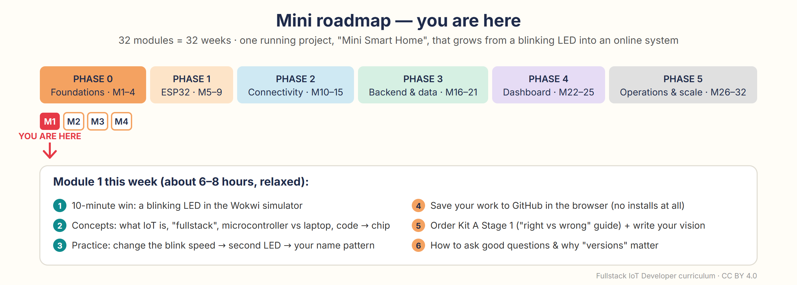

> [!NOTE]
> **How to read this module (and every module after it).** Every module has the same rhythm: 🎯 goals → 🧰 preparation → 🏆 Quick Win → 🧠 concepts → 🔧 practice → 🚨 "Troubleshooting" box → 🔬 technical deep dive → 🧩 challenges → ➕ running project → 📖 glossary → 📝 quiz → ✅ checklist → 📚 image sources. After 2–3 modules, you'll know the rhythm by heart. Some sections are **collapsed** (click the title to open them). Beginners may skip the collapsed sections in 🔬 Technical Deep Dive. Open the collapsed sections in 🚨 and the quiz answer key when you need them.

## Contents

1. [🎯 After this module you can…](#-after-this-module-you-can)
2. [🧰 What you need](#-what-you-need)
3. [🏆 Quick Win: a blinking LED in 10 minutes](#-quick-win-a-blinking-led-in-10-minutes)
4. [🧠 The "Why" Concepts](#-the-why-concepts)
5. [🔧 Step-by-step practice](#-step-by-step-practice)
6. [🚨 Troubleshooting](#-troubleshooting)
7. [🔬 Technical Deep Dive (optional)](#-technical-deep-dive-optional)
8. [🧩 Independent Challenges](#-independent-challenges)
9. [➕ Add-on to "Mini Smart Home"](#-add-on-to-mini-smart-home)
10. [📖 Glossary](#-glossary) · [📝 Quiz](#-5-question-quiz) · [✅ Completion checklist](#-module-1-completion-checklist)
11. [📚 Sources & Image Credits](#-sources--image-credits)

---

## 🎯 After this module you can…

- **Explain** what IoT is and what "fullstack IoT" means to a friend or family member in everyday language, with examples they know (an electricity meter, a ride-hailing app, a flood warning).
- **Make an LED blink** in the Wokwi simulator with a pattern you designed yourself, and know exactly which line of code controls what.
- **Save your first learning results** on GitHub through the browser, so they don't get lost and other people can see them.
- **Ask good questions** when you're stuck, including to an AI assistant, and understand why "version" is the most important word in every question.
- **Order the right Kit A Stage 1** — not a board that looks similar but is different — so Module 2 can start as soon as the package arrives.

---

## 🧰 What you need

| Requirement | Details |
| :--- | :--- |
| **Laptop/PC** with a modern browser | The latest Chrome, Edge, or Firefox. Windows, macOS, or Linux all work the same. **A phone alone is not enough** for Wokwi (the screen is too narrow and the simulator needs computer power), but you can use it to read the material and take photos. |
| **No laptop?** | Use a campus computer lab, an internet café, or a library — Wokwi and GitHub **don't need anything installed**, so 1–2 hours on a borrowed computer is enough for the Quick Win and Practices 1–4 (upload to GitHub from that same computer, or send the screenshots to your phone first). The other parts (concepts, shopping, question practice) can be read on a phone. Emergency option: Chrome on your phone with the ⋮ menu → **Desktop site**, for the Quick Win only; it's cramped, but it works. |
| **Internet connection** | Wokwi and GitHub both run in the browser. Mobile data shared by tethering is enough. |
| **Email address** | To create a GitHub account (free) and, if you want to save projects, a Wokwi account (free). |
| **Money for Kit A Stage 1** | Kit A = the basic ESP32 parts kit from the Syllabus; Stage 1 = the portion of it needed for Modules 2–6. IDR 300,000–620,000, **ordered at the end of this module** so it arrives before Module 2. You don't need to buy it yet — first read the shopping guide in Practice 5. |
| **What you DON'T need** | Installing any program. The Arduino IDE is installed in Module 2, Git in Module 3, Node.js in Module 4. One tool per module, right when you need it. |

**Versions used in this module** (important — you'll see why later):

| Tool | Version | Notes |
| :--- | :--- | :--- |
| Wokwi | Web version, October 2026 | The interface may look slightly different from the screenshots here; the buttons usually stay in the same place. |
| GitHub | Web version, October 2026 | Same as above. |
| Example code | Written for the **arduino-esp32 core 3.3.x** | Core = the "translator" package that lets you program the ESP32 Arduino-style (explained in Concept 9). Wokwi uses core 3.x; for the Module 1 code (`pinMode`, `digitalWrite`, `delay`) the exact version makes no difference. In Module 2 you'll install the same core version on your laptop. |

> [!TIP]
> **Set up one folder on your laptop** called `learn-iot`, for example inside *Documents* (on both Windows and macOS). Save all the screenshots and files from this module there, so you won't have to hunt for them when you upload to GitHub later.

---

## 🏆 Quick Win: a blinking LED in 10 minutes

Let's get hands-on right away. **Don't worry if you don't understand a single line yet** — that's exactly the point. The theory comes after you've seen the result for yourself.

> 🖥️ **Tool used in this section:** just the browser on your laptop/PC. Open Chrome/Edge/Firefox now.

### Step 1 — Open the Wokwi editor

Type this address into your browser's address bar, then press **Enter**:

```
https://wokwi.com/projects/new/esp32
```

That address opens a **new ESP32 project** directly. (If you come in through the [wokwi.com](https://wokwi.com) home page, pick the **ESP32** box — same result.) You don't need to sign up first. If a welcome box or an ad pops up, close it with the ×.

You'll see a screen like this. Get to know its parts first — for the next five minutes we'll only use numbers **1, 2, and 3**:

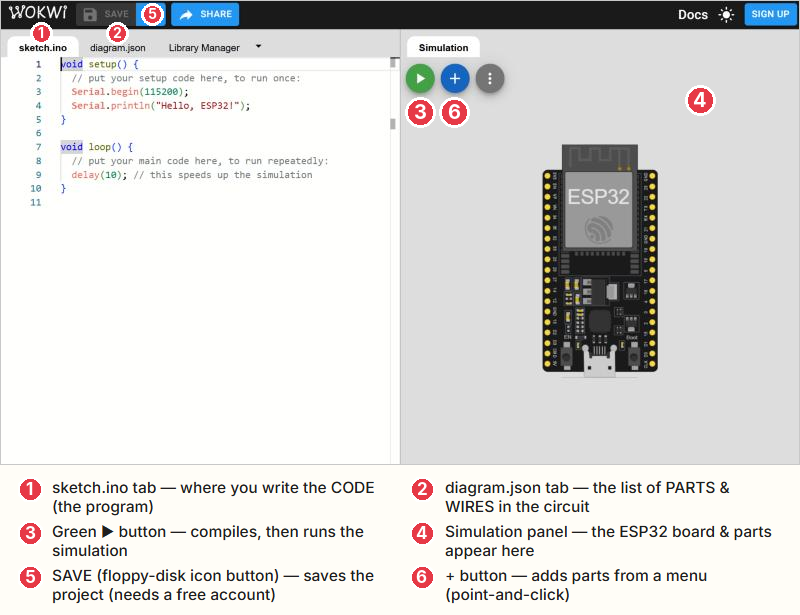

On your screen the **SAVE** button is still gray and there's a **SIGN UP** button in the top-right corner — that's normal, we haven't signed up yet. The right panel shows an ESP32 *board* — that's Wokwi's **default** board, the 38-pin version (pins = the metal legs along the edge of the board). We'll replace it with the **30-pin** board, exactly like the one you'll buy, plus one LED (a small light) and one resistor (a small part that limits current). How? By pasting in a "parts list".

### Step 2 — Paste the parts list (diagram.json)

> 🖥️ **Where?** In Wokwi, in the **left** panel, click the **`diagram.json`** tab (number 2 in the picture above).

1. Click the **`diagram.json`** tab.
2. Click in the middle of the text, press **Ctrl + A** (macOS: **Cmd + A**) to select everything, then press **Delete** until it's empty.
3. Copy the entire contents of the box below (move your cursor to the top-right corner of the box and click the copy icon 📋), then paste it into the editor with **Ctrl + V** (macOS: **Cmd + V**).

```json
{
  "version": 1,
  "author": "Fullstack IoT Developer curriculum",
  "editor": "wokwi",
  "parts": [
    { "type": "wokwi-esp32-devkit-v1", "id": "esp", "top": 0, "left": 0, "attrs": {} },
    { "type": "wokwi-resistor", "id": "r1", "top": 94.35, "left": 130, "attrs": { "value": "220" } },
    { "type": "wokwi-led", "id": "led1", "top": 107, "left": 150, "attrs": { "color": "red" } }
  ],
  "connections": [
    [ "esp:TX0", "$serialMonitor:RX", "", [] ],
    [ "esp:RX0", "$serialMonitor:TX", "", [] ],
    [ "esp:D4", "r1:1", "green", [] ],
    [ "r1:2", "led1:A", "green", [ "h20", "v49" ] ],
    [ "led1:C", "esp:GND.1", "black", [] ]
  ]
}
```

As soon as you paste it, the right panel **changes immediately**: a 30-pin board, a resistor, a red LED, and three wires appear on their own. If the text on your screen looks tighter or looser than in the screenshot below, that's fine — it's only a matter of display; the parts and wires are the same.

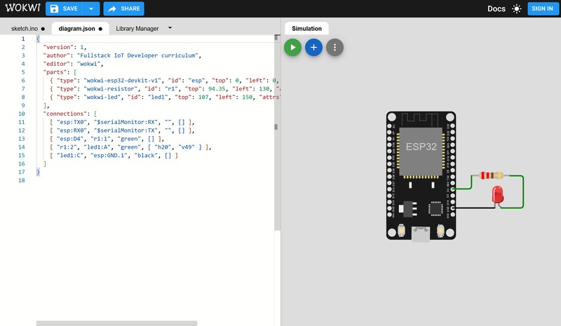

> [!NOTE]
> This file is called `diagram.json`. **JSON** is a tidy way of writing data that computers can read; here it holds the list of parts (`parts`) and wires (`connections`). You *don't* need to understand it yet — we'll take it apart in the 🔬 section. What matters: the brackets, commas, and quotation marks must stay intact; that's why we **copy and paste** instead of retyping.

### Step 3 — Paste the program code (sketch.ino)

> 🖥️ **Where?** Still in Wokwi, left panel, click the **`sketch.ino`** tab (number 1).

1. Click the **`sketch.ino`** tab.
2. Click inside the code, press **Ctrl + A**, then **Delete** to clear the default "Hello, ESP32!" example.
3. Copy the code below, then paste it with **Ctrl + V**.

```cpp
// Our first program: a blinking LED (Blink)
// The LED is connected to pin D4 through a 220 ohm resistor

const int PIN_LED = 4;  // the pin number the LED is connected to

void setup() {
  // Runs ONCE when the ESP32 first powers on
  pinMode(PIN_LED, OUTPUT);  // this pin is an output
}

void loop() {
  // Repeats OVER AND OVER as long as the ESP32 is on
  digitalWrite(PIN_LED, HIGH);  // HIGH = LED on
  delay(500);                   // wait 500 milliseconds
  digitalWrite(PIN_LED, LOW);   // LOW  = LED off
  delay(500);                   // wait another 500 milliseconds
}
```

Here's how it looks — code on the left, circuit on the right:

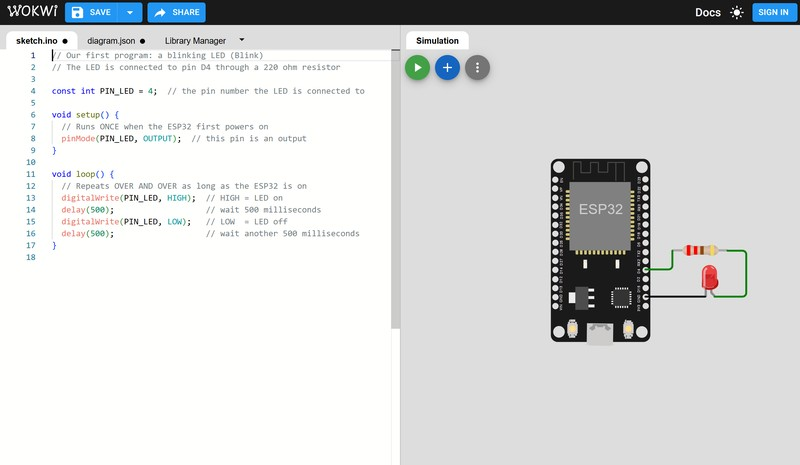

Both files are also in the [`code/01-blink/`](code/01-blink/) folder — their contents are exactly the same as the two boxes above.

### Step 4 — Run it!

> 🖥️ **Where?** The **right** panel in Wokwi, the **green ▶** button (number 3).

Click the green button. A **"Compiling project…"** box appears with a seconds counter — Wokwi is translating your code into machine language on its server. It usually takes 5–20 seconds; if the server is busy, it can take up to a minute (there's some text about the *build queue* and paid plans — just ignore it). More than 2 minutes? See the 🚨 box.

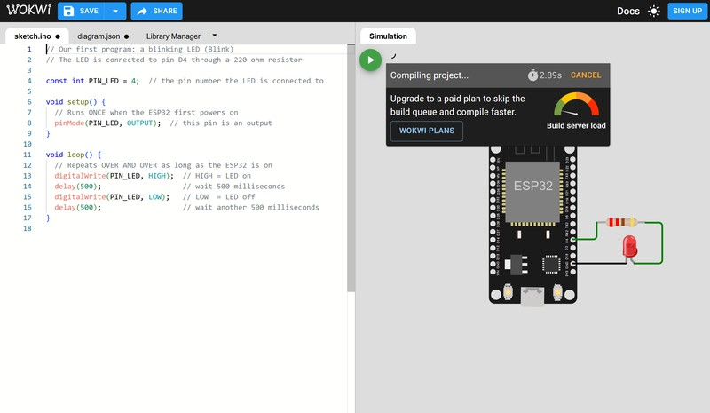

Then… **the red LED blinks.** On for half a second, off for half a second, over and over. In the top-right corner a simulation timer is running, and at the bottom a black box appears with strange text in it (that's the chip's "diary" as it starts up — ignore it for now).

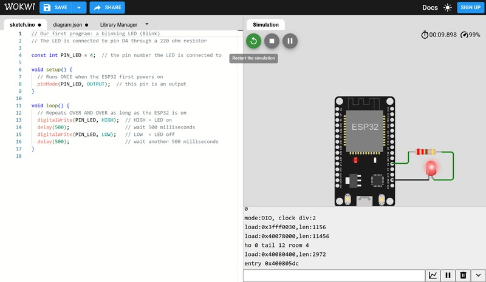

If you click the **⏸ pause** button (next to the stop button), Wokwi freezes the simulation and shows the state of every pin. Look at pin **D4**: if you pause while the LED is on, its label says `OUT High`; pause while it's off, and the label says `OUT Low` — exactly what your code told it to do (compare the two pictures below). To continue, click the **yellow ▶** button.

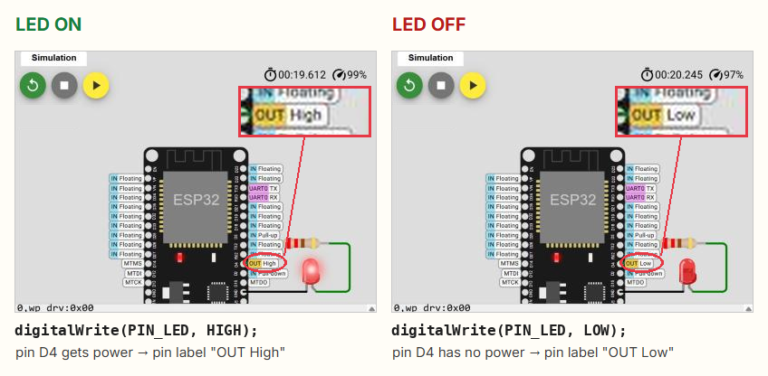

### Step 5 — Capture your win

Take a screenshot while the LED is on — you'll upload it to GitHub later. Trick: click **⏸ pause** right when the LED is on (if you catch it while it's off, click the **yellow ▶** button to continue, wait for the LED to light up, then ⏸ again), and then take the screenshot.

| System | How |
| :--- | :--- |
| **Windows 11** | Press **Win + Shift + S** and drag a box over the Wokwi area. The result is saved automatically in the *Pictures → Screenshots* folder. |
| **Windows 10** | Press **Win + Shift + S** and drag a box. The result is **not** saved yet: click the notification that appears in the bottom-right corner, then click the save icon (floppy disk) in the Snip & Sketch app that opens. |
| **macOS** | Press **Cmd + Shift + 4** and drag a box. The file is saved on the *Desktop* with an automatic name, "Screenshot …". To rename it: click the file name once, press **Enter**, and type the new name. |
| **Linux (GNOME/Ubuntu)** | Press the **PrtSc** key, choose *area* mode, drag a box, then click the round button. The file is saved in the *Pictures/Screenshots* folder. |

Name the file **`module-01-blink.png`** (Windows/Linux: right-click the file → **Rename**, or select the file and press **F2**) and move it into the `learn-iot` folder you created earlier. (Windows usually **hides** the `.png` extension — if the name shows up without `.png`, that's fine.)

> [!IMPORTANT]
> **🎉 Congratulations — you just programmed a microcontroller.** Seriously. The code you pasted isn't "pretend": you'll upload the very same code, without changing a single letter, to a real ESP32 in Module 2, and the LED on your desk will blink with the same rhythm. The only difference is *where* the chip runs — today inside the browser, next week on a board that costs IDR 50,000.

**Want to save the project?** Click **SAVE** (number 5). Wokwi will ask you to sign in or sign up — it's free, and you can use a Google account. Once it's saved, the **SHARE** button gives you a link you can send to anyone. If you don't save it, the project is lost when you close the tab; that's no problem, because the code is right here in this material.

---

## 🧠 The "Why" Concepts

Now you've seen the result. Let's take it apart slowly — one concept per section, always with a real-world comparison. Concepts 1–6 are enough to move on to Practices 1–3; Concepts 7–10 can be read later, right before Practices 4–6.

### 1. What is IoT?

**IoT** (*Internet of Things*) is a simple idea: **everyday objects fitted with sensors and a connection, so they can report and be controlled from far away.** It's not only laptops and phones that connect to the internet, but also electricity meters, water pumps, porch lights, chicken coops, and floodgates.

Take a look at three examples you've almost certainly come across:

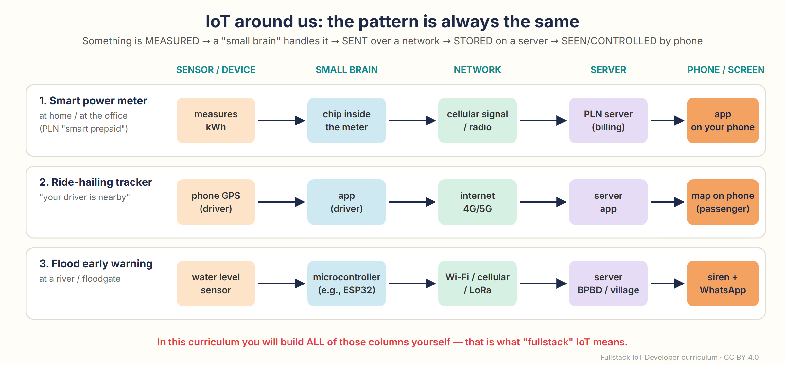

(*LoRa* in the picture = long-range, low-power radio, covered in Module 15; BPBD = Badan Penanggulangan Bencana Daerah, Indonesia's regional disaster management agency.)

See the pattern? **It's always the same**, whatever the object:

1. Something is **measured** (a sensor): how many kWh, where something is, how high the water is.
2. A **small brain** in the object reads the sensor and decides "time to report".
3. The report is sent over a **network**: Wi-Fi, a cellular signal, radio.
4. A **server** somewhere receives, stores, and calculates.
5. You see or control it from a **phone/screen**.

What you did earlier — turning on an LED from code — is the tiniest version of **step 2**: the small brain (the ESP32) runs your commands. The next thirty-one modules add steps 1, 3, 4, and 5 one by one.

### 2. "Fullstack" = you build every layer

In industry, the steps above are usually handled by different teams: some specialize in chips, some in networks, some in servers, some in apps. A **fullstack IoT developer** is someone who understands and can build **all of it** — at least well enough to build a complete system alone, and well enough to work with any specialist.

This is the system you'll build over 32 weeks, from sensor to phone screen:

<picture>
  <source media="(prefers-color-scheme: dark)" srcset="../../assets/architecture-fullstack-iot-dark.png">
  
</picture>

Don't be put off by all the boxes and abbreviations — this picture is shown now on purpose, so you **know the end goal**, not so you memorize it. Every box will get its turn. The system has **five layers**, each with an everyday analogy (this is the same mapping as in [Syllabus §2](../../SYLLABUS.md#2-the-big-picture-what-we-will-build)):

| Layer | Analogy | Built in | How it relates to the "IoT pattern" in Concept 1 |
| :--- | :--- | :---: | :--- |
| **1. Devices (ESP32)** | Senses & hands | Phases 0–1 (+ Node 2 in Module 14) | Steps 1 & 2: sensor + small brain. You already touched this today. |
| **2. Gateway (Raspberry Pi)** | The local post office at home | Phase 2 | Part of step 3: collects the reports of every device in the home and holds on to them if the internet goes down. |
| **3. Backend & Data** | Headquarters & archive warehouse | Phase 3 | Step 4: the server that stores the history and runs the rules. |
| **4. Dashboard** | The screen on your desk | Phase 4 | Step 5: where humans see the numbers and press the buttons. |
| **5. Operations** | Security guard, technician, & repair person | Phase 5 | Not in the simple pattern above — this is what keeps everything alive, secure, and updatable 24 hours a day. |

Two more things to remember from that picture:

- There are **two nodes** (a *node* = one ESP32 device with its sensors): **Node 1 "Home"**, which is always plugged in, and **Node 2 "Garden"**, which lives on a battery (in the picture, Node 2 sits right below Node 1 and sends its data to Node 1 via ESP-NOW). You won't assemble Node 1 until Phase 1, or Node 2 until Module 14.
- The brains are in **many places**: on the ESP32 (split-second decisions, for example "soil dry → water it"), on the Raspberry Pi (the link at home), and on the server (storing history, sending notifications). Fullstack means you decide which brain does what.

### 3. Laptop vs microcontroller: "a small computer that runs only one program"

The ESP32 is a **microcontroller**: a tiny computer that costs tens of thousands of rupiah and **has no operating system** like Windows — no other apps, no "close" button. As soon as it's powered on, it immediately runs **the one and only program** stored inside it, and keeps running it until the power is pulled. (A small, honest simplification: inside there's a "mini OS" called FreeRTOS, but you won't meet it until Module 8.)

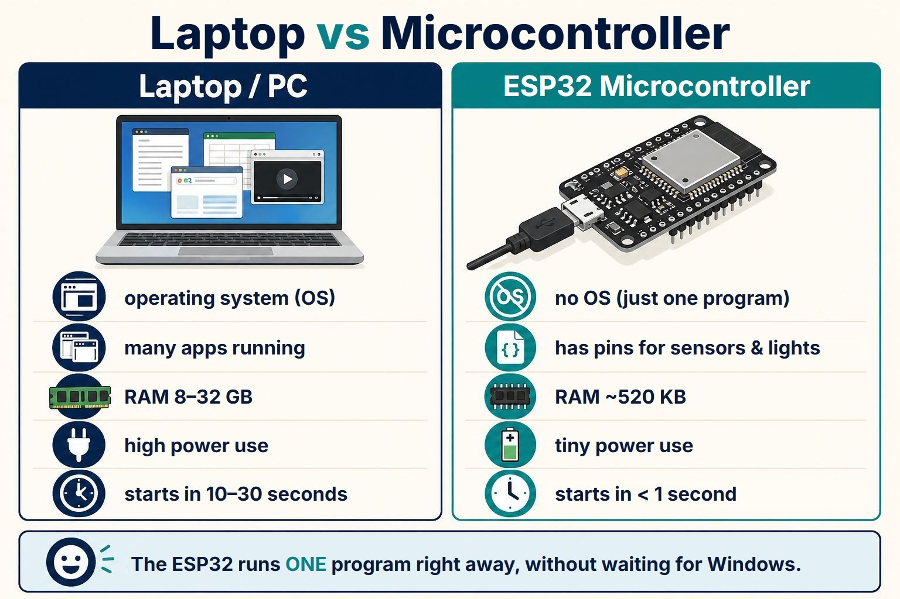

*(The board in this illustration is only a symbol; what the board we actually buy looks like is shown in Practice 5. "Starts in < 1 second" in the picture means: from plugging it in to the program running, without waiting for anything.)*

Weaknesses? Obviously: it can't open a browser, and its memory is only one ten-thousandth of your laptop's. But that's exactly its strength for IoT:

- **It starts in a fraction of a second** and never lags, because no other programs are competing with it.
- **Extremely power-efficient** — Node 2 "Garden" will later last from several days to a few weeks on a single 18650 battery (Module 9 explains the math honestly).
- **Cheap and small**, so it can be hidden inside a flowerpot, a pump, or a switch box.
- It has **legs (pins)** that connect directly to sensors and lights — a laptop doesn't.

> [!TIP]
> **Analogy:** a laptop is like a restaurant with many cooks, waiters, and a long menu. A microcontroller is like a **satay street vendor** who can do only one thing, but does it very fast, very cheaply, and without needing a building.

### 4. From code to chip: recipe → cook → dish

The code you pasted earlier is **plain text**. A chip can't read text. So what happens when you click ▶?

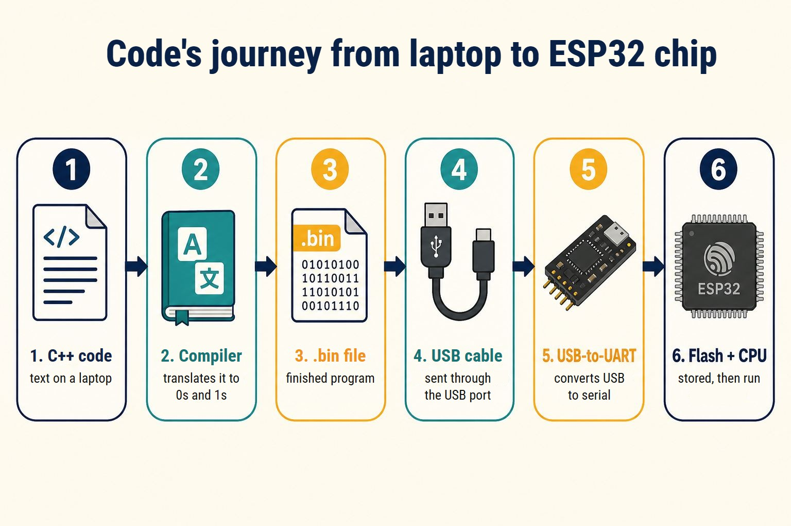

Imagine a **recipe** (your code, written in a "half-human" language called C++) handed to a **cook** called the **compiler**. The compiler turns it into a "finished dish": a file of 0s and 1s (`.bin`) that the chip understands. That file is then **sent to the chip**. In Module 2, it travels over a USB cable to a real ESP32 (steps 4–6 in the picture; those terms are explained there). Today, Wokwi replaces steps 4–5: the `.bin` file doesn't go through a cable, but is loaded straight into a **simulated ESP32** running inside your browser.

That's why there's a "Compiling project…" pause: the cook is at work. It's also why error messages often say `error: expected ';'` — the cook can't guess a recipe that's missing punctuation. We'll see an example in the 🚨 section.

### 5. Two "rooms" in every program: `setup()` and `loop()`

Every Arduino/ESP32 program — from 10 lines to 10,000 lines — has these two required parts:

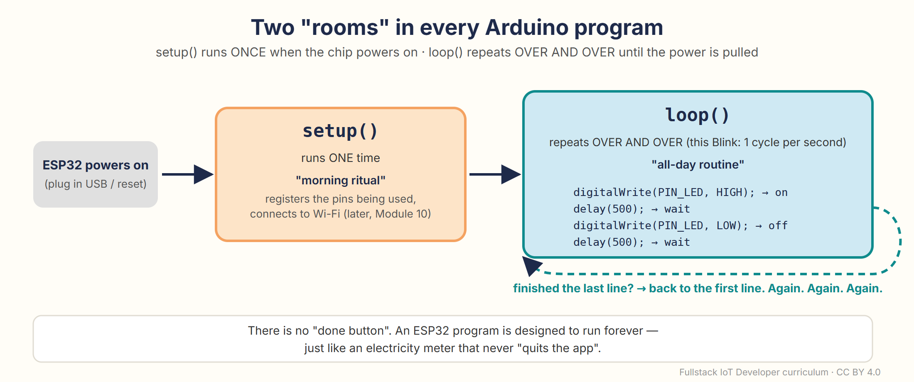

- **`setup()`** runs **once** when the chip powers on — like a morning ritual: wash your face, turn on the kitchen light, check whether there's still coffee. This is where we "register" the pins.
- **`loop()`** runs **again and again, without stopping** — like an all-day routine repeated forever. Finished the last line? Back to the first line. There's no "done" button, because a microcontroller is designed to live forever.

Now let's read the earlier code line by line. No need to memorize it — the goal is that no line feels like a magic spell:

| Line | What it means in human language |
| :--- | :--- |
| `// Our first program…` | Anything after `//` is a **comment**: a note for humans that the compiler ignores. Use as many as you can. |
| `const int PIN_LED = 4;` | "Create a **name** `PIN_LED` that holds the number 4, and never let it change (`const`)." This way, if the LED moves to another pin, you change **one number** instead of searching through all the code. `int` = the whole-number data type. |
| `void setup() { … }` | Start of the `setup` room. `void` = the required opening word for this kind of room (it literally means "returns nothing"; covered in Module 3). The curly braces `{` and `}` are the room's entrance and exit doors. |
| `pinMode(PIN_LED, OUTPUT);` | "Pin number 4 will be used to **send out** electricity" (`OUTPUT`), not to read a sensor (`INPUT`). Required before the pin is used. |
| `void loop() { … }` | Start of the `loop` room. |
| `digitalWrite(PIN_LED, HIGH);` | "Pin 4: **send out electricity**" (`HIGH` = 3.3 V). The LED turns on. |
| `delay(500);` | "**Wait** 500 milliseconds" = 0.5 seconds. While waiting, the chip does nothing. |
| `digitalWrite(PIN_LED, LOW);` | "Pin 4: **stop the electricity**" (`LOW` = 0 V). The LED turns off. |
| `delay(500);` | Wait another 0.5 seconds, then `}` → back to the first line of `loop()`. |

Three C++ grammar rules you'll run into often:

1. **Every statement ends with a semicolon `;`** — like the period at the end of a sentence. Forget just one → error (see the 🚨 section).
2. **Uppercase and lowercase are different.** `digitalWrite` is right; `DigitalWrite` or `digitalwrite` is wrong.
3. **Brackets must come in pairs**: every `(` has a `)`, every `{` has a `}`.

### 6. Why does an LED need a resistor, and why is one leg longer?

The circuit earlier has only three parts and three wires — laid out the same way as in Wokwi:

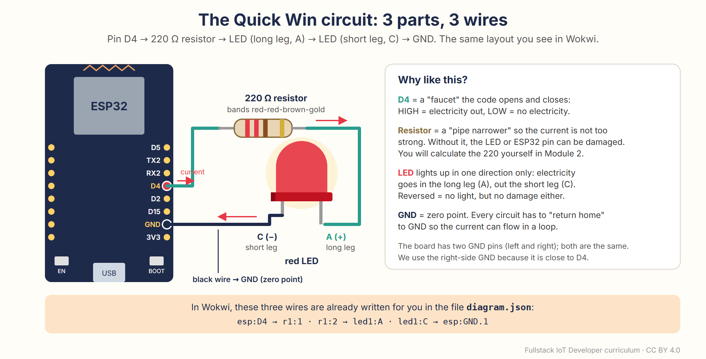

- **D4** is the "faucet" your code opens and closes.
- The **220 Ω resistor** (Ω = ohm) is a "pipe narrower". Without it, the current flows too strongly and the LED or the ESP32 pin can be damaged. Nothing breaks in the simulator, but we're **building the habit** now — in Module 2 you'll calculate for yourself why the number is 220.
- An **LED** only lets current through in **one direction**. Electricity goes in through the **long leg** (the anode, marked `A` or `+`) and comes out of the **short leg** (the cathode, `C` or `−`). Connected backwards? It won't light up — but it won't be damaged either, so don't be afraid to experiment.
- **GND** (*ground*) is the zero point. Every circuit has to "return home" to GND so the current can flow around in a loop, like water that has to return to the water tank.


That's enough about electricity for now. Module 2 is entirely about it — with a water tank analogy and just one formula.

> ☕ **Break point.** By now you have what you need for Practices 1–3. If you want to jump straight into practice, skip to [🔧 Practice](#-step-by-step-practice) and come back to Concepts 7–10 later — Concept 8 is needed before Practice 4, and Concept 9 before Practice 6.

### 7. Simulator vs real board: what Wokwi can and can't do

**Wokwi** is a simulated ESP32 that runs in the browser: its CPU is imitated precisely, so code that runs in Wokwi almost always runs on the real board. The nice part: it's free, it can't burn out, there are no loose wires, and you can try it anywhere. That's why about 90% of the practice in Modules 1–9 can be done in Wokwi.

What Wokwi **can't** imitate — and the reason the real board still matters (the terms in this table belong to Module 2; it's just an overview, you don't need to understand them now):

| In the real world | In Wokwi |
| :--- | :--- |
| Loose wires, a loose *breadboard* (a circuit board that needs no soldering) | All wires are always perfect |
| A "charge-only" USB cable that can't send data | There's no cable |
| The USB driver isn't installed, the wrong COM port (the laptop doesn't recognize the board) | There's no laptop in between |
| Sensors whose numbers jitter (noise) | Sensor numbers are always clean |
| Not enough power → the chip restarts on its own | Unlimited power |

So the learning pattern is: **try it in Wokwi first** (fast, safe), **then move it to the real board** (to learn the real-world things in the table above). You need both.

### 8. What are GitHub and a "repository"?

**GitHub** is a website where millions of programmers store their code. One project is stored in one **repository** (*repo*): imagine a **folder on the internet that remembers every change** — you can see what the folder looked like a week ago, who changed what, and why. Every repository usually has a **README** file ("read me"): the main notes that appear automatically on its front page — this very article you're reading is a README.

In this module we use it for the simplest thing: **uploading files through the browser**, like uploading a photo to social media. No commands yet, no apps yet. The more advanced tools (GitHub Desktop, then the `git` command) come in Modules 3 and 16 — when you actually have a reason to need them.

Why bother saving to GitHub instead of just on your laptop?

- **It doesn't get lost** when your laptop breaks or gets replaced.
- **Portfolio** — in Module 32 you'll be glad to see your first repository dated today.
- **You can show it** when asking for help: "here's my code, the link is here" makes you much easier to help than a blurry photo of your screen.

### 9. Versions matter (and why internet tutorials often "don't work")

This lesson will save you hundreds of hours down the road.

The tools we use are **constantly updated**. The arduino-esp32 core (the "translator" package that lets you program the ESP32 Arduino-style), for example, moved from version 2.x to 3.x in 2024 — and some commands were **renamed**. A tutorial written in 2022 with the old commands will produce errors with 2026 tools, even though its code was "correct" in its day.

A real example you'll meet in Module 5:

| Old tutorial (core 2.x) | Correct for our version (core 3.3.x) |
| :--- | :--- |
| `ledcSetup(0, 5000, 8); ledcAttachPin(pin, 0);` | `ledcAttach(pin, 5000, 8);` |

That means there are **two habits** to start today:

1. Every time you follow a tutorial from outside this curriculum, **check its year and version**. If they're not mentioned, be suspicious.
2. Every time you **ask a question** (to a human or an AI), **state your versions**: "arduino-esp32 core 3.3.x", "Wokwi", "Arduino IDE 2.x", "Node.js 24". Without them, whoever answers will guess — and they often guess an old version.

That's also why every module in this curriculum opens its 🚨 box with an **"old code → correct for our version"** table.

### 10. Basic safety (short, because there's no hardware this week)

One sentence to take with you to Module 2: **everything we use in this curriculum is low-voltage power from USB — safe to touch with your hands, and it can't shock you.** USB supplies 5 V to the board; the board steps it down to 3.3 V for the chip and its pins (that's the `HIGH = 3.3 V` figure from Concept 5). Both are safe. We **never** touch the 220 V mains supply from PLN (the state power company): this curriculum doesn't connect anything to 220 V; how a relay works with 220 V is only discussed as background knowledge and as a warning.

The golden rule that will be repeated in every hardware module: **unplug the USB cable before changing the circuit's wiring.** For now you just need to remember it.

---

## 🔧 Step-by-step practice

Six practices. Do them in order, at a relaxed pace — you can spread them over several days. Each practice starts with a **🖥️ Tool** box, so you always know what to open.

### Practice 1 — Change the blink speed

> 🖥️ **Tool:** browser → Wokwi, `sketch.ino` tab (the Quick Win project from earlier; if you've already closed the tab, repeat Steps 1–3 above — it only takes 2 minutes).

The number inside `delay(…)` is the waiting time in **milliseconds** (1 second = 1,000 ms). Changing it = changing the blink rhythm.

1. If the simulation is still running, click the **⏹ stop** button (the gray square between the green ↻ button and the ⏸ button).
2. Change **both** `delay(500)` to `delay(100)`.
3. Click **▶** again. Wokwi recompiles (be patient, 5–20 seconds), and then the LED blinks **five times faster**.
4. Try again with the combinations in this table, one at a time. Each time: change the code → stop → play.

| `delay` while on | `delay` while off | What you see | Used for |
| :---: | :---: | :--- | :--- |
| 500 | 500 | A calm blink, 1× per second | "System alive" light |
| 100 | 100 | A fast, slightly panicky blink | Alarm / warning |
| 1000 | 50 | On for a long time, off for an instant | A "normal" light that doesn't demand attention |
| 50 | 1000 | A short flash every second | Battery indicator (saves power!) |
| 2 | 2 | Looks like it's **on all the time, but at half brightness** | The basis of *dimming* (Module 5) |

That last row is a little surprise: the human eye can't follow hundreds of blinks per second, so the LED looks dimly lit. (In Wokwi the result may look dim *or* flicker rapidly, depending on the simulation speed; on a real LED later it will truly be dim.) This trick of switching on and off very fast to control brightness is called **PWM** (*pulse width modulation*), and you'll use it to dim LEDs and play buzzer tones in Module 5.

Here's what two of the patterns from the table look like drawn on a timeline — plus a sneak peek at the "name" pattern you'll make in Practice 3:

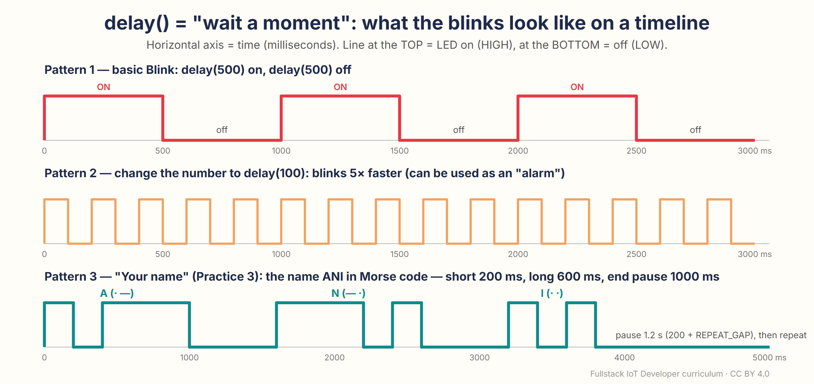

> [!TIP]
> **A good habit to start now:** change **one thing**, run it, see the effect. Don't change five things at once — if the result is weird, you won't know which change caused it.

### Practice 2 — Add a second LED

> 🖥️ **Tool:** browser → Wokwi, the `diagram.json` **and** `sketch.ino` tabs.

There are two ways to add parts in Wokwi. **Pick one.** If you want to try both, do Method A first; Method B will replace the whole circuit with a tidy version — that's normal.

**Method A — with the ➕ button (point-and-click, good for exploring).**

1. Click the blue **➕** button in the right panel (number 6 in the editor picture). A list of parts appears.
2. Choose **LED** (in the *Basic* group). A new LED appears in the panel; drag it to an empty spot. It's red — the color doesn't affect the code, but if you want it to match the pictures and the challenges, click the new LED, then click the **green color box** in the row that appears above it (see the picture below).

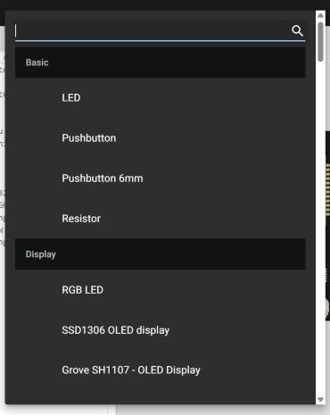

3. Click ➕ again and choose **Resistor**. Click the resistor that just appeared — a small panel opens above it with a **Resistance** field; change its value to `220`. (Clicking a part also shows icons for rotate, delete, and `?` for documentation.)
4. **Connecting wires:** hover your cursor over the tip of a pin *without* clicking — Wokwi shows the **pin's name** in a small box (`esp:D18`, `esp:GND.1`, `led2:A`, `led2:C`, `r2:1`, `r2:2`). Click the first pin, then click the destination pin. Connect: ESP32 pin **D18** → resistor leg **1**; resistor leg **2** → LED leg **A**; the new LED's leg **C** → the first LED's leg **C** (both "return home" to GND through the black wire that's already there — like two houses sharing one drain).

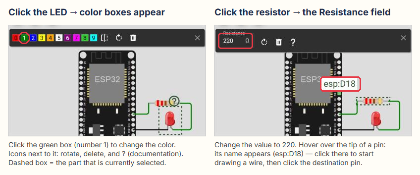

**Method B — with `diagram.json` (paste text, guaranteed tidy).** Open the `diagram.json` tab, clear it (**Ctrl + A**, **Delete**), then paste this:

```json
{
  "version": 1,
  "author": "Fullstack IoT Developer curriculum",
  "editor": "wokwi",
  "parts": [
    { "type": "wokwi-esp32-devkit-v1", "id": "esp", "top": 0, "left": 0, "attrs": {} },
    { "type": "wokwi-resistor", "id": "r1", "top": 94.35, "left": 130, "attrs": { "value": "220" } },
    { "type": "wokwi-led", "id": "led1", "top": 107, "left": 150, "attrs": { "color": "red" } },
    { "type": "wokwi-resistor", "id": "r2", "top": 54.35, "left": 210, "attrs": { "value": "220" } },
    { "type": "wokwi-led", "id": "led2", "top": 107, "left": 230, "attrs": { "color": "green" } }
  ],
  "connections": [
    [ "esp:TX0", "$serialMonitor:RX", "", [] ],
    [ "esp:RX0", "$serialMonitor:TX", "", [] ],
    [ "esp:D4", "r1:1", "green", [] ],
    [ "r1:2", "led1:A", "green", [ "h20", "v49" ] ],
    [ "led1:C", "esp:GND.1", "black", [] ],
    [ "esp:D18", "r2:1", "blue", [ "h20", "v-21.7" ] ],
    [ "r2:2", "led2:A", "blue", [ "h20", "v89" ] ],
    [ "led2:C", "led1:C", "black", [ "v15", "h-80" ] ]
  ]
}
```

If you compare it with the first one, the difference is: **two new parts** (`r2` and the green `led2`) and **three new wires** for the D18 path (a blue wire from D18 to the resistor, one from the resistor to the LED, and a black wire from the green LED's C leg to the red LED's C leg). This file is also in [`code/02-blink-two-leds/diagram.json`](code/02-blink-two-leds/diagram.json).

> [!TIP]
> **How to copy a file's contents from GitHub** (works for every file in the `code/` folder): click the file name → at the top right of the file content box there's a **Raw** button and a **copy** icon (two stacked squares, **Copy raw file**) → click the copy icon → paste it where you need it. Don't copy from the "pretty" view, because line numbers or formatting can get copied along with it.

Whichever method you used, now replace the code in `sketch.ino` with this (it's also in [`code/02-blink-two-leds/sketch.ino`](code/02-blink-two-leds/sketch.ino)):

```cpp
// Practice 2: two LEDs blinking in turn
// Red LED on D4, green LED on D18 (each through a 220 ohm resistor)

const int PIN_RED_LED = 4;     // red LED on pin D4
const int PIN_GREEN_LED = 18;  // green LED on pin D18

void setup() {
  // Two pins, two pinMode calls. Every pin you use must be "registered".
  pinMode(PIN_RED_LED, OUTPUT);
  pinMode(PIN_GREEN_LED, OUTPUT);
}

void loop() {
  // Red on, green off
  digitalWrite(PIN_RED_LED, HIGH);
  digitalWrite(PIN_GREEN_LED, LOW);
  delay(500);

  // Red off, green on
  digitalWrite(PIN_RED_LED, LOW);
  digitalWrite(PIN_GREEN_LED, HIGH);
  delay(500);
}
```

Click ▶. The two LEDs blink **in turn**, like the lights at a railroad crossing:

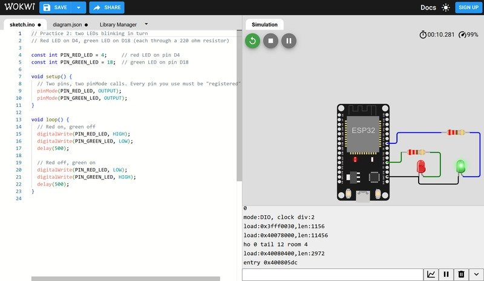

Notice the pattern: for each new pin you need (1) the part and its wires in the diagram, (2) one `const int` for its name, (3) one `pinMode` in `setup()`, and (4) `digitalWrite` in `loop()`. This four-step pattern applies to relays, buzzers, pumps — all of them.

### Practice 3 — Mini project: a "your name" blink pattern

> 🖥️ **Tool:** browser → Wokwi, `sketch.ino` tab (the circuit goes back to using the red LED on D4; you can leave the green LED in place, it won't get in the way).

This is the module's pass requirement: **an LED blinking in a pattern you designed yourself.** The most fun way: write your name in **Morse code** — a short blink = a dot (·), a long blink = a dash (—).

| Letter | Morse | Letter | Morse | Letter | Morse |
| :---: | :--- | :---: | :--- | :---: | :--- |
| A | · — | J | · — — — | S | · · · |
| B | — · · · | K | — · — | T | — |
| C | — · — · | L | · — · · | U | · · — |
| D | — · · | M | — — | V | · · · — |
| E | · | N | — · | W | · — — |
| F | · · — · | O | — — — | X | — · · — |
| G | — — · | P | · — — · | Y | — · — — |
| H | · · · · | Q | — — · — | Z | — — · · |
| I | · · | R | · — · | | |

To avoid writing `digitalWrite … delay …` dozens of times, we'll make one **small recipe** called `blink(…)` that can be called again and again. (This is called a *function* — covered thoroughly in Module 3; for now, knowing how to use it is enough.) This code is also in [`code/03-name-pattern/sketch.ino`](code/03-name-pattern/sketch.ino).

```cpp
// Practice 3: a "your name" blink pattern in Morse code
// Same circuit as the Quick Win (red LED on D4)

const int PIN_LED = 4;

const int SHORT = 200;         // length of a short blink (dot), in milliseconds
const int LONG = 600;          // length of a long blink (dash)
const int BLINK_DELAY = 200;   // short pause between two blinks
const int LETTER_GAP = 400;    // pause between two letters
const int REPEAT_GAP = 1000;   // long pause before the pattern repeats

// A small function = a "recipe" you can call again and again
void blink(int onTime) {
  digitalWrite(PIN_LED, HIGH);
  delay(onTime);              // stay on for onTime milliseconds
  digitalWrite(PIN_LED, LOW);
  delay(BLINK_DELAY);         // off for a moment before the next blink
}

void setup() {
  pinMode(PIN_LED, OUTPUT);
}

void loop() {
  // Example pattern for the name "ANI" (A = · —, N = — ·, I = · ·)
  // One letter = one line of blink(...) + one line of delay(LETTER_GAP)
  // Replace these with the letters of your name (the Morse table is in the module text)
  blink(SHORT); blink(LONG);       // A
  delay(LETTER_GAP);
  blink(LONG); blink(SHORT);       // N
  delay(LETTER_GAP);
  blink(SHORT); blink(SHORT);      // I
  delay(REPEAT_GAP);               // long pause, then start over
}
```

Your task: replace the letters in `loop()` with the letters of **your name** (3–5 letters is enough; a nickname is fine). The rule: **one letter = one line** with 1–4 `blink(…)` calls (matching the number of dots/dashes in the table), followed by one `delay(LETTER_GAP);` line. Example for the letter B (— · · ·):

```cpp
  blink(LONG); blink(SHORT); blink(SHORT); blink(SHORT);   // B
  delay(LETTER_GAP);
```

A 4–5 letter name? Copy that pair of lines and paste it before `delay(REPEAT_GAP);`. Want a different rhythm? Change the numbers of `SHORT`, `LONG`, `BLINK_DELAY`, or the `…_GAP` constants at the top — one number applies to every letter. Run it, then **take a screenshot** named `module-01-name-pattern.png`.

**Save the code too.** There are two paths; pick the one you like:

- **Path A (easiest, no file on your laptop):** copy the code from Wokwi (click inside the editor, **Ctrl + A**, **Ctrl + C**), then later, in Practice 4, paste it directly into GitHub with **Add file → Create new file** under the name `module-01-name-pattern.ino`. The steps are exactly like those in the ➕ section below.
- **Path B (saving a file on your laptop)** — this step often trips beginners up, so follow it slowly:
  1. Click inside the Wokwi editor, press **Ctrl + A**, then **Ctrl + C**.
  2. Open a plain-text notes app: **Notepad** (Windows), **TextEdit** (macOS — choose the menu *Format → Make Plain Text* first), or **Text Editor/gedit** (Linux). Paste with **Ctrl + V**.
  3. *File → Save As*, then type the name `module-01-name-pattern.ino` and choose the `learn-iot` folder.
  4. Before clicking **Save**, check for the file-extension trap: **Windows** — change *Save as type* to **All files (\*.\*)**; if you leave it at "Text Documents", Notepad quietly adds `.txt`, so the name becomes `module-01-name-pattern.ino.txt`. **macOS** — if TextEdit asks *Use .txt / Use .ino*, choose **Use .ino**.
  5. Check the result in the folder. Windows hides file extensions; to see them: Windows 11 → File Explorer → **View** menu → **Show** → check **File name extensions**; Windows 10 → **View** tab → check **File name extensions**.

> [!TIP]
> If your name is long and the pattern gets boring, make a "signature" version instead: your two initials. What counts isn't the length, but **whether you understand which number controls what**.

### Practice 4 — Save to GitHub (in the browser, without installing anything)

> 🖥️ **Tool:** browser → [github.com](https://github.com). Have these files ready in the `learn-iot` folder: `module-01-blink.png`, `module-01-name-pattern.png`, and (if you used Path B in Practice 3) `module-01-name-pattern.ino`. (Haven't read Concept 8 about GitHub yet? Read it first, 3 minutes.)

#### 4a. Create a GitHub account (skip if you already have one)

1. Open `https://github.com/signup`.
2. Fill in your **email**, **password**, and **username**. The username will be **visible to everyone** and becomes part of your repository's address. You can change it later, but links to your old profile will break — so pick a tidy one from the start, for example your real name (`budisantoso`) or a name + a word (`budi-iot`).
3. Complete the verification puzzle, then enter the code that was sent to your email.
4. GitHub may ask you a few things (goals, interests) — you can skip them. If you're offered a plan, choose **Free**.

#### 4b. Create the `learn-iot` repository

1. Once you're signed in, open `https://github.com/new` (or click the **➕** button in the top-right corner → **New repository**).
2. Fill in **Repository name**: `learn-iot`. A green check mark with "learn-iot is available" means the name is free.
3. **Description** (can be left empty): `Fullstack IoT Developer learning notes`.
4. Leave it **Public** — so you can show it later when asking questions, and it becomes your portfolio. (There are no secrets here; Wi-Fi passwords and the like will never be stored in the repository — that's a Module 10 lesson.)

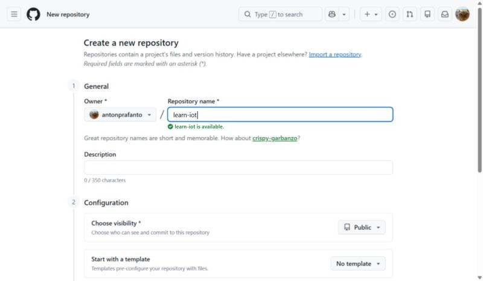

5. Scroll down. **Turn on "Add README"** (click the switch until it turns green/*On*). This matters: a repository that has a README immediately shows an easy upload button. (README = the "read me" file shown on a repository's front page; see Concept 8.)
6. Click the green **Create repository** button.

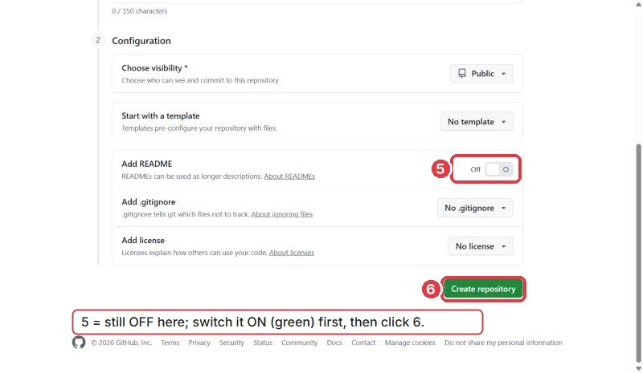

#### 4c. Upload the files

1. On your new repository's page (it only has one file so far, `README.md`), find the **➕** button next to the "Go to file" box (or the **Add file** button, depending on the layout), then choose **Upload files**.

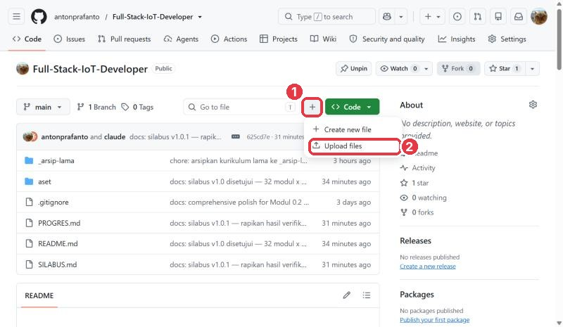

2. **Drag** the files from the `learn-iot` folder into the box that says *"Drag files here to add them to your repository"*, or click **choose your files** and select them (hold **Ctrl** while clicking to select several files at once; or upload them one at a time).

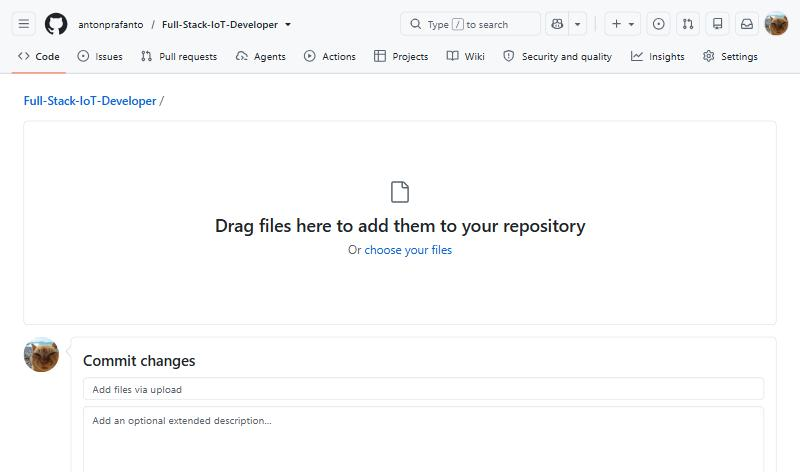

3. Scroll down to the **Commit changes** section. The first box is the **commit message** — a short note about this change. Replace its contents with `Module 1: first blink and name pattern`. (Commit = "saving one snapshot of your progress" — you'll use this term hundreds of times.)
4. Click the green **Commit changes** button (below the form). Wait a few seconds; you'll be back on the repository page, and your files will be in the list.
5. Used **Path A** for the code? Now: **➕ / Add file → Create new file**, type the name `module-01-name-pattern.ino`, paste the code into the big box, then **Commit changes…** → **Commit changes**.

#### 4d. Write notes in the README (optional, 3 minutes)

1. Click the **`README.md`** file → click the **pencil ✏️** icon (*Edit*) at the top right.
2. Paste this text below the existing title, then fill in the parts in parentheses. Leave the `##`, `**`, and `` marks as they are.

```markdown
## Module 1 — My first blinking LED (date: …)


My name's blink pattern: **(NAME)** → (write the pattern, e.g. "· — / — · / · ·")


The most confusing thing this week: (be honest, one sentence)
```

3. Click **Commit changes…** (top right) → **Commit changes**.

> [!NOTE]
> Marks like `##`, `**`, and `` are **Markdown**, a way of writing formatted text on GitHub: `##` = heading, `**bold**`, `` = insert an image. This article is written in Markdown too.

Open your repository's main page: its README now shows both screenshots. The address `https://github.com/YOUR-USERNAME/learn-iot` is your **first portfolio** — save the link.

> [!NOTE]
> File names should have **no spaces** and be all lowercase (`module-01-blink.png`, not `Module 1 Blink.PNG`). Spaces and capital letters often stop image links from showing.

### Practice 5 — Order Kit A Stage 1 (so Module 2 doesn't have to wait)

> 🖥️ **Tool:** the Tokopedia or Shopee website/app, or your usual electronics shop. You don't need to open Wokwi yet.

Shipping from component shops usually takes 2–7 days. If you order **this week**, the package arrives just as Module 2 begins. If the kit hasn't arrived when Module 2 starts, relax: Module 2 offers a Wokwi path first.

#### The most common wrong purchase: the board

There are more than a dozen boards with "ESP32" in their name. This curriculum uses the **ESP32 DevKit V1, 30 pins** (often written as "DOIT ESP32 DevKit V1"). Here's how to tell it apart from look-alikes (a schematic drawing, not a product photo — match the features against the photos in the shop):

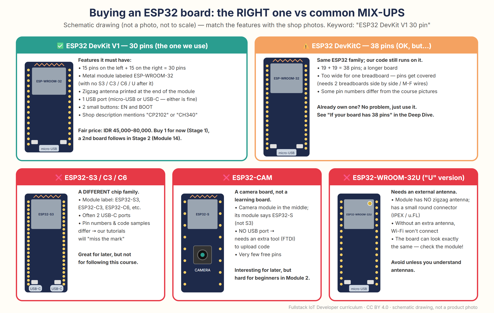

Here's what the real thing looks like, with the features you should look for in the product photo:

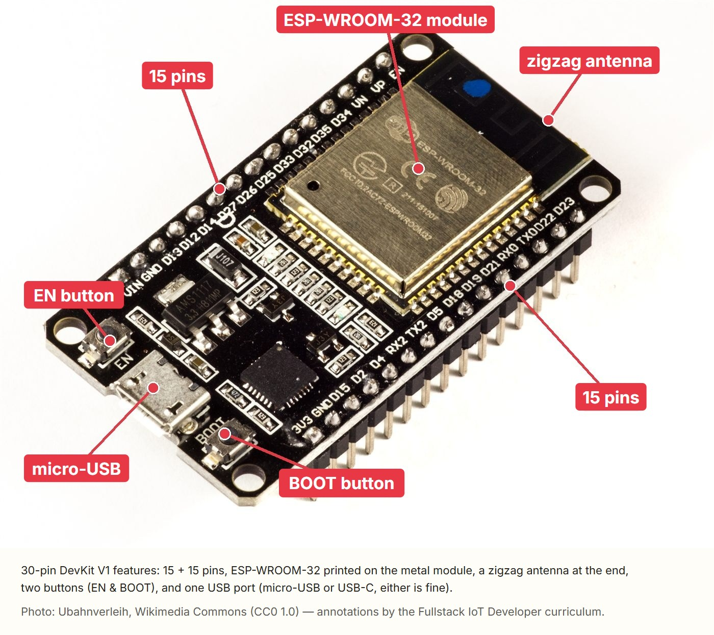

The second most common mistake: **the USB cable**. Many cheap cables only have two wires (for charging) and no data wires — the board turns on, but the laptop "doesn't see it". Look for one whose description says **"kabel data"** (data cable), and match the connector (micro-USB or USB-C) to the board you buy. Already have a cable at home and want to test it? Plug your phone into your laptop with that cable: if the phone offers "File transfer"/MTP, it's a data cable.

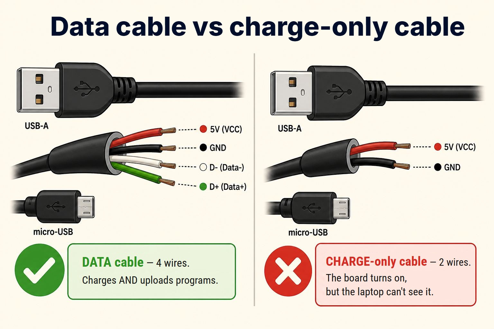

#### Stage 1 shopping list

The full list with prices is in [Syllabus §5.2](../../SYLLABUS.md#52-kit-a--esp32--basic-electronics). Here's the summary — just copy the **search keywords** column into the shop's search box. You don't need to understand what every part does yet; each one is explained when it's used.

**Required for Module 2** (order now):

| Part | Qty | Search keywords | Notes |
| :--- | :---: | :--- | :--- |
| ESP32 DevKit V1, 30 pins | 1 | `ESP32 DevKit V1 30 pin` | See the guide above. The shop description mentions a **CP2102** or **CH340** USB chip — either is fine. IDR 45,000–80,000. |
| USB **data** cable | 1 | `kabel data micro usb` / `kabel data usb c` (*kabel data* = data cable) | Match the board's connector. |
| 830-point breadboard | 2 | `breadboard 830` | Two of them, so the 30-pin board has room. |
| M-M, M-F, F-F jumper wires | 1 set | `kabel jumper 40 pin set` (*kabel* = cable) | M = male (plug), F = female (socket). |
| Assorted 5 mm LEDs + resistor pack | 1 set | `led 5mm set`, `resistor pack 1/4 watt` | Make sure it includes 220 Ω, 1 kΩ, 4.7 kΩ, and 10 kΩ. |
| 100 µF and 100 nF capacitors | 2 + 2 (2 of each) | `kapasitor elektrolit 100uF`, `kapasitor keramik 104` (electrolytic / ceramic capacitor) | "104" = 100 nF. |
| Digital multimeter | 1 | `multimeter digital` | Used from Module 2 on to measure voltage and resistors; IDR 50,000–100,000, a lifetime investment. |

<details>
<summary><b>You can order these for Modules 5–6 at the same time (saves on shipping) — click to open</b></summary>

| Part | Qty | Search keywords | Notes |
| :--- | :---: | :--- | :--- |
| 5 V ≥ 2 A adapter + MB102 breadboard power supply module | 1 + 1 | `adaptor 5v 2a`, `MB102 breadboard power supply` | Module 5. |
| Push buttons, 10 kΩ potentiometers, passive buzzers | 2 of each | `push button 12mm`, `potensiometer 10k`, `buzzer pasif` (*pasif* = passive) | Module 5. |
| 1–2 channel 5 V *low-level trigger* relay | 1 | `relay 2 channel 5v low level trigger` | Choose one with an *optocoupler*. Module 5. |
| 5 V 40 mm DC fan, 3–5 V mini pump + tubing | 1 + 1 | `kipas dc 5v 4cm`, `pompa mini 5v dc` (*kipas* = fan, *pompa* = pump) | Loads for the relay/MOSFET. Module 5. |
| IRLZ44N MOSFET (or a D4184 module) + 1N4007 diode | 1 + 1 | `IRLZ44N`, `dioda 1N4007` | **Not** the IRF520 module. Module 5. |
| SG90 servo | 1 | `servo sg90` | Module 5. |
| DHT22 3-pin module | 1 | `DHT22 modul` | Not the DHT11. Module 6. |
| 5 mm LDR | 2 | `LDR 5mm` | Module 6. |
| **Capacitive** soil moisture sensor | 2 | `capacitive soil moisture sensor v1.2` | Not the kind with exposed copper plates. Module 6. |
| 3.3 V ultrasonic sensor (HC-SR04+ / RCWL-1601) | 1 | `HC-SR04+ 3.3V` / `RCWL-1601` | A regular HC-SR04 is OK too, but it needs 2 extra resistors. Module 6. |
| PIR HC-SR501 | 1 | `PIR HC-SR501` | Module 6. |

</details>

Estimated total for Stage 1: **IDR 300,000–620,000** (October 2026, subject to change). "ESP32 starter kit" bundles are often cheaper — they're fine as long as they include the **Required** table above and the right board. The pass requirement for this module: **at least the Required table is ordered now**; the rest of Stage 1 can follow later, before Module 5 at the latest.

> [!WARNING]
> Before you click "buy", check **three things**: (1) the board photo shows **30 pins** and the text **ESP-WROOM-32**, (2) the cable is a **data cable**, (3) the resistor pack includes **220 Ω**. These three mistakes account for almost every "I'm stuck on Module 2".

After ordering, write down the **order date** and the **estimated arrival date** in your notes (or in your repository's README).

### Practice 6 — Asking good questions (including asking AI)

> 🖥️ **Tool:** any notes app. This is a writing exercise, 15 minutes. (Concept 9 about "versions" is needed here.)

Self-learners most often quit not because the material is hard, but because they **get stuck alone** and are too embarrassed to ask — or they ask in a way that can't be answered. Compare:

> ❌ *"Hey, how come my LED won't turn on? Already followed the tutorial. Help pls."*

Nobody can answer this except with twenty questions back. A version that **someone can help with in a single reply**:

> ✅ *"Hi, I'm working on Module 1 of the Fullstack IoT curriculum in **Wokwi** (Chrome browser, Windows 11). Goal: make the LED on pin D4 blink. **What happens:** after I click ▶, 'Build failed!' appears with the message `sketch.ino:15:16: error: expected ';' before 'digitalWrite'`. **The full code** is at https://github.com/budi/learn-iot/blob/main/module-01-name-pattern.ino. **What I've tried:** copying the code from the material again (still an error), switching the browser to Edge. A screenshot of the error is attached."*

The pattern is always the same. Copy this template into your notes and fill it in every time you ask:

```text
1. CONTEXT       : which module/tutorial, tools & VERSION (Wokwi / Arduino IDE 2.x + arduino-esp32 core 3.3.x / Node.js 24), OS.
2. GOAL          : what should happen (one sentence).
3. REALITY       : what actually happens — copy the ERROR MESSAGE exactly; don't retype or summarize it.
4. CODE          : a link to the file on GitHub, or the complete code (not a snippet).
5. PICTURES      : a photo of the circuit (hardware) / a screenshot (software).
6. ALREADY TRIED : 2–3 things you've already tried and what happened.
```

**Where to ask?**

- An Issue (a question/report ticket) in this curriculum's repository — click the **Issues** tab at the top of the repository page; the author and other learners read them.
- The Wokwi community on Discord (link in the Wokwi menu) — beginner-friendly; simple English is enough.
- The "ESP32 Indonesia" / "Arduino Indonesia" Facebook/Telegram groups.
- The official Arduino forum and r/esp32 on Reddit.

**Using AI assistants (ChatGPT, Claude, Gemini) the right way.** AI is very helpful for *explaining error messages* and *giving ideas*, but it often confidently suggests old ways of doing things (see Concept 9). Two rules: **state your version** and **test the answer**. An example prompt (the question text for the AI) that produces a useful answer:

```text
I'm a beginner, learning the ESP32 with arduino-esp32 core version 3.3.x (not 2.x) in the Wokwi simulator.
My code below produces an error:
  sketch.ino:14:13: error: expected ';' before 'digitalWrite'
Please explain what it means in simple language, show me the wrong line,
and DON'T switch the library (code package) or the coding style to an older version.
[paste the complete code here]
```

Exercise: write one "✅ version" question about anything that confused you in this module (it's fine to pretend there's an error). Save it in your notes — next week you'll really need it.

---

## 🚨 Troubleshooting

This box always opens with an **"old code → correct for our version"** table, because 80% of beginners' problems come from other tutorials written for a different version.

| What you often see in other tutorials | Correct for this curriculum (arduino-esp32 core 3.3.x, Wokwi) | Why |
| :--- | :--- | :--- |
| `digitalWrite(LED_BUILTIN, HIGH);` | `const int PIN_LED = 4;` then `digitalWrite(PIN_LED, HIGH);` | `LED_BUILTIN` isn't defined for every ESP32 board → a *"not declared"* error. Use a clear pin number. |
| `#define LED 2` + relying on the small LED on the board | An **external** LED on D4 + a resistor | The board's built-in LED isn't on every board clone and doesn't show in every simulator; an external LED is always visible. |
| `ledcSetup(…)` + `ledcAttachPin(…)` (will come up in Module 5) | `ledcAttach(pin, frequency, resolution)` | Changed in core 3.x. Not used this week; noted here so it doesn't surprise you. |
| `diagram.json` with `"board-esp32-devkit-c-v4"` (Wokwi's default board, 38 pins) | `"wokwi-esp32-devkit-v1"` (30 pins) | So the picture in the simulator matches the board you buy. Both work; a note for owners of 38-pin boards is in 🔬. |
| `Delay(500)` / `digitalwrite(…)` | `delay(500)` / `digitalWrite(…)` | C++ is case-sensitive. |

Here are the most common problems at this stage:

<details>
<summary><b>"Build failed!" — a red box with an error message</b></summary>

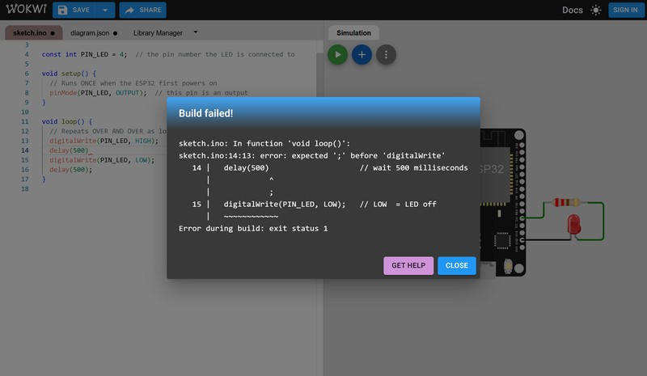

This is **not** a sign that you have no talent — it's the compiler showing you exactly where it got confused. How to read it:

- `sketch.ino:14:13` → the file `sketch.ino`, **line 14**, column 13. Look at the line numbers on the left of the editor. That's where it is — right at the end of line 14, `delay(500)` — the missing semicolon.
- `error: expected ';' before 'digitalWrite'` → "I expected a semicolon **before** the word digitalWrite". The word `digitalWrite` is the **next** statement (line 15); the compiler only notices something is missing when it reaches that word. So the line to fix is still **line 14**: add `;` at its end.
- The `^` and `;` marks below the code show the exact suggested position.

Other errors that come up often:

| Message | What it means | Fix |
| :--- | :--- | :--- |
| `'PIN_LED' was not declared in this scope` | A name is used but hasn't been created, or it's misspelled (`PIN_LED` vs `PIN_led`). | Check the `const int …` line; make the spelling match. |
| `expected '}' at end of input` | The curly braces aren't paired. | Count the `{` and `}`; usually one is missing at the end of `loop()`. |
| `'digitalwrite' was not declared` | Wrong uppercase/lowercase. | `digitalWrite`. |
| `expected unqualified-id` / `stray '\342'` | There's a strange character, usually "smart" quotes (“ ”) from a notes app/Word. | Copy again from the material, not from Word. |

After fixing it, click ▶ again. If the error is different, great — you've moved one step forward.
</details>

<details>
<summary><b>The LED and resistor don't appear after pasting diagram.json</b></summary>

- Make sure you pasted into the **`diagram.json`** tab, not `sketch.ino`.
- Make sure the editor is **empty** before pasting (**Ctrl + A**, then **Delete**). If some old text is left over, the JSON breaks and Wokwi quietly ignores it or shows a red line.
- Hover over the wavy red line (if there is one): the message is usually *"Expected comma"* or *"Unexpected token"* → a comma or bracket is missing. The easiest fix: delete everything and paste again from the material.
- The board isn't fully visible in the panel? Turn the mouse wheel over the right panel to zoom in/out, or drag the gray background to move around.
</details>

<details>
<summary><b>The simulation runs, but the LED doesn't light up at all</b></summary>

- Check the wires: `esp:D4 → r1:1`, `r1:2 → led1:A`, `led1:C → esp:GND.1`. If `A` and `C` are swapped, the LED won't light (it isn't damaged — just swap them back).
- Check the pin number in the code: `PIN_LED = 4` must match the pin in the diagram (`esp:D4`). LED moved to D18 in the diagram, but the code still says 4 → it won't light.
- A very small `delay` (`delay(1)` or `delay(2)`)? The LED looks dim/half-bright, not off. Set it back to 500.
- Forgot `pinMode(PIN_LED, OUTPUT);` → the pin doesn't put out enough electricity; the LED is dim/off.
</details>

<details>
<summary><b>"Compiling project…" takes very long or gets stuck</b></summary>

- Free Wokwi uses a server queue; 5–20 seconds is normal, up to about 1 minute when it's busy. Wait.
- If it takes more than 2 minutes: click **CANCEL**, reload the page (**F5**), paste the code again, and try again.
- The simulation counter is running, but very slowly (for example "10%")? Close other heavy tabs or switch to the Chrome/Edge browser. The simulator needs computer power.
</details>

<details>
<summary><b>The SAVE button asks me to sign in / my project is gone</b></summary>

Wokwi only saves projects for signed-in users. Sign up for free (with Google or GitHub), then click SAVE. If the project is already gone: no problem — paste it again from `code/01-blink/` (2 minutes).
</details>

<details>
<summary><b>GitHub: there's no "Upload files" button</b></summary>

- The repository was created **without a README** → GitHub shows a confusing "Quick setup" page. Look for the small link **"uploading an existing file"** on that page — it does the same thing. Or click **Add file → Create new file**, create a `README.md` with one line, commit it, and then the **Upload files** button appears.
- You're not signed in → the button doesn't appear. Check the top-right corner.
</details>

<details>
<summary><b>GitHub: the image doesn't show in the README</b></summary>

- The file name in the text must be **exactly** the same as the name of the uploaded file, including uppercase/lowercase and the extension (`.png` vs `.PNG`).
- The file name has spaces → rename it without spaces and upload it again.
- Files over 25 MB can't be uploaded through the browser → make the screenshot smaller.
- Your code file is named `module-01-name-pattern.ino.txt`? That's the Notepad trap (see Practice 3, step 4) — rename it and upload it again.
</details>

> [!TIP]
> **The 2-hour rule.** If a problem still isn't solved after 2 hours, stop. Write a "✅ version" question (Practice 6), send it, then move on to another section or take a break. A rested brain often finds the answer on its own the next morning.

---

## 🔬 Technical Deep Dive (optional)

This section is for anyone curious about what's "behind the scenes". **You can skip it** — nothing in this section is a pass requirement.

<details>
<summary><b>3-minute history: Arduino and the ESP32</b></summary>

**Arduino** was born in 2005 at a design school in Ivrea, Italy, from a simple wish: to let design students (not engineers) make interactive objects. The recipe: a cheap board + a simplified way of writing code (`setup()`/`loop()`, `digitalWrite`) + a community that shares examples. That's the recipe you're using today, even though the chip isn't made by Arduino.

The **ESP32** was made by Espressif Systems (Shanghai) and released in 2016 as the successor to the ESP8266 (2014), which stunned the world by offering Wi-Fi for the price of a cup of coffee. The ESP32 added Bluetooth, two processor cores, and lots of pins. Espressif then made a core (a "translator" package) so the ESP32 could be programmed Arduino-style — that's **arduino-esp32**, whose version (3.3.x) we've been mentioning all along. Version 3.x (2024) is built on ESP-IDF 5, Espressif's official framework, and that's where some command names changed. A mini operating system called **FreeRTOS** also runs inside that core — so "no OS" in Concept 3 is a simplification: there's no OS *like Windows*, but there is a small task scheduler that you'll put to use in Module 8.

The ESP32 family now includes many chips (S2, S3, C3, C6, H2, P4…). This curriculum uses the **"classic" ESP32** (the ESP-WROOM-32 module) because it's the cheapest, has the most examples, and is available in Wokwi.
</details>

<details>
<summary><b>Anatomy of diagram.json</b></summary>

```json
{
  "version": 1,                       // file format; always 1
  "author": "…", "editor": "wokwi",   // just information
  "parts": [                          // LIST OF PARTS
    { "type": "wokwi-esp32-devkit-v1",   // part type (Wokwi's standard name)
      "id": "esp",                       // nickname, your choice, must be unique
      "top": 0, "left": 0,               // position on the screen
      "attrs": {} },                     // extra settings
    { "type": "wokwi-resistor", "id": "r1", "top": 94.35, "left": 130,
      "attrs": { "value": "220" } },     // value in ohms
    { "type": "wokwi-led", "id": "led1", "top": 107, "left": 150,
      "attrs": { "color": "red" } }      // LED color
  ],
  "connections": [                    // LIST OF WIRES: [from, to, color, bends]
    [ "esp:TX0", "$serialMonitor:RX", "", [] ],   // these two lines connect
    [ "esp:RX0", "$serialMonitor:TX", "", [] ],   // the chip's "diary" to the black box
    [ "esp:D4", "r1:1", "green", [] ],            // [] = Wokwi picks the route itself
    [ "r1:2", "led1:A", "green", [ "h20", "v49" ] ],  // bends: right 20, down 49
    [ "led1:C", "esp:GND.1", "black", [] ]
  ]
}
```

(Note: real JSON **must not** contain `//` comments; they're here only for explanation. Use the files in `code/` for pasting.)

Every pin is written as `id:pinName`. The board's pin names follow the labels on the physical board (`D4`, `D18`, `3V3`, `VIN`); because the board has **two** GND pins, Wokwi numbers them `GND.1` (right side, near 3V3) and `GND.2` (left side, near VIN). The LED's pins are `A` and `C`; the resistor's pins are `1` and `2`. The full list of parts and their pins is at [docs.wokwi.com](https://docs.wokwi.com/) → *Parts*. You can move parts with the mouse — Wokwi rewrites the `top`/`left` numbers on its own.
</details>

<details>
<summary><b>What happens when you click the ▶ button</b></summary>

1. The contents of `sketch.ino` are sent to Wokwi's **compile server**. There, the C++ compiler for the ESP32 (the same one you'll later install with the Arduino IDE) translates it into a binary file (`.bin`). That's the "Compiling project…" pause. If there's a grammar mistake, the server sends back a *Build failed* message.
2. The binary file is downloaded to your browser.
3. In the browser, Wokwi runs an **emulator**: a program that imitates the ESP32's CPU instruction by instruction, complete with its pins. The LED on the screen lights up because the emulator "sees" voltage on pin D4 — not because of a specially made animation.
4. The strange text in the black box is the ***serial monitor***: messages the chip sends through the TX0 pin while booting (loading the program). Starting in Module 3, you'll send messages there yourself with `Serial.println(…)` to "peek into the chip's brain".

Because the emulator runs in the browser, the simulation speed depends on your laptop — that's the percentage in the top-right corner (100% = as fast as the real chip).
</details>

<details>
<summary><b>Why pins D4 and D18, not pin 2 (the board's built-in LED)?</b></summary>

The original DevKit V1 board has a small blue LED connected to **GPIO 2**; many tutorials use it. This curriculum chose an **external LED on GPIO 4** (and GPIO 18 for the second LED) for three reasons: (1) not every board clone has that LED, and not every simulator shows it; (2) you practice building a circuit right away, which is exactly the goal of Module 2; (3) GPIO 4 and 18 are "safe" pins — they have no special role while the chip starts up. Some ESP32 pins (0, 2, 5, 12, 15) have special roles during booting and can make the board fail to start, or blink briefly, if something is connected to them; these pins are covered thoroughly in the **canonical pin map** in Module 5. Until then, follow the pin numbers in the material.
</details>

<details>
<summary><b>If your board has 38 pins (ESP32 DevKitC)</b></summary>

The code is exactly the same; only the picture in the simulator and the pin positions on the physical board differ. In Wokwi, change the board line in `diagram.json` to `{ "type": "board-esp32-devkit-c-v4", "id": "esp", "top": 0, "left": 0, "attrs": {} }` — then watch for two differences: its serial pins are named `TX` and `RX` (not `TX0`/`RX0`), so the two `$serialMonitor` lines must be changed to `"esp:TX"` and `"esp:RX"`; and GPIO pin names are written without the letter D (`"esp:4"`, not `"esp:D4"`; `"esp:GND.1"` stays the same). On the physical board later (Module 2), look for the label `D4`/`IO4`/`4` next to the pin — its GPIO number is the same, only its position shifts.
</details>

---

## 🧩 Independent Challenges

Three levels, from "change a little" to "build it yourself". Do at least level 1. All in Wokwi, with the circuit from Practice 2 (two LEDs).

**Level 1 — Change a little: a heartbeat.** Make the red LED blink in a "lub-dub … lub-dub …" pattern: two quick blinks (on 100 ms, off 100 ms, on 100 ms), then stay dark for 700 ms. Using just `digitalWrite` and `delay` is enough.

**Level 2 — Fill in the blanks: a traffic light.** Add a **yellow** LED on pin **D19** (220 Ω resistor; its C leg to the other LEDs' C legs), then complete the `___` parts of this code so the sequence is: green 3 seconds → yellow 1 second → red 3 seconds → repeat.

```cpp
const int PIN_RED    = 4;
const int PIN_YELLOW = ___;
const int PIN_GREEN  = 18;

void setup() {
  pinMode(PIN_RED, OUTPUT);
  pinMode(___, OUTPUT);
  pinMode(PIN_GREEN, OUTPUT);
}

void loop() {
  digitalWrite(PIN_GREEN, HIGH);
  delay(___);
  digitalWrite(PIN_GREEN, LOW);

  digitalWrite(PIN_YELLOW, ___);
  delay(1000);
  digitalWrite(PIN_YELLOW, LOW);

  digitalWrite(___, HIGH);
  delay(3000);
  digitalWrite(PIN_RED, ___);
}
```

**Level 3 — From scratch: a two-color SOS.** Design your own program that sends the distress signal **SOS** (· · · — — — · · ·) with the red LED, then the "reply" **OK** (— — — / — · —) with the green LED, then pauses for 2 seconds and starts over. Hint: make two functions, `blinkRed(int duration)` and `blinkGreen(int duration)`, modeled on `blink(…)` in Practice 3. There's no answer key for level 3 — if the LEDs blink the way you planned, you're right.

Upload your challenge results (screenshot + code) to the `learn-iot` repository — extra practice for Practice 4.

---

## ➕ Add-on to "Mini Smart Home"

Module 1's contribution to the running project isn't code but **direction**: a *project vision* page — what **you** want to monitor and control in your own home/rented room/garden. This isn't a formality. In Module 6 you'll compare the sensors we use with what you want here. In Module 19 you'll write automation rules from the "IF … THEN …" sentences you write now. In Module 31 (the *capstone*, the final project) you're free to build your own version.

1. Open [`code/project-vision-TEMPLATE.md`](code/project-vision-TEMPLATE.md) and copy its contents (the **Raw** button / copy icon — see the tip in Practice 2).
2. In the `learn-iot` repository: **➕ / Add file → Create new file**, name it `project-vision.md`, paste, then fill in its six sections (15–20 minutes; one- or two-sentence answers are enough).
3. **Commit changes**.

A short sample answer to give you an idea: *"Place: a 3×3 m rented room and two chili pots on the windowsill. Monitor: room temperature, soil moisture in the pots, whether a light was left on. Control: a fan, a mini pump. Rule: IF the soil has been dry for more than 6 hours, THEN water for 20 seconds and send a Telegram message. Other users: my roommate. Reason: I want to switch careers to IoT within a year."*

---

## 📖 Glossary

| Term | Plain-language meaning |
| :--- | :--- |
| **IoT** (*Internet of Things*) | Everyday objects fitted with sensors and a connection, so they can report and be controlled from far away. |
| **Fullstack** | Mastering every layer of a system: from the sensor on the object to the display on the phone. |
| **Microcontroller** | A tiny computer, without an operating system like Windows, that runs one program forever. The ESP32 is one of them. |
| **ESP32** | A cheap microcontroller made by Espressif, with Wi-Fi and Bluetooth; the main chip of this curriculum. |
| **Board** (DevKit) | A circuit board that carries the ESP32 chip plus a USB port, buttons, and pins — so the chip can be used right away. |
| **Node** | One device (an ESP32 + its sensors/actuators) in an IoT system. Our project has Node 1 "Home" and Node 2 "Garden". |
| **Pin / GPIO** | A metal "leg" on the board that can send out or read an electrical signal. GPIO = *general purpose input/output*, a multipurpose pin; `D4` = GPIO number 4. |
| **LED** | A small, power-efficient light that only lets current flow in one direction (long leg = +). |
| **Resistor** | A "pipe narrower" part that limits current; its value is in ohms (Ω). |
| **GND** (*ground*) | The electrical zero point; where the current "returns home". |
| **HIGH / LOW** | Pin commands: send out electricity (3.3 V) / don't (0 V). |
| **Sketch** (`.ino`) | Arduino's name for a program file. |
| **Firmware** | The program embedded in the chip; a sketch that has been compiled and sent to the chip. |
| **Compiler** | The "cook" that translates text code into machine language (0s and 1s). |
| **`setup()` / `loop()`** | The two required parts of an Arduino program: runs once / repeats forever. |
| **`delay(ms)`** | The "wait" command, for a given number of milliseconds (1,000 ms = 1 second). |
| **Simulator (Wokwi)** | A simulated ESP32 in the browser; code that runs here almost always runs on the real board. |
| **JSON** | A tidy text format for data, used by `diagram.json` (and later for sensor data in Module 4+). |
| **Repository (repo)** | "A folder on the internet that remembers every change" — one project on GitHub. |
| **Commit** | Saving one "snapshot of your progress" to the repository, along with a short message. |
| **README** | A repository's main notes file; shown automatically on its front page. |
| **Markdown** | A way of writing formatted text with simple marks (`##` heading, `**bold**`); used in READMEs. |
| **Version** | The release number of a tool/library. Different versions → possibly different commands. Always state it when you ask. |
| **Core (arduino-esp32)** | The "translator" package that lets you program the ESP32 Arduino-style; we use 3.3.x. |
| **Library** | Ready-made code written by other people that we can call; covered in Module 3. |

---

## 📝 5-Question Quiz

Answer in your head or in your notes first, then open the key. Pass = at least 4 correct.

1. What is the most fundamental difference between a laptop and a microcontroller like the ESP32?
2. In the Blink code, which command runs **only once**, and which commands **repeat over and over**?
3. If you change the first `delay(500)` to `delay(2000)` but leave the second `delay(500)` as it is, what do you see?
4. A friend copied code from a 2022 tutorial and got the error `'ledcSetup' was not declared`. What is the most likely cause, and what should they mention when asking for help?
5. You're about to buy an ESP32 board for this curriculum. Name three features you check in the product photo.

<details>
<summary><b>Answer key & explanations</b></summary>

1. **A microcontroller has no operating system like Windows, and it runs only one program**, which is embedded in it, starting right when it's powered on; a laptop has an OS that runs many apps. (If you answered "smaller/cheaper/more power-efficient", that's true, but those are *consequences*, not the fundamental difference.)
2. `pinMode(PIN_LED, OUTPUT);` inside **`setup()`** runs once. The four `digitalWrite`/`delay` lines inside **`loop()`** repeat over and over.
3. The LED is **on for 2 seconds, off for 0.5 seconds**, repeatedly. The first `delay` sets how long it stays on (after `HIGH`), the second `delay` sets how long it stays off (after `LOW`).
4. That tutorial was written for **arduino-esp32 core version 2.x**; in version 3.x the command was replaced by `ledcAttach(…)`. When asking, they should mention the **core version** (3.3.x), the Arduino IDE/Wokwi version, the exact error message, and the complete code.
5. (Any three of these) **30 pins** (15 + 15); the text **ESP-WROOM-32** on the metal module — not S3/C3/C6/U; a **zigzag antenna** at the end of the module (not a round antenna connector); a **USB port** and two buttons, **EN/BOOT** (not an ESP32-CAM without USB); the description mentions a **CP2102/CH340** USB chip.
</details>

---

## ✅ Module 1 Completion Checklist

Check them off honestly. The ⭐ boxes are the **official pass requirements** from the Syllabus; the rest are strongly recommended. When everything is checked, mark Module 1 in your own copy of [PROGRESS.md](../../PROGRESS.md) (open `PROGRESS.md` → the copy icon **Copy raw file** → in your repository, **Add file → Create new file** named `PROGRESS.md` → paste → Commit; then change `[ ]` to `[x]` with the pencil icon) and move on to Module 2 — even if the kit hasn't arrived yet.

- [ ] The LED in Wokwi blinks from Blink code that I pasted myself.
- [ ] I've changed the blink speed and seen the effect (Practice 1).
- [ ] Two LEDs blink in turn (Practice 2).
- [ ] ⭐ **The LED blinks in a pattern I designed myself** (my name/initials in Morse), and I can point to the lines that set how long or short the blinks are (Practice 3).
- [ ] ⭐ The `learn-iot` repository exists on my GitHub, with a **screenshot** and the name-pattern code; its address: `https://github.com/________/learn-iot` (Practice 4).
- [ ] ⭐ **Kit A Stage 1 is ordered** (at least the Required table), the board is a 30-pin DevKit V1, and the cable is a data cable (Practice 5).
- [ ] I have the "✅ version" question template in my notes and know where to ask (Practice 6).
- [ ] `project-vision.md` is filled in and committed to the repository (➕).
- [ ] Quiz: at least 4 out of 5 correct.

**You pass when** (as stated in the Syllabus): *the LED in Wokwi blinks in a pattern you designed yourself, its screenshot is in your GitHub repository, and Kit A Stage 1 has been ordered.*

---

## 📚 Sources & Image Credits

All screenshots were taken by the author in October 2026 from the services concerned and are used for educational purposes; interfaces may change. The original diagrams are licensed **CC BY 4.0** (for all seven diagrams, the `.svg` source files are included in the `assets/` folder so you can modify them; the three `.jpg` illustrations are only available as finished images). A complete summary is also in [`assets/SOURCES.md`](assets/SOURCES.md).

| File | Source | License / notes |
| :--- | :--- | :--- |
| `roadmap-module-01.png`, `iot-around-us.png`, `setup-vs-loop.png`, `led-circuit-wokwi.png`, `led-leg-polarity.png`, `blink-pattern-timeline.png`, `kit-right-vs-wrong.png` (+ `.svg`) | Original diagrams of the Fullstack IoT Developer curriculum | CC BY 4.0. `kit-right-vs-wrong` is a schematic drawing, not a product photo. |
| `../../assets/architecture-fullstack-iot.png` and `-dark.png` | Original curriculum diagram (a cross-module image; light version and dark-theme version) | CC BY 4.0 |
| `laptop-vs-microcontroller.jpg`, `code-to-chip-flow.jpg`, `data-vs-charge-cable.jpg` | Original illustrations of the Fullstack IoT Developer curriculum (from a previous version of the curriculum, re-checked) | CC BY 4.0 |
| `photo-esp32-devkit-v1.jpg`, `photo-esp32-devkit-v1-annotated.jpg` | [Ubahnverleih, Wikimedia Commons — *ESP32 Espressif ESP-WROOM-32 Dev Board*](https://commons.wikimedia.org/wiki/File:ESP32_Espressif_ESP-WROOM-32_Dev_Board.jpg); annotations by the author | [CC0 1.0 (public domain)](https://creativecommons.org/publicdomain/zero/1.0/deed.en) |
| `wokwi-02-editor-explained.png`, `wokwi-03-diagram-json.jpg` … `wokwi-11-click-part.png` | Screenshots of [Wokwi](https://wokwi.com) (© Wokwi / CodeMagic LTD), some annotated by the author | Used for educational/tutorial purposes; not part of the curriculum's CC license. |
| `github-01-new-repo.jpg` … `github-04-upload-files.jpg` | Screenshots of [GitHub](https://github.com) (© GitHub, Inc.), some annotated by the author | Used for educational/tutorial purposes; not part of the curriculum's CC license. |

References used while writing: the Wokwi documentation ([docs.wokwi.com](https://docs.wokwi.com/)), the source code of the Wokwi parts ([github.com/wokwi/wokwi-elements](https://github.com/wokwi/wokwi-elements) — board pin names and positions), the arduino-esp32 documentation ([docs.espressif.com/projects/arduino-esp32](https://docs.espressif.com/projects/arduino-esp32/en/latest/); especially the 2.x → 3.x migration notes), and the GitHub documentation ([docs.github.com](https://docs.github.com/)) for the browser file-upload flow.

---

[⬅️ Back to Syllabus](../../SYLLABUS.md) · [Progress tracker](../../PROGRESS.md) · **Next: [Module 2 — Electricity for Beginners, Breadboards, & Your First Upload to a Real ESP32](../module-02-electricity-and-first-upload/README.md) ➡️**
