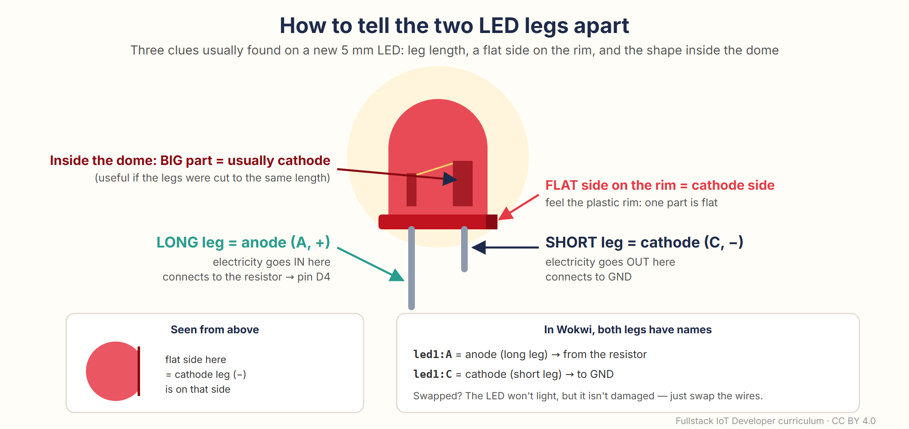
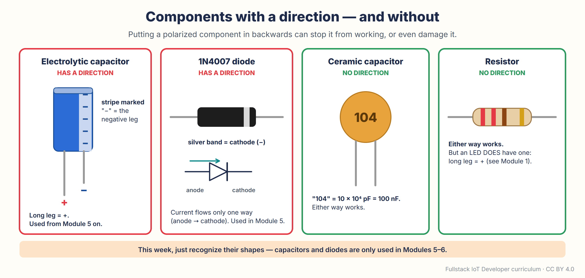
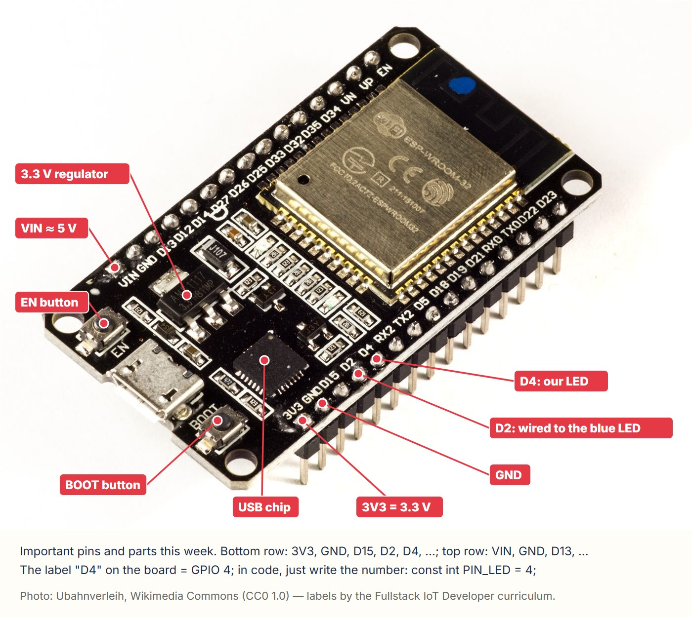
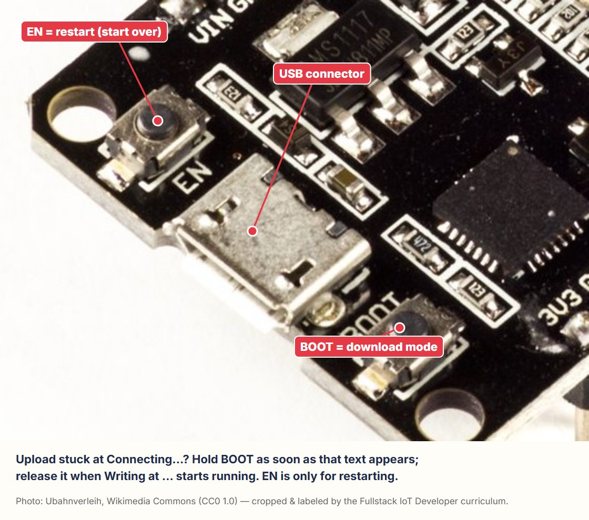
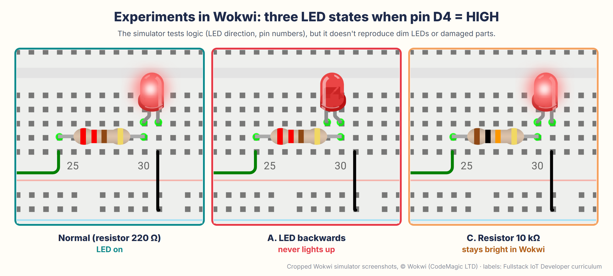
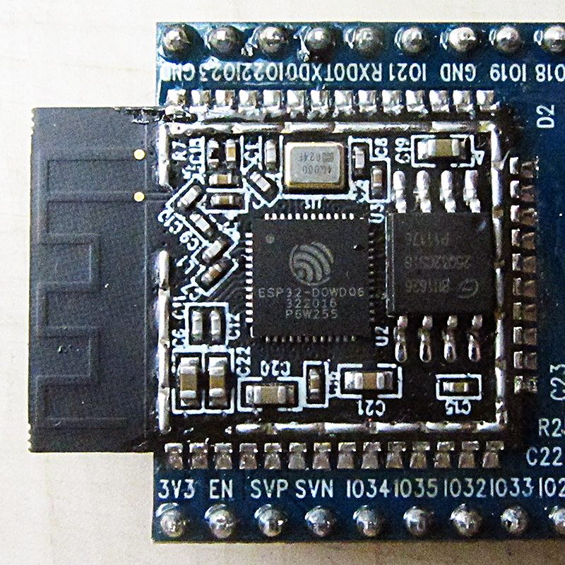

# Module 2 — Electricity for Beginners, Breadboards, & Your First Upload to a Real ESP32

🌐 **English** · [Bahasa Indonesia](../../../fase-0-fondasi/modul-02-listrik-dan-unggah-pertama/README.md)

*Phase 0 · Week 2 · Hardware: **Kit A Stage 1** (you can start in Wokwi if your kit hasn't arrived yet) · Prerequisite: **Module 1** · Time: 8–10 hours, spread over the week*

[⬅️ Module 1](../module-01-big-picture-iot/README.md) · [Syllabus](../../SYLLABUS.md) · [Progress tracker](../../PROGRESS.md) · [Module 3 ➡️](../module-03-cpp-for-esp32/README.md)

---

Last week your LED blinked on a screen. This week the LED is **real**: you'll hold a real ESP32 board, plug it into a *breadboard* (a circuit board that needs no soldering), place an LED and a resistor with your own hands, and then send a program from your laptop to the chip over a USB cable. Along the way we'll stop briefly to understand electricity in the language of water and valves — just enough to know why the resistor is a must; why 5 V from USB is safe to touch but 220 V from the wall outlet isn't; and why an ESP32 pin may only be "fed" 3.3 V.

This module also has the **biggest "Troubleshooting" box in the whole curriculum**. Not because this module is hard, but because this is the first time three worlds meet: the hardware, the driver (a small program that lets the laptop recognize a device) on your laptop, and the USB cable. If something gets stuck, the answer is almost certainly already in that box.


> [!NOTE]
> **Kit hasn't arrived yet?** No problem. Start with the parts that don't need the kit: 🧠 Concepts, Practice 2.1–2.2 (installing the Arduino IDE and the esp32 package — the longest part because the download is big), and Practice 5 (the same circuit in Wokwi). The Quick Win, Practice 2.3–2.4, and Practices 1, 3, 4, and 6 wait until the kit arrives. You can do them in any order; the checklist at the end stays the same.

This module has the same rhythm as Module 1. Open the collapsible sections in 🚨 (click a title to expand it) only when you need them; the collapsible sections in 🔬 can be skipped. Every practice starts with a **🖥️** box that tells you which tools to open.

## Contents

1. [🎯 After this module you can…](#-after-this-module-you-can)
2. [🧰 What you need](#-what-you-need)
3. [🏆 Quick Win: light up an LED without code (10 minutes)](#-quick-win-light-up-an-led-without-code-10-minutes)
4. [🧠 The "Why" Concepts](#-the-why-concepts)
5. [🔧 Step-by-step practice](#-step-by-step-practice)
6. [🚨 Troubleshooting](#-troubleshooting)
7. [🔬 Technical Deep Dive (optional)](#-technical-deep-dive-optional)
8. [🧩 Independent Challenges](#-independent-challenges)
9. [➕ Add-on to "Mini Smart Home"](#-add-on-to-mini-smart-home)
10. [📖 Glossary](#-glossary) · [📝 Quiz](#-5-question-quiz) · [✅ Completion checklist](#-module-2-completion-checklist)
11. [📚 Sources & Image Credits](#-sources--image-credits)

---

## 🎯 After this module you can…

- **Explain voltage, current, and resistance** to a non-technical person using the water analogy, and use **Ohm's law** to calculate an LED resistor — including answering "why not just use 5 V?".
- **Build circuits on a breadboard without short circuits**: know which holes are connected inside, where the LED's long leg goes, and why you unplug USB before changing any wires.
- **Upload a program to a real ESP32** from Arduino IDE 2: install the esp32 3.3.x board package and the USB driver, select the board and port, click **Upload**, and then "chat" with the ESP32 through the Serial Monitor.
- **Measure with a multimeter**: the voltage on the 3V3, VIN, and D4 pins; resistor values; and connections on the breadboard.
- **State the 3.3 V golden rule**: which pin may power a 5 V module, which pins must never receive 5 V — and why USB's 5 V is safe to touch while 220 V mains power isn't.

---

## 🧰 What you need

| Item | Details |
| :--- | :--- |
| **ESP32 DevKit V1, 30 pins** (from Kit A Stage 1) | Pins already soldered. Check its features against the [guide in Module 1](../module-01-big-picture-iot/README.md#practice-5--order-kit-a-stage-1-so-module-2-doesnt-have-to-wait): 15 + 15 pins, the label "ESP-WROOM-32", a zigzag antenna. |
| **USB data cable** | Micro-USB or USB-C, matching your board's connector. Cheap phone charging cables often **have no data lines** — the symptom: the board powers on (a small red LED on the board), but the laptop detects nothing. Use the cable that came with a brand-name phone/power bank, or a cable you know can transfer files. |
| **830-point breadboard** | One is enough this week (keep the second one for later modules). |
| **Male–male (M-M) jumper wires** | At least 4: 1 red, 1 green (or yellow), and 2 black. The color doesn't actually matter, but a color habit helps a lot: red = +, black = GND, other colors = signal. Add 2 spares for Practice 1. |
| **Red 5 mm LED** + **220 Ω** resistor | From the LED/resistor packs. Also have a **1 kΩ** and a **10 kΩ** resistor ready for the "dim" experiment, plus one **green** LED + another 220 Ω for the challenges. |
| **Digital multimeter** | A cheap one (DT-830B, DT-9205, and similar) is enough. Make sure its battery is installed (usually a 9 V rectangular battery). |
| **Laptop/PC** | Windows 10/11 64-bit, macOS, or 64-bit Linux, with one USB port. A laptop that **only has USB-C** needs a USB-C → USB-A adapter, or a USB-C → micro-USB cable (make sure it's a data cable). |
| **Internet + about 2.5 GB of data, about 10 GB of free disk space** | Just once: the Arduino IDE (about 160–200 MB), then the esp32 board package (about 2 GB; it contains compilers for *every* type of ESP32 chip, not just yours). Once extracted, the package takes up several GB, so leave plenty of room. If your phone data is limited, do Practice 2 on Wi-Fi at your campus, office, or a café. |
| **What you DON'T need** | A soldering iron, a power adapter, batteries, sensors. Those only show up in Modules 5–9. |

**Versions used in this module:**

| Tool | Version | Notes |
| :--- | :--- | :--- |
| Arduino IDE | **2.3.x** (at the time of writing: 2.3.10, released June 2026) | The app on your laptop for writing, compiling, and uploading code. **Don't** use the old 1.8.x version (*Legacy IDE*). |
| The **esp32 by Espressif Systems** board package | **3.3.x** (at the time of writing: 3.3.12, released September 2026) | This is the arduino-esp32 core discussed in [Module 1, Concept 9](../module-01-big-picture-iot/README.md#9-versions-matter-and-why-internet-tutorials-often-dont-work). If you see version **4.0.0-RC** or **alpha** somewhere else, don't use it — those are test versions. |

<details>
<summary><b>Other versions used (esptool, USB <i>driver</i>, operating system)</b></summary>

| Tool | Version | Notes |
| :--- | :--- | :--- |
| esptool | 5.x (installed together with the board package; in 3.3.12 it's version 5.3.1) | The small program that actually sends the file to the chip. Its name shows up in the Output panel when you upload. |
| USB driver | CP210x (Silicon Labs) or CH340/CH9102 (WCH) | Depends on the USB translator chip on your board. Windows 10/11 often installs it automatically; if not, Practice 2 explains how. |
| Operating system | Windows 10/11 64-bit, macOS, 64-bit Linux (for example Ubuntu 22.04/24.04) | The Arduino IDE images in this module are **illustrations** redrawn from Arduino IDE 2.3.10 on Windows, with exactly the same button and menu text. On macOS/Linux the contents are the same; only the window frame and the port names differ. |

</details>

> [!TIP]
> **Set up a small "workbench"**: a non-metal surface (paper or a thick book is fine), a bright enough lamp, and an old box to keep your parts in. Jumper wires and resistors get lost very easily.

---

## 🏆 Quick Win: light up an LED without code (10 minutes)

We'll start with the simplest thing: **lighting an LED using only power from the board, without writing any code at all.** The goal is for your hands to get to know the breadboard and the LED before the laptop gets involved. If your kit hasn't arrived yet, jump ahead to [🧠 Concepts](#-the-why-concepts) and come back here later.

> 🖥️ **Tools used in this section:** the ESP32 board, the breadboard, 1 red LED, one 220 Ω resistor, 3 jumper wires (1 red, 2 black), a USB cable, and a USB power source (a laptop port or a phone charger — either works). **No need to open any app.**

First, look at what we're aiming for. Keep this picture in front of you during the next five steps:

![The Quick Win circuit on the breadboard, seen from above: the ESP32 board lies lengthwise along the breadboard in columns 4 to 18 with the USB connector on the left; a 220 ohm resistor in holes 24i and 30i; a red LED with its long leg in 30h and its short leg in 31h; a red wire from 4j (below the 3V3 pin) to 24j; black wires from 5j (below the GND pin) and from 31j straight down to the bottom blue rail; the row letters a to j are marked on the right edge, and a zoom box shows the 3V3, GND, and D4 pins with holes 4j, 5j, and 8j below them](assets/circuit-quick-win.png)

*Image made with the [Wokwi](https://wokwi.com) simulator so the hole positions are exact — screenshot © Wokwi (CodeMagic LTD), labels by the author. The hole layout of your real breadboard is the same.*

### Step 1 — Plug the ESP32 board into the breadboard

Place the breadboard with **number 1 on the left** and **letter a at the top** (the numbers and letters are printed along the breadboard's edges). Place the ESP32 board **lengthwise along the breadboard, straddling the center channel** — the long gap that splits the breadboard into a top half and a bottom half — with the USB connector facing **left**, so that:

- the **top** row of pins (VIN, GND, D13, …, EN) goes into **row a**, columns **4 to 18**;
- the **bottom** row of pins (3V3, GND, D15, D2, D4, …, D23) goes into **row i**, columns 4 to 18.

Press the board in gently and evenly at both ends until it's seated. A slightly bent pin can be straightened first with a fingernail. Most important: **row j below the bottom row of pins stays empty**, because that's where our wires go.

Clone boards vary slightly in width. If your board is narrower, so its bottom row lands in row h, that's fine — every "row j" instruction in this module still applies. If your board is so wide that it covers every row, see [🔬 Technical Deep Dive → *If your board covers every hole*](#if-your-board-covers-every-hole).

### Step 2 — Place the resistor and the LED

1. **220 Ω resistor**. On a cream-colored body with four bands: **red-red-brown-gold**. On a blue body with five bands: **red-red-black-black-brown**. The packaging is usually also labeled *220R* or *220Ω*. One leg into hole **24i**, the other into **30i**. Either direction works. Bend the legs as needed so they fit.
2. **Red LED**: look at its legs — one is **longer**. **Long leg into 30h**, **short leg into 31h**. If the legs have been trimmed to the same length, look at the LED's plastic rim: the **flat** side is the short-leg side.

Why are the resistor leg in 30i and the LED leg in 30h connected without a wire? Because the five holes of one column in the bottom half (f, g, h, i, j) are connected inside the breadboard. Concept 4 explains this.

### Step 3 — Three jumper wires

1. A **black wire** from **31j** (the column of the LED's short leg) **straight down** to the nearest hole of the **bottom blue (−) rail** — at column 31 or slightly to the left, **not to the right**. On some breadboards this rail is split in the middle (around column 32).
2. A second **black wire** from **5j** — the hole right below the **GND** pin — to the same blue (−) rail. Now that blue rail is "officially" GND.
3. A **red wire** from **4j** — right below the **3V3** pin — to **24j** (the column of the resistor's left leg).

The red wire will cross the black wire from 5j — that's fine. Jumper wires are covered in plastic insulation, so wires that cross or touch are not connected. Only the metal tips that go into the holes make connections.

Trace it with your finger: **3V3 → red wire → resistor → LED (in through the long leg, out through the short leg) → black wire → blue rail → black wire → GND**. One complete loop: electricity always needs a way back.

### Step 4 — Plug in USB

Connect the USB cable to the board, then to a laptop or a phone charger. Two lights come on: **the small red LED on the board** (a sign that the board is getting power) and **your LED on the breadboard**. 🎉

Not lighting up? First look at the small LED on the board, then **unplug USB** and check these in order:

1. The small LED on the board is off too → the problem is the USB cable or the power source. Try another cable/port.
2. LED backwards → swap its two legs (an LED isn't damaged by being backwards).
3. An LED or resistor leg is in the wrong column → recount the column numbers.
4. Is the red wire in 4j? (Hole 4i is already taken by a pin.)
5. Your breadboard's blue rail may be split in the middle (is there a gap in the blue line along its edge?). Move the bottom end of the black wire from 31j to a spot on the blue rail further left, near the other black wire.

Still dark? Expand *The LED on the breadboard doesn't light up* in [🚨 Troubleshooting](#-troubleshooting).

### Step 5 — Move one wire, and notice something

**Unplug USB.** Move the end of the red wire from **4j to 8j** — the hole below the **D4** pin. Plug USB back in. The LED is **off**.

That's normal, and it's exactly the point: the 3V3 pin is always "live", while pin **D4 only puts out power when a program tells it to**. That program is what you'll upload in Practice 3. (If the LED blinks instead, your board happens to already contain a factory example program. That's fine — your program will replace it.) Leave the circuit set up like this; we'll use it again.

> [!IMPORTANT]
> **The golden rule for this week (and from now on): unplug USB before touching or changing any wires.** A wrong circuit without power damages nothing. A wrong circuit *with* power can burn out the LED, heat up the board, or make the laptop shut down its USB port.

---

## 🧠 The "Why" Concepts

Ten concepts, one per section. Take your time reading — there's a ☕ break in the middle. Concepts 1–8 are enough for Practice 1; read Concepts 9–10 before Practices 2 and 3.

### 1. Electricity is like water: voltage, current, resistance, power

You don't need a physics degree for this week. One picture in your head is enough: **water from a tank up high flows through a pipe and a valve, turns a water wheel, and is then pumped back up to the tank.**


| Electrical term | Unit | In water terms | In our project |
| :--- | :--- | :--- | :--- |
| **Voltage** (V) | volt (V) | Water pressure. The higher the tank, the stronger the push. | USB = 5 V, ESP32 pin = 3.3 V, mains (PLN) = 220 V. |
| **Current** (I) | ampere (A); 1 A = 1,000 mA | How strong the flow is: how many liters pass per second. | Our LED: about 6 mA; the ESP32 chip while Wi-Fi is transmitting: up to about 250 mA. |
| **Resistance** (R) | ohm (Ω); 1 kΩ = 1,000 Ω | A valve that narrows the pipe. | The 220 Ω resistor "brakes" the LED's current. |
| **Power** (P) | watt (W) | The work done: the water wheel turns. | P = V × I. Our LED circuit: 3.3 V × 0.006 A ≈ 0.02 W; a room light: about 10 W. |

Two sentences that save a lot of components:

- **Voltage is still "there" even when nothing is flowing** (a full tank, a closed valve). So the 3V3 pin is still at 3.3 V even when it isn't being used.
- **Current only flows when there's a way back to GND.** That's why every circuit this week ends at the blue rail.

### 2. Ohm's law — the only formula this week

The first three quantities are tied together by one formula: **V = I × R** (voltage = current × resistance). Cover the letter you want to find in this triangle; what's left is the formula.


The only calculation you must master is **the resistor for an LED**:

1. The pin supplies **3.3 V**. A red LED "uses" about **2.0 V** (each LED color is different; see 🔬).
2. The rest, **3.3 − 2.0 = 1.3 V**, has to be "held back" by the resistor.
3. With a 220 Ω resistor: **I = V ÷ R = 1.3 ÷ 220 ≈ 0.0059 A = 5.9 mA**.

The result is bright enough, safe for the LED (a regular LED is comfortable at 5–15 mA), and safe for the ESP32 pin (the limit we use in this curriculum is about 12 mA per pin — the chip's datasheet allows more, but we play it safe).


The value doesn't have to be exactly 220 Ω. Resistors from 150 to 470 Ω are all safe for a red LED at 3.3 V; only the brightness changes. What's **not allowed** is 0 Ω, in other words no resistor: 1.3 ÷ 0 = "unlimited" current. In reality, the current is limited by the pin itself — and the pin is what suffers.

**So why not just use 5 V to make it brighter?** There are three reasons:

- The pins a program can switch on and off (GPIO pins) only put out **3.3 V**. No ESP32 pin can be "blinked" at 5 V.
- The board's 5 V pin (VIN) is **always on** as long as USB is plugged in, so an LED there can't be controlled by code.
- Even with 5 V, **the resistor is still a must**: (5 − 2) ÷ 220 ≈ 13.6 mA. Brighter, yes, but without a resistor the LED still burns out.

### 3. DC and AC: why USB's 5 V is safe to touch but 220 V mains isn't


Everything we use in this curriculum is **DC** (*direct current*, current that flows one way): USB 5 V, batteries, 3.3 V pins. The voltage is low and the direction is fixed — there's a + pole and a − pole.

Why is it safe? Use Ohm's law again. At low voltages, dry skin has a resistance of tens of thousands of ohms. From USB: 5 V ÷ 50,000 Ω = 0.0001 A — you can't feel it at all. Household power is a different story: **AC** (*alternating current*, current that keeps switching direction) at 220 V, switching back and forth 50 times per second (50 Hz). At a voltage that high, the outer layer of the skin "breaks down", so the body's hand-to-hand resistance drops to about 1,000–2,000 Ω, **even when the skin is dry**: 220 V ÷ 1,500 Ω ≈ 150 mA, many times more than the current that can disrupt the heartbeat (about 30–50 mA). So 220 V is dangerous, dry or wet. What makes USB safe is its **low voltage**, not just the fact that it's DC.

**This curriculum never touches 220 V directly.** The phone charger is what handles the 220 V, inside its closed case; what comes out of its USB socket is already 5 V DC.

### 4. The breadboard: hidden connections behind the holes

A breadboard is a **solderless** circuit board: you just push the components in, and you can pull them out again. The holes aren't independent — underneath them are **metal clips** that connect certain groups of holes.


*Photo of the back of a breadboard (right): Guhuru, [Wikimedia Commons](https://commons.wikimedia.org/wiki/File:Breadboard.png), CC0 (public domain); cropped and rotated by the author.*

These three rules explain everything:

1. **The five holes in one column are connected**: a-b-c-d-e is one strip, f-g-h-i-j is another. Column 24 in the top half and column 24 in the bottom half are **not** connected — the center channel separates them.
2. **The power rails along the edges are connected lengthwise** (the red + line and the blue − line), not up and down. Watch out: on some 830-point breadboards, the power rails are **split in the middle** (there's a gap in the red/blue line around column 32). You'll check this with the multimeter in Practice 1.
3. **The two legs of one component must not be in the same column.** If both resistor legs go into the same column, the current takes a shortcut through the metal clip, and it's as if the resistor isn't there. For the LED, that's the same as connecting it without a resistor.


The ESP32 DevKit V1 board "rides" over the center channel: the top row of pins in row a, the bottom row of pins in row i, so **row j below each bottom pin stays empty**. That's the only hole you can use for each bottom pin. For the top row of pins there's no hole left; if we need one later, we put two breadboards side by side (see [🔬 *If your board covers every hole*](#if-your-board-covers-every-hole)).

### 5. Getting to know the components: LEDs, resistors, capacitors, diodes, jumper wires

An **LED** (*light-emitting diode*) only lets current flow **one way**: in through the **long** leg (anode, +), out through the **short** leg (cathode, −). Connected backwards, it isn't damaged; it just doesn't light up. This picture from Module 1 still applies:



The third clue in that picture — the larger metal part inside the dome is usually the cathode — doesn't hold for every brand. The most reliable clues are still the long leg and the flat side.

A **resistor** has no direction. Its value is read from its **color bands**: the first two bands = digits, the third band = how many zeros follow, the fourth band (gold) = a tolerance of ±5%. Three values you'll use often:


Do the resistors in your pack have a **blue body with 5 bands**? That's a more precise type (±1%) and very common in resistor packs. You read it almost the same way: the first three bands are digits, the fourth band is the number of zeros, the fifth band is the tolerance. So 220 Ω = red-red-black-black-brown (see the blue box in the picture).

The fourth value in the kit, **4.7 kΩ** (yellow-violet-red-gold), is used from Module 6 on (the voltage divider for the distance sensor) and again in Module 7 (the DS18B20 temperature sensor). Don't feel like memorizing colors? The multimeter can read the value for you (Practice 1). Even so, being able to "see 220 Ω from its colors" is very handy when parts are scattered everywhere.

<details>
<summary><b>Capacitors and diodes in the kit — just recognize them for now; they're used in Modules 5–6</b></summary>

**Electrolytic capacitors** and **diodes** have a direction, like LEDs; **ceramic capacitors** don't. This week we just learn to recognize their shapes. The 100 µF and 100 nF capacitors are already in the Stage 1 kit and are only used from Module 5 on: the 100 µF as a "small water tank" that absorbs the servo's current surges, and the 100 nF as a "damper" for signal noise. The 1N4007 diode (if you've already ordered it) is used in Module 5 as protection when controlling the pump.



</details>

**Jumper wires** come with three kinds of ends. For the breadboard, use **male–male (M-M)**. Male–female (M-F) is for connecting sensor modules with pins that stick out (Module 6), and female–female (F-F) for connecting pin to pin.


### 6. A shared zero point (*common ground*) and short circuits

Voltage is always measured **relative to something**, like a mountain's height measured from sea level. Our circuit's "sea level" is **GND**. Every component, every sensor, and later every add-on module must share the **same** GND; otherwise "3.3 V" according to the ESP32 can differ from "3.3 V" according to the sensor, and the readings turn into garbage. That's what the blue rail on the breadboard is for: one GND for everything. You'll hear this sentence a lot in Modules 5–15: *"Have you connected the GNDs together?"*

A **short circuit** (often just called a *short*) is the opposite: the + pole meets the − pole **with no load** in between, so the current shoots up.


For beginners, a short circuit is rarely caused by deliberately connecting 3V3 to GND. The usual causes are: two legs of a component in the same column, component legs touching each other, or the board lying on a metal object (keys, scissors) so the pins underneath get connected to each other. The symptoms: the board feels warm, the red LED on the board dims, or the laptop shows a *USB power surge* warning. The first action is always the same: **unplug USB**.

> ☕ **Break time.** The six concepts above are "the electricity". The next four are "the board and the laptop". If you've been reading for 20 minutes, stand up, have a drink, then continue.

### 7. Three power sources on the ESP32 board (plus GND) and the 3.3 V golden rule

The board receives 5 V from USB. A small component called a **regulator** (usually an AMS1117 on DevKit V1 boards) steps it down to 3.3 V for the chip. As a result, there are several kinds of "power" pins you need to tell apart:


| Pin | Value | OK for | Never |
| :--- | :--- | :--- | :--- |
| **VIN** (labeled **5V** on some boards) | about 4.5–5 V (passed straight through from USB) | Feeding modules that really need 5 V, for example relays and the distance sensor (Modules 5–6). This week it's only measured. | Connecting it to a GPIO pin or to 3V3. Touching it to GND. |
| **3V3** | a stable 3.3 V from the regulator | 3.3 V sensors (DHT22, BME280, OLED display) and the no-code LED experiment. Its capacity is limited — assume about 500 mA, shared with the ESP32 chip itself. | Motors, pumps, fans — anything that spins or heats up. |
| **GPIO** (D4, D18, D19, …) | Output: HIGH = 3.3 V, LOW = 0 V. Input: reads HIGH when close to 3.3 V | Signals: LED + resistor, buttons, sensors. The current is small (we use a limit of about 12 mA per pin). | **Receiving 5 V.** The chip can be permanently damaged — no smoke, no warning. |
| **GND** (there are two; both are the same) | 0 V | The shared zero point for everything. | — |

An easy way to remember it: **"5 V to eat, 3.3 V to talk, GND to agree."** Sensors with a 5 V output can still be used, but their signal is first stepped down with two resistors (a voltage divider) before it goes into a pin — you'll do that in Module 6.



*Photo: Ubahnverleih, [Wikimedia Commons](https://commons.wikimedia.org/wiki/File:ESP32_Espressif_ESP-WROOM-32_Dev_Board.jpg), CC0 (public domain); labels by the author.*

One more thing from that photo: the label **D4** on the board means **GPIO number 4**, and in code we write just the number (`const int PIN_LED = 4;`). Pins with other names — **VP, VN, EN, RX0, TX0** — have special jobs and aren't used for LEDs. RX0/TX0, for example, are used by the USB connection; attaching something there can make uploads fail.

### 8. The multimeter: "eyes" for seeing electricity

Electricity is invisible; a multimeter turns it into numbers you can read. The cheapest model is enough for the three measurements we need until Module 9:


*Multimeter photo: K.Venkataramana, [Wikimedia Commons](https://commons.wikimedia.org/wiki/File:Digital_Multimeter_(To_measure_Voltage,_Current_and_Resistance).jpg), CC0 (public domain); labels and cards by the author.*

The safe order is always the same: **turn the dial to the right position → plug in the probes (the test leads; black into COM, red into VΩmA) → only then touch them to the circuit → when you're done: turn it to OFF** so the battery lasts.

Measuring current (the A⎓ position) is deliberately **not** taught this week: it works differently and can easily blow the fuse inside the multimeter. To measure current, we use an INA219 module in Module 9.

### 9. From Wokwi to a real board: what changes and what stays the same

What stays **the same**: the code. The Blink that runs in Wokwi also runs on the real board without changes, because Wokwi emulates the same arduino-esp32 core. What **changes** is the code's "journey" from the screen to the chip:


In Wokwi, the ▶ button runs the simulation right away. On a real board, the **Upload** button does five things in a row:

1. translates the code into machine language (**compiling**);
2. opens the **USB port**;
3. coaxes the chip into "download mode" (the `Connecting…` stage);
4. **writes** the program into flash memory — memory that keeps its contents even when the power is off;
5. restarts the chip.

A program in flash **stays there** even when USB is unplugged. As soon as the board gets power again, it starts running on its own. That's why an ESP32 can be installed in a garden without a laptop.

Three new players that don't exist in Wokwi:

- **Arduino IDE 2** — "the desktop version of Wokwi": editor + compiler + uploader. It looks like Wokwi because Wokwi deliberately follows Arduino's conventions.
- **The USB translator chip** on the board (CP2102 or CH340) — converts the laptop's "USB language" into the ESP32 chip's "serial language". This is the chip that needs a driver on Windows, and the one that makes the board show up as "COM3" (Windows), `/dev/cu.usbserial-…` (macOS), or `/dev/ttyUSB0` (Linux).
- **Two buttons on the board**: **EN** = restart (the program on the chip runs again from the beginning), **BOOT** = "ready to receive a new program". Usually the BOOT button is "pressed" electronically by the USB translator chip, but with some boards and cables you need to **hold it down with your finger**: hold BOOT as soon as `Connecting…` appears, then release it when `Writing at …` starts running. With the USB connector on the left, EN is in the top-left corner (near VIN) and BOOT is in the bottom-left corner (near 3V3).



*Photo: Ubahnverleih, [Wikimedia Commons](https://commons.wikimedia.org/wiki/File:ESP32_Espressif_ESP-WROOM-32_Dev_Board.jpg), CC0 (public domain); cropped and labeled by the author.*

### 10. Safety and habits that make components last

Nothing in this module is dangerous to people — the voltage is only 5 V. What needs protecting is the components (and sometimes the laptop's USB port):

1. **Unplug USB before changing wires.** Mentioned twice already, and it'll be mentioned again.
2. **A non-metal work surface**, and never put the board on keys, scissors, or a can. The pins under the board can get connected to each other.
3. **Touch a large metal object** (a steel table leg, a PC case) before handling the board in a dry, air-conditioned room, to discharge static electricity from your body. Not required, but a good habit.
4. **Never connect anything above 3.3 V to a GPIO pin.** VIN is only for measuring this week.
5. **Board feels hot or smells?** Unplug it. Look for the short circuit calmly. ESP32 boards are fairly tough; even a burned-out regulator usually just means "buy a new board for IDR 45,000–80,000", not a disaster.
6. **One change, one test.** Changing three things at once and then failing = no idea which one caused it. This is a technician's habit, and a programmer's habit too.

---

## 🔧 Step-by-step practice

Six practices. Practice 2 is the longest (installing tools), but you only do it **once** per laptop. If your kit hasn't arrived yet, do Practice 2.1–2.2 and Practice 5 first.

### Practice 1 — Measuring with a multimeter (20 minutes)

> 🖥️ **Tools used:** the multimeter, the Quick Win circuit (USB plugged into a laptop or a charger), a spare 220 Ω and a spare 10 kΩ resistor that aren't in the circuit, and 2 spare jumper wires. **No need to open any app.**

Plug in the probes: **black into the COM jack**, **red into the VΩmA jack** (not the 10A jack). Then do the following three measurements.


*Left: a cropped screenshot of the [Wokwi](https://wokwi.com) simulator, © Wokwi (CodeMagic LTD), plus drawn probes; right: the author's diagram.*

**1. Pin voltage** (USB plugged in).

1. Turn the dial to **V⎓ 20** (DC voltage, 20 V range). V⎓ is the letter V with a solid line and a dashed line (DC) — **not** the wavy V~.
2. Hold the probes like pencils. Touch the tip of the **black** probe to the head of the **GND** pin and the **red** tip to the head of the **3V3** pin. The pin head is the silver solder point on the board's surface, right next to the pin's printed name.
3. The display shows **about 3.3** (3.2–3.4 is still normal). For example, **3.29** on the display means 3.29 V.
4. Move the red probe to **VIN** (the end of the top row of pins, on the USB side, opposite 3V3): **about 4.5–5.0**. On many boards the number is a little below 5 V because the USB power passes through a protection diode.
5. Move the red probe to **D4**: about 0 V for now. After Practice 3, the number will alternate between 0 and 3.3.

> [!WARNING]
> The 3V3–GND pins (bottom row) and the VIN–GND pins (top row) are **right next to each other**. Hold the probes steady and don't let a tip touch two pins at once — that's a small short circuit. If it happens, usually the board just restarts or the laptop's USB port shuts off for a moment; lift the probe and try again. A flickering number usually means a wobbly probe. A negative number? Your two probes are just swapped.

**2. Resistor value** (USB **unplugged**).

1. Turn the dial to **Ω 2000** (sometimes labeled **2k**).
2. Take the 220 Ω resistor that isn't in the circuit. Touch one probe to each leg (either way around). Don't hold both legs with your fingers, because your body gets measured too.
3. The display shows about **220** (210–230 is still normal).
4. Switch to the 10 kΩ resistor: the display shows **"1"** on the left — meaning "out of range". Turn the dial to **Ω 20k**: about **10.0** on the display (the unit is kΩ). Now you can "read" a resistor without memorizing colors.

**3. Breadboard connections** (USB still unplugged). The probe tips are usually too big to fit into the breadboard holes, so we use two spare jumper wires as "extensions".

1. Turn the dial to the **•)))** symbol (**continuity** mode: the multimeter beeps when two points are connected). The cheapest multimeters, like the DT-830B, often **don't have** a beep mode. In that case, use **Ω 200**: a number close to 0 means connected, a "1" on the left means not connected.
2. Plug the spare wires into holes **40f** and **40j** (an empty column). Touch the probes to the metal tips at the other ends of the wires: **beep** (or a number close to 0) — one column really is connected.
3. Move one wire to **41f**: silence — a different column, not connected.
4. Plug the two wires into the leftmost and rightmost holes of the **bottom blue rail**. A beep means the rail is connected from end to end; silence means your power rail is **split in the middle**. Write down the result! If it's split and you later use both halves, add one jumper wire to bridge them.
5. Also test each of your **jumper wires**: one probe on each end of the wire. Silence means the wire is broken inside — just throw it away.

Write the results in your notes (for example: 3V3 = 3.29 V; VIN = 4.71 V; 220 Ω reads 218). You'll compare them again in Module 9 when measuring batteries.

### Practice 2 — Installing Arduino IDE 2, the esp32 board package, and the driver (45–90 minutes, just once)

> 🖥️ **Tools used:** a laptop + internet. The ESP32 board isn't plugged in until step 2.3. Set aside time, about 2.5 GB of data, and some patience: the "waiting for the download" part can take 10–30 minutes.

> [!NOTE]
> All the Arduino IDE images in this practice are **illustrations** redrawn from Arduino IDE 2.3.10 on Windows. The text on the buttons and menus is exactly the same as the real thing, but the colors and sizes may differ slightly on your screen.
>
> **macOS users:** in the Arduino IDE and the browser, replace **Ctrl** with **Cmd** (for example **Cmd + U** for Upload). In Terminal, including nano, keep using the **Control** key.

#### 2.1 Download and install Arduino IDE 2

1. Open a browser, type **https://www.arduino.cc/en/software**, and press Enter. If a *cookie* notice pops up, click **REJECT** (rejecting extra cookies doesn't block the download).
2. The very top of that page usually promotes **App Lab** — that's for a different kind of Arduino board, **not** for us. Scroll down to the **Arduino IDE 2.3.10** box (the last number may be newer). Don't choose *Legacy IDE (1.8.19)* or *Cloud Editor*.
3. The drop-down menu next to the **DOWNLOAD** button usually already matches your laptop. Make sure it's right:
   - **Windows** → *Windows Win 10 or newer (64-bit)*. The downloaded file: `arduino-ide_2.3.10_Windows_64bit.exe` (about 160 MB).
   - **macOS** → choose the **Apple Silicon** version for M1/M2/M3/M4 Macs (file `…_macOS_arm64.dmg`), or **Intel** for older Macs (file `…_macOS_64bit.dmg`). Not sure which Mac you have? Click the Apple logo in the top-left corner of the screen → **About This Mac**, then look at the *Chip* line.
   - **Linux** → *AppImage 64-bit* (file `…_Linux_64bit.AppImage`).
4. Click **DOWNLOAD**. No need to sign up for an account.
5. Install it:
   - **Windows**: double-click the `.exe` file (usually in the *Downloads* folder). If Windows asks *Do you want to allow this app to make changes to your device?*, click **Yes** (**Ya** on Indonesian-language Windows). Then **I Agree** → choose who it's for (leave the default) → **Next** → **Install** → **Finish**. If a *Windows Security* window asks about installing a driver from Arduino, click **Install** (it's a driver for official Arduino boards; it doesn't get in the way).
   - **macOS**: open the `.dmg` file, drag the Arduino IDE icon into the *Applications* folder, then open it from *Applications*. If you're asked *"…downloaded from the Internet. Are you sure you want to open it?"*, click **Open**. If macOS refuses to open it, go to **System Settings → Privacy & Security**, scroll to the *Security* section, and click **Open Anyway**.
   - **Linux (Ubuntu)**: there are a few extra steps — expand *Linux-only steps* right below this list.
6. Open the Arduino IDE. The first time it opens, it installs a few components by itself (progress text appears in the bottom panel and in the bottom-right corner, about 1–2 minutes). Let it finish. Windows may ask for firewall permission → click **Allow access**. If a notification about an *update* appears in the bottom-right corner, you can ignore it for now.

<details>
<summary><b>Linux-only steps (Ubuntu)</b> — Windows and macOS users can skip this</summary>

1. Right-click the `.AppImage` file → **Properties** → turn on **Executable as Program** (Ubuntu 22.04: the **Permissions** tab → tick **Allow executing file as program**), then double-click the file. Another way, through Terminal (open it with **Ctrl + Alt + T**): type `cd ~/Downloads`, Enter, then `chmod +x arduino-ide_*.AppImage`, Enter. If the Arduino IDE won't open, see 🚨 *The Arduino IDE won't open* (it usually needs one extra package).
2. So that you're allowed to use the USB port later, open **Terminal** (press **Ctrl + Alt + T**), type this command, press Enter, and then enter your laptop password when asked. While you type the password, the screen really does show nothing — just type it and press Enter.

   ```bash
   sudo usermod -aG dialout $USER
   ```

3. After that, **log out of your Ubuntu account and log back in** — this change only takes effect after you log in again.

</details>

Get to know the layout — it looks like Wokwi, right? When it first opens, the editor contains an empty `setup()` and `loop()` skeleton, and the board box still says **Select Board**. That's normal.


#### 2.2 Install the esp32 3.3.x board package (the waiting part)

Out of the box, the Arduino IDE only knows Arduino boards. To make it know the ESP32, we install the board package made by Espressif (the maker of the ESP32 chip).

> [!NOTE]
> **Another tutorial tells you to paste a URL into File → Preferences?** That's the old way. The **esp32 by Espressif Systems** package is now in the Arduino IDE's built-in catalog (checked October 2026), so that step isn't needed anymore. If you've already pasted Espressif's official URL, that's fine — the result is the same.

> 🖥️ **Where?** The **Boards Manager** icon in the Arduino IDE's left sidebar (the second icon from the top, shaped like a board). Another way: the **Tools → Board → Boards Manager…** menu.

1. Click the **Boards Manager** icon. A panel opens on the left.
2. In the search box (`Filter your search...`), type **esp32**.
3. Two similar entries appear. Choose **"esp32" by Espressif Systems**. The **"Arduino ESP32 Boards" by Arduino** entry is for the Arduino Nano ESP32 board — **not** the one we want.
4. In that entry's version menu, make sure the latest **3.3.x** is selected (at the time of writing: 3.3.12), then click **INSTALL**.


Now comes the part that takes patience. The Arduino IDE downloads about 2 GB and then extracts it. Progress text like `Processing esp32:3.3.12: …` appears in the bottom-right corner, and the Output panel at the bottom shows `Downloading…` / `Installing…` lines. Don't close the Arduino IDE, and don't let the laptop go to sleep. On Windows, open **Settings → System → Power** (in some versions: **Power & battery** or **Power & sleep**), then set the *sleep* option to **Never** for now. You'll know it's done when you see `3.3.12 installed` and the button changes to **REMOVE**:


Download failed halfway? Click **INSTALL** again — the parts already downloaded aren't downloaded again. If a message containing `DEADLINE_EXCEEDED` appears, the fix is in 🚨 *Boards Manager: download fails*.

#### 2.3 Plug in the board and make sure the laptop recognizes it

Connect the ESP32 board to the laptop with a USB **data** cable. The small red LED on the board lights up. Now check whether the laptop "sees" its USB translator chip. When the board is plugged in for the first time, Windows 10/11 often installs the driver by itself — wait 1–2 minutes. macOS and Linux users: go straight to the **macOS** or **Linux** collapsible section at the end of this step.

**Windows.** Right-click the **Start** button (the Windows icon on the *taskbar*) → **Device Manager** (*Manajer Perangkat* in Indonesian) → click the arrow in front of **Ports (COM & LPT)**. One of these must be there:

- *Silicon Labs CP210x USB to UART Bridge (COM**3**)* — the COM number may differ; **write the number down**;
- *USB-SERIAL CH340 (COM**4**)*;
- *USB-Enhanced-SERIAL CH9102 (COM**5**)*;
- *USB Serial Device (COM**5**)* — a CH9102 chip with Windows' built-in driver; it can be used, but if uploads fail often, install CH343SER (below).

**No Ports (COM & LPT) branch, or it only contains *Standard Serial over Bluetooth link*, and no device marked ⚠?** Your cable is almost certainly charge-only. Change the cable first (see 🚨 *The board doesn't show up in the port list*). *Standard Serial over Bluetooth link* is not your board. On Indonesian-language Windows, the names are *Manajer Perangkat*, *Port (COM & LPT)*, and *Perangkat lain*.

![Illustration of two Windows 11 Device Manager windows. Left, driver already installed: the Ports (COM & LPT) branch contains Silicon Labs CP210x USB to UART Bridge (COM3), with a note to write down its COM number, and Standard Serial over Bluetooth link (COM4), which is ignored. Right, driver not installed yet: CP2102 USB to UART Bridge Controller with a warning sign under the Other devices branch. Below them, a note: if there's no Ports (COM & LPT) branch, or it only contains Bluetooth devices, and there's no warning sign, change the cable first](assets/device-manager-com-port.png)

If what shows up instead is a device with a yellow ⚠ under the *Other devices* branch (for example *CP2102 USB to UART Bridge Controller* or *USB2.0-Serial*), the driver isn't installed yet. Read the text on the small chip near your board's USB connector (use your phone's flashlight if needed):


*Left photo: Ubahnverleih, [Wikimedia Commons](https://commons.wikimedia.org/wiki/File:ESP32_Espressif_ESP-WROOM-32_Dev_Board.jpg); right photo: Retired electrician, [Wikimedia Commons](https://commons.wikimedia.org/wiki/File:Noname_clone_of_Arduino_Uno_-_CH340G_USB_controller.jpg); both CC0 (public domain), cropped and labeled by the author.*

Then install the matching driver:

- **CP2102 / CP2104**: open the Silicon Labs page **https://www.silabs.com/developers/usb-to-uart-bridge-vcp-drivers**, open the **Downloads** tab, and download **CP210x Universal Windows Driver**. Extract the ZIP file (right-click → **Extract All**), then in the extracted folder right-click the `silabser.inf` file → **Install** (on Windows 11 you may have to go through **Show more options** first). Unplug the board and plug it back in.
- **CH340 / CH340C / CH340G**: download `CH341SER.EXE` from WCH's official site, **https://www.wch-ic.com/downloads/CH341SER_EXE.html**, run it, then click **INSTALL**. Unplug the board and plug it back in.
- **CH9102**: same as the CH340, but download `CH343SER.EXE` from **https://www.wch-ic.com/downloads/CH343SER_EXE.html**.

After that, Device Manager should show the COM port. Website addresses can change; if the links above don't open, search Google for "CP210x VCP driver" or "CH341SER" and only pick results from **silabs.com** or **wch-ic.com** (avoid unofficial download sites).

<details>
<summary><b>macOS</b> — how to check the port</summary>

Open **Terminal** (press **Cmd + Space**, type *Terminal*, Enter), type this command, then press Enter:

```bash
ls /dev/cu.*
```

A name like `/dev/cu.usbserial-0001` should appear (the exact name may differ), or `/dev/cu.usbmodem…` (a CH9102 chip; if uploading to this port fails, install the CH34xSER_MAC driver from WCH — the port is then called `/dev/cu.wchusbserial…`). Ignore `cu.Bluetooth-Incoming-Port` and `cu.debug-console` — those aren't your board. Recent macOS versions already include drivers for these chips. Nothing shows up? Try a different cable first — the most common cause is a charge-only cable. If it still doesn't show up, install the driver from Silicon Labs (CP210x) or WCH (CH34x), then allow it in **System Settings → Privacy & Security**.

</details>

<details>
<summary><b>Linux</b> — how to check the port</summary>

Open **Terminal** (**Ctrl + Alt + T**), type this command, then press Enter:

```bash
ls /dev/ttyUSB* /dev/ttyACM*
```

`/dev/ttyUSB0` should appear (for a CH9102 chip, sometimes `/dev/ttyACM0`). A `No such file or directory` line for the other pattern is normal. Nothing at all, or it appears and then disappears after a few seconds (common on Ubuntu with a CH340 chip)? Run `sudo apt remove brltty` to remove a Braille reader program that likes to "grab" the port (if asked `[Y/n]`, type **Y**, then Enter), then unplug the board and plug it back in. Also make sure you've run the `usermod` command in *Linux-only steps* (2.1) and logged in again.

</details>

#### 2.4 Select the board and port in the Arduino IDE

> 🖥️ **Where?** The **Select Board** box in the Arduino IDE's top bar → **Select other board and port…**. Another way: the **Tools → Board → esp32 → DOIT ESP32 DEVKIT V1** menu, then **Tools → Port**.

1. Click the **Select Board** box, then **Select other board and port…**. The *Select Other Board and Port* window opens.
2. In the left column (**BOARDS**), type **doit** in the search box, then click **DOIT ESP32 DEVKIT V1** (not *DOIT ESPduino32*, which also shows up).
3. In the right column (**PORTS**), click your board's port: **COM3** (Windows; the number from Device Manager), `/dev/cu.usbserial-…` (macOS), or `/dev/ttyUSB0` (Linux). If the list is empty, tick **Show all ports**; if it's still empty, go back to step 2.3.
4. Click **OK**. The box in the top bar now says **DOIT ESP32 DEVKIT V1**.


Your board says "ESP32 DevKit" without the word DOIT? The **DOIT ESP32 DEVKIT V1** option still fits every 30-pin board with an ESP-WROOM-32 module; the alternative is **ESP32 Dev Module**. For the code in this curriculum, both produce the same program.

Once a board is selected, the **Tools** menu shows the board settings (**Upload Speed**, **Flash Frequency**, and so on). **Leave them all at their defaults.** Only **Upload Speed** sometimes needs lowering to **115200** if uploads fail often (see 🚨).

Congratulations — the most boring part is done, and you never have to repeat it.

### Practice 3 — Your first upload: Blink on a real ESP32 (20 minutes)

> 🖥️ **Tools used:** the Arduino IDE (already installed), the board plugged into USB, and the Quick Win circuit with the wire already moved to **8j** (below the D4 pin) in Step 5.

Remember Module 1's promise? **Exactly the same Blink code**, without changing a single letter, will now run on a real board. One small preparation first: **unplug USB**, then replace the red wire (which now connects 8j and 24j) with a **green** wire. That wire now carries a **signal** from D4, not constant power — and the color habit (red = +, black = GND, other colors = signal) will help you a lot as circuits get busier. Don't have a green wire? The red one still works. Plug USB back in.


*Image made with the [Wokwi](https://wokwi.com) simulator — screenshot © Wokwi (CodeMagic LTD); labels and mini schematic by the author.*

1. **Create a new sketch**: the **File → New Sketch** menu (**Ctrl + N**; macOS **Cmd + N**). A new window opens with an empty `setup()` and `loop()` skeleton.
2. **Delete** its contents (**Ctrl + A**, then **Delete**). Copy the code box below — click the copy icon (two stacked squares) in the box's top-right corner — then **paste** it into the editor with **Ctrl + V**. It's exactly the same as Module 1's Blink code and the file [`code/module02_blink/module02_blink.ino`](code/module02_blink/module02_blink.ino):

   ```cpp
   // Our first program: a blinking LED (Blink)
   // The LED is connected to pin D4 through a 220 ohm resistor

   const int PIN_LED = 4;  // the pin number the LED is connected to

   void setup() {
     // Runs ONCE when the ESP32 first powers on
     pinMode(PIN_LED, OUTPUT);  // this pin is an output
   }

   void loop() {
     // Repeats OVER AND OVER as long as the ESP32 is on
     digitalWrite(PIN_LED, HIGH);  // HIGH = LED on
     delay(500);                   // wait 500 milliseconds
     digitalWrite(PIN_LED, LOW);   // LOW  = LED off
     delay(500);                   // wait another 500 milliseconds
   }
   ```

3. **Save**: **File → Save** (**Ctrl + S**). In the save window, name it **`module02_blink`** and save it in the default folder (*Documents/Arduino*). Arduino keeps every sketch inside a **folder with the same name** as its `.ino` file (`module02_blink/module02_blink.ino`) — that's an Arduino rule, so don't move things around. Use a name **without spaces** (replace spaces with an underscore `_`).
4. **Verify** (the round ✓ button in the top left, or **Ctrl + R**). The Arduino IDE compiles your code — the first time can take 1–3 minutes, after that it's much faster. A `Done compiling.` notification appears in the bottom-right corner. The Output panel below it also ends with a two-line summary like this (your numbers will surely be a bit different on your laptop):

   ```text
   Sketch uses 271780 bytes (20%) of program storage space. Maximum is 1310720 bytes.
   Global variables use 22116 bytes (6%) of dynamic memory, leaving 305564 bytes for local variables. Maximum is 327680 bytes.
   ```

   Meaning: your program uses about 20% of the program storage "shelf" and 6% of the working memory. Still plenty of room.

   

   Got an `error` message? Read the **first** error line: its format is `module02_blink.ino:LINE:COLUMN: error: …` — the same as in Wokwi (see 🚨 in Module 1). Fix it, then Verify again.
5. **Upload** (the round → button next to ✓, or **Ctrl + U**). The Arduino IDE compiles again, then uploads. Watch the Output panel; the sequence goes roughly like this (about 20–40 seconds):
   - `esptool v5.3.1` and `Serial port COM3:` — the uploader starts working;
   - **`Connecting....`** with more and more dots — coaxing the chip into download mode;
   - `Connected to ESP32 on COM3:` and a few lines of chip information — connected successfully;
   - `Writing at 0x00010000 [=====>    ] 25.0% …` up to `100.0%` — writing to flash;
   - `Hash of data verified.` — what was written has been checked;
   - **`Hard resetting via RTS pin...`** — the chip is restarted, and a `Done uploading.` notification appears in the bottom-right corner.

   Two possibilities you should know about:

   - The `Connecting....` dots keep going for **more than 5 seconds** without progress? **Hold down the BOOT button** on the board (with the USB connector on the left: the small button in the bottom-left corner, near 3V3; look for the word BOOT next to it), then release it when `Writing at …` starts running. If it fails before you get the chance, click **Upload** again and hold BOOT as soon as `Connecting…` appears. With some boards and cables, this is normal.
   - Got `A fatal error occurred: Failed to connect to ESP32: No serial data received.`? Open 🚨 — its three main causes are there.

   ![Illustration of two Arduino IDE Output panels side by side. Left, a successful upload: the Writing at line up to 100 percent, Hash of data verified, and Hard resetting via RTS pin are marked, with the Done uploading notification. Right, a failed upload: the lines A fatal error occurred: Failed to connect to ESP32: No serial data received and Failed uploading: uploading error: exit status 2 are marked, with the Failed uploading: uploading error: exit status 2 notification in the bottom-right corner. Below them, a tip about holding BOOT during Connecting](assets/ide-06-upload-success-vs-failure.png)

6. Look at the breadboard: **the LED blinks** once per second. You've just moved your program from the screen into the real world. 🎉

Three small tests before moving on:

- **Multimeter** on D4 and GND (dial at V⎓ 20): the number alternates between about 3.3 and 0. HIGH and LOW are real.
- **Unplug USB from the laptop and plug it into a phone charger**: the LED keeps blinking. The program is stored on the chip; the laptop isn't needed anymore. That's how IoT devices live in a garden or on a roof.
- **Plug it back into the laptop**, then **change `delay(500)` to `delay(100)`** (both of them) and click **Upload** again: it blinks fast. Every code change = upload again. You'll repeat this rhythm hundreds of times.

### Practice 4 — Serial Monitor: "chatting" with the ESP32 (20 minutes)

> 🖥️ **Tools used:** the Arduino IDE with the board plugged in; the same circuit as Practice 3.

The Serial Monitor is a two-way chat window between the laptop and the ESP32 over the USB cable. From this week until the last module, this is the number-one tool for finding out "what the chip is thinking".

1. **File → New Sketch**, delete its contents, then copy and paste the code below as in Practice 3 (the original file: [`code/module02_serial/module02_serial.ino`](code/module02_serial/module02_serial.ino)). Save it as `module02_serial`:

   ```cpp
   // Module 2 - Practice 4: "chatting" with the ESP32 through the Serial Monitor
   // Same circuit as Practice 3 (red LED on D4). The board's built-in blue LED is on GPIO 2.
   // Type 1 then Enter in the Serial Monitor -> red LED on. Type 0 -> LED off.

   const int PIN_LED = 4;          // red LED on the breadboard (labeled "D4" on the board)
   const int PIN_BUILTIN_LED = 2;  // small blue LED already built into the board

   int secondsAlive = 0;           // counter: how many seconds the ESP32 has been on

   void setup() {
     pinMode(PIN_LED, OUTPUT);          // pin D4 as an output
     pinMode(PIN_BUILTIN_LED, OUTPUT);  // pin 2 as an output
     Serial.begin(115200);              // open a talk line to the laptop, speed 115200
     delay(500);                        // give it a moment before it starts talking
     Serial.println();                  // one blank line to keep things tidy
     Serial.println("=== ESP32 ready! ===");
     Serial.println("Type 1 then Enter to turn the LED on, 0 to turn it off.");
   }

   void loop() {
     // 1) Has a character been sent from the laptop?
     if (Serial.available() > 0) {           // some data has arrived
       char command = Serial.read();         // read one character
       if (command == '1') {                 // if the character is '1' ...
         digitalWrite(PIN_LED, HIGH);        // ... turn the red LED on
         Serial.println("Command 1 received: LED on");
       } else if (command == '0') {          // if the character is '0' ...
         digitalWrite(PIN_LED, LOW);         // ... turn the red LED off
         Serial.println("Command 0 received: LED off");
       }
       // any other character (including the Enter key) is simply ignored
     }

     // 2) Every loop: blink the built-in blue LED and report how long it has been on
     digitalWrite(PIN_BUILTIN_LED, HIGH);  // blue LED on briefly ...
     delay(100);                           // ... for 0.1 second
     digitalWrite(PIN_BUILTIN_LED, LOW);   // then off ...
     delay(900);                           // ... for 0.9 second (1 second in total)
     secondsAlive = secondsAlive + 1;      // add one second
     Serial.print("Alive for ");
     Serial.print(secondsAlive);
     Serial.println(" s");
   }
   ```

   Two new things compared with Blink: `Serial.begin(115200)` opens a "talk line" to the laptop, and `Serial.println(…)` sends one line of text through it. There are also `if` and `else if` ("if … otherwise, if …"), which Module 3 covers in full. This week, just read them as human language: *if the character that arrives is '1', turn on the LED.*
2. Click **Upload** (**Ctrl + U**). Stuck at `Connecting…`? Hold BOOT as in Practice 3, step 5.
3. **Open the Serial Monitor**: click the magnifying-glass icon in the **top-right** corner of the Arduino IDE (or the **Tools → Serial Monitor** menu, **Ctrl + Shift + M**). The bottom panel switches to the **Serial Monitor** tab.
4. On the right side of that panel there's a speed selector. Set it to **115200 baud**, the same as the number in `Serial.begin(115200)` (line 13 of the code). If they don't match, you'll see random letters and symbols like `���`.

   

5. Press the **EN** button on the board (top-left corner, near VIN) to restart. A few "strange" lines appear in the Serial Monitor, like `rst:0x1 (POWERON_RESET),boot:0x13 (SPI_FAST_FLASH_BOOT)` and `entry 0x400805dc`. That's a report from the bootloader, a small built-in program in the chip that gets everything ready before your program runs — normal, just ignore it. Then your own lines appear: **`=== ESP32 ready! ===`**, followed by `Alive for 1 s`, `Alive for 2 s`, and so on, while the blue LED on the board blinks every second.

   Why press EN? With this board, opening the Serial Monitor does **not** restart the ESP32. Without EN, you "arrive" in the middle of the conversation and miss its opening messages.
6. Click the **Message** box at the top of the panel (it says `Message (Enter to send message to 'DOIT ESP32 DEVKIT V1' on 'COM3')`), type **1**, then press **Enter**. Within a second, the red LED on the breadboard **turns on** and the ESP32 replies `Command 1 received: LED on`. Type **0**, Enter: the LED turns off. You've just controlled hardware from your keyboard — a mini version of "turning on a light from your phone" that we'll build in Module 19.

Why can the reply be up to a second late? Because the ESP32 only checks for incoming messages once per pass through `loop()`, and one pass contains a total of one second of `delay`. In Module 8 you'll learn how to wait without "falling asleep" like this.

Two notes so you won't get confused later:

- A port can only be opened by **one program** at a time. If an upload fails because the port is busy, first close the Serial Monitor in any other Arduino IDE window, or close the other program that's using the port (PuTTY, 3D printer apps).
- The **New Line** setting next to the speed selector has no effect on this program.

### Practice 5 — Deliberately "breaking" the circuit, safely, in Wokwi (20 minutes)

> 🖥️ **Tools used:** a browser → **https://wokwi.com/projects/new/esp32** (it works the same way as in Module 1). You can unplug the real board for now.

In Module 1, we used Wokwi because there was no kit yet. From now on, Wokwi has a new role: **a place to experiment with no risk**. We rebuild exactly the same breadboard circuit, then deliberately make common mistakes to see their symptoms.

First, get to know the parts of the Wokwi editor we'll use; the numbered markers in this picture are referred to in the steps below:


*Screenshot of [Wokwi](https://wokwi.com), © Wokwi (CodeMagic LTD), October 2026; used for educational purposes, markers by the author.*

1. Open the **`diagram.json`** tab (marker 1) in Wokwi, clear its contents (**Ctrl + A**, **Delete**), then paste the contents of the file [`code/wokwi-breadboard/diagram.json`](code/wokwi-breadboard/diagram.json). How to copy it: open that link, then click the copy icon (*Copy raw file*) at the top right of the file contents. The full contents are also in the collapsible box below.
2. Open the **`sketch.ino`** tab (marker 2), clear it, then paste the Blink code from Practice 3 (or from [`code/wokwi-breadboard/sketch.ino`](code/wokwi-breadboard/sketch.ino) — the contents are the same).
3. Click the green **▶** button (where marker 3 is; once the simulation is running, it changes to ↻ ■ ‖ as in the picture). Look at the simulation panel (marker 4): the breadboard, the board in columns 4–18, the resistor at 24i–30i, the LED at 30h–31h, the green wire 8j → 24j — **exactly the same** as your circuit. The board pins that go into breadboard holes are marked with green dots, and the LED blinks. The Serial Monitor (marker 5) only shows boot messages because the Blink program doesn't send any text.

<details>
<summary><b>Full contents of <code>diagram.json</code> (click to expand)</b></summary>

```json
{
  "version": 1,
  "author": "Fullstack IoT Developer curriculum",
  "editor": "wokwi",
  "parts": [
    {"type": "wokwi-breadboard", "id": "bb1", "top": 0, "left": 0, "attrs": {}},
    {"type": "wokwi-esp32-devkit-v1", "id": "esp", "top": -2.8, "left": 57.8, "rotate": 90, "attrs": {}},
    {"type": "wokwi-resistor", "id": "r1", "top": 141.35, "left": 246.2, "attrs": {"value": "220"}},
    {"type": "wokwi-led", "id": "led1", "top": 95.4, "left": 289.4, "attrs": {"color": "red", "flip": "1"}}
  ],
  "connections": [
    ["esp:TX0", "$serialMonitor:RX", "", []],
    ["esp:RX0", "$serialMonitor:TX", "", []],
    ["esp:VIN", "bb1:4t.a", "", ["$bb"]],
    ["esp:GND.2", "bb1:5t.a", "", ["$bb"]],
    ["esp:D13", "bb1:6t.a", "", ["$bb"]],
    ["esp:D12", "bb1:7t.a", "", ["$bb"]],
    ["esp:D14", "bb1:8t.a", "", ["$bb"]],
    ["esp:D27", "bb1:9t.a", "", ["$bb"]],
    ["esp:D26", "bb1:10t.a", "", ["$bb"]],
    ["esp:D25", "bb1:11t.a", "", ["$bb"]],
    ["esp:D33", "bb1:12t.a", "", ["$bb"]],
    ["esp:D32", "bb1:13t.a", "", ["$bb"]],
    ["esp:D35", "bb1:14t.a", "", ["$bb"]],
    ["esp:D34", "bb1:15t.a", "", ["$bb"]],
    ["esp:VN", "bb1:16t.a", "", ["$bb"]],
    ["esp:VP", "bb1:17t.a", "", ["$bb"]],
    ["esp:EN", "bb1:18t.a", "", ["$bb"]],
    ["esp:3V3", "bb1:4b.i", "", ["$bb"]],
    ["esp:GND.1", "bb1:5b.i", "", ["$bb"]],
    ["esp:D15", "bb1:6b.i", "", ["$bb"]],
    ["esp:D2", "bb1:7b.i", "", ["$bb"]],
    ["esp:D4", "bb1:8b.i", "", ["$bb"]],
    ["esp:RX2", "bb1:9b.i", "", ["$bb"]],
    ["esp:TX2", "bb1:10b.i", "", ["$bb"]],
    ["esp:D5", "bb1:11b.i", "", ["$bb"]],
    ["esp:D18", "bb1:12b.i", "", ["$bb"]],
    ["esp:D19", "bb1:13b.i", "", ["$bb"]],
    ["esp:D21", "bb1:14b.i", "", ["$bb"]],
    ["esp:RX0", "bb1:15b.i", "", ["$bb"]],
    ["esp:TX0", "bb1:16b.i", "", ["$bb"]],
    ["esp:D22", "bb1:17b.i", "", ["$bb"]],
    ["esp:D23", "bb1:18b.i", "", ["$bb"]],
    ["r1:1", "bb1:24b.i", "", ["$bb"]],
    ["r1:2", "bb1:30b.i", "", ["$bb"]],
    ["led1:A", "bb1:30b.h", "", ["$bb"]],
    ["led1:C", "bb1:31b.h", "", ["$bb"]],
    ["bb1:8b.j", "bb1:24b.j", "green", ["v14.4", "h153.6"]],
    ["bb1:5b.j", "bb1:bn.3", "black", ["v0"]],
    ["bb1:31b.j", "bb1:bn.25", "black", ["v0"]]
  ],
  "dependencies": {}
}
```

</details>

Now "break" things one at a time. Remember: **one change, one test.** Stop the simulation (the ■ button) before changing anything, then click ▶ again to try it. Undo each change before the next experiment (easiest: paste `diagram.json` or the code again).

| Experiment | How | What you see | Lesson for the real board |
| :--- | :--- | :--- | :--- |
| **A. LED backwards** | In `diagram.json`, find the `"wokwi-led"` line and delete the `, "flip": "1"` part so that `"attrs": {"color": "red"}` is left. The LED's legs swap places. | The LED **never** lights up, even though the simulation runs without errors. | The symptom "silent, no error" → check the LED's direction first. |
| **B. Code and wiring disagree** | In `sketch.ino`, change `PIN_LED = 4` to `PIN_LED = 5`. | The LED doesn't light up: the wire is on D4, but the program switches on D5. | The pin number in the code must match the label on the board. Most "LED doesn't light up" cases in Modules 5–6 come down to this. |
| **C. A 10 kΩ resistor** | In `diagram.json`, on the `"wokwi-resistor"` line, change `"value": "220"` to `"value": "10000"`. | In Wokwi, the LED **stays bright**. | The simulator doesn't reproduce LED dimming. Try it on the real board (unplug USB first!): swap the resistor for 1 kΩ, then 10 kΩ — the LED gets dimmer and dimmer. Simulator ≠ reality. |
| **D. No resistor** | Change the resistor's `"value"` to `"0"` (0 ohms = the same as a plain wire, in other words no resistor). | In Wokwi, the LED blinks just as usual. | **Don't try this on the real board.** Wokwi doesn't simulate damaged components — protection has to come from your habits. |



*Cropped screenshots of [Wokwi](https://wokwi.com), © Wokwi (CodeMagic LTD); labels by the author.*

The takeaway: the simulator is very useful for testing **logic** (code and connections), but it **doesn't protect you from electrical mistakes**. Resistors, component direction, and the 3.3 V rule are still your responsibility.

### Practice 6 — Save your evidence to GitHub (15 minutes)

> 🖥️ **Tools used:** a browser → your `learn-iot` repository (created in [Module 1, Practice 4](../module-01-big-picture-iot/README.md#practice-4--save-to-github-in-the-browser-without-installing-anything)), and a phone for taking photos.

1. **Photograph your breadboard circuit** with your phone while the LED is on, then send it to your laptop (through WhatsApp Web, email, or a cable). Save it as `circuit-module-02.jpg` in the `learn-iot` folder on your laptop.
2. **Take a screenshot** of the Serial Monitor showing `=== ESP32 ready! ===` and the reply `Command 1 received` (Windows: **Win + Shift + S**, select an area, click the notification that appears, then save with **Ctrl + S**; macOS: **Cmd + Shift + 4**, the image is saved straight to the Desktop). Save it as `serial-monitor-module-02.png`.
3. On GitHub, open your repository → **Add file → Create new file**. In the file name box, type **`module-02/module02_blink.ino`** — the slash automatically creates a `module-02` folder. Paste the contents of your `module02_blink.ino` (copy it from the Arduino IDE: click in the editor → **Ctrl + A** → **Ctrl + C**), then click **Commit changes…** (top right) → **Commit changes**.
4. Repeat for **`module-02/module02_serial.ino`**.
5. Open the `module-02` folder on GitHub, then **Add file → Upload files**. Drag both images into the upload area, then **Commit changes**.
6. Open your repository's `README.md` → the pencil icon (*Edit*) → add this below your Module 1 notes:

   ```markdown
   ## Module 2 — Blink on a real ESP32 (date: …)

   - Board: ESP32 DevKit V1, 30 pins, USB chip: CP2102 / CH340 / CH9102 (pick one), port: COM…
   - Circuit: red LED + 220 Ω resistor on D4, on a breadboard. Photo: module-02/circuit-module-02.jpg
   - Calculation: (3.3 − 2.0) V ÷ 220 Ω ≈ 5.9 mA
   - Multimeter results: 3V3 = … V, VIN = … V, 220 Ω resistor reads …
   - Problems I ran into & how I solved them: …
   ```

   Click **Commit changes…** → **Commit changes**. The "problems I ran into" part is the most important — those are the notes you'll come looking for three months from now.

---

## 🚨 Troubleshooting

This is the biggest box in the whole curriculum, because this week three worlds have to get along: the hardware, the laptop's driver, and the USB cable. **Stuck right now? Skip the table below** — the list of symptoms (clickable collapsible titles) comes right after it. This table summarizes **"what you often see in other tutorials → what's right for our versions"**:

| What you often see in other tutorials | What's right for this curriculum (Arduino IDE 2.3.x, esp32 package 3.3.x) | Why |
| :--- | :--- | :--- |
| Arduino IDE **1.8.x** (a plain window with no icons in the left sidebar) | Arduino IDE **2.3.x** | Its layout, Boards Manager, and Serial Monitor are different; every instruction here is for 2.x. |
| "Paste the URL `…/package_esp32_index.json` into **File → Preferences**" | **Not needed.** Just search for `esp32` in the Boards Manager | The esp32 by Espressif package is already in the Arduino IDE's built-in catalog. A URL containing the word `dev` (`package_esp32_dev_index.json`) even contains test versions — don't use it. |
| "Install esp32 **1.0.6** / **2.0.x**" | esp32 **3.3.x** | Old versions; some functions (for example `ledcSetup`) no longer exist in 3.x — see [Module 1, Concept 9](../module-01-big-picture-iot/README.md#9-versions-matter-and-why-internet-tutorials-often-dont-work). |
| `Serial.begin(9600);` + Serial Monitor at 9600 | `Serial.begin(115200);` + Serial Monitor at **115200 baud** | 115,200 is the ESP32's standard speed (even its bootloader messages use 115,200). 9,600 still works, but the boot messages turn into random characters. |
| The message `Timed out waiting for packet header` | In esptool 5.x the message is `No serial data received.` | Same meaning: the chip isn't answering. When searching for solutions online, use both phrases. |
| Board: "NodeMCU-32S", "ESP32S3 Dev Module", or whatever board the tutorial uses | "DOIT ESP32 DEVKIT V1" (alternatively "ESP32 Dev Module") | Choose based on your board, not the tutorial. Anything with S2, S3, C3, or C6 tacked on is a different chip — don't pick it. |
| "Press BOOT, press EN, then release BOOT" before clicking **Upload** (a button ritual) | Just **hold BOOT** as soon as `Connecting…` appears, release it when `Writing at …` starts running | The full ritual is only needed for boards without an auto-reset circuit; the DevKit V1 has one. |
| The board's built-in LED (GPIO 2) for every exercise | An **external** LED on D4 + resistor; the built-in LED is just a "heartbeat light" (Practice 4) | GPIO 2 helps decide how the chip boots (a *strapping pin*); an extra load there sometimes interferes with uploads. The explanation is in 🔬. |
| An LED circuit to `5V` without a resistor (Arduino UNO tutorials) | 3.3 V pin → 220 Ω resistor → LED | The ESP32 isn't an UNO: its pins are 3.3 V and can supply less current. The resistor is **a must**. |

<details>
<summary><b>The board doesn't show up in the port list (no "Ports (COM & LPT)" branch, or it only contains Bluetooth, or there's a ⚠ sign)</b></summary>

> Got the message `Failed uploading: no upload port provided`? That only means no port has been selected yet: **Select Board → Select other board and port…** → click your board's port → **OK**.

Sorted from the most common cause:

1. **A charge-only cable, not a data cable** — the number-one cause worldwide. The signs: the red LED on the board is on (power is getting in), but the laptop does nothing; on Windows there's no "ding" sound when you plug it in. Try another cable, ideally the one that came with a brand-name phone/power bank.
2. **The driver isn't installed** (Windows): there's a device marked ⚠ under *Other devices*. Install the driver for that chip (Practice 2.3). Don't know the chip yet? Read the text on the small chip near the USB connector (see the chip photo in Practice 2.3): *CP2102* / *CP2104* → Silicon Labs; *CH340*, *CH340C*, *CH9102* → WCH.
3. **A weak laptop USB port or a hub**: plug straight into the laptop, try another port. USB-C ports through a cheap adapter sometimes cause trouble — try another adapter or cable.
4. **The board hasn't been "heard" yet**: unplug it, wait 5 seconds, plug it back in; then close and reopen the *Select Other Board and Port* window. Tick **Show all ports**.
5. **Linux**: you're not in the `dialout` group yet (you need to *log out* and log back in after running `usermod`), or `brltty` is grabbing the port (remove it with `sudo apt remove brltty`).
6. **macOS**: the port name for the ESP32 always starts with `cu.`, not `tty.`. If `ls /dev/cu.*` is still empty after changing the cable, install the Silicon Labs/WCH driver, then allow it in **Privacy & Security**.
7. If everything fails, try your board on another laptop, or a friend's board on your laptop, to tell a "broken board" apart from a "problem laptop". A damaged USB chip is rare, but it can happen.
</details>

<details>
<summary><b>"A fatal error occurred: Failed to connect to ESP32: No serial data received." (or "Wrong boot mode detected")</b></summary>

Compiling succeeded and the port opened, but the chip isn't answering. `Failed uploading: uploading error: exit status 2` appears in the bottom-right corner of the Arduino IDE. Try these three fixes in order:

1. **Hold down the BOOT button** as soon as the `Connecting....` dots appear; release it when `Writing at …` starts running. Still failing? Click **Upload** again, and **while** the `Connecting....` dots are running: hold BOOT, press and release **EN** once (keep holding BOOT), then release BOOT.
2. **Lower the speed**: the **Tools → Upload Speed → 115200** menu. Long or poor-quality cables often fail at the default speed of 921,600.
3. **Check the selected port.** On Windows, the COM number can change if the board is plugged into a different USB port; select it again through **Select Board**.

What two other possible messages mean:

- `Wrong boot mode detected (0x13)! The chip needs to be in download mode.` → the chip is running its old program and hasn't entered download mode → fix number 1.
- `Download mode successfully detected, but getting no sync reply: The serial TX path seems to be down.` → something is connected to the **TX0/RX0** pins; disconnect it.

A board that **always** needs BOOT held down is normal (its auto-reset circuit isn't quite right). The permanent fix — a 10 µF capacitor between EN and GND, which needs soldering — is in the last paragraph of the 🔬 *What esptool does…* section. Until you can solder, holding BOOT is a perfectly valid method.
</details>

<details>
<summary><b>"Could not open COM3, the port is busy or doesn't exist" / "Access is denied" / "Resource busy" / "Permission denied"</b></summary>

- **Windows** — the full message is roughly `A fatal error occurred: Could not open COM3, the port is busy or doesn't exist.` along with `Access is denied` and the tip `Hint: Check if the port is not used by another task`. **macOS** — it says `Resource busy`, with no *Hint* line. Same meaning: the port is being used by another program, for example the Serial Monitor in another Arduino IDE window, PuTTY, a 3D printer app, or a Wokwi tab using the *Web Serial* feature. Close them all, then unplug the board and plug it back in. If the port really doesn't exist (the board was unplugged, the COM number changed), select the port again.
- **Linux** — `Permission denied: '/dev/ttyUSB0'` along with the tip `Hint: Try to add user into dialout or uucp group.` → run `sudo usermod -aG dialout $USER` in Terminal, then *log out* and log back in (not just close Terminal).
- The Serial Monitor in the **same** Arduino IDE window doesn't need to be closed when uploading — Arduino IDE 2 releases the port by itself. But if in doubt, just close it.
</details>

<details>
<summary><b>The upload stops at 30–70%, or only succeeds after three tries</b></summary>

The message may read `Serial data stream stopped: Possible serial noise or corruption.` The cause is almost always the **cable** (too long, too thin, or a loose connector) or a **USB hub**. Lower **Upload Speed** to 115200, plug straight into the laptop, and use a shorter cable. Thin laptops with "weak" USB ports sometimes need a hub with its own power supply. Board feels hot to the touch? There's a short circuit — unplug it and check the circuit.
</details>

<details>
<summary><b>The LED on the breadboard doesn't light up (in the Quick Win, or even though the upload succeeded)</b></summary>

If the upload succeeded (`Hard resetting via RTS pin...`), the program is already on the chip; the problem is in the circuit or in the pin "agreement". In the Quick Win (no program yet), skip numbers 1 and 7. Check in order (USB can stay plugged in as long as you **don't** touch the wires; as soon as you want to change something, unplug it first):

1. Does `PIN_LED` in the code match the pin the wire goes to? Code `4` ↔ the wire in the hole below **D4** (8j), not below D2 or D15.
2. LED backwards? Swap its two legs (that doesn't damage it).
3. Resistor or LED in the **wrong column**? Recount the column numbers — a component leg sometimes slips into the next column without you noticing.
4. An LED/resistor leg **not pushed in far enough** (bent or "floating")? Pull it out, straighten it, press it in again.
5. Blue rail **split in the middle** (see Practice 1, part 3)? If the two black wires are on different halves, move them to the same half.
6. A jumper wire broken inside? Test it with continuity mode.
7. Measure D4–GND with the multimeter while the program runs. If the number alternates 0 ↔ 3.3, the pin and the code are fine; the problem is in the resistor/LED path. If it stays at 0, check number 1 again, or the program hasn't really been uploaded (look at the Output panel).
</details>

<details>
<summary><b>The LED stays on and doesn't blink</b></summary>

The wire is still in **4j (3V3)** and hasn't been moved to **8j (D4)** — left over from the Quick Win. Another possibility: the `delay` in the code is too small (for example `delay(5)`), so your eyes see it as always on even though it's actually blinking hundreds of times per second. It could also be that the line `digitalWrite(PIN_LED, LOW);` was deleted by accident.
</details>

<details>
<summary><b>The Serial Monitor is empty, or shows random characters ���</b></summary>

- **Random characters** = the speeds don't match. Make them the same: `Serial.begin(115200)` ↔ the **115200 baud** selector in the Serial Monitor.
- **Completely empty**: (1) no port is selected, or the Serial Monitor was opened before the board was plugged in — close it and open it again; (2) the program was already running before the Serial Monitor was opened → press **EN** so the ESP32 starts from the beginning and its opening messages appear; (3) the code doesn't call `Serial.begin`.
- `rst:…` lines keep repeating without your messages (often preceded by `Brownout detector was triggered`): the chip keeps restarting — see the next box.
</details>

<details>
<summary><b>The ESP32 keeps <i>restarting</i> ("Brownout detector was triggered")</b></summary>

Brownout = the voltage dipped for a moment. The chip detects "weak" power and restarts to protect itself. Causes: a thin or long USB cable, a weak USB port, a hub without its own power supply, or — later on — a sensor/relay drawing too much current from the 3V3 pin. This week's fix: a short cable, plugged straight into the laptop or into a 5 V 2 A charger. In Module 5, big loads will get their own power supply.
</details>

<details>
<summary><b>Boards Manager: download fails, "DEADLINE_EXCEEDED", or it's very slow</b></summary>

The package is big (about 2 GB). Campus or office networks sometimes block `github.com` (where the files are stored) or cut off long downloads.

1. Click **INSTALL** again — the parts already downloaded are kept and not downloaded again.
2. If a message like `Error: 4 DEADLINE_EXCEEDED: net/http: request canceled (Client.Timeout …)` appears, your connection is too slow for the default time limit (60 seconds). Extend the time limit:
   1. Close the Arduino IDE completely.
   2. Open its settings file. On **Windows**: press **Win + R**, type `notepad %USERPROFILE%\.arduinoIDE\arduino-cli.yaml`, then press Enter. On **macOS/Linux**: open Terminal, type `nano ~/.arduinoIDE/arduino-cli.yaml`, then press Enter.
   3. Add these two lines at the very bottom (the spaces at the start of the second line matter; if there's already a `network:` line, just add the second line below it):

      ```yaml
      network:
        connection_timeout: 300s
      ```

   4. Save (Notepad: **Ctrl + S**; nano, also on macOS: **Control + O**, Enter, then **Control + X**), open the Arduino IDE again, and click **INSTALL** once more.
3. Still failing: use *tethering* from your phone (make sure you have enough data), or download on another network.
4. **Antivirus software** (including an overly eager Windows Defender) sometimes scans the thousands of extracted files, so the Arduino IDE seems frozen. Just wait; don't force it to close. If this happens every time you compile, add the folder `C:\Users\<your-account-name>\AppData\Local\Arduino15` to the antivirus *exclusions* list. On Windows: **Windows Security → Virus & threat protection → Manage settings → Exclusions**.
</details>

<details>
<summary><b>Compile errors even though the code was copied exactly</b></summary>

- `No board selected. Please select your Arduino board from the Tools > Board menu.` → no board is selected (the box in the top bar still says **Select Board**). Select DOIT ESP32 DEVKIT V1 (Practice 2.4).
- A message mentioning a `…-g++` or `…-gcc` file `not found` / `does not exist` → the board package didn't finish installing or is damaged. Open the Boards Manager → **REMOVE** → **INSTALL** again.
- `expected ';' before …` or `stray '\342' in program` → a strange character came along when copying, usually "curly" quotation marks (“ ”) from WhatsApp or Word. Copy from the code boxes on this page or from the **Raw** button on GitHub, not from a messaging app.
- The Arduino IDE refuses the sketch name → the name contains spaces or starts with a punctuation mark. Save it again with a name like `module02_blink`.
</details>

<details>
<summary><b>The laptop only has USB-C</b></summary>

Use a **USB-C → micro-USB** cable (one that supports data) or a USB-C → USB-A adapter + a regular cable. "Charge-only" cables and adapters exist in this type too — test first by transferring files from your phone. On macOS with an adapter, the port name is still `cu.usbserial-…`.
</details>

<details>
<summary><b>The board feels hot, the red LED on the board dims, or the laptop shows a "USB power surge" warning</b></summary>

**Unplug it now.** There's a short circuit. Check: the pins under the board aren't touching a metal object; no wire from 3V3/VIN goes into the same column as GND; component legs aren't touching each other. A "dead" laptop USB port usually comes back after the laptop is restarted. If the board stays hot with nothing plugged into the breadboard, its regulator is damaged; the board needs replacing (IDR 45,000–80,000), not repairing.
</details>

<details>
<summary><b>The Arduino IDE won't open, shows a blank white screen, or is very slow</b></summary>

- **Windows**: make sure it's Windows 10/11 64-bit — Arduino IDE 2 doesn't run on Windows 7/8. Blank screen? Close the Arduino IDE, delete the folder `C:\Users\<your-account-name>\.arduinoIDE`, then open it again (your settings go back to the defaults; your sketches aren't deleted).
- **Linux (Ubuntu)**: if a message about `libfuse.so.2` appears, install an extra package through Terminal — Ubuntu 22.04: `sudo apt install libfuse2`; Ubuntu 24.04 and later: `sudo apt install libfuse2t64`. If the message `The SUID sandbox helper binary was found, but is not configured correctly` appears, run the Arduino IDE from Terminal with `--no-sandbox` added: type `cd ~/Downloads` (the folder where the file is), Enter, then `./arduino-ide_2.3.10_Linux_64bit.AppImage --no-sandbox`, Enter.
- **All systems**: a laptop with 4 GB of RAM works, but close any browser with lots of tabs while compiling. If your laptop is too old and keeps freezing, consider borrowing a laptop for Practices 2–4.
</details>

Still stuck after all that? Use the question template from [Module 1, Practice 6](../module-01-big-picture-iot/README.md#practice-6--asking-good-questions-including-asking-ai) and include your operating system + its version, the Arduino IDE version, the esp32 package version, your board's USB chip type (CP2102/CH340/CH9102), **the full contents of the Output panel** (copy the text, not a photo of the screen), and a photo of the circuit from above.

> [!TIP]
> **The 2-hour rule.** If a problem still isn't solved after 2 hours, stop. Write down your question, send it, then move on to another part or take a break. A rested brain often finds the answer by itself the next morning.

---

## 🔬 Technical Deep Dive (optional)

This section is for the curious who want to see "behind the scenes". **You can skip it** — nothing here is required to pass. One exception: if your board is so wide that it covers every breadboard hole, read *If your board covers every hole*.

<details>
<summary><b>The AMS1117 regulator and why VIN needs about 4.5 V or more</b></summary>

The AMS1117-3.3 is a linear regulator of the LDO (*low-dropout*) type: it "throws away" the extra voltage as heat so its output stays at 3.3 V. This regulator needs an input about 1.1–1.3 V above its output (the *dropout*), so VIN needs about 4.5 V or more. The voltage from 5 V USB (minus a protection diode's roughly 0.3 V on many boards) is only just enough, but it is enough. That's why in Module 9 the 18650 battery (3.7–4.2 V) is **first boosted** to 5 V with an MT3608 module before going into VIN — not plugged straight into 3V3 (dangerous for the chip when the battery is full at 4.2 V). On paper, the AMS1117 can handle 1 A, but because of heat, just assume about 500 mA for the chip (Wi-Fi draws up to about 250 mA while transmitting) plus a few small sensors. Motors, pumps, and relays must have their own power supply — this rule applies from Module 5 on.
</details>

<details>
<summary><b>Why each LED color "drinks" a different voltage</b></summary>

An LED is a semiconductor diode. The color of its light is set by its material's "energy gap", and that gap also sets the **forward voltage** (V<sub>f</sub>) that has to be exceeded before the LED lights up: red about 1.8–2.2 V, yellow/orange about 2.0–2.2 V, classic green about 2.0–2.4 V, while bright green, blue, and white are about 2.8–3.4 V. At 3.3 V, a blue LED leaves only about 0.2–0.5 V for the resistor → small current → dim. A 100–150 Ω resistor helps for blue/white LEDs at 3.3 V; for red, stay with 220 Ω.

The maximum current for a regular 5 mm LED is about 20 mA (continuous); above that, its lifespan gets shorter. Without a resistor, the current can reach tens of mA until the ESP32 pin "gives up". The ESP32 datasheet says each pin can source up to about 40 mA at the highest *drive strength* setting (the default is about 20 mA); the safe number this curriculum uses is 12 mA.
</details>

<details>
<summary><b><i>Strapping</i> pins (GPIO 0, 2, 5, 12, 15): why a load on D2 sometimes causes trouble</b></summary>

When it powers on, the chip reads the level of a few pins to decide "which mode am I in now": GPIO 0 (the BOOT button) low = download mode; GPIO 2 must be low or floating for download mode; GPIO 12 high = a 1.8 V flash voltage (**which can stop the chip from booting**); GPIO 15 controls the boot messages; GPIO 5 sets the timing of the SDIO interface. The built-in LED on GPIO 2 is safe because the board's designers took it into account, but extra loads on those pins (sensors that pull the voltage up, modules that hold it down) often cause "upload failed" or "chip silent after restart" symptoms. This curriculum deliberately uses D4, D18, and D19 for LEDs, and Module 5 gives an official pin map that avoids the strapping pins for general use.
</details>

<details>
<summary><b>What esptool does, and what the boot message <code>rst:0x1 (POWERON_RESET)</code> means</b></summary>

When you upload, the Arduino IDE calls **esptool** (a program made by Espressif, installed together with the board package). esptool drives two signal lines on the USB translator chip — **RTS** and **DTR** — which on DevKit boards are connected through two small transistors to **EN** (from RTS) and **GPIO 0** (from DTR). The signal sequence mimics "hold BOOT, press EN": the chip restarts with GPIO 0 low, then enters download mode (the *ROM bootloader*, a permanent program inside the chip, not in flash).

After that, esptool "greets" the chip (`Connecting...`), sends a small helper program to RAM (`Uploading stub flasher...`), raises the speed (`Changing baud rate to 921600...`), erases and writes the flash block by block (`Writing at 0x00010000…`), checks the result (`Hash of data verified.`), and finally drives RTS to restart the chip (`Hard resetting via RTS pin...`).

The message `rst:0x1 (POWERON_RESET),boot:0x13 (SPI_FAST_FLASH_BOOT)` in the Serial Monitor is a report from the *ROM bootloader*: the reason for the restart (0x1 = just powered on; 0xc = restart by the program; 0x10 = the *watchdog*, the "guard dog" that restarts a frozen chip) and the boot mode (0x13 = normal boot from flash; 0x3 = download mode). These numbers become valuable clues in Module 8 when we diagnose mysterious restarts.

The auto-reset circuit on some clone boards is sometimes too fast, so `Connecting…` fails. The classic fix: a **10 µF** electrolytic capacitor (1–10 µF also works) between the **EN** pin (+ leg) and **GND** (− leg), which slows the EN signal down by a fraction of a second. Don't use a much bigger capacitor (for example the 100 µF from the kit) — it's too slow and actually makes the auto-reset fail. If uploads go smoothly without holding BOOT once that capacitor is in place, leave it there. Because the EN column on the breadboard is covered by the board, this capacitor has to be soldered directly onto the board's EN and GND pins — and a 10 µF capacitor isn't in the Stage 1 kit. So save this fix for later; holding BOOT is enough.
</details>

<a id="if-your-board-covers-every-hole"></a>

<details>
<summary><b>If your board covers every hole (boards wider than 1.0 inch)</b></summary>

The distance between the two rows of pins on ESP32 boards isn't the same across manufacturers: there are narrow 0.9-inch versions (leaving two rows free), 1.0-inch ones (the original DOIT and the official 38-pin ESP32-DevKitC; leaving one row free, as in this module), and occasionally wider ones. A board wider than 1.0 inch covers **all** rows a–j, so no holes are left. The solutions:

- **Two breadboards side by side** with their long edges pushed together (first remove the power rails on the touching sides; they can usually be detached). The board straddles the gap between them, so each breadboard has a few rows of holes left.
- **Female–male jumper wires** from the board's pins to the breadboard; the board itself isn't plugged into the breadboard.
- An **expansion board** with screw terminals, sold specifically for the ESP32.

38-pin boards usually print GPIO numbers without the letter D (`4`, `IO4`, or `G4`). **Careful:** on those boards, the labels `D0`, `D1`, `D2`, `D3`, `CMD`, and `CLK` are flash pins (GPIO 7, 8, 9, 10, 11, 6), not GPIO 0–3 — **don't use them**. A built-in LED isn't always present; some clones put it on GPIO 2. All the code in this curriculum runs without changes; only the breadboard layout adapts.
</details>

<details>
<summary><b>Wokwi: how does it know a component's leg is in a breadboard hole?</b></summary>

Look at the `diagram.json` from Practice 5. Every leg plugged into the breadboard is recorded as a normal connection, but with the marker **`"$bb"`** — for example `["r1:1", "bb1:24b.i", "", ["$bb"]]` means "leg 1 of the resistor goes into hole 24i". That marker tells Wokwi not to draw a wire, because the leg itself goes into the hole.

The hole names are easy to read: `bb1:24b.i` = breadboard `bb1`, column **24**, bottom half (**b**, *bottom*; the top half is **t**, *top*), row **i**. The power rails are called `tp`/`tn` (top, + and −) and `bp`/`bn` (bottom); `bb1:bn.25` = the 25th hole on the bottom blue rail. A wire between holes is written like `["bb1:8b.j", "bb1:24b.j", "green", ["v14.4", "h153.6"]]`: from 8j to 24j, colored green, down 14.4 pixels and then 153.6 pixels to the right (one hole = 9.6 pixels = 0.1 inch).

If you want to rearrange the circuit, it's easier to drag the components around on the Wokwi screen (their legs snap to the nearest hole automatically), then copy the resulting `diagram.json`.
</details>

<details>
<summary><b>Inside the ESP-WROOM-32 module</b></summary>



*Photo: Brian Krent, [Wikimedia Commons](https://commons.wikimedia.org/wiki/File:Espressif_ESP-WROOM-32_Wi-Fi_%26_Bluetooth_Module.jpg), [CC BY-SA 4.0](https://creativecommons.org/licenses/by-sa/4.0/deed.en). The module in the photo sits on a blue ESP32-DevKitC board, not a DevKit V1 — but the module is the same.*

The metal can on your board protects two main chips: the **ESP32 chip** (in this photo an ESP32-D0WDQ6; newer boards usually have an ESP32-D0WD-V3) with two 240 MHz processor cores, Wi-Fi, Bluetooth, and 520 KB of RAM; and the **4 MB flash chip** — where your program is stored, the "flash memory" in the upload flow. The flash chip is connected through GPIO 6–11; that's why those pins must not be used. The zigzag antenna is printed directly on the circuit board. The can also works as a radio interference shield and a heat spreader — don't remove it.
</details>

---

## 🧩 Independent Challenges

Three levels. Do at least level 1 on the **real board** (Wokwi is fine for trying things out first). They all use the Practice 3 circuit as a base.

**Level 1 — A small change: move the pin.** Unplug USB. Move the end of the green wire from **8j** to the hole below the **D18** pin. Work out the column yourself: 3V3 is in column 4, GND in 5, D15 in 6, D2 in 7, D4 in 8, … (follow the order of the pin labels on your board). Then change `PIN_LED` in the code to `18` and click **Upload**. The LED should still blink. After that, try the opposite: change the code without moving the wire, and watch the LED stay dark — the "code and wiring must agree" lesson in real life.

**Level 2 — Fill in the blanks: two LEDs.** First, put the red LED's green wire back in **8j** (D4) as in Practice 3. Then add a **green** LED with a 220 Ω resistor, using the same pattern as the red LED, shifted **12 columns** to the right (starting at column 36):

- a wire from the hole below **D18** to **36j**;
- a resistor in **36i** and **42i**;
- the green LED: long leg in **42h**, short leg in **43h**;
- a black wire from **43j** to the blue rail. If your blue rail turned out to be split in the middle in Practice 1, add one black wire that connects the left and right halves of that blue rail.

(The new wire will cross the red LED's black wire — that's fine.) Then fill in the `___` parts of the following code:

```cpp
const int PIN_RED = 4;
const int PIN_GREEN = ___;

void setup() {
  pinMode(PIN_RED, OUTPUT);
  pinMode(___, OUTPUT);
  Serial.begin(115200);
}

void loop() {
  digitalWrite(PIN_RED, HIGH);
  digitalWrite(PIN_GREEN, ___);
  Serial.println("red");
  delay(500);
  digitalWrite(PIN_RED, ___);
  digitalWrite(PIN_GREEN, HIGH);
  Serial.println("___");
  delay(500);
}
```

The correct result: the red and green LEDs blink **alternately**, and the Serial Monitor prints `red` and `green` alternately too.

**Level 3 — From scratch: "report blinks".** Write a program that, every time you type a number from **1–9** in the Serial Monitor, blinks the red LED that many times (200 ms on, 200 ms off), then prints `Done: N blinks`. Hint: `char c = Serial.read();` and then `int n = c - '0';` turns the character `'3'` into the number 3. The loop `for (int i = 0; i < n; i++) { … }` is only officially covered in Module 3, but feel free to try it now. There's no answer key — if the LED blinks as many times as the number you typed, you got it right.

Upload your challenge code to the `module-02/` folder in your `learn-iot` repository.

---

## ➕ Add-on to "Mini Smart Home"

Module 2's contribution to the running project is **Node 1's status LED** — and the habit of not taking your circuit apart.

The red LED on D4 that you set up this week **stays where it is**. From Module 8 on, this LED becomes the "heartbeat" of Node 1 "Home": slow blinking = the program is running normally, steady on = connecting to Wi-Fi (Module 10), fast blinking = there's a problem (a sensor failed to read, MQTT disconnected). In Module 5 we set the project's official pin map, and D4 is already reserved for this status LED. So **don't take your breadboard apart**. Keep it intact in its box; Modules 3 and 5 use it again.

Also write one line in your `project-vision.md` (from Module 1's ➕), in section 1 (*Place*): *"Planned power source for Node 1: a 5 V USB charger in … (room)."* How to do it on GitHub: open `project-vision.md` → the pencil icon → add the line → **Commit changes…** → **Commit changes**. After this week you know that 5 V from a phone charger is enough to run the ESP32 without a laptop — and that's what Node 1 will use all year round.

---

## 📖 Glossary

| Term | Plain-language meaning |
| :--- | :--- |
| **Voltage** (V, volts) | Electrical "pressure". USB 5 V, ESP32 pin 3.3 V, mains (PLN) 220 V. |
| **Current** (I, amperes; mA = one-thousandth of an ampere) | How "strong" the flow of electricity is. Our LED: about 6 mA. |
| **Resistance** (R, ohms Ω; kΩ = 1,000 Ω) | The "valve" that narrows the flow. A resistor is a component whose value is a resistance. |
| **Power** (P, watts) | The work done by electricity; P = V × I. |
| **Ohm's law** | V = I × R. One formula for calculating an LED resistor. |
| **DC / AC** | Direct current (USB, batteries; safe because the voltage is low) / alternating current (220 V mains; dangerous, even with dry skin). |
| ***Breadboard*** | A solderless circuit board; the five holes of one column are connected inside, and the edge rails are connected lengthwise. |
| **Power rail** | The two rows of holes along a breadboard's edge, with a red (+) line and a blue (−) line. |
| **Center channel** | The long gap in the middle of a breadboard that separates the a–e half from the f–j half. |
| **Jumper wire** (Dupont) | A short wire with plug-in ends: M-M (male–male) for the breadboard. |
| **Anode / cathode** | The + leg (long) / the − leg (short) of an LED or a diode. |
| **Polarity** | A component's "direction": LEDs, electrolytic capacitors, and diodes have one; resistors don't. |
| **Capacitor** | A component that briefly stores charge; electrolytic (has a direction) and ceramic (doesn't). Used from Module 5 on. |
| **Diode** | A "one-way valve" for electricity; an LED is a diode that gives off light. |
| **Short circuit** | The + pole meets the − pole with no load; the current shoots up and things get hot. |
| ***Common ground*** (shared zero point) | All parts of a circuit share the same zero point. |
| **Regulator** (AMS1117) | The component on the board that steps 5 V down to 3.3 V. |
| **VIN / 3V3 / GPIO** | The USB pass-through pin (about 5 V) / the 3.3 V output pin / general-purpose signal pins (3.3 V level). |
| **Multimeter** | A tool for measuring voltage (V), resistance (Ω), and connections (beep). |
| ***Probe*** (test lead) | The multimeter's two metal-tipped leads: red into the VΩmA jack, black into the COM jack. |
| **Continuity** | The multimeter mode that beeps when two points are connected. |
| **Arduino IDE** | The app on your laptop for writing, compiling, and uploading code to the board; "the desktop version of Wokwi". |
| **Boards Manager** | The part of the Arduino IDE for installing board packages (for example esp32 3.3.x). |
| **Board package / *core*** | Compiler + libraries for one family of chips; we use esp32 by Espressif 3.3.x. |
| **USB *driver*** (CP210x / CH340) | A small program on the laptop so the board's USB translator chip is recognized as a port. |
| **COM / serial port** | The communication "door" between laptop ↔ board: COM3 (Windows), `/dev/cu.usbserial-…` (macOS), `/dev/ttyUSB0` (Linux). |
| **Verify / Upload** | Just compile the code / compile it and then send it to the chip. |
| **esptool** | The program that actually writes your program into the ESP32's flash memory. |
| ***Flash*** | The permanent memory in the ESP32 module where the program is stored; it keeps its contents without power. |
| ***Bootloader*** | A small built-in program in the chip that runs first and decides: run the program, or receive a new one. |
| **EN / BOOT** | The restart button / the "download mode" button on the board. |
| **Serial Monitor** | A two-way chat window, laptop ↔ ESP32, over USB. |
| **Baud** (115,200) | Serial talking speed; it must be the same in the code and in the Serial Monitor. |
| ***Brownout*** | The voltage dipped for a moment, so the chip restarts; usually because of a weak USB cable or port. |
| ***Strapping pin*** | A pin the chip reads at power-on to decide its mode (GPIO 0, 2, 5, 12, 15); avoid these pins for LEDs/sensors. |

---

## 📝 5-Question Quiz

Answer in your notes first, then open the key. You pass with at least 4 correct.

1. A red LED (2.0 V) is connected to a 3.3 V pin with a 330 Ω resistor. What's the current, and is it safe?
2. Your friend says: "To make the LED brighter, just connect it to the VIN pin (5 V), without a resistor." Name two things that are wrong with that advice.
3. A friend plugs both legs of the resistor into the same column (holes 30f and 30g), the wire from D4 also into column 30, and the LED's long leg into 30h. The LED lights up very brightly. What's wrong, and what's the danger?
4. The Output panel shows `Connecting.......` for a very long time, then `A fatal error occurred: Failed to connect to ESP32: No serial data received.` What are your first, second, and third actions?
5. In the Serial Monitor, only `���x��` appears every time the EN button is pressed. What's the cause, and what's the fix?

<details>
<summary><b>Answer key & explanations</b></summary>

1. The remaining voltage is 3.3 − 2.0 = 1.3 V; I = 1.3 ÷ 330 ≈ **0.0039 A ≈ 3.9 mA**. **Safe** for the LED and the pin. The LED is a little dimmer than with 220 Ω (5.9 mA), but still clearly visible.
2. (a) **Without a resistor**, the current isn't limited → the LED can burn out, and getting into the habit of connecting 5 V carelessly is dangerous for GPIO pins. (b) **VIN can't be controlled by code** — the LED will stay on all the time and can't blink; only GPIO pins (3.3 V) can be switched on and off by a program. The answer "even with 5 V you still need a resistor, (5 − 2) ÷ 220 ≈ 13.6 mA" is also correct.
3. Both resistor legs in one column means the resistor is **bypassed**: the current takes a shortcut through the breadboard's metal clip instead of through the resistor. The LED ends up connected to D4 **with nothing limiting the current** → too bright, the LED can be damaged, and pin D4 is forced to supply too much current. The fix: unplug USB, then put the two resistor legs in **different** columns (like 24i and 30i in Practice 3).
4. (1) **Hold down the BOOT button** as soon as the dots appear, and release it when `Writing at …` starts running; (2) lower **Upload Speed to 115200**, and plug straight into the laptop with a short cable; (3) check the selected **port** (the COM number can change) and make sure nothing is connected to the TX0/RX0 pins. If your board always needs BOOT, holding BOOT is a perfectly valid method; the permanent fix is a 10 µF capacitor soldered between EN and GND (🔬).
5. **The speed (baud) doesn't match** between `Serial.begin(…)` in the code and the selector in the Serial Monitor (for example code at 115200, Serial Monitor at 9600). Set both to **115200**. The chip's boot messages are printed at 115,200 too, so at that speed everything is readable.
</details>

---

## ✅ Module 2 Completion Checklist

Tick honestly. The ⭐ boxes are the **official completion requirements** from the Syllabus; the rest are strongly recommended. When everything is ticked, mark Module 2 in your `PROGRESS.md` and continue to Module 3 — the circuit **stays set up**.

- [ ] An LED lights up from the 3V3 pin on the breadboard without code, then goes off when its wire is moved to D4 (Quick Win).
- [ ] I've measured 3V3, VIN, the 220 Ω resistor, and the breadboard connections with the multimeter, and written down the results (Practice 1).
- [ ] Arduino IDE 2.3.x is installed, the esp32 3.3.x package shows `installed`, and the board shows up as a COM / `cu.usbserial…` / `ttyUSB…` port (Practice 2).
- [ ] ⭐ **The LED on the breadboard blinks from a program I uploaded myself to a real ESP32**, and keeps blinking when USB is moved to a charger (Practice 3).
- [ ] The Serial Monitor shows messages from the ESP32 at 115200 baud, and typing `1`/`0` turns the LED on/off (Practice 4).
- [ ] I've seen the symptoms of a backwards LED and of mismatched pins in Wokwi, and I know why 10 kΩ doesn't look dim in the simulator (Practice 5).
- [ ] The `module-02/` folder in the `learn-iot` repository contains the code, the circuit photo, the Serial Monitor screenshot, and notes on problems (Practice 6).
- [ ] ⭐ **I can calculate the resistor for a 2 V red LED on a 3.3 V pin** (1.3 V ÷ 220 Ω ≈ 5.9 mA) **and explain why the answer isn't "just use 5 V"** (Concept 2, quiz questions 1–2).
- [ ] Quiz: at least 4 out of 5 correct.

**You pass when** (per the Syllabus): *an LED on the breadboard blinks from a program you uploaded yourself to a real ESP32, and you can calculate the resistor for a 2 V red LED on a 3.3 V pin (and explain why the answer isn't "just use 5 V").*

---

## 📚 Sources & Image Credits

Our own diagrams and illustrations are licensed **CC BY 4.0**; for the ones drawn entirely by the author, the `.svg` source files are included in the `assets/` folder so you can edit them. The Arduino IDE images are **illustrations** redrawn to match Arduino IDE 2.3.10 (checked October 2026); the real interface may change. A full summary is also in [`assets/SOURCES.md`](assets/SOURCES.md).

| File | Source | License / notes |
| :--- | :--- | :--- |
| `roadmap-module-02`, `water-analogy`, `ohms-law-triangle`, `ohms-law-led`, `dc-vs-ac-current`, `breadboard-resistor-right-wrong`, `resistor-color-code`, `component-polarity`, `jumper-wire-types-and-colors`, `short-circuit-vs-correct`, `esp32-power-sources`, `upload-flow` (`.png` + `.svg`) | Original diagrams of the Fullstack IoT Developer curriculum | CC BY 4.0. Schematic drawings, not to scale. |
| `ide-01-initial-view` … `ide-07-serial-monitor` (`.png` + `.svg`) | Original curriculum illustrations, redrawn to match [Arduino IDE 2.3.10](https://www.arduino.cc/en/software) (open-source software; the Arduino name and logo belong to Arduino SA) | CC BY 4.0 for the illustrations. Not real screenshots. |
| `device-manager-com-port` (`.png` + `.svg`) | Original curriculum illustration: a **redrawn** Windows 11 Device Manager window, not a real screenshot | CC BY 4.0 |
| `en-boot-buttons.jpg`, `usb-chip.jpg` | Photo crops by Ubahnverleih, [Wikimedia Commons — *ESP32 Espressif ESP-WROOM-32 Dev Board.jpg*](https://commons.wikimedia.org/wiki/File:ESP32_Espressif_ESP-WROOM-32_Dev_Board.jpg), and (for `usb-chip.jpg` only, the right photo) by Retired electrician, [Wikimedia Commons — *Noname clone of Arduino Uno - CH340G USB controller.jpg*](https://commons.wikimedia.org/wiki/File:Noname_clone_of_Arduino_Uno_-_CH340G_USB_controller.jpg); labels by the author | Photos: [CC0 1.0](https://creativecommons.org/publicdomain/zero/1.0/deed.en); labels: CC BY 4.0. |
| `breadboard-internal-connections` (`.png` + `.svg`) | Original curriculum diagram + a photo of the back of a breadboard by Guhuru, [Wikimedia Commons — *Breadboard.png*](https://commons.wikimedia.org/wiki/File:Breadboard.png) | Diagram: CC BY 4.0. Photo: [CC0 1.0 (public domain)](https://creativecommons.org/publicdomain/zero/1.0/deed.en). |
| `multimeter-three-measurements` (`.jpg` + `.svg`) | Photo by K.Venkataramana, [Wikimedia Commons — *Digital Multimeter (To measure Voltage, Current and Resistance).jpg*](https://commons.wikimedia.org/wiki/File:Digital_Multimeter_(To_measure_Voltage,_Current_and_Resistance).jpg); labels and cards by the author | Photo: [CC0 1.0](https://creativecommons.org/publicdomain/zero/1.0/deed.en); labels and cards: CC BY 4.0. |
| `photo-esp32-key-pins.jpg` | Photo by Ubahnverleih, [Wikimedia Commons — *ESP32 Espressif ESP-WROOM-32 Dev Board.jpg*](https://commons.wikimedia.org/wiki/File:ESP32_Espressif_ESP-WROOM-32_Dev_Board.jpg); labels by the author | Photo: [CC0 1.0](https://creativecommons.org/publicdomain/zero/1.0/deed.en); labels: CC BY 4.0. |
| `esp32-wroom-32-module.jpg` | Photo by Brian Krent, [Wikimedia Commons — *Espressif ESP-WROOM-32 Wi-Fi & Bluetooth Module.jpg*](https://commons.wikimedia.org/wiki/File:Espressif_ESP-WROOM-32_Wi-Fi_%26_Bluetooth_Module.jpg) | [CC BY-SA 4.0](https://creativecommons.org/licenses/by-sa/4.0/deed.en) |
| `circuit-quick-win.png`, `circuit-practice-3.png`, `wokwi-12-editor-simulation.png`, `wokwi-13-experiments.png`, `multimeter-probe-positions.png` (left part) | Screenshots of the [Wokwi](https://wokwi.com) simulator, © Wokwi (CodeMagic LTD), October 2026; labels, markers, and drawn probes by the author | Used for educational/tutorial purposes; not part of the curriculum's CC license. The labels and the right-hand diagram of `multimeter-probe-positions`: CC BY 4.0. |
| `../module-01-big-picture-iot/assets/led-leg-polarity.png` | Original curriculum diagram (from Module 1) | CC BY 4.0 |

References used while writing: the arduino-esp32 documentation ([docs.espressif.com/projects/arduino-esp32](https://docs.espressif.com/projects/arduino-esp32/en/latest/)), the `boards.txt` board list and the `doitESP32devkitV1` variant at [github.com/espressif/arduino-esp32](https://github.com/espressif/arduino-esp32) (tag 3.3.12), the esptool source code and *troubleshooting* guide ([github.com/espressif/esptool](https://github.com/espressif/esptool), v5.3.1 — error message texts), the Arduino IDE interface texts ([github.com/arduino/arduino-ide](https://github.com/arduino/arduino-ide), 2.3.10), the Arduino IDE 2 documentation ([docs.arduino.cc/software/ide-v2](https://docs.arduino.cc/software/ide-v2/)), Arduino's built-in package catalog (`package_index.json`, checked October 2026), the Arduino forum (the `connection_timeout` fix), the ESP32 datasheet (Espressif, the *DC characteristics* and *strapping pins* sections), the ESP32-DevKitC V4 user guide (Espressif), the human body impedance tables of the IEC 60479-1 standard (for the numbers in Concept 3), and the Wokwi documentation ([docs.wokwi.com](https://docs.wokwi.com/)). All the code in this module has been tested in the Wokwi simulator.

---

[⬅️ Module 1](../module-01-big-picture-iot/README.md) · [Syllabus](../../SYLLABUS.md) · [Progress tracker](../../PROGRESS.md) · **Next: [Module 3 — C++ Programming for the ESP32 from Scratch](../module-03-cpp-for-esp32/README.md) ➡️**
