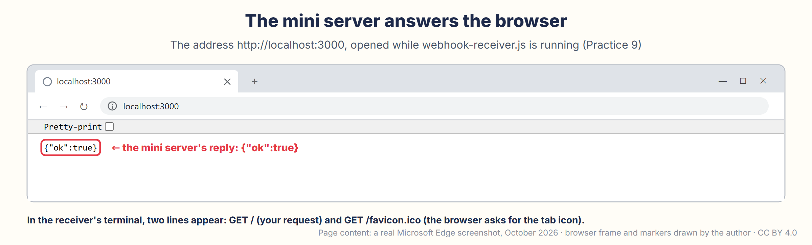

# Module 4 — JavaScript & Node.js from Scratch (the Language for Servers & Dashboards)

🌐 **English** · [Bahasa Indonesia](../../../fase-0-fondasi/modul-04-javascript-nodejs/README.md)

*Phase 0 · Week 4 · Hardware: **not needed** — just a laptop and internet · Prerequisite: **Module 3** · Time: 8–10 hours, spread over a week*

[⬅️ Module 3](../module-03-cpp-for-esp32/README.md) · [Syllabus](../../SYLLABUS.md) · [Progress tracker](../../PROGRESS.md) · [Module 5 ➡️](../../phase-1-esp32-embedded/module-05-gpio-and-pin-map/README.md)

---

For the past three weeks, you have been talking to a **chip** in C++. This week we move to the other end of the cable: to the **laptop and the server**, where the data from the ESP32 will be received, processed, stored, and then displayed. The language is **JavaScript**, and the "engine" that runs it outside the browser is called **Node.js**. Starting in Module 10, your ESP32 sends data to a JavaScript program you wrote yourself. In Module 16, that program grows into a backend (the kitchen behind the scenes), and in Module 22 into a dashboard on your phone. So the language you learn this week will stay with you almost until the end of the curriculum.

The good news: you already know a lot of it from Module 3: variables, `if`, loops, and functions. You only need to learn its "accent". Just four things are truly new: the **terminal** (giving your laptop commands by typing), **waiting without freezing** (`async`/`await`), **npm** (the library store), and the **server** (a program that waits for deliveries). We'll work through all of them slowly, one at a time. By the end of the week, you'll have a sensor statistics script and a mini server saved on GitHub — the last two pieces of evidence you need to complete Phase 0.

![Mini roadmap: Module 4's position as the last module of Phase 0 among the 32 modules, and the six things you do this week without hardware: Quick Win, JavaScript in the browser Console; Practices 1–3, installing VS Code and Node.js, the terminal, then hello.js; Practices 4–5, fake sensor data and statistics; Practices 6–7, waiting with await and a library from npm; Practices 8–9, weather from the internet and a mini server; and Practice 10, saving to GitHub as the Phase 0 checkpoint. A star marks the parts required to pass: statistics, await, the mini server, and saving to GitHub](assets/roadmap-module-04.png)

> [!NOTE]
> **How to use the code and commands in this module.**
>
> - Every code box has a copy button (an icon of two stacked squares) in its top-right corner. Typing the code yourself is still recommended, because your fingers learn too. Pay attention to uppercase and lowercase letters and to punctuation: to JavaScript, `console` and `Console` are two different names.
> - Boxes with **terminal commands** contain only the command. Type or paste it into the terminal, then press **Enter**. Ready signs such as `PS C:\…>`, `%`, or `$` are never included in the command boxes.
> - Boxes introduced by the words **Expected output** are only for comparing, not for typing. Your numbers, dates, and times will certainly be different.
> - All the code is also available as files in the [`code/`](code/) folder.
> - macOS users: replace **Ctrl** with **Cmd** to save, copy, and paste. **Except in the terminal:** stopping a program is still **Ctrl + C**, on a Mac too.

This module follows the same rhythm as Modules 1–3. Open the collapsible sections in 🚨 (click a title to open it) only when you need them; you can skip the collapsible sections in 🔬. Every practice starts with a **🖥️** box that tells you which tool to open.

## Table of contents

1. [🎯 After this module you can…](#-after-this-module-you-can)
2. [🧰 What you need](#-what-you-need)
3. [🏆 Quick Win: your first JavaScript, right in the browser (10 minutes)](#-quick-win-your-first-javascript-right-in-the-browser-10-minutes)
4. [🧠 The "Why" Concepts](#-the-why-concepts)
   - [1 JavaScript & Node.js](#1-javascript-and-nodejs-one-language-two-homes) · [2 Terminal](#2-the-terminal-folders-paths-and-commands) · [3 Variables](#3-variables-and-data-types-let-const-text-numbers-truefalse) · [4 Operators & loops](#4-operators-ifelse-and-loops-almost-the-same-as-c) · [5 Error messages](#5-consolelog-and-how-to-read-nodejs-error-messages) · [6 Functions](#6-functions-and-arrow-functions) · [7 Arrays & objects](#7-arrays-and-objects-lists-and-forms) · [8 JSON](#8-json-the-universal-letter-format) · [9 `map` & `filter`](#9-map-and-filter-processing-a-whole-list-at-once) · [10 Modules & npm](#10-modules-packagejson-and-npm-sharing-code-and-shopping-for-libraries) · [11 Files](#11-reading-and-writing-files) · [12 `await`](#12-waiting-without-freezing-promise-async-and-await) · [13 HTTP](#13-http-letters-between-programs) · [14 C++ vs JavaScript](#14-c-vs-javascript-side-by-side)
5. [🔧 Step-by-step practice](#-step-by-step-practice)
   - [1 VS Code](#practice-1--install-vs-code-and-open-the-learn-iot-folder-2030-minutes-one-time-install) · [2 Terminal](#practice-2--the-terminal-without-fear-your-first-six-commands-20-minutes) · [3 Node.js & `hello.js`](#practice-3--install-nodejs-24-lts-then-run-hellojs-30-minutes-one-time-install) · [4 Fake data](#practice-4--fake-sensor-data-packagejson-and-generate-dummyjs-20-minutes) · [5 Statistics ⭐](#practice-5--sensor-statistics-lowest-highest-average-20-minutes) · [6 `await` ⭐](#practice-6--waiting-for-a-sensor-with-await--and-what-if-await-is-deleted-15-minutes) · [7 npm](#practice-7--a-library-from-npm-a-specific-version-of-dayjs-15-minutes) · [8 Weather](#practice-8--weather-from-the-internet-with-fetch-15-minutes) · [9 Mini server ⭐](#practice-9--a-mini-server-webhook-receiverjs-and-send-datajs-25-minutes) · [10 GitHub ⭐](#practice-10--save-to-github-the-phase-0-checkpoint-15-minutes)
6. [🚨 Troubleshooting](#-troubleshooting)
7. [🔬 Technical Deep Dive (optional)](#-technical-deep-dive-optional)
8. [🧩 Independent Challenges](#-independent-challenges)
9. [➕ Add-on to "Mini Smart Home"](#-add-on-to-mini-smart-home)
10. [📖 Glossary](#-glossary) · [📝 Quiz](#-5-question-quiz) · [✅ Completion checklist](#-module-4-completion-checklist)
11. [📚 Sources & Image Credits](#-sources--image-credits)

---

## 🎯 After this module you can…

- **Open a terminal without fear** and use its ten basic commands (moving between folders, creating folders, running programs, and installing libraries), and stop a program that is running.
- **Write and run JavaScript programs in Node.js** — using `let`/`const`, text, numbers, `true`/`false`, arrays (lists), objects, JSON, functions, `if`, loops, and `map` and `filter`.
- **Understand how to "wait without freezing"** with `Promise`, `async`, and `await`, and **explain what happens if `await` is deleted**.
- **Use npm** to install a library at a specific version, **read and write files**, and **fetch data from the internet** with `fetch`.
- **Build a mini server that "listens"** and prints the JSON sent by another program — direct preparation for Modules 10 and 16.

---

## 🧰 What you need

| What | Details |
| :--- | :--- |
| **Laptop** | Windows 10/11 64-bit, macOS 13.5 (Ventura) or later, or Linux (Ubuntu/Debian/Fedora). Have about 1.5 GB of free space. **No ESP32 board is needed this week.** A Mac stuck on macOS 12 can still follow along with Node.js 22 (see Practice 3.1). |
| **Internet** | The VS Code download is about 250 MB (Windows) or about 580 MB (macOS); Node.js is about 33 MB (Windows) or about 94 MB (macOS). The internet is also used for `npm install` (small) and the weather API in Practice 8. |
| **Browser** | Chrome or Edge (Firefox works too; Safari works after a little setup) for the Quick Win and for viewing JSON data. |
| **The `learn-iot` repository on your laptop + GitHub Desktop** | The clone you made in [Module 3 Practice 9](../module-03-cpp-for-esp32/README.md#practice-9--github-desktop-clone-commit-push-3045-minutes-one-time-setup), usually in `Documents\GitHub\learn-iot`. Linux or macOS 12 users without GitHub Desktop: follow the alternative path explained in Module 3. No copy on your laptop because you uploaded through the browser in Module 3? Practice 1.2 explains what to do. |
| **Administrator rights (Windows)** | The Node.js installer asks for administrator permission once. If your laptop belongs to your office or school and you don't have that permission, ask whoever manages it for help. |

**Versions used in this module:**

| Tool | Version | Notes |
| :--- | :--- | :--- |
| **Visual Studio Code** | **1.141 or later** (at the time of writing: 1.141.0) | Installed in Practice 1. VS Code updates itself regularly, almost every week, so it may look slightly different. |
| **Node.js** | **24 LTS** (at the time of writing: 24.21.0, released September 7, 2026) | Installed in Practice 3. LTS (*Long Term Support*) means a "long-lasting" version that keeps getting fixes — for Node.js 24, until April 2028. |
| **npm** | **11.x** (at the time of writing: 11.19.0) | Installed automatically with Node.js. |
| **dayjs** | **1.11.23** | A date-handling library; installed in Practice 7. |

---

## 🏆 Quick Win: your first JavaScript, right in the browser (10 minutes)

In Module 3, your first program needed Wokwi, the **▶** button, and time spent waiting for the compiler. JavaScript is more relaxed: every browser on your laptop already carries its own JavaScript "interpreter". We'll use that first — without installing anything.

> 🖥️ **Tool used in this section:** the **Chrome** or **Edge** browser on your laptop (Firefox works too; Safari needs a little setup, see step 2). No need to install anything.

1. Open a new tab, type `about:blank` in the address bar, then press **Enter**. A blank white page appears — on purpose, so that no website gets in the way.
2. Press **Ctrl + Shift + J** (macOS: **Cmd + Option + J**). The **DevTools** panel (*developer tools*) opens beside or below the page, directly on the **Console** tab. In Firefox, press **Ctrl + Shift + K** (macOS: **Cmd + Option + K**). If the browser first asks whether you really want to open DevTools, answer yes.

   Safari users (macOS): first turn on **Safari → Settings → Advanced → Show features for web developers**, then press **Cmd + Option + C**. Firefox and Safari look slightly different from the picture below (for example, Firefox marks its input line with `»`), but they work the same way. If your DevTools runs in another language, the tab may have a different name (in Indonesian, for example, **Konsol**).

   The panel looks roughly like this picture. The answer lines only appear after you do steps 3 and 4:

   

3. Click the bottom line of that panel — it has a blue `›` sign and a blinking cursor. That's where you type. **Type** this line (don't paste it; the reason is in the note below), then press **Enter**:

   ```js
   console.log("Hello, JavaScript!")
   ```

   Two lines appear. `Hello, JavaScript!` is your message. The second line, `undefined` (meaning "there's nothing in it"), is the Console's answer to the question "what is the result of the command you just ran?". `console.log` only prints; it doesn't produce any value. Just ignore it.

4. Type the lines in the left column of this table **one at a time**, each followed by **Enter**:

   | You type | The Console answers | What it means |
   | :--- | :--- | :--- |
   | `17 * 365` | `6205` | The calculation is done right away. |
   | `"Ani".toUpperCase()` | `'ANI'` | The text is changed to all capital letters. |
   | `"Ani".length` | `3` | The length of the text: 3 letters. |
   | `new Date().toLocaleString("en-US")` | for example `'10/10/2026, 3:42:10 PM'` | Your laptop's date and time, US style. |
   | `let age = 17` | `undefined` | Stores the number 17 in a "jar" named `age`. |
   | `age * 365 * 24` | `148920` | Roughly how many hours you've been alive. |

5. Finally, something more fun. Type:

   ```js
   alert("Hello! This is my first JavaScript.")
   ```

   The browser shows a message box. Click **OK** to close it.

Congratulations — you just ran JavaScript! There's no **▶** button and no compiler to wait for: every line runs as soon as you press **Enter**. Remember the shape `console.log(…)`; it's JavaScript's `Serial.println`, and you'll use it throughout this module.

Try making two small mistakes before moving on. (1) Type `let 1age = 17` — the variable name deliberately starts with a digit, which isn't allowed (see the naming rules in Concept 3). The Console answers in red: `Uncaught SyntaxError: Invalid or unexpected token` ("there's a sign I don't understand"). In Firefox, the wording of the message is slightly different. (2) Type `Console.log("Hello")` with a capital C. The answer is `Uncaught ReferenceError: Console is not defined` ("I don't know the name `Console`"). Just like C++, JavaScript is case-sensitive. How to read messages like these is covered in Concept 5.

> [!NOTE]
> **Why "type, don't paste"?** If you paste code into the Console, Chrome and Edge show a warning and ask you to type `allow pasting` first. That's a good safeguard, because scammers often tell their victims to paste "magic code" into the Console to break into their accounts. **The rule: never paste code you don't understand, especially code sent by people you don't know.** The code in this section is short, so just type it.

The browser Console is great for trying out a line or two. For real programs — ones that are saved in files, read data, and act as servers — we need **Node.js** and a code editor. That's what Practices 1–3 are about.

---

## 🧠 The "Why" Concepts

Fourteen concepts, one per section — **no need to read them all at once**. Concepts and practices alternate, in this order:

1. Concepts 1–2 → Practices 1–2
2. Concepts 3–5 → Practice 3
3. Concepts 6–11 → Practices 4–5
4. Concept 12 → Practices 6–7
5. Concept 13 → Practices 8–10
6. 🧩 Challenges → ➕ Mini Smart Home → 📝 Quiz → ✅ Checklist

No need to memorize it. At every switching point there's a ➡️ or ☕ box (forward to the practice or the next section) and a ⬆️ box (back to the concepts) with links you can simply click. Concept 14 (the C++ vs JavaScript table) is a summary; open it anytime. Every practice also says which concepts it uses.

> 🖥️ **Want to try the code in the Concepts section?** It's not required — reading is enough, because you'll run all of it yourself in the Practices. If you're curious, you can type short lines (for example `17 === "17"`, `"12" + 5`, or `typeof 28.5`) into the browser Console, as in the Quick Win. Code that uses `import` or files (Concepts 10–11) only works as a file in Node.js, so don't try it in the Console.

### 1. JavaScript and Node.js: one language, two homes

JavaScript was born in 1995 to make web pages "come alive": buttons that react, forms that check their own contents, and so on. That's why **every browser carries a JavaScript engine**, which you just used in the Console. The engine in Chrome and Edge is called **V8**.

In 2009, V8 was taken out of the browser and given abilities that web pages are deliberately not given: reading and writing files on the laptop and opening network "doors" to receive deliveries. The result is called **Node.js**. With Node.js, JavaScript can run on a laptop, on a Raspberry Pi, and on internet servers — without a browser.

So JavaScript has two homes: the browser and Node.js. Add the ESP32, which speaks C++, and the programs in the Mini Smart Home project are spread across three "homes":

![Diagram of the three program homes in the Mini Smart Home project. Left, the ESP32 with the C++ language, which reads sensors, drives the fan and lamp, and sends data (Modules 1–3 and 5–15). Middle, a laptop, Raspberry Pi, or server with JavaScript in Node.js, which receives deliveries, calculates, stores, and gives commands, marked "YOU ARE HERE" (starting this week; Modules 16–21). Right, a browser on a phone with JavaScript, which shows the dashboard, control buttons, charts, and alerts (Modules 22–25). A bracket above the middle and right boxes is labeled JavaScript: one language, two homes. Arrows labeled JSON flow from the ESP32 to the laptop (over Wi-Fi, Module 10) and from the laptop to the phone (Module 22), while thin arrows labeled command flow back. Below, a reminder: JavaScript is not Java](assets/javascript-two-homes.png)

| Place | Language | Its job | Modules |
| :--- | :--- | :--- | :--- |
| ESP32 | C++ | Reads sensors, drives actuators, sends data | 1–3, 5–15 |
| Laptop, Raspberry Pi, server | JavaScript in **Node.js** | Receives, calculates, stores, gives commands | **starting this week**; 16–21 |
| Browser on a laptop or phone | JavaScript in the browser | Shows the dashboard | 22–25 |

Why not just use C++ on the server? You could, but it's much more work. JavaScript is more flexible for handling text and data, has millions of ready-to-use libraries (Concept 10), and — most importantly — **can be used for both the server and the dashboard**. On the other hand, for small chips like the ESP32, C++ is still the first choice: fast, light on memory, and with plenty of examples.

They also run differently. A C++ program must first be **compiled** into a binary file, then uploaded to the chip ([Module 1 Concept 4](../module-01-big-picture-iot/README.md#4-from-code-to-chip-recipe--cook--dish)). A JavaScript program is simply saved as a `.js` file, then run with the command `node file-name.js`. Node.js reads the file and executes it right away, from top to bottom (behind the scenes, V8 translates it on the fly).

> [!TIP]
> **JavaScript is not Java.** The names are similar, but the languages are completely different — like "car" and "carpet". When searching for help on the internet, write "JavaScript" or "Node.js", not "Java".

### 2. The terminal: folders, paths, and commands

So far you've used your laptop by **clicking**: icons, menus, buttons. The terminal is a second way: **typing commands**. The difference is like ordering at a food stall by pointing at the pictures on the menu versus saying your order out loud: "one *nasi goreng* (fried rice), spicy, no crackers". Saying the order is faster, can be repeated exactly, and can be written down for someone else. That's why almost all programming tools — including Node.js — are used through a terminal.

Its name differs on each operating system: **PowerShell** on Windows, **Terminal** on macOS and Linux. You don't need to open it separately, because **VS Code has a terminal built in** (Practice 2).


How to read the terminal screen:

1. ***Prompt*** (the ready sign). An example on Windows: `PS C:\Users\Ani\Documents\GitHub\learn-iot>`. `PS` means PowerShell, followed by **the folder the terminal is currently standing in**, then `>`, which means "ready for a command". On macOS it looks like `ani@MacBook-Air learn-iot %`, and on Linux like `ani@laptop:~/Documents/GitHub/learn-iot$`. (In the picture, the terminal is already standing in the `module-04` folder, so its prompt is longer.)
2. **Command**: what you type after the prompt, then finish with **Enter**.
3. **Output**: the command's answer. Some commands don't answer anything when they succeed — **silence means success**.
4. **A new *prompt*** appears when the command has finished. If no new prompt appears, the program is still running (for example, the server in Practice 9). Stop it with **Ctrl + C**.

**The folder you're standing in.** The terminal always "stands" in one folder (the *working directory*). A command like `node hello.js` looks for the file `hello.js` **in that folder**. The number one beginner mistake is running a command from the wrong folder, so get used to glancing at the prompt before typing.

**The address (*path*).** Every file and folder has a full address, like a home address: province, city, street, house number.

- Windows: `C:\Users\Ani\Documents\GitHub\learn-iot\module-04\hello.js` (the separator is `\`)
- macOS: `/Users/ani/Documents/GitHub/learn-iot/module-04/hello.js` (the separator is `/`)
- Linux: `/home/ani/Documents/GitHub/learn-iot/module-04/hello.js` (the separator is also `/`)

Besides the full path, there's the **relative path**: an address counted from where you're standing. If you're standing in `learn-iot`, the path `module-04` means "the `module-04` folder that's here". Two important shortcuts: `..` means "the folder one level above me" (the parent folder), and `.` means "this folder".

![Folder diagram. Left, the folder tree: C:\Users\Ani (your personal folder), then Documents, GitHub, and learn-iot (the repository cloned in Module 3), which contains module-02, module-03, and module-04 (you are here, Practice 2) with the file hello.js. Top right, how to move: cd module-04 to go from learn-iot into module-04, and cd .. to go back up to the parent. Middle right, the prompt changes too, from PS C:\…\GitHub\learn-iot> to PS C:\…\learn-iot\module-04>. Bottom right, the full path of the module-04 folder on Windows and macOS, and its relative path from learn-iot: just module-04. At the very bottom, the meaning of .. (parent folder) and . (this folder), and a tip to avoid spaces in folder names](assets/folder-map.png)

These **ten commands** are enough for the whole module. They all work in PowerShell, the macOS Terminal, and the Linux Terminal; only their output looks slightly different.

| No. | Command | What it means | Used in |
| :---: | :--- | :--- | :--- |
| 1 | `pwd` | "Which folder am I standing in?" (*print working directory*) | Practice 2 |
| 2 | `ls` | "What's in this folder?" (*list*) | Practice 2 |
| 3 | `mkdir folder-name` | Create a new folder (*make directory*). | Practice 2 |
| 4 | `cd folder-name` | Go into a folder (*change directory*). | Practice 2 |
| 5 | `cd ..` | Go up one level to the parent folder. | Practice 2 |
| 6 | `clear` | Clear the terminal screen. | Practice 2 |
| 7 | `node -v` and `npm -v` | Show the versions of Node.js and npm — which also confirms that both are installed. | Practices 2–3 |
| 8 | `node file-name.js` | Run a JavaScript program. | Practices 3–9 |
| 9 | `npm init -y` | Create the "project ID card" (`package.json`). | Practice 4 |
| 10 | `npm install name@version` | Install a library from npm. | Practice 7 |

There are also three keyboard tricks:

- **Ctrl + C** — stop the program that is running (on a Mac it's also **Ctrl**, not **Cmd**). In the terminal, **Ctrl + C** with no text selected means "stop", not "copy".
- **↑** (up arrow) — bring back the previous command. Press it several times to go further back, then press **Enter**.
- **Tab** — complete a file or folder name automatically. Type its first few letters, then press **Tab**.

Three good habits: **avoid spaces in file and folder names** (use hyphens, for example `module-04`; if a space can't be avoided, wrap the path in quotation marks: `cd "My Folder"`); **type uppercase and lowercase letters exactly** (Windows forgives you, Linux doesn't); and **read the message before you panic** — the terminal almost always tells you what went wrong.

> ➡️ **Time to practice.** First do [Practice 1](#practice-1--install-vs-code-and-open-the-learn-iot-folder-2030-minutes-one-time-install) and [Practice 2](#practice-2--the-terminal-without-fear-your-first-six-commands-20-minutes), then come back here for [Concept 3](#3-variables-and-data-types-let-const-text-numbers-truefalse).

### 3. Variables and data types: `let`, `const`, text, numbers, `true`/`false`

Remember the labeled jars from Module 3? In JavaScript the jars are the same, but you **don't need to write what kind of content they hold**. JavaScript works out the kind of content by itself:

```js
const name = "Ani"; // text: always wrapped in quotation marks
let age = 17; // a number
let temperature = 28.5; // also a number: whole numbers and fractions aren't told apart
let motionDetected = false; // yes/no: true or false
```

The semicolon `;` at the end of a line is optional (we didn't write it in the Console earlier). This curriculum always writes it, just like in C++.


**`const` or `let`?**

- `const` (from *constant*) is a jar with a glued lid: its content can't be replaced. If you try to replace it (`name = "Budi";`), Node.js stops with the message `TypeError: Assignment to constant variable.`
- `let` is an ordinary jar: its content can be replaced at any time, simply by using its name without `let` again, for example `age = 18;`.
- **Rule of thumb: use `const` first.** Change it to `let` only if its content really will change, for example a counter or a running total. Old tutorials use `var`; don't copy them (see 🚨).

**Three basic data types.** You can check what kind of content a jar holds with `typeof`; for example, `typeof 28.5` gives `'number'`.

| Type | Examples | Notes |
| :--- | :--- | :--- |
| text (***string***) | `"Ani"`, `"28.5"` | Wrapped in double or single quotation marks. This curriculum uses **double quotes**, just like C++ and JSON. Careful: `"28.5"` in quotation marks is **text**, not a number. |
| number (***number***) | `17`, `28.5`, `-6.2` | One type for both whole numbers and fractions, so `7 / 2` gives `3.5` (in C++ with `int`, the result is `3`). The decimal separator is a **point**, not a comma. |
| true/false (***boolean***) | `true`, `false` | For yes/no answers, for example "is there motion?". |

**Template strings.** If text is wrapped in *backticks* — the backward quote mark `` ` ``, whose key is at the top left of the keyboard, below **Esc** — you can insert values into it with `${…}`:

```js
console.log(`I'm ${age} years old, or about ${age * 365} days.`);
// result: I'm 17 years old, or about 6205 days.
```

Compare that with the Module 3 way of joining text with `+` over and over. Shorter, isn't it?

**Empty jars.** A variable that hasn't been filled has the value `undefined` ("nothing in it yet") — the same word that appeared in the Console earlier. There's also `null`, which means "deliberately left empty". For now, just recognize the names.

**Naming rules** are the same as in Module 3: no spaces, don't start with a digit, uppercase and lowercase letters are different, and use the *camelCase* style (every word after the first starts with a capital letter): `motionDetected`, `buildTelemetry`, `readSensorSlowly`.

### 4. Operators, `if`/`else`, and loops: almost the same as C++

Good news: you **already know** almost everything in this section from Module 3. The arithmetic signs (`+ - * / %`), comparisons (`< > <= >=`), and logic (`&& || !`) are exactly the same. `if`/`else` and the `for` and `while` loops are also the same; the only difference is that `int` is replaced by `let`:

```js
const temperature = 31.5;

if (temperature > 30) {
  console.log("Hot! Turn on the fan.");
} else if (temperature < 20) {
  console.log("Cold.");
} else {
  console.log("Comfortable.");
}

for (let i = 1; i <= 3; i++) {
  console.log("Blink #" + i); // Blink #1, Blink #2, Blink #3
}
```

There are **two differences** you must remember.

**First, "equals" is written with three signs: `===`.** JavaScript has two kinds of "equals" comparison:

| Written | Result | Why |
| :--- | :--- | :--- |
| `17 == "17"` | `true` | `==` (two signs) quietly converts the type first, then compares. It's often misleading. |
| `17 === "17"` | `false` | `===` (three signs) compares the content **and** the type: the number 17 is not the same as the text `"17"`. |

**Always use `===` and `!==`** (not equal). In all the JavaScript code in this curriculum, `==` is never used.

One more trap is the `+` sign. If either side is text, `+` **joins** instead of adding: `"12" + 5` gives `"125"`, while `"12" * 5` gives `60`. When in doubt, turn text into a number with `Number("12")`.

**Second, there's a "for each item" loop: `for…of`.** To process every item in a list, JavaScript has a form that's easier to read than `for (let i = 0; …)`:

```js
const temperatures = [28.5, 31.2, 27.9];

for (const temperature of temperatures) {
  console.log(temperature); // 28.5, then 31.2, then 27.9
}
```

Read it as: "**for each** `temperature` **of** `temperatures`, do what's inside the curly braces". The word used is `of`. There's also `for…in`, but that's for something else — don't mix them up.

### 5. `console.log` and how to read Node.js error messages

`console.log` is JavaScript's `Serial.println`. It can print several values at once: separate the values with commas, and the spaces between them are added automatically.

```js
const temperature = 28.5;
console.log("Temperature:", temperature, "°C"); // result: Temperature: 28.5 °C
```

The most powerful debugging technique (finding the cause of a mistake) for beginners is still the same as in Module 3: **print the contents of your variables at suspicious points**, then compare them with what you expected.

There are two kinds of errors in JavaScript:

1. **Grammar errors** (`SyntaxError`), for example a missing quotation mark or parenthesis. Node.js checks the grammar of the whole file **before** running it, so **not a single line runs**. It's similar to a compiler error in Module 3.
2. **Runtime errors**, for example `ReferenceError` (an unknown name) or `TypeError` (a type that doesn't fit). The program has already run up to that line, then it stops. **The lines before it have already been executed.**

Node.js error messages usually follow the same pattern. The following example — which you'll create yourself in Practice 3.4 — appears when `name` is deliberately mistyped as `nme`:

![Anatomy of a Node.js error message with five markers on the real output: 1, the path of the file hello.js and line number 8; 2, a copy of line 8 with a ^ sign under the word nme; 3, the error type and message ReferenceError: nme is not defined, the most important line; 4, the call trace starting with at, where hello.js:8:29 is the line pointing to your file and the node:internal lines can be ignored; 5, the Node.js version v24.21.0 on the last line. Above it, the line Hello, Node.js! that had already been printed](assets/node-error-anatomy.png)

How to read it, from the top:

1. **The file path and line number.** `…\module-04\hello.js:8` means line 8 in the file `hello.js`. (Later, once `package.json` contains `"type": "module"` in Practice 4, the paths of all `.js` files — including `hello.js` — start with `file:///`; the meaning is the same.)
2. **A copy of that line**, with a `^` sign under the spot where the problem is.
3. **The error type and its message** — the most important line. `ReferenceError: nme is not defined` means "I don't know the name `nme`".
4. **The call trace** (*stack trace*), the lines that start with `at`. Look for the one that mentions your file name: `hello.js:8:29` means line 8, column 29. Lines that mention `node:internal` are Node.js's own internals — ignore them. For errors from Node.js's built-in functions (for example `ENOENT` or `fetch failed`), the top line actually points inside Node.js (`node:internal/…`), not to your file. Don't be confused; just read the error type line. For `ENOENT`, your file is only mentioned on the `at async file:///…` line; for `fetch failed`, your file isn't mentioned at all, so read its `[cause]` part (Practice 9).
5. **The Node.js version** on the last line. Include it when you ask for help.

Three kinds of errors you'll run into most often this week:

| Type | What it means | Example cause |
| :--- | :--- | :--- |
| `SyntaxError` | The grammar is wrong. | Quotation marks, parentheses, or curly braces that don't come in pairs. |
| `ReferenceError` | There's a name it doesn't know. | A typo (`nme`), the wrong uppercase/lowercase (`Console`), or a variable that hasn't been created. |
| `TypeError` | The type doesn't fit what you're doing. | Replacing the content of a `const`, or taking a field from something that is `undefined`. |

When asking other people or an AI for help, **copy the text of the message**; don't photograph the screen. Here's how: highlight the text with the mouse, then press **Ctrl + C** (Windows), **Cmd + C** (macOS), or **Ctrl + Shift + C** (Linux).

> ☕ **Break point.** Concepts 3–5 prepare you for [Practice 3](#practice-3--install-nodejs-24-lts-then-run-hellojs-30-minutes-one-time-install). Do it first, then come back here for [Concept 6](#6-functions-and-arrow-functions).

### 6. Functions and *arrow functions*

Functions in JavaScript are the same as the "recipes" in Module 3, just without a type in front of the name and the parameters:

```js
function average(list) {
  let total = 0;
  for (const number of list) {
    total = total + number;
  }
  return total / list.length; // list.length = the number of items in the list
}

console.log(average([28.5, 31.2, 27.9])); // 29.2
```

Compare it with C++: in Module 3 Practice 5 you wrote `float computeAverage(float data[], int count)`. In JavaScript there's no `float`, no `void`, and you can ask a list how many items it has directly with `.length`.

Parameters can have **default values**: with `function greet(name = "friend")`, calling `greet()` with nothing inside makes `name` equal to `"friend"`. You'll meet default values in `generate-dummy.js`.

***Arrow functions*** are a short way to write small functions:

```js
const timesTwo = (x) => x * 2; // same as: function timesTwo(x) { return x * 2; }
console.log(timesTwo(21)); // 42
```

Read `(x) => x * 2` as "**from** `x`, **produce** `x * 2`". Arrow functions are often handed to other functions to be run later, for example to `map` and `filter` (Concept 9) or to `setTimeout(() => { … }, 2000)`, which means "run what's inside these curly braces 2 seconds from now" (Concept 12). A function handed over like this is called a callback (a function to be "called back" later).

### 7. Arrays and objects: lists and forms

An ***array*** (list) in JavaScript is like the row of drawers in Module 3 — its index also starts at 0 — but its size is **not fixed**: you can add items to it at any time.

```js
const temperatures = [28.5, 31.2, 27.9];
console.log(temperatures[0]); // 28.5 (first drawer = index 0)
console.log(temperatures.length); // 3
temperatures.push(30.1); // add one item at the end
console.log(temperatures); // [ 28.5, 31.2, 27.9, 30.1 ]
```

Wait, `temperatures` is a `const` — so how can items be added to it? `const` only locks **which list** the name points to, not the contents of the list. So adding items is allowed, but replacing the whole list (`temperatures = [1, 2];`) is not.

An **object** is a "form": a set of **keys** (field names) together with their **values** (field contents). It's similar to a `struct` in Module 3, but you don't need to design the form first — just write it:

```js
const reading = { temperature: 28.5, humidity: 71, motion: false };
console.log(reading.temperature); // 28.5 (get a field's content with a dot)
reading.temperature = 29.4; // replace a field's content
reading.light = 412; // add a new field
console.log(reading); // { temperature: 29.4, humidity: 71, motion: false, light: 412 }
```

Combine the two and you get a **list of forms** — the most common shape of sensor data. Each form is one reading; the whole list is a record over time.

```js
const records = [
  { ts: "2026-10-09T09:41:30Z", temperature: 28.5 },
  { ts: "2026-10-09T09:41:40Z", temperature: 28.7 },
];
console.log(records[1].temperature); // 28.7 (second form, temperature field)
```

Notice the comma after the last form: it's allowed in JavaScript, but not in JSON (Concept 8).

### 8. JSON: the universal letter format

The ESP32 speaks C++, the server speaks JavaScript, and the database has a language of its own. For them to exchange data, they need a **letter format** that every party understands. That format is called **JSON** (*JavaScript Object Notation*): plain text shaped like a JavaScript object. You already met JSON briefly in Module 3 (ArduinoJson).

Here's the letter that **Node 1** will send every 10 seconds. (Node 1 "Home" is the first ESP32 device in the Mini Smart Home project, introduced in Module 1. It has nothing to do with Node.js; the names just happen to be similar.) Its shape is set by our project's **data contract**, exactly as written in [Syllabus Appendix A](../../SYLLABUS.md#14-appendix-a--mini-smart-home-data-contract):

```json
{ "ts": "2026-10-09T09:41:30Z", "fw": "1.0.0", "temperature": 28.5, "humidity": 71, "light": 412, "soil": 37, "motion": false, "water_level": 64 }
```

| Key | What it holds |
| :--- | :--- |
| `ts` | The timestamp of the reading in UTC, the world's reference time. The letter `Z` at the end means UTC; WIB (Western Indonesia Time) = UTC + 7 hours. |
| `fw` | The version of the firmware (the program on the chip) that sent it. |
| `temperature` | Air temperature, in °C. |
| `humidity` | Air humidity, in percent. |
| `light` | Light level: a number from `0` to `4095` (covered in Module 6). |
| `soil` | Soil moisture, in percent. |
| `motion` | Whether there's motion: `true` or `false`. |
| `water_level` | How full the water tank is, in percent. |

JSON is **stricter** than a JavaScript object. Its five rules:

1. Keys **must** be wrapped in double quotes: `"temperature"`, not `temperature`.
2. Text may only use **double quotes**, not single quotes.
3. **No comma** after the last item.
4. **No comments** (`// …`).
5. The content may only be text, numbers, `true`/`false`, `null`, arrays, and objects.

JavaScript has two built-in "translators" that turn an object into a letter, and back again:

```js
const reading = { temperature: 28.5, motion: false };

const letter = JSON.stringify(reading); // object -> JSON text: {"temperature":28.5,"motion":false}
const back = JSON.parse(letter); // JSON text -> an object again
console.log(back.temperature); // 28.5
```

![Diagram of an object and JSON. Left, a JavaScript object in the program's memory, drawn as a form with the fields temperature 28.5 and motion false. Right, the JSON text {"temperature":28.5,"motion":false} inside an envelope, ready to be sent or stored. The top arrow, labeled JSON.stringify, turns the object into text; the bottom arrow, labeled JSON.parse, turns the text back into an object. Below, the five JSON rules: keys in double quotes, text in double quotes, no comma at the end, no comments, and the allowed content](assets/object-vs-json.png)

`JSON.stringify(object, null, 2)` produces neat text: one key per line, indented 2 spaces. In the other direction, if the text you give `JSON.parse` breaks the rules — for example `JSON.parse("{temperature: 28.5}")` — the result is `SyntaxError: Expected property name or '}' in JSON at position 1 (line 1 column 2)`. It means: "at position 1 (the second character), I expected a key name in double quotes".

Why does `ts` use UTC and not WIB? Because devices can be in any time zone, and a single reference makes the data easy to compare. The time is converted to local time only when it's **shown** to humans; you'll do that in Practice 7.

### 9. `map` and `filter`: processing a whole list at once

These two tools process every item in an array without you writing a loop yourself. Both take an arrow function, and both produce a **new list**; the original list doesn't change.

- **`map`** is a transforming machine. Each item goes into the arrow function, and the results are collected. The new list has the **same** number of items as the original list.
- **`filter`** is a sieve. Only the items for which the arrow function answers `true` get through, so the new list can be **shorter**.

```js
const readings = [
  { temperature: 28.5, motion: false },
  { temperature: 31.2, motion: true },
  { temperature: 27.9, motion: false },
  { temperature: 30.6, motion: false },
];

const temperatures = readings.map((r) => r.temperature); // take only the temperatures
const hot = readings.filter((r) => r.temperature > 30); // keep those above 30

console.log(temperatures); // [ 28.5, 31.2, 27.9, 30.6 ]
console.log(hot.length); // 2
console.log(Math.max(...temperatures)); // 31.2
```

![Diagram of map and filter on four reading cards with the temperatures 28.5, 31.2, 27.9, and 30.6. Top lane: all four cards go into the map transforming machine with the rule (r) => r.temperature and come out as just four numbers, 28.5, 31.2, 27.9, and 30.6; four in, four out. Bottom lane: all four cards go into the filter sieve with the rule (r) => r.temperature > 30; only the 31.2 and 30.6 cards get through and form a new list of 2 readings, while the 28.5 and 27.9 cards are held back under the sieve and marked with a cross](assets/map-filter.png)

The last line uses two new things. `Math.max()` finds the largest number, and its partner, `Math.min()`, finds the smallest. The three dots `...` (*spread*) mean "pour out every item of this list as separate ingredients", because `Math.max` wants the numbers written one by one, like `Math.max(28.5, 31.2, 27.9, 30.6)`, not given as one whole list.

The letter `r` in `(r) => r.temperature` is just a temporary name for "the one reading being processed". You can replace it with another name, for example `(one) => one.temperature`.

### 10. Modules, `package.json`, and npm: sharing code and "shopping" for libraries

**JavaScript modules: sharing functions between files.** A big program is split into several files. A file that wants to share marks its functions with `export`, and other files take them with `import`:

```js
// in generate-dummy.js
export function buildTelemetry() { … }

// in wait.js
import { buildTelemetry } from "./generate-dummy.js";
```

`./` means "in the same folder as this file", and the `.js` ending must be written. Note: for `import` only, a relative path is counted from **the folder of the file itself**, not from the folder the terminal is standing in as in Concept 2 (the paths of data files in Concept 11 go back to following the Concept 2 rule). Node.js also has built-in modules whose names start with `node:`, for example `node:fs/promises` for files (Concept 11) and `node:http` for servers (Concept 13).

**`package.json`: the project's ID card.** Every Node.js project has one `package.json` file in its main folder. It holds the project's identity (name and version), **the list of libraries it needs**, and one important setting: `"type": "module"`, which means "this project uses `import`/`export`". If that line says `"commonjs"` — what `npm init -y` writes by default — Node.js treats your project as old-style (CommonJS, which uses `require`) and rejects `import` with the message `SyntaxError: Cannot use import statement outside a module`. If the line is missing altogether, Node.js guesses the style by itself while printing a long warning (see 🚨). This file is created with `npm init -y` in Practice 4.

**npm: a store and courier for libraries.** The npm program (*Node Package Manager*) is installed along with Node.js. Behind it is a warehouse holding millions of library packages made by people all over the world. When you type `npm install dayjs@1.11.23` (Practice 7), three things happen:

1. The library is downloaded into the **`node_modules/`** folder, your project's "kitchen cupboard". It can hold hundreds of files; don't change them and **don't commit them**.
2. `package.json` records `"dayjs": "^1.11.23"` in its `dependencies` section. This is the **shopping list**. The `^` sign means "version 1.11.23 or a newer 1.x version".
3. A **`package-lock.json`** file is created. This is the **receipt**: the exact version that was actually installed. This file is committed too, so that everyone gets the same version. It's the receipt that truly **locks** the version, so don't delete it.

Because the shopping list and its receipt are saved, `node_modules/` can be recreated at any time: anyone who takes your project just runs `npm install`. That's why we write `node_modules/` in the `.gitignore` file (the list of files that Git deliberately doesn't track).

![Diagram of shopping for a library with npm, numbered 1–3 in the order of Concept 10. Top center, the command npm install dayjs@1.11.23, which records dayjs in package.json and fetches the package from the npm warehouse cloud on the internet. Left, package.json (number 2) as a shortened shopping list containing "type": "module" and the dependency dayjs ^1.11.23, marked as committed. Top right, the node_modules folder (number 1) as a kitchen cupboard that can hold hundreds of files, marked "DON'T commit" because it's listed in .gitignore. Bottom right, package-lock.json (number 3) as the receipt that records exactly dayjs 1.11.23, marked as committed. Bottom note: a friend who clones your project just runs npm install to refill the cupboard](assets/npm-shopping-list.png)

> [!WARNING]
> **Shop carefully.** Anyone can publish a package on npm. In September 2025, for example, several very popular packages were infected with malicious code for a few hours after their authors' accounts were hacked. Four safe habits: (1) install **only what you need**; (2) **check the spelling of the name**, because scammers deliberately create packages with similar names, for example `dayjss`; (3) choose packages that are well known and still maintained; (4) **pin the version**, as every module of this curriculum does. The message `found 0 vulnerabilities` at the end of `npm install` means npm didn't find any known security holes.

### 11. Reading and writing files

Node.js can read and write files on your laptop through the built-in module `node:fs/promises` (`fs` = *file system*):

```js
import { readFile, writeFile, mkdir } from "node:fs/promises";

await mkdir("data", { recursive: true }); // create the data folder (no complaint if it already exists)
await writeFile("data/notes.txt", "Hello from Node.js"); // write text to a file (the old content is overwritten!)
const content = await readFile("data/notes.txt", "utf8"); // read the file as text
console.log(content); // Hello from Node.js
```

Three things to watch out for:

- **`"utf8"`** means "read it as text". Without it, what you get is raw numbers (bytes).
- **`writeFile` overwrites** the content of an existing file without asking.
- **A relative path is counted from the folder the terminal is standing in**, not from the folder where the `.js` file is saved. `"data/notes.txt"` means "the file `notes.txt` inside the `data` folder, in the place where the terminal is standing". That's why every practice is run from the `module-04` folder. If the terminal is standing in another folder, the result is `Error: ENOENT: no such file or directory`. `ENOENT` is short for *Error NO ENTry*: "there's no such file or folder". (This rule applies to data file paths, as in `readFile` and `writeFile`. A path in `import` is always counted from the location of the `.js` file itself, as in Concept 10.)

So what does the `await` in front of every line mean? Reading and writing files takes time — very little, but it still has to be waited for. For now, read `await` as "**wait until this is done, then continue**". The next concept takes it apart.

> ☕ **Break point.** Concepts 6–11 prepare you for [Practice 4](#practice-4--fake-sensor-data-packagejson-and-generate-dummyjs-20-minutes) and Practice 5. Do them first, then come back here for [Concept 12](#12-waiting-without-freezing-promise-async-and-await).

### 12. Waiting without freezing: `Promise`, `async`, and `await`

Many program tasks take time: reading a sensor over the network, fetching weather data from the internet, or waiting for a delivery from the ESP32. In Module 3, the way to wait was `delay(2000)`, and during those 2 seconds **the whole chip froze**: it couldn't read a button, couldn't do anything. For a server, freezing is a disaster. Imagine a server that can't serve anyone while it waits for one sender!

JavaScript has a different way of waiting. Imagine **ordering food at a *food court***:

1. You order at the cashier. Your food isn't ready yet, so the cashier gives you a **buzzer** (a vibrating pager) — a **promise** that your food will follow.
2. You don't stand frozen in front of the cashier. You sit down, chat, or order a drink. The cashier is also free to serve the next customer.
3. When the buzzer vibrates, you pick up your food.

![Diagram of the food court analogy in two timelines, from 0 to 2 seconds. Top lane, WITH await, the code const result = await readSensorSlowly(): you receive a buzzer (Promise), the next line waits while Node.js stays free to serve others, then after 2 seconds the buzzer vibrates and you pick up { temperature: 28.5 }, so 28.5 is printed. Bottom lane, WITHOUT await: all you hold is the buzzer, and the next line runs immediately; console.log(result) prints Promise { <pending> }, a promise that is still waiting, and console.log(result.temperature) prints undefined because a buzzer has no temperature field. The food that's ready 2 seconds later is picked up by no one](assets/async-food-order.png)

In JavaScript, that buzzer is called a **`Promise`**. A `Promise` has three states: **waiting** (*pending*), **kept** (*fulfilled*: the food is ready), or **refused** (*rejected*: "sorry, that dish is sold out" — it turns into an error). The word **`await`** means "wait until this promise is kept, take its result, and only then move on to the next line". While it waits, Node.js **doesn't freeze**; it's free to handle other work (the proof is in 🔬).

```js
function readSensorSlowly() {
  return new Promise((resolve) => {
    setTimeout(() => {
      resolve({ temperature: 28.5 }); // 2 seconds later: the promise is kept, its result is handed over
    }, 2000);
  });
}

const result = await readSensorSlowly(); // wait for the promise, take its result
console.log(result.temperature); // 28.5 (appears after 2 seconds)
```

`setTimeout(function, 2000)` means "run this function 2,000 milliseconds (2 seconds) from now". The difference from `delay`: `setTimeout` is like setting a kitchen timer and then going off to do something else, rather than standing over the timer until it rings.

**What if `await` is deleted?** This is one of the completion requirements, so understand it well:

```js
const result = readSensorSlowly(); // without await
console.log(result); // Promise { <pending> }
console.log(result.temperature); // undefined
```

1. `result` holds **the buzzer**, not the food: `Promise { <pending> }`, a promise that is still waiting.
2. The following lines **run immediately without waiting**, so the order of events gets mixed up.
3. Code that uses the result goes wrong too: `result.temperature` is `undefined` because a buzzer has no `temperature` field.

**`async`: permission to use `await` inside a function.** `await` may be written directly in the body of a file (as in the example above; the condition is that the project uses `"type": "module"`) or inside a function marked `async`:

```js
async function getWeather() {
  const reply = await fetch("https://api.open-meteo.com/…"); // see Practice 8
  return await reply.json();
}
```

Forgot to write `async`? Node.js refuses with `SyntaxError: Unexpected reserved word` ("the special word `await` is used in the wrong place"). One more thing: an `async` function **always** returns a promise, so its caller has to wait too, for example `const data = await getWeather();`.

> ➡️ **Time to practice again.** Do [Practice 6](#practice-6--waiting-for-a-sensor-with-await--and-what-if-await-is-deleted-15-minutes) and Practice 7, then come back here for [Concept 13](#13-http-letters-between-programs).

### 13. HTTP: letters between programs

Programs in two different places — or two programs on one laptop — talk through **HTTP**. There are two roles:

- **Client** (the asker): the side that starts the conversation. Examples: a browser, the `fetch` command in JavaScript, and — starting in Module 10 — your ESP32.
- **Server** (the answerer): the side that waits and answers. Examples: the Open-Meteo site in Practice 8 and the `webhook-receiver.js` you'll write in Practice 9.

Remember the analogy in the Syllabus: an **API** (*Application Programming Interface*) is like a **restaurant waiter**. You don't go into the kitchen; you give your order in a set format, and the waiter brings you the result. Every HTTP exchange consists of **one request** and **one response**, like a letter and its reply:

| Part | In the request | In the response |
| :--- | :--- | :--- |
| Kind of letter | ***Method***: `GET` (ask for data) or `POST` (send data) | ***Status code***: `200` (all good), `404` (the address doesn't exist), `500` (the server has a problem) |
| Envelope label | ***Headers***, for example `Content-Type: application/json` = "the content is JSON" | ***Headers*** |
| Letter content | ***Body***, for example one sensor reading in JSON (for `POST`) | ***Body***, for example `{"ok":true}` |

![Diagram of HTTP letters between two programs on one laptop. Left, send-data.js as the client (the asker), which runs fetch; starting in Module 10, the ESP32 does the sending. Top center, the request envelope: method POST, path /telemetry, headers Content-Type: application/json, and a body containing one sensor reading in JSON. Right, webhook-receiver.js as the server (the answerer), which stands guard at counter 3000, prints what was sent, then replies. Bottom center, the response envelope: status 200 OK, headers Content-Type: application/json, and the body {"ok":true}. Below, the anatomy of the address http://localhost:3000/telemetry: http:// is the protocol, localhost means this computer itself, 3000 is the port number or counter, and /telemetry is the path. Note: 404 means the address doesn't exist and 500 means the server has a problem](assets/http-letters.png)

**Reading an address (URL).** Take `http://localhost:3000/telemetry` as an example:

- `http://` — the protocol (the "language of the letter"). `https://` is the version whose content is encrypted (covered in Module 27).
- `localhost` — the name of the destination computer. **`localhost` always means "this computer itself".**
- `3000` — the **port** number, like a counter number at a post office. One computer has 65,535 counters; every server program occupies one counter, and **one counter is for one program only**.
- `/telemetry` — the path (similar to a folder path in Concept 2): which part is being addressed.

The weather API address in Practice 8 has an extra part after the `?` sign: the **parameters**, `?latitude=-6.2&longitude=106.85`. They are `key=value` pairs joined with `&`.

In Node.js, the client role is played by `fetch` (built in, no library needed), while a server is made with the `node:http` module. A server set up specifically to **receive news from other programs** is called a ***webhook***. That's `webhook-receiver.js`: in Practice 9 it receives deliveries from another script on your laptop, and in Module 10 from the ESP32 over Wi-Fi.

> ➡️ **Time to practice.** Do [Practice 8](#practice-8--weather-from-the-internet-with-fetch-15-minutes) through Practice 10. Concept 14 below is a summary table; open it anytime.

### 14. C++ vs JavaScript side by side

Keep this table handy; it's useful when you switch back and forth between the Arduino IDE and VS Code and start "mixing up your accents".

| Item | C++ (ESP32, Module 3) | JavaScript (Node.js, Module 4) |
| :--- | :--- | :--- |
| Comment | `// note` | `// note` (the same) |
| Creating a variable | `int age = 17;` · `float temperature = 28.5;` | `let age = 17;` · `let temperature = 28.5;` (no type) |
| Constant | `const int PIN_LED = 4;` | `const PIN_LED = 4;` |
| Whole numbers and fractions | `int` and `float` are different; `7 / 2` = `3` | a single `number` type; `7 / 2` = `3.5` |
| Text | `String name = "Ani";` | `const name = "Ani";` |
| Inserting a value into text | `"Age " + String(age)` | `` `Age ${age}` `` |
| Printing | `Serial.println(x);` | `console.log(x);` |
| Equal / not equal | `==` / `!=` | `===` / `!==` |
| `if`, `for`, `while` | `if (…) { … }` · `for (int i = 0; …)` | the same, only `int` is replaced by `let`: `for (let i = 0; …)` |
| Processing every item in a list | `for (int i = 0; i < 7; i++) { … temperature[i] … }` | `for (const t of list) { … }` |
| Function | `float average(float a, float b) { … }` | `function average(a, b) { … }` or `(a, b) => …` |
| List | `float temperature[3] = {28.5, 31.2, 27.9};` (fixed size) | `const temperatures = [28.5, 31.2, 27.9];` (can `push`) |
| Group of data | design it first: `struct SensorReading { … };` | write it directly: `{ temperature: 28.5, humidity: 71 }` |
| JSON | the ArduinoJson library | built in: `JSON.stringify` and `JSON.parse` |
| Using other people's code | `#include <ArduinoJson.h>` + **Library Manager** | `import dayjs from "dayjs";` + `npm install` |
| Waiting | `delay(2000);` — the whole chip stops | `await` + `setTimeout` — waiting without freezing |
| From code to running | compile → upload → `setup()` once, `loop()` forever | `node file.js` → executed from top to bottom, then it ends (except servers) |
| Where it runs | the ESP32 chip | laptop, Raspberry Pi, server; also the browser |
| Semicolon `;` | required | recommended; always written in this curriculum |

---

## 🔧 Step-by-step practice

Ten practices, **in order** — each practice uses the result of the one before it. The practices marked ⭐ in the table of contents are required: **5** (statistics), **6** (`await`), and **9** (mini server) are this module's completion requirements, while **10** (saving to GitHub) is the evidence for the Phase 0 completion criteria. All the files are written in one folder, `learn-iot/module-04`, which at the end of the module contains:

```text
learn-iot/
└── module-04/
    ├── data/
    │   └── readings.json      ← created by generate-dummy.js (Practice 4)
    ├── node_modules/          ← created by npm (Practice 7); not committed
    ├── .gitignore             ← Practice 7
    ├── generate-dummy.js      ← Practice 4
    ├── hello.js               ← Practice 3
    ├── mini-server.png        ← Practice 10 (screenshot)
    ├── package-lock.json      ← Practice 7
    ├── package.json           ← Practice 4 (dayjs added in Practice 7)
    ├── send-data.js           ← Practice 9 ⭐
    ├── statistics.js          ← Practice 5 ⭐
    ├── time.js                ← Practice 7
    ├── wait.js                ← Practice 6 ⭐
    ├── weather.js             ← Practice 8
    └── webhook-receiver.js    ← Practice 9 ⭐
```

### Practice 1 — Install VS Code and open the `learn-iot` folder (20–30 minutes, one-time install)

> 🖥️ **Tools used:** a browser to download, then the **Visual Studio Code** app. The download is about 250 MB (Windows) or about 580 MB (macOS). Concepts used: 1 and 2.

**Visual Studio Code** (**VS Code** for short) is a free code editor made by Microsoft — the "Arduino IDE" of JavaScript, but usable for almost any language. It colors your code so it's easy to read, flags some typos, and has a terminal built in. You'll still use the Arduino IDE for the ESP32; the two live side by side.

#### 1.1 Download and install VS Code

**Windows**

1. Go to **https://code.visualstudio.com/download**, then click the **Windows** button. A file with a name like `VSCodeUserSetup-x64-1.141.0.exe` downloads to your *Downloads* folder.
2. Double-click that file. The *installer* opens on the **License Agreement** screen. Choose **I accept the agreement**, then click **Next**.
3. On the **Select Destination Location** and **Select Start Menu Folder** screens, leave the default choices, then click **Next** on each screen.
4. On the **Select Additional Tasks** screen, check **all** the boxes:
   - **Create a desktop icon** — a VS Code icon on the desktop.
   - **Add "Open with Code" action to Windows Explorer file context menu** and **Add "Open with Code" action to Windows Explorer directory context menu** — so you can right-click a file or folder, then choose **Open with Code**.
   - **Register Code as an editor for supported file types** — VS Code also appears in the **Open with** choices for code files such as `.js`. (Already checked.) Note: don't double-click a `.js` file in File Explorer. The Windows default for `.js` is *Windows Script Host*, which would run it and show an error message. Always open `.js` files through VS Code.
   - **Add to PATH (requires shell restart)** — so that the terminal recognizes the `code` command. (Already checked.)
5. Click **Next**, then **Install**. Wait until the **Completing the Visual Studio Code Setup Wizard** screen appears. Leave **Launch Visual Studio Code** checked, then click **Finish**.

**macOS**

1. Go to **https://code.visualstudio.com/download**, then click the **Mac Universal** button (some layouts just say **Mac**). This Universal version works on Macs with Apple chips as well as Intel chips.
2. Open your *Downloads* folder and double-click the downloaded file (`.zip` or `.dmg`). Drag the **Visual Studio Code** app that appears into the *Applications* folder.
3. Open VS Code from *Applications* or Launchpad. If macOS warns you that this app was downloaded from the internet, click **Open**.

<details>
<summary><b>Linux users</b> — install via Snap or a <code>.deb</code>/<code>.rpm</code> package</summary>

- **Ubuntu (the shortest way):** open Terminal (**Ctrl + Alt + T**), then run `sudo snap install code --classic`. Enter your password when asked (what you type really isn't shown).
- **Ubuntu/Debian (`.deb` package):** on the download page, click **Debian/Ubuntu**, then run `sudo apt install ./Downloads/code_*.deb` in Terminal. If you're asked whether the Microsoft repository may be added, answer **Yes** so that VS Code gets updated by the system.
- **Fedora (`.rpm` package):** click **Red Hat/Fedora**, then run `sudo dnf install ./Downloads/code-*.rpm`.

Once it's installed, open **Visual Studio Code** from the applications menu.

</details>

#### 1.2 Open the `learn-iot` folder and get to know the layout

1. When it first opens, VS Code shows a **Welcome** tab with introductory steps. You can look around or close it with the **×** on its tab.
2. Choose the menu **File → Open Folder…**. Navigate to the repository folder you cloned in Module 3 — usually **Documents → GitHub → learn-iot** (on Windows in another language, *Documents* may show a translated name, such as *Dokumen* in Indonesian), or another location you noted in Module 3 Practice 9.3 — then click **Select Folder** (macOS: **Open**).

   Don't have a cloned copy because you uploaded through the browser in Module 3? Just choose the ordinary `learn-iot` folder you created in Module 1 (usually in **Documents**). If that folder no longer exists, create an empty folder named `learn-iot` (the **Open Folder** window has a **New folder** button; macOS: **New Folder**), then choose that folder. Users of the Linux Terminal path in Module 3: your folder is at `~/learn-iot`.

3. VS Code asks `Do you trust the authors of the files in this folder?`. This folder is your own, so click **Yes, I trust the authors**. If you choose **No, I don't trust the authors**, VS Code opens the folder in **Restricted Mode**, a limited mode that turns off some features. (Already chosen it? See 🚨.)
4. A notification may also appear in the bottom-right corner: `Git not found. Install it or configure it using the "git.path" setting.` Click **Don't Show Again**. That's normal: the Git that comes inside GitHub Desktop can't be used by VS Code, and we still commit through GitHub Desktop. No need to install anything.
5. Get to know the parts of VS Code (see the picture):
   1. **Activity Bar** — the row of icons along the left edge. The two-sheets-of-paper icon opens the **Explorer**.
   2. **Explorer** — the list of files and folders in the open folder: `module-02`, `module-03`, `README.md`, and so on.
   3. **Editor** — where you write code. Each file opens as a tab; the line numbers are on its left.
   4. **Bottom panel** — where the **Terminal** lives. You'll open it in Practice 2.
   5. **Status Bar** — the thin bar at the very bottom.
6. The panel on the right side (usually titled **Chat**) is VS Code's built-in AI assistant. We don't use it in this module. Close it with the **×** button in the top-right corner of that panel (its name is **Hide Secondary Side Bar**) or press **Ctrl + Alt + B** (macOS: **Cmd + Option + B**).
7. Turn on automatic saving: choose the menu **File → Auto Save** so that a check mark appears in front of it. From now on, everything you type saves itself about 1 second later. Without Auto Save, the tab of a file that hasn't been saved shows a dot **●**, and you have to press **Ctrl + S**.

![Illustration of the VS Code window with the learn-iot folder open and eight markers: 1, the Activity Bar, the strip of icons along the left edge, with the Explorer icon at the top; 2, the Explorer, containing the folders module-02 and module-03, the Module 1 files, and README.md; 3, the editor with the README.md tab and line numbers; 4, the bottom panel, where the terminal appears; 5, the Status Bar at the very bottom; 6, the Chat panel on the right with the close button ×, that is, Hide Secondary Side Bar; 7, the File menu (shortened) with the Auto Save option checked; 8, an inset of the MODULE-04 folder title with the New File… icon that appears when the mouse hovers over it, with the message: first click the empty space below the file list so that the new file goes into the main folder, not into the data folder](assets/vscode-layout.png)

### Practice 2 — The terminal without fear: your first six commands (20 minutes)

> 🖥️ **Tools used:** **VS Code** with the `learn-iot` folder open (Practice 1). Concepts used: 2.

1. Choose the menu **Terminal → New Terminal**. A terminal panel appears at the bottom with a prompt like this (macOS: `ani@MacBook-Air learn-iot %`):

   ```text
   PS C:\Users\Ani\Documents\GitHub\learn-iot>
   ```

   (It may be preceded by a few lines of welcome text from PowerShell; just ignore them.) That's the sign that the terminal is ready, and it's standing in the `learn-iot` folder. **Click inside the terminal panel before typing** — what you type must go into the terminal, not into the editor.

2. Type this command, then press **Enter**:

   ```bash
   pwd
   ```

   Expected output on Windows (on macOS it's just one line, `/Users/ani/Documents/GitHub/learn-iot`; on Linux, `/home/ani/Documents/GitHub/learn-iot`):

   ```text
   Path
   ----
   C:\Users\Ani\Documents\GitHub\learn-iot
   ```

3. See what's in this folder:

   ```bash
   ls
   ```

   Expected output on Windows, roughly like this — the same as what you see in File Explorer:

   ```text
       Directory: C:\Users\Ani\Documents\GitHub\learn-iot


   Mode                 LastWriteTime         Length Name
   ----                 -------------         ------ ----
   d-----        10/10/2026   3:02 PM                module-02
   d-----        10/10/2026   3:02 PM                module-03
   -a----        10/10/2026   3:02 PM          48213 module-01-blink.png
   -a----        10/10/2026   3:02 PM           1342 module-01-name-pattern.ino
   -a----        10/10/2026   3:02 PM          51877 module-01-name-pattern.png
   -a----        10/10/2026   3:02 PM             50 README.md
   ```

   The letter `d` in the `Mode` column marks a folder (*directory*), and the `Length` column is the size of the file in bytes. The folder contents and the date and time format will, of course, differ from yours. On macOS and Linux, `ls` only shows the names.

4. Create a folder for this module:

   ```bash
   mkdir module-04
   ```

   Windows shows information about the new folder; macOS and Linux show nothing — **silence means success**. Look at the Explorer on the left: the `module-04` folder has appeared. (Red text, `An item with the specified name … already exists`, or `File exists` on macOS/Linux? It means the folder already exists, for example because you're repeating this step. That's fine; continue to step 5.)

5. Go into that folder:

   ```bash
   cd module-04
   ```

   There's no output, but **the prompt changes** to `PS C:\Users\Ani\Documents\GitHub\learn-iot\module-04>`. Type `pwd` to make sure, then `ls`. Nothing appears, because this folder is still empty.

6. Go back up to the parent folder:

   ```bash
   cd ..
   ```

   The prompt ends with `learn-iot>` again (macOS: `learn-iot %`; Linux: `learn-iot$`).

7. Press **↑** (up arrow) a few times. The earlier commands appear again, one by one. Stop at `cd module-04`, then press **Enter** — you're back in `module-04` without retyping anything.
8. Type `clear`, then press **Enter**. The terminal screen is clean; the command history under **↑** is still there.
9. Try a command that it doesn't know yet:

   ```bash
   node -v
   ```

   If Node.js has never been installed on your laptop, red text like this appears:

   ```text
   node : The term 'node' is not recognized as the name of a cmdlet, function, script file, or operable program. Check
   the spelling of the name, or if a path was included, verify that the path is correct and try again.
   At line:1 char:1
   + node -v
   + ~~~~
       + CategoryInfo          : ObjectNotFound: (node:String) [], CommandNotFoundException
       + FullyQualifiedErrorId : CommandNotFoundException
   ```

   It means "I don't know the command `node`". That's normal, because Node.js really isn't installed yet. You'll also see a message like this whenever you mistype the name of a command. On macOS the message is `zsh: command not found: node`. On Linux it's `bash: node: command not found`; on Ubuntu, `Command 'node' not found, but can be installed with:`, followed by a suggestion to install `nodejs` with `apt` — **don't follow that suggestion**, because that version is old; use the method in Practice 3. If a version number appears instead (for example `v22.12.0`), Node.js was installed on your laptop at some point; still do Practice 3 so that the version becomes 24.

10. **Make `module-04` VS Code's "home".**
    1. Choose **File → Open Folder…**, go into **learn-iot**, select the **module-04** folder, then click **Select Folder** (macOS: **Open**). VS Code reloads its window, and the Explorer now shows only the contents of `module-04` (still empty). From now on, every new terminal (**Terminal → New Terminal**) automatically stands in `module-04`, so you don't need `cd` anymore. VS Code also remembers this folder the next time you open it.
    2. **If** a question appears in the bottom-right corner, `A git repository was found in the parent folders of the workspace or the open file(s). Would you like to open the repository?`, click **Yes**. VS Code then also keeps an eye on the `learn-iot` repository and colors the files: new files are green with the letter **U** (*untracked*, never committed), and files that Git ignores look faded. This question only appears if Git is installed separately on your laptop, not just the Git inside GitHub Desktop. It didn't appear? Just skip this; nothing is missing. We still commit through GitHub Desktop.

You've used six commands: `pwd`, `ls`, `mkdir`, `cd`, `cd ..`, and `clear`, plus the **↑** trick. The remaining four commands need Node.js.

> ⬆️ **Before installing Node.js**, first read [Concepts 3–5](#3-variables-and-data-types-let-const-text-numbers-truefalse) (variables, operators, and error messages), then continue to Practice 3.

### Practice 3 — Install Node.js 24 LTS, then run `hello.js` (30 minutes, one-time install)

> 🖥️ **Tools used:** a browser to download, the Node.js installer, then **VS Code** with the `module-04` folder. The download is about 33 MB (Windows) or about 94 MB (macOS). Concepts used: 1, 3, and 5.

#### 3.1 Download and install Node.js

**Windows**

1. Go to **https://nodejs.org/en/download**. In the top row (**Get Node.js®**), make sure the version box shows a version that starts with **v24** and has an **LTS** label (at the time of writing: **v24.21.0**). Starting at the end of October 2026, version 26 will also be labeled LTS and may become the default choice. If so, click the version box and choose the one that starts with **v24**, so that it matches this module. Below it there's a dark box with a series of commands (for other ways to install, for example through Docker). **Ignore that box** and don't copy its contents into the terminal; we use the ordinary installer in step 2.
2. Scroll down a little to the section **Or get a prebuilt Node.js® for Windows running a x64 architecture**, then click **Windows Installer (.msi)**. The file `node-v24.21.0-x64.msi` downloads. (Laptops with an ARM processor, for example Snapdragon, automatically get the `ARM64` version; that's fine.)
3. Double-click that file, then follow its screens:
   1. **Welcome to the Node.js Setup Wizard** → click **Next**.
   2. **End-User License Agreement** → check **I accept the terms in the License Agreement** → **Next**.
   3. **Destination Folder** → leave it as is (`C:\Program Files\nodejs\`) → **Next**.
   4. **Custom Setup** → leave every part set to install, including **npm package manager** and **Add to PATH** → **Next**.
   5. **Tools for Native Modules** → **don't check** the box **Automatically install the necessary tools…** (see the picture). That box installs Chocolatey, Python, and Visual Studio Build Tools — several gigabytes that we don't need. Click **Next**.
   6. **Ready to install Node.js** → **Install**. Windows asks `Do you want to allow this app to make changes to your device?` → click **Yes**.
   7. **Completed the Node.js Setup Wizard** → **Finish**.

![Illustration of two screens of the Node.js 24 installer for Windows with three markers. Left, the Custom Setup screen: the list of parts Node.js runtime, corepack manager, npm package manager, Online documentation shortcuts, and Add to PATH, all left set to install, then the Next button (marker 1). Right, the Tools for Native Modules screen: the checkbox Automatically install the necessary tools, left empty and labeled "DON'T check" (marker 2), then the Next button (marker 3). The subtitle reminds you: on the other screens, just click Next, except for the license screen, which needs a check mark first](assets/nodejs-installer.png)

**macOS**

> [!NOTE]
> **First check your macOS version** through the Apple menu → **About This Mac**. Node.js 24 needs **macOS 13.5 or later**. Still on macOS 12 (Monterey) or 13.0–13.4? If your Mac can still be updated (macOS 12: **System Preferences → Software Update**; macOS 13: **System Settings → General → Software Update**), update it first. If it can't (for example, many Macs made in 2015–2016), install **Node.js 22, version 22.18 or later**: in step 1 below, choose the version that starts with **v22**, then click **macOS Installer (.pkg)**. All the code in this module still works. The differences: `node -v` shows `v22…`, `npm -v` shows `10…`, and `npm init -y` in Practice 4 doesn't write the `"type"` line — still run `npm pkg set type=module`.

1. Go to **https://nodejs.org/en/download** and make sure the version starts with **v24** and has an **LTS** label (see step 1 for Windows). In the section **Or get a prebuilt Node.js® for …**, choose **macOS**, then click **macOS Installer (.pkg)**. The file `node-v24.21.0.pkg` downloads; this file works on Macs with Apple chips as well as Intel chips.
2. Double-click that file. Follow its screens: **Continue** → **Continue** → **Agree** → **Install**. Enter your Mac's password (or use Touch ID), then click **Close**.

<details>
<summary><b>Linux users</b> — install via nvm, not via <code>apt</code></summary>

The `nodejs` package that comes with Ubuntu/Debian is usually an old version (Ubuntu 24.04 still gives you Node.js 18), so we use **nvm** (*Node Version Manager*), the method the Node.js site recommends for Linux. Open Terminal, then run these commands one at a time:

```bash
sudo apt install curl
```

```bash
curl -o- https://raw.githubusercontent.com/nvm-sh/nvm/v0.40.8/install.sh | bash
```

```bash
\. "$HOME/.nvm/nvm.sh"
```

```bash
nvm install 24
```

The third command makes the Terminal that's currently open recognize `nvm` right away (instead of closing Terminal and opening it again). When it's done, `node -v` must show `v24.21.0` (or a newer version 24). Fedora users: replace the first command with `sudo dnf install curl`.

</details>

#### 3.2 Make sure the terminal knows `node` and `npm`

1. **Close VS Code completely** with **File → Exit** (macOS: **Code → Quit Visual Studio Code**), then open it again. This is important: a terminal that was already open before Node.js was installed doesn't "know" about the new commands yet. VS Code automatically opens the `module-04` folder again.
2. Choose **Terminal → New Terminal**, then run these two commands, one at a time:

   ```bash
   node -v
   ```

   ```bash
   npm -v
   ```

   Expected output:

   ```text
   v24.21.0
   11.19.0
   ```

   The numbers after it may be bigger (for example `v24.22.0`), as long as it starts with `v24`. (Node.js 22 users on macOS 12: `v22.18.0` or later, and npm `10…`.)

3. **Windows only:** if `npm -v` produces red text like this instead:

   ```text
   npm : File C:\Program Files\nodejs\npm.ps1 cannot be loaded because running scripts is disabled on this system. For
   more information, see about_Execution_Policies at https:/go.microsoft.com/fwlink/?LinkID=135170.
   At line:1 char:1
   + npm -v
   + ~~~
       + CategoryInfo          : SecurityError: (:) [], PSSecurityException
       + FullyQualifiedErrorId : UnauthorizedAccess
   ```

   it means that PowerShell on your laptop is locked so that it won't run any scripts, including `npm.ps1`, npm's "front door" in PowerShell. Unlock it **once, just for your account**, with this command:

   ```powershell
   Set-ExecutionPolicy -ExecutionPolicy RemoteSigned -Scope CurrentUser
   ```

   If PowerShell asks `Do you want to change the execution policy?`, type `Y`, then press **Enter**. After that, run `npm -v` again. The `RemoteSigned` setting means that scripts created on your own laptop may run, while scripts downloaded from the internet must have a digital signature. Programmers commonly use this setting (it's also the default on Windows Server), and it only applies to your account. Don't want to change any settings? Type `npm.cmd` every time this module writes `npm`, for example `npm.cmd -v`.

#### 3.3 Your first program: `hello.js`

1. In the VS Code Explorer, hover the mouse over the **MODULE-04** folder title; a few small icons appear to its right. Click the **New File…** icon (a sheet of paper with a +), type `hello.js`, then press **Enter**. An empty file opens in the editor.

   **Important — where is the new file created?** The **New File…** icon creates the file in the folder that's currently highlighted (colored) in the Explorer; if a file is highlighted, the new file goes into the folder where that file is. Get into the habit of first clicking **the empty space below the file list** until no row is highlighted, and only then clicking the icon (see marker 8 in the VS Code layout picture). The new file must appear level with the other files, not indented inside a folder such as `data` or `node_modules`. This habit will be very useful from Practice 4 on, when `module-04` starts to fill up.
2. Type or paste this code (original file: [`code/hello.js`](code/hello.js)):

   ```js
   // Module 4 - Practice 3: your first JavaScript program in Node.js
   // Run it from the VS Code terminal (module-04 folder):  node hello.js

   const name = "Ani"; // text: write your name between the two quotation marks
   const age = 17; // number: your age in years

   console.log("Hello, Node.js!");
   console.log("My name is " + name + ".");
   console.log(`I'm ${age} years old, or about ${age * 365} days.`);
   console.log("Now:", new Date().toLocaleString("en-US"));
   ```

3. Change `"Ani"` to your name (don't delete the quotation marks) and `17` to your age. With Auto Save, the file saves right away; without Auto Save, press **Ctrl + S**.
4. In the terminal, run:

   ```bash
   node hello.js
   ```

   Expected output:

   ```text
   Hello, Node.js!
   My name is Ani.
   I'm 17 years old, or about 6205 days.
   Now: 10/10/2026, 4:05:12 PM
   ```

5. Try the **Tab** trick: type `node he`, then press **Tab**. The terminal completes it to `node .\hello.js` (macOS/Linux: `node hello.js`). `.\` means "in this folder"; leave it as it is. Press **Enter**. Then try the **↑** and **Enter** trick to run it once more.

Congratulations — that's your first Node.js program! Compare it with the Quick Win of Module 3: the result is similar, but this time there's no board and no compiler. The program also **ends** as soon as the last line has run (there's no `loop()` that repeats forever), so a new prompt appears right away.

Reading the code line by line:

- The first two lines are comments, notes for humans. Node.js ignores them.
- `const name = "Ani";` and `const age = 17;` — two jars with glued lids (Concept 3).
- `console.log("My name is " + name + ".");` — joining text with `+`, the Module 3 way.
- `` console.log(`I'm ${age} years old, …`); `` — a template string, the shorter way.
- `new Date()` gets the laptop's current date and time, then `.toLocaleString("en-US")` writes it in US style.

#### 3.4 A mini error workshop

Like the error workshop in Module 3, we make mistakes on purpose to get used to reading the messages (Concept 5). Do them **one at a time**: make the mistake, run `node hello.js` again (use **↑**), read the message, then **put the code back the way it was** before trying the next one. The line numbers are on the left of the editor.

| No. | What to change | Main message that appears | Type and meaning |
| :---: | :--- | :--- | :--- |
| 1 | On line 8, change the variable `name` (the one outside the quotation marks) to `nme`. | `ReferenceError: nme is not defined` | At runtime: there's a name it doesn't know. Notice that `Hello, Node.js!` **had already been printed**, because line 7 ran first. |
| 2 | On line 7, delete the quotation mark before `)`. | `SyntaxError: Invalid or unexpected token` | Grammar: the text isn't closed. **Nothing is printed** at all. |
| 3 | On line 8, delete the closing parenthesis `)` before `;`. | `SyntaxError: missing ) after argument list` | Grammar: the parentheses don't pair up. The `^` sign points to the place where Node.js first noticed the mistake. |
| 4 | Add the line `age = 18;` below `const age = 17;`. | `TypeError: Assignment to constant variable.` | At runtime: the content of a `const` can't be replaced. The fix: change `const age` to `let age`. |

Here's the full message for number 1. Compare it with the anatomy picture in Concept 5:

```text
Hello, Node.js!
C:\Users\Ani\Documents\GitHub\learn-iot\module-04\hello.js:8
console.log("My name is " + nme + ".");
                            ^

ReferenceError: nme is not defined
    at Object.<anonymous> (C:\Users\Ani\Documents\GitHub\learn-iot\module-04\hello.js:8:29)
    at Module._compile (node:internal/modules/cjs/loader:1929:14)
    at Object..js (node:internal/modules/cjs/loader:2060:10)
    at Module.load (node:internal/modules/cjs/loader:1651:32)
    at Module._load (node:internal/modules/cjs/loader:1443:12)
    at wrapModuleLoad (node:internal/modules/cjs/loader:261:19)
    at Module.executeUserEntryPoint [as runMain] (node:internal/modules/run_main:154:5)
    at node:internal/main/run_main_module:33:47

Node.js v24.21.0
```

VS Code often marks grammar mistakes (numbers 2 and 3) with a **red squiggly line** even before you run the program. Hover the mouse over the line to read the explanation. When all four are done, make sure `hello.js` is back the way it was and runs normally.

> ⬆️ **Done with Practice 3?** Go back to [Concept 6](#6-functions-and-arrow-functions) and read through Concept 11 (the ☕ there will take you to Practice 4).

### Practice 4 — Fake sensor data: `package.json` and `generate-dummy.js` (20 minutes)

> 🖥️ **Tools used:** **VS Code** (`module-04` folder) and its terminal. Concepts used: 6, 7, 8, 10, and 11.

Before we have real sensors, we need **practice data**. The `generate-dummy.js` script creates fake readings shaped exactly like the data contract (Appendix A). This script isn't just an exercise: it's used again in Modules 10, 16, and 22, whenever we need data without waiting for a sensor.

#### 4.1 Create the project's ID card: `package.json`

1. In the terminal (make sure its prompt ends with `module-04>`; macOS: `module-04 %`; Linux: `module-04$`), run:

   ```bash
   npm init -y
   ```

   `-y` means "answer *yes* to every question". npm then creates `package.json` and shows its contents:

   ```text
   Wrote to C:\Users\Ani\Documents\GitHub\learn-iot\module-04\package.json:

   {
     "name": "module-04",
     "version": "1.0.0",
     "description": "",
     "main": "hello.js",
     "scripts": {
       "test": "echo \"Error: no test specified\" && exit 1"
     },
     "keywords": [],
     "author": "",
     "license": "ISC",
     "type": "commonjs"
   }
   ```

2. Look at its last line: `"type": "commonjs"`. That's the old style, which rejects `import` (Concept 10). Switch it to the new style with this command (no output means success):

   ```bash
   npm pkg set type=module
   ```

   Node.js 22 users (macOS 12): the `"type"` line really isn't in your `npm init -y` output. Still run the command above; the line will be added.

3. Click `package.json` in the Explorer to look at it. Its last line is now `"type": "module"`. You don't need to change anything else in this file.

#### 4.2 Write and run `generate-dummy.js`

1. First click the empty space in the Explorer, then create a new file, `generate-dummy.js`, with the **New File…** icon. Paste this code (original file: [`code/generate-dummy.js`](code/generate-dummy.js)):

   ```js
   // generate-dummy.js — fake sensor data generator that follows the "data contract" (Syllabus Appendix A)
   // Module 4 - Practice 4. Used again in Modules 10, 16, and 22.
   //
   // How to use (from a terminal, in the folder that contains this file):
   //   node generate-dummy.js        -> writes 100 readings to data/readings.json
   //   node generate-dummy.js 500    -> writes 500 readings
   // Other files can use its function:
   //   import { buildTelemetry } from "./generate-dummy.js";

   import { mkdir, writeFile } from "node:fs/promises";

   // A random whole number from min to max (both included).
   function randomBetween(min, max) {
     return Math.floor(Math.random() * (max - min + 1)) + min;
   }

   // One Node 1 "telemetry" reading, shaped exactly like the example in Appendix A.
   export function buildTelemetry(time = new Date()) {
     return {
       ts: time.toISOString().slice(0, 19) + "Z", // UTC time without milliseconds, e.g. "2026-10-09T09:41:30Z"
       fw: "0.1.0", // firmware version (same as the Node 1 skeleton in Module 3)
       temperature: randomBetween(250, 330) / 10, // 25.0 to 33.0 degrees Celsius
       humidity: randomBetween(55, 85), // percent
       light: randomBetween(0, 4095), // 0 to 4095 (12-bit analog reading, Module 6)
       soil: randomBetween(20, 60), // soil moisture, percent
       motion: Math.random() < 0.2, // roughly 1 in 5 readings detects motion
       water_level: randomBetween(30, 90), // water tank level, percent
     };
   }

   // The part below only runs when this file is run directly
   // (node generate-dummy.js), not when another file uses its function through import.
   if (import.meta.main) {
     const count = Number(process.argv[2]) || 100; // the number after the file name, or 100
     const PAUSE_MS = 10000; // one reading every 10 seconds (Appendix A, rule 3), in milliseconds
     const start = Date.now() - (count - 1) * PAUSE_MS; // go back first so that the last reading = now

     const list = [];
     for (let i = 0; i < count; i++) {
       list.push(buildTelemetry(new Date(start + i * PAUSE_MS)));
     }

     await mkdir("data", { recursive: true }); // create the data folder if it doesn't exist yet
     await writeFile("data/readings.json", JSON.stringify(list, null, 2));
     console.log(`Done: ${count} readings written to data/readings.json`);
     console.log("Example of the first reading:", list[0]);
   }
   ```

2. Run:

   ```bash
   node generate-dummy.js
   ```

   Expected output (the numbers are random, so yours will certainly be different):

   ```text
   Done: 100 readings written to data/readings.json
   Example of the first reading: {
     ts: '2026-10-10T09:10:18Z',
     fw: '0.1.0',
     temperature: 29.1,
     humidity: 67,
     light: 3416,
     soil: 55,
     motion: true,
     water_level: 86
   }
   ```

3. Look at the Explorer: there's a new `data` folder with `readings.json` inside it. Click it to open it — 100 JSON forms, one reading every 10 seconds, with the last reading matching the moment you ran the command. Node.js shows objects in the terminal with single quotes and keys without quotes; that's just its display style. The file's content is real JSON, with double quotes. While this file is open, **don't type in the editor**: with Auto Save, a stray keystroke is saved immediately and breaks the JSON. Already typed something? Run `node generate-dummy.js` again.
4. Try running `node generate-dummy.js 5`, then open `data/readings.json` again. Now it contains only 5 readings, which are easy to read in full. When you're done, run `node generate-dummy.js` again so that it goes back to 100 readings.

The important parts of the code:

- **`randomBetween(min, max)`** — `Math.random()` produces a random fraction from 0 up to just under 1. That result is multiplied by the width of the range, then `Math.floor` rounds it down. The temperature is made with `randomBetween(250, 330) / 10` so that it has one decimal place (25.0–33.0 °C).
- **`export function buildTelemetry(time = new Date())`** — `export` makes this function usable by other files (Practices 6 and 9). `time = new Date()` is a default value: if no time is given, use the current time.
- **`time.toISOString().slice(0, 19) + "Z"`** — `toISOString()` writes the time in UTC, for example `2026-10-10T09:10:18.734Z`. `slice(0, 19)` takes the first 19 characters (dropping the milliseconds, `.734Z`), then `"Z"` is stuck back on. The result is exactly the `ts` format in Appendix A.
- **`if (import.meta.main) { … }`** — this part only runs if this file is run directly with `node generate-dummy.js`. When its function is borrowed by another file through `import`, this part is skipped. This feature has only existed since Node.js 24.2 (and 22.18); in older versions, this part silently doesn't run (see 🚨).
- **`process.argv[2]`** — the third word on the command line: `node` (0), `generate-dummy.js` (1), `500` (2). `Number(…) || 100` means "turn it into a number; if it's empty or not a number, use 100".
- **`Date.now() - (count - 1) * PAUSE_MS`** — `Date.now()` is the current time in milliseconds. The start time is counted backward by 99 × 10 seconds (for 100 readings) so that the last reading falls exactly at this moment.
- **`JSON.stringify(list, null, 2)`** — turns the whole list into neat JSON text, then `writeFile` writes it to `data/readings.json`.

### Practice 5 — Sensor statistics: lowest, highest, average (20 minutes)

> 🖥️ **Tools used:** **VS Code** (`module-04` folder) and its terminal. Concepts used: 7, 8, 9, and 11.
>
> ⭐ **Required** — completion requirement 1 of 3.

This is the first of this module's three completion requirements: a script that reads 100 readings, then summarizes them.

1. First click the empty space in the Explorer — you just opened `data/readings.json`, so that file (which is inside the `data` folder) is still highlighted. After that, create a new file, `statistics.js`, and make sure it sits level with `hello.js`, not inside `data`. Paste this code (original file: [`code/statistics.js`](code/statistics.js)):

   ```js
   // statistics.js — reads the fake sensor readings, then computes a summary
   // Module 4 - Practice 5. Create the data first:  node generate-dummy.js
   // Then run:  node statistics.js

   import { readFile } from "node:fs/promises";

   const text = await readFile("data/readings.json", "utf8"); // the file's content as text
   const readings = JSON.parse(text); // JSON text -> array of objects

   // map: from every reading, take only the temperature
   const temperatures = readings.map((r) => r.temperature);

   const lowest = Math.min(...temperatures); // three dots = "pour out everything in the array"
   const highest = Math.max(...temperatures);

   let total = 0;
   for (const temperature of temperatures) {
     total = total + temperature;
   }
   const average = total / temperatures.length;

   // filter: keep only the readings that meet the condition
   const hot = readings.filter((r) => r.temperature > 30);
   const motionDetected = readings.filter((r) => r.motion === true);

   const last = readings[readings.length - 1];
   console.log(`Number of readings  : ${readings.length}`);
   console.log(`From                : ${readings[0].ts}`);
   console.log(`To                  : ${last.ts}`);
   console.log(`Lowest temperature  : ${lowest} °C`);
   console.log(`Highest temperature : ${highest} °C`);
   console.log(`Average temperature : ${average.toFixed(2)} °C`);
   console.log(`Above 30 °C         : ${hot.length} times`);
   console.log(`Motion detected     : ${motionDetected.length} times`);
   ```

2. Run:

   ```bash
   node statistics.js
   ```

   Expected output (your numbers will certainly differ, because the data is random):

   ```text
   Number of readings  : 100
   From                : 2026-10-10T09:10:18Z
   To                  : 2026-10-10T09:26:48Z
   Lowest temperature  : 25.1 °C
   Highest temperature : 33 °C
   Average temperature : 28.91 °C
   Above 30 °C         : 33 times
   Motion detected     : 12 times
   ```

   **The first completion requirement is met: your sensor statistics script runs from the terminal.** Notice `33 °C`, not `33.0 °C`: JavaScript doesn't write `.0` for whole numbers.

How it works, from top to bottom:

1. `readFile` reads the whole content of `data/readings.json` as text, then `JSON.parse` turns it into an array of 100 objects (Concepts 8 and 11).
2. `map` takes only the temperatures, so `temperatures` holds 100 numbers (Concept 9).
3. `Math.min(...temperatures)` and `Math.max(...temperatures)` find the smallest and the largest number.
4. The `for…of` loop adds up all the temperatures; the sum is divided by the number of readings. `toFixed(2)` writes the result with two decimal places.
5. `filter` keeps the readings whose temperature is above 30 °C and the readings that detected motion; `.length` counts how many got through.
6. `readings[readings.length - 1]` is the last reading. If there are 100 readings, the indexes are 0 to 99, so the last one has index 99.

Three small experiments:

- Change `r.temperature > 30` to `r.temperature > 32`, then run it again. The number on the `Above 30 °C` line gets smaller — but the label still says `30`! Fix the label too, so that it's honest.
- Run `node generate-dummy.js`, then `node statistics.js` again. Almost every number changes, because the data is new.
- Add `console.log(temperatures);` right below the line `const temperatures = …`. You'll see all 100 numbers — the "peek into the jar" technique from Concept 5. Delete it again when you're done.

> ⬆️ **Done with Practice 5?** Go back to [Concept 12](#12-waiting-without-freezing-promise-async-and-await) before Practice 6.

### Practice 6 — Waiting for a sensor with `await` — and what if `await` is deleted (15 minutes)

> 🖥️ **Tools used:** **VS Code** (`module-04` folder) and its terminal. Concepts used: 10 and 12.
>
> ⭐ **Required** — completion requirement 2 of 3.

1. Create a new file, `wait.js`, then paste this code (original file: [`code/wait.js`](code/wait.js)):

   ```js
   // wait.js — simulates "waiting for a sensor" with a Promise and await
   // Module 4 - Practice 6. Run:  node wait.js
   // Then try deleting the word await on the line "const result = ...", save, and run it again.

   import { buildTelemetry } from "./generate-dummy.js";

   // A pretend sensor that needs 2 seconds to take a reading.
   // This function immediately returns a Promise: a "promise" that the result will follow.
   function readSensorSlowly() {
     return new Promise((resolve) => {
       setTimeout(() => {
         resolve(buildTelemetry()); // 2 seconds later: the promise is kept, the result is handed over
       }, 2000);
     });
   }

   console.log("1. Asking the sensor to read...");
   const result = await readSensorSlowly(); // await = wait until the promise is kept
   console.log("2. The result has arrived:", result);
   console.log("3. Moving on to the next task.");
   ```

2. Run `node wait.js` and **watch the pause**. Line 1 appears, then 2 seconds later lines 2 and 3 follow:

   ```text
   1. Asking the sensor to read...
   2. The result has arrived: {
     ts: '2026-10-10T09:27:01Z',
     fw: '0.1.0',
     temperature: 32.8,
     humidity: 84,
     light: 2874,
     soil: 46,
     motion: false,
     water_level: 90
   }
   3. Moving on to the next task.
   ```

   Notice the `import` line: `wait.js` borrows `buildTelemetry` from `generate-dummy.js`. The `if (import.meta.main)` part of that file doesn't run, so `data/readings.json` isn't overwritten.

3. **The experiment for the second completion requirement.** On the line `const result = await readSensorSlowly();`, delete the word `await` (along with the space after it), then run it again. Expected output:

   ```text
   1. Asking the sensor to read...
   2. The result has arrived: Promise { <pending> }
   3. Moving on to the next task.
   ```

   All three lines appear **instantly**, with no pause. Line 2 no longer contains a sensor reading, but `Promise { <pending> }` instead — a buzzer that hasn't buzzed yet. Strangely, the new prompt still appears about 2 seconds later: the promise is still kept, but no one is waiting to pick up its result anymore. (Node.js only exits after all its timers have gone off.)

4. **Put the word `await` back**, then run it once more to make sure the pause comes back.

> [!IMPORTANT]
> **The answer for the completion requirement: what happens if `await` is deleted?** Write it in your own words in your notes. There are three key points: (1) the variable holds a **promise** (`Promise { <pending> }`), not the result; (2) the following lines **run immediately without waiting**; (3) code that uses the result goes wrong too — for example, `result.temperature` is `undefined`. On a real server, the consequences can be empty data saved to the database, or a reply sent before the data is ready.

### Practice 7 — A library from npm: a specific version of `dayjs` (15 minutes)

> 🖥️ **Tools used:** **VS Code** (`module-04` folder), its terminal, and the internet. Concepts used: 10.

We'll show `ts` (which is in UTC) in your laptop's local time, complete with the names of the day and month. We could write that code ourselves, but **dayjs** — a small library with no other dependencies — makes it much easier.

1. Install dayjs **version 1.11.23**:

   ```bash
   npm install dayjs@1.11.23
   ```

   Expected output (the time may differ):

   ```text
   added 1 package, and audited 2 packages in 3s

   found 0 vulnerabilities
   ```

   If an `npm notice` line about a newer npm version appears too, just ignore it.

2. See what changed (Concept 10):
   - `package.json` now has a new section — the shopping list:

     ```json
     "dependencies": {
       "dayjs": "^1.11.23"
     }
     ```

   - There's a new **`node_modules`** folder (the kitchen cupboard) with a `dayjs` folder inside it.
   - There's a new **`package-lock.json`** file (the receipt).

3. **Stop Git from tracking `node_modules`.** First click the empty space in the Explorer (not inside `node_modules`), then create a new file named **`.gitignore`** (it starts with a dot, with no name in front of it). Put this one line in that file, then save it:

   ```text
   node_modules/
   ```

   If you answered **Yes** about the Git repository in the parent folder in Practice 2, the `node_modules` folder in the Explorer now looks faded — a sign that Git is ignoring it. The color doesn't change? That's normal if a separate Git isn't installed on your laptop; GitHub Desktop still obeys `.gitignore` (you'll see the proof in Practice 10).

4. Create a new file, `time.js`, then paste this code (original file: [`code/time.js`](code/time.js)):

   ```js
   // time.js — uses a library from npm (dayjs) to show ts in English
   // Module 4 - Practice 7. Install the library first:  npm install dayjs@1.11.23
   // Then run:  node time.js

   import { readFile } from "node:fs/promises";
   import dayjs from "dayjs"; // a library from npm: just say its name
   import "dayjs/locale/en.js"; // day and month names in English

   dayjs.locale("en");

   const readings = JSON.parse(await readFile("data/readings.json", "utf8"));
   const first = readings[0];

   console.log("Original ts (UTC)  :", first.ts);
   console.log("Your laptop's time :", dayjs(first.ts).format("dddd, MMMM D, YYYY, HH:mm:ss"));
   console.log("Time elapsed       :", dayjs().diff(dayjs(first.ts), "minute"), "minutes");
   ```

5. Run `node time.js`. Expected output, on a laptop set to the WIB time zone:

   ```text
   Original ts (UTC)  : 2026-10-10T09:10:18Z
   Your laptop's time : Saturday, October 10, 2026, 16:10:18
   Time elapsed       : 16 minutes
   ```

   09:10 UTC becomes 16:10 WIB (add 7 hours). On a laptop set to WITA (Central Indonesia Time), you get 17:10, and on WIT (Eastern Indonesia Time), 18:10. The dayjs library follows your laptop's time zone.

What's new in this code:

- **`import dayjs from "dayjs";`** — a library from npm is referred to just by its name, without `./` and without `node:`. Node.js looks for it in the `node_modules` folder.
- **`import "dayjs/locale/en.js";`** and **`dayjs.locale("en")`** — load and then use the English names of the days and months. (English is already dayjs's default, so these two lines are where you would switch languages: with `id` instead of `en` in both lines, for example, you get Indonesian names.)
- **`format("dddd, MMMM D, YYYY, HH:mm:ss")`** — the display pattern: `dddd` the name of the day, `MMMM` the name of the month, `D` the date, `YYYY` the year, then `HH:mm:ss` the hours, minutes, and seconds (separated by colons, as is usual in English).
- **`dayjs().diff(…, "minute")`** — the difference between now and the time of the reading, in minutes.

Why is the version pinned (`@1.11.23`)? So that your results match this module exactly, even if dayjs someday releases a new version that works differently. `package.json` does say `^1.11.23` ("1.11.23 or a newer 1.x"); what truly locks the version is `package-lock.json`, so don't delete that file. This is the "pinned versions" principle that the whole curriculum sticks to.

> ⬆️ **Done with Practice 7?** Go back to [Concept 13](#13-http-letters-between-programs) before Practice 8.

### Practice 8 — Weather from the internet with `fetch` (15 minutes)

> 🖥️ **Tools used:** a browser, then **VS Code** (`module-04` folder) and its terminal. Needs internet. Concepts used: 12 and 13.

We use **Open-Meteo**, a free weather service that doesn't need an account or a secret key.

1. **First, look at its response in the browser.** Open this address in a new tab (it's all one line):

   ```text
   https://api.open-meteo.com/v1/forecast?latitude=-6.2&longitude=106.85&current=temperature_2m,relative_humidity_2m,weather_code&timezone=auto
   ```

   What appears isn't a pretty page but **raw JSON** — an API response meant for programs, not for humans. In Chrome and Edge, check **Pretty-print** at the top to make it neat; Firefox formats it automatically.

   

   The part we need is inside `current`: `temperature_2m` (the air temperature 2 meters above the ground, °C), `relative_humidity_2m` (humidity, %), and `weather_code` (a standard weather code of the WMO, the World Meteorological Organization; for example `0` clear sky, `3` overcast, and `61` light rain).

2. Create a new file, `weather.js`, then paste this code (original file: [`code/weather.js`](code/weather.js)):

   ```js
   // weather.js — fetches the current weather from the internet through the free Open-Meteo API
   // Module 4 - Practice 8. Run:  node weather.js   (needs an internet connection)
   // Weather data: Open-Meteo.com, license CC BY 4.0 — https://open-meteo.com/

   const LATITUDE = -6.2; // Jakarta. Replace it with your location (how to: see Practice 8)
   const LONGITUDE = 106.85;

   const address =
     "https://api.open-meteo.com/v1/forecast" +
     `?latitude=${LATITUDE}&longitude=${LONGITUDE}` +
     "&current=temperature_2m,relative_humidity_2m,weather_code" +
     "&timezone=auto";

   // The WMO weather codes that show up most often in Indonesia
   const CONDITIONS = {
     0: "clear sky",
     1: "mainly clear",
     2: "partly cloudy",
     3: "overcast",
     45: "fog",
     51: "light drizzle",
     53: "drizzle",
     55: "heavy drizzle",
     61: "light rain",
     63: "moderate rain",
     65: "heavy rain",
     80: "light showers",
     81: "showers",
     82: "heavy showers",
     95: "thunderstorm",
   };

   console.log("Fetching weather data...");
   const reply = await fetch(address); // send the request, wait for the reply
   if (!reply.ok) {
     console.log("The server rejected the request. Status code:", reply.status);
     process.exit(1);
   }
   const data = await reply.json(); // the reply's content (JSON text) -> object
   const current = data.current;

   console.log(`Time       : ${current.time} (${data.timezone})`);
   console.log(`Temperature: ${current.temperature_2m} °C`);
   console.log(`Humidity   : ${current.relative_humidity_2m} %`);
   console.log(`Conditions : ${CONDITIONS[current.weather_code] || "weather code " + current.weather_code}`);
   console.log("Data source: Open-Meteo.com (CC BY 4.0)");
   ```

3. Run `node weather.js`. Expected output (different, of course, depending on the weather at the time):

   ```text
   Fetching weather data...
   Time       : 2026-10-10T16:45 (Asia/Jakarta)
   Temperature: 31.3 °C
   Humidity   : 60 %
   Conditions : partly cloudy
   Data source: Open-Meteo.com (CC BY 4.0)
   ```

4. **Use your own location.** Open [Google Maps](https://maps.google.com) in your laptop's browser, right-click the place where you live on the map, then click the top line of numbers in the menu that appears (for example `-7.2575, 112.7521`); the numbers are copied. The first number is the **latitude** (`LATITUDE`) and the second is the **longitude** (`LONGITUDE`). Places south of the equator — such as Java, Bali, and Nusa Tenggara — have a negative latitude. Write the numbers with a decimal **point**, because `-7,25` (with a decimal comma) is a syntax error in JavaScript. More examples: Bandung `-6.92`/`107.62`, Medan `3.59`/`98.67`, Makassar `-5.14`/`119.42`, Denpasar `-8.65`/`115.22`. If `node weather.js` then answers `The server rejected the request. Status code: 400`, the latitude and longitude are most likely swapped.

How it works:

- **`fetch(address)`** sends a `GET` request (Concept 13) and returns a promise, so we wait for it with `await`. The result is a response object: `reply.ok` is `true` if the status is in the 200s, and `reply.status` holds the code.
- **`process.exit(1)`** stops the program early; the number 1 means "stopped because of a problem".
- **`await reply.json()`** reads the content of the response and runs `JSON.parse` on it for you. Reading it also takes time, so there's another `await`.
- **`CONDITIONS[current.weather_code]`** looks up the translation of the weather code. The `||` sign means "if it isn't found, use this one instead", so a code that isn't in the list is still printed as a number.
- **`timezone=auto`** makes Open-Meteo use the time zone of the location you asked about, so `time` is already in local time (not UTC).

> [!NOTE]
> **Etiquette for using a free API.** Open-Meteo is free for non-commercial use, with a limit of 10,000 calls per day. Its data is licensed **CC BY 4.0**, which means you may use it as long as you credit the source — that's what the last line of our script is for. Don't call it hundreds of times per minute; the weather data is only updated every 15 minutes anyway.

### Practice 9 — A mini server: `webhook-receiver.js` and `send-data.js` (25 minutes)

> 🖥️ **Tools used:** **VS Code** (`module-04` folder) with **two terminals side by side**, plus a browser. Concepts used: 12 and 13.
>
> ⭐ **Required** — completion requirement 3 of 3.

This is direct preparation for Module 10: a small server that waits for deliveries on your laptop and prints whatever it receives.

#### 9.1 Start the receiver

1. Create a new file, `webhook-receiver.js`, then paste this code (original file: [`code/webhook-receiver.js`](code/webhook-receiver.js)):

   ```js
   // webhook-receiver.js — a mini server that prints whatever is sent to it
   // Module 4 - Practice 9. Used again in Modules 10, 16, and 22.
   // Run:  node webhook-receiver.js   (to stop: Ctrl + C)

   import http from "node:http";

   const PORT = 3000;

   const server = http.createServer((request, reply) => {
     let content = "";
     request.on("data", (chunk) => {
       content = content + chunk; // the data arrives piece by piece
     });
     request.on("end", () => {
       const time = new Date().toLocaleTimeString("en-US");
       console.log(`[${time}] ${request.method} ${request.url}`);
       if (content !== "") {
         console.log(content); // print the content exactly as it arrived
       }
       reply.writeHead(200, { "Content-Type": "application/json" });
       reply.end(JSON.stringify({ ok: true })); // reply: "received"
     });
   });

   server.listen(PORT, () => {
     console.log(`Receiver ready at http://localhost:${PORT} — press Ctrl + C to stop.`);
   });
   ```

2. Run:

   ```bash
   node webhook-receiver.js
   ```

   Expected output:

   ```text
   Receiver ready at http://localhost:3000 — press Ctrl + C to stop.
   ```

   **No new prompt — and that's exactly how it should be.** The server is standing guard at counter 3000, waiting for deliveries. Leave this program running.

3. **Windows:** if a **Windows Security Alert** window appears (`Windows Defender Firewall has blocked some features of this app`), make sure that only **Private networks** (such as your home Wi-Fi) is checked, then click **Allow access**. The ESP32 will need this permission in Module 10 to reach your laptop. If you choose **Cancel**, this week's practice still works, because `localhost` isn't blocked. However, Windows then records a block for Node.js and won't ask again; how to undo it is covered in Module 10. **macOS:** if you're asked whether `node` may accept incoming connections, click **Allow**.

#### 9.2 Test it from the browser

1. Open **http://localhost:3000** in the browser. The browser becomes a client that sends a `GET` request, and the server replies:

   

2. Look at the receiver's terminal. There are two new lines:

   ```text
   [4:52:10 PM] GET /
   [4:52:10 PM] GET /favicon.ico
   ```

   The first line is your request. The browser sends the second line automatically to ask for the little icon on the tab (the *favicon*). Our server answers everything with `{"ok":true}` — simple, but enough for now.

#### 9.3 Send data from another script

1. Open a second terminal without closing the first one: choose the menu **Terminal → Split Terminal**. The terminal panel splits in two; the new terminal on the right also stands in `module-04`. Click the right terminal before typing.
2. Create a new file, `send-data.js`, then paste this code (original file: [`code/send-data.js`](code/send-data.js)):

   ```js
   // send-data.js — sends 3 fake readings to webhook-receiver.js
   // Module 4 - Practice 9. Run it in the SECOND TERMINAL while webhook-receiver.js is running:
   //   node send-data.js

   import { buildTelemetry } from "./generate-dummy.js";

   const ADDRESS = "http://localhost:3000/telemetry";

   // pause(ms): a Promise that is kept after ms milliseconds (see wait.js)
   function pause(ms) {
     return new Promise((resolve) => setTimeout(resolve, ms));
   }

   for (let i = 1; i <= 3; i++) {
     const reading = buildTelemetry();
     const reply = await fetch(ADDRESS, {
       method: "POST", // POST = send data
       headers: { "Content-Type": "application/json" }, // label: "this content is JSON"
       body: JSON.stringify(reading), // object -> JSON text
     });
     console.log(`Sent ${i}: temperature ${reading.temperature} °C -> reply ${reply.status}`, await reply.json());
     await pause(1000); // 1-second pause so the test is quick; a real ESP32 sends every 10 seconds (Appendix A, rule 3)
   }
   console.log("Done. Check the receiver's terminal: all three readings are printed there.");
   ```

3. In the **right** terminal, run:

   ```bash
   node send-data.js
   ```

   The right terminal (the sender) shows:

   ```text
   Sent 1: temperature 32.8 °C -> reply 200 { ok: true }
   Sent 2: temperature 31.3 °C -> reply 200 { ok: true }
   Sent 3: temperature 27.9 °C -> reply 200 { ok: true }
   Done. Check the receiver's terminal: all three readings are printed there.
   ```

   At the same time, the left terminal (the receiver) prints:

   ```text
   [4:53:04 PM] POST /telemetry
   {"ts":"2026-10-10T09:53:04Z","fw":"0.1.0","temperature":32.8,"humidity":58,"light":3972,"soil":31,"motion":false,"water_level":47}
   [4:53:05 PM] POST /telemetry
   {"ts":"2026-10-10T09:53:05Z","fw":"0.1.0","temperature":31.3,"humidity":78,"light":1723,"soil":55,"motion":false,"water_level":63}
   [4:53:06 PM] POST /telemetry
   {"ts":"2026-10-10T09:53:06Z","fw":"0.1.0","temperature":27.9,"humidity":64,"light":2091,"soil":60,"motion":false,"water_level":89}
   ```

   ![Illustration of VS Code with the terminal panel split in two and four markers; above it, the send-data.js tab. Marker 1, the Split Terminal button on the panel bar. Marker 2, the left terminal running node webhook-receiver.js: the line Receiver ready at http://localhost:3000, two GET lines from the browser at 4:52:10 PM, then three POST /telemetry deliveries with their JSON content. Marker 3, the right terminal running node send-data.js: the three lines Sent 1 to Sent 3 with the reply 200 { ok: true }, the Done line, then the prompt coming back. Marker 4, yellow boxes that pair delivery 1 on the right with the 4:53:04 PM block on the left. Long lines are wrapped automatically by the terminal](assets/vscode-two-terminals.png)

   **The third completion requirement is met: your mini server prints the JSON sent by another script.** This is what the ESP32 will do later: take the place of `send-data.js` as the sender.

#### 9.4 Stop the receiver — and see what happens

1. Click the **left** terminal, then press **Ctrl + C**. The server stops and the prompt comes back.
2. In the right terminal, run `node send-data.js` again. This time a long error appears; the gist of it is:

   ```text
   [TypeError: fetch failed] {
     [cause]: AggregateError [ECONNREFUSED]:
     ...
         Error: connect ECONNREFUSED ::1:3000
     ...
         Error: connect ECONNREFUSED 127.0.0.1:3000
   ```

   `ECONNREFUSED` (*connection refused*) means "no one is serving at counter 3000". `::1` and `127.0.0.1` are two numeric addresses (IP addresses) for `localhost` (see 🔬); on some Linux systems, for example Ubuntu, only `127.0.0.1` appears. Start the receiver again, and sending works again.

How the two scripts work:

- **`http.createServer((request, reply) => { … })`** — creates the server. The arrow function inside it is called **every time a letter arrives**; `request` holds the incoming letter, and `reply` is used to answer it.
- **`request.on("data", …)`** and **`request.on("end", …)`** — "when a piece of the content arrives, do this" and "when the letter is complete, do that". The `.on("event", function)` pattern is called an *event listener*. The content of a letter can arrive piece by piece, so it's collected first in `content`.
- **`reply.writeHead(200, …)`** and **`reply.end(…)`** — write the status, the envelope label, and the content of the reply, then send it.
- **`server.listen(PORT, …)`** — start standing guard at counter 3000. The arrow function inside it runs once, when the server is ready.
- **`fetch(ADDRESS, { method: "POST", headers: …, body: … })`** — in `send-data.js`, `fetch` doesn't just ask, it also **sends**: the letter type `POST`, the label `Content-Type: application/json`, and content made of one reading turned into JSON text.

### Practice 10 — Save to GitHub: the Phase 0 checkpoint (15 minutes)

> 🖥️ **Tools used:** **VS Code**, your laptop's built-in screenshot tool, and **GitHub Desktop** (from Module 3). Concepts used: no new concepts (Git from Module 3).
>
> ⭐ **Required** — evidence for the Phase 0 completion criteria.

1. **Capture the evidence.** Make sure the receiver is running in the left terminal (if there's a prompt there already, run `node webhook-receiver.js` again), then run `node send-data.js` in the right terminal. After that, take a screenshot of the VS Code window showing both terminals:
   - **Windows:** press **Win + Shift + S**, then drag a selection box. On Windows 11, the image is saved automatically in *Pictures → Screenshots*. On Windows 10, click the notification that appears in the bottom-right corner, then click the save icon.
   - **macOS:** press **Cmd + Shift + 4**, then drag. The image is saved on the *Desktop*.
   - **Linux (Ubuntu):** press **PrtSc**, choose the area mode, drag a selection box, then click the round button. The image is saved in *Pictures → Screenshots*.

   To keep things easy, put that image into `module-04` through VS Code. Open the folder where the image was saved (Windows: File Explorer, **Win + E**; macOS: Finder; Linux: Files), then **drag** the newest image onto the empty space in the VS Code Explorer panel (the panel on the left, not the editor area). VS Code copies it into `module-04` and opens it in the editor right away. Right-click that image in the VS Code Explorer → **Rename…** (or click the image in the Explorer, then press **F2**; macOS: **Enter**). VS Code immediately highlights the old name **without** the `.png` ending, so just type `mini-server`, then press **Enter** — the result is `mini-server.png`. (Typed `mini-server.png` by accident, so the name became `mini-server.png.png`? Right-click that file → **Rename…** again, type `mini-server`, then press **Enter**.) After that, click the left terminal, then stop the receiver with **Ctrl + C**.
2. Open **GitHub Desktop**. Make sure the **Current repository** box at the top left shows **learn-iot**.
3. The **Changes** tab now lists the new files in `module-04`: `.gitignore`, `data/readings.json`, `generate-dummy.js`, `hello.js`, `mini-server.png`, `package-lock.json`, `package.json`, `send-data.js`, `statistics.js`, `time.js`, `wait.js`, `weather.js`, and `webhook-receiver.js` — **about 13 files**. There may be more if you also created files from 🔬 or tried the Concept 11 example (for example `event-loop-order.js` or `data/notes.txt`); it's fine to commit them too, only the number on the button will be different. macOS users: if a `.DS_Store` file appears, uncheck it, as in Module 3. **There must be no `node_modules`.** If the list contains hundreds of files from `node_modules`, your `.gitignore` isn't right yet; check step 3 of Practice 7 again.
4. Fill in the **Summary** box with `Module 4: sensor statistics and mini server (JavaScript)`, then click **Commit 13 files to main** (the number follows how many files are checked).
5. Click **Push origin** in the top bar.
6. Click **Repository → View on GitHub**. Open the `module-04` folder in your repository: all the files are there, and `node_modules` didn't come along.

**Phase 0 checkpoint reached.** The `learn-iot` repository now holds all the evidence required by [Syllabus §8](../../SYLLABUS.md#8-evaluation--completion-criteria-for-each-phase): the traffic light in C++ (`module-03`) plus the statistics script and the mini server in JavaScript (`module-04`), complete with their code and screenshots.

> [!NOTE]
> **No GitHub Desktop** (Linux or macOS 12)? Use the alternative path from [Module 3 Practice 9](../module-03-cpp-for-esp32/README.md#practice-9--github-desktop-clone-commit-push-3045-minutes-one-time-setup):
>
> - **Through the browser:** first move the `node_modules` folder out of `module-04` (for example, to the Desktop), because uploading through the browser doesn't obey `.gitignore`. Then, on the main page of your `learn-iot` repository on GitHub, click **Add file → Upload files** and drag **the whole `module-04` folder** (not its contents one by one); the folder structure comes along. Click **Commit changes**, then put `node_modules` back where it was (or run `npm install` again in the `module-04` folder).
> - **Through the Terminal (Linux):** from the `learn-iot` folder, run `git add .`, then `git commit -m "Module 4: sensor statistics and mini server"`, then `git push`. The `git` command obeys `.gitignore` automatically.

> ➡️ **After Practice 10:** do the [🧩 Independent Challenges](#-independent-challenges) (at least Level 1) and the [➕ Add-on to "Mini Smart Home"](#-add-on-to-mini-smart-home) — its tools are used again in Module 10 — then finish with the [📝 Quiz](#-5-question-quiz) and the [✅ Completion checklist](#-module-4-completion-checklist). Open the 🚨 and 🔬 sections in between only when you need them.

---

## 🚨 Troubleshooting

This week, most problems come from **the wrong folder** and **typos**, and the good news is that Node.js almost always tells you where. **Stuck right now? Skip the table below** — the list of symptoms (the collapsible titles you can click) comes right after it. This table summarizes **"what you often see in other tutorials → what's right for this curriculum"**:

| What you often see in other tutorials | What's right for this curriculum | Why |
| :--- | :--- | :--- |
| `var temperature = 28.5;` | `const temperature = 28.5;` or `let` | `var` is the old way, and its rules are confusing. Since 2015, `let`/`const` have been the standard. |
| `const fs = require("fs");` | `import { readFile } from "node:fs/promises";` + `"type": "module"` in `package.json` | `require` is the old style (CommonJS). If `require` is mixed with `"type": "module"`, you get `ReferenceError: require is not defined in ES module scope`. |
| `module.exports = { … };` | `export function …` | `require`'s partner, also old style. |
| `fs.readFile("x.json", (err, data) => { … })` | `const data = await readFile("x.json", "utf8");` | The old callback style is hard to read when it's nested many levels deep. |
| `.then(…).then(…).catch(…)` | `await` | The result is the same, but `await` reads from top to bottom as usual. |
| `npm install node-fetch` or `axios` just for a simple `fetch` | the built-in `fetch` | Since Node.js 18, `fetch` has been available without any extra library. |
| `npm install -g nodemon` so that the program reruns when a file is saved | `node --watch file-name.js` | A built-in Node.js feature; press **Ctrl + C** to stop. |
| `if (a == b)` | `if (a === b)` | `==` quietly converts data types (Concept 4). |
| Node.js 16, 18, or 20 | Node.js **24 LTS** | Those versions are no longer maintained (EOL, *end of life*), and they don't have `import.meta.main` yet. |

<details>
<summary><b>The <code>node</code> or <code>npm</code> command isn't recognized</b> (<code>is not recognized</code>, <code>command not found</code>)</summary>

- **Just installed Node.js?** Close VS Code **completely** (**File → Exit**; macOS: **Code → Quit Visual Studio Code**), then open it again. Closing only the terminal isn't enough. Still failing on Windows? Restart the laptop once.
- **Haven't installed Node.js yet**, or the installation was canceled halfway? Repeat Practice 3.1. On the **Custom Setup** screen, make sure **Add to PATH** hasn't turned into a red cross.
- **A typo**, for example `nodez` or `npn`. The message `The term 'nodez' is not recognized…` only means "I don't know this command".
- **Linux:** make sure you ran `\. "$HOME/.nvm/nvm.sh"` or opened a new Terminal after installing nvm.

</details>

<details>
<summary><b><code>npm.ps1 cannot be loaded because running scripts is disabled on this system</code></b> (Windows)</summary>

PowerShell on your laptop is locked so that it won't run scripts, including `npm.ps1`. Run `Set-ExecutionPolicy -ExecutionPolicy RemoteSigned -Scope CurrentUser` once, answer `Y`, then repeat your npm command. The full explanation, and a way that doesn't change any settings (`npm.cmd`), is in [Practice 3.2](#32-make-sure-the-terminal-knows-node-and-npm), step 3.

</details>

<details>
<summary><b><code>Error: Cannot find module 'C:\…\statistics.js'</code></b> — Node.js can't find your program file</summary>

Read the path inside the message carefully. The cause is usually one of these:

- **The terminal is standing in the wrong folder.** Example: `Cannot find module 'C:\Users\Ani\Documents\GitHub\learn-iot\statistics.js'` — notice that `module-04` isn't in that path. Type `pwd` to see where you are, then `cd module-04`. Even better, open the `module-04` folder through **File → Open Folder…** (Practice 2, step 10), so that every new terminal stands there right away.
- **The file accidentally ended up in another folder**, for example `data/statistics.js`. In the Explorer, that file appears indented under the `data` folder, and the path in the error message still ends with `module-04\statistics.js`. Drag the file to the empty space below the file list, click **Move** if VS Code asks, then run it again.
- **The file name is mistyped**, or the file hasn't been created yet. Type `ls` and compare the name letter by letter.
- **A double file extension**, for example `statistics.js.txt` — this usually happens when the file was created with Notepad. Create the file again with the **New File…** icon in VS Code.

</details>

<details>
<summary><b><code>Error: ENOENT: no such file or directory, open '…\data\readings.json'</code></b></summary>

The program was found, but its **data** file wasn't. Two possibilities:

- **The data hasn't been created yet.** Run `node generate-dummy.js` first (Practice 4).
- **The terminal is standing in another folder.** The path `data/readings.json` is counted from the folder the terminal is standing in (Concept 11). For example, running `node module-04/statistics.js` from the `learn-iot` folder makes Node.js look for `learn-iot\data\readings.json`. Move into `module-04` with `cd module-04`, then run `node statistics.js`.

</details>

<details>
<summary><b><code>SyntaxError: Cannot use import statement outside a module</code></b></summary>

It's usually preceded by the warning `Warning: Failed to load the ES module … Make sure to set "type": "module" in the nearest package.json file…`. It means that the `package.json` in your folder is still old-style (`"type": "commonjs"`).

- Make sure the terminal is standing in `module-04`, then run `npm pkg set type=module` (Practice 4.1).
- No `package.json` yet? Run `npm init -y` first, then `npm pkg set type=module`.

</details>

<details>
<summary><b>A long warning: <code>[MODULE_TYPELESS_PACKAGE_JSON] Warning: Module type of … is not specified</code></b></summary>

Your program still runs, but your `package.json` doesn't have the `"type"` line yet, so Node.js has to guess the style of your files by itself (Concept 10). Make sure the terminal is standing in `module-04`, then run `npm pkg set type=module`. The warning disappears.

</details>

<details>
<summary><b><code>ReferenceError: … is not defined</code></b> — an unknown name</summary>

- **A typo or the wrong uppercase/lowercase**: `nme` for `name`, `Console` for `console`, or `consol.log` for `console.log`. Compare letter by letter.
- **A variable used before it was created**, or created inside other curly braces. A variable created with `let`/`const` inside `{ … }` is only known inside those curly braces.
- **`require is not defined in ES module scope`**: you copied old-style code. Replace `require` with `import` (see the table above).

</details>

<details>
<summary><b><code>SyntaxError</code></b> — wrong grammar (quotation marks, parentheses, commas)</summary>

- `Invalid or unexpected token` — usually quotation marks that don't pair up, or "curly" quotation marks (“ ”) copied from a messaging app or Word. A variable name that starts with a digit (`1age`) also gives this message. Retype the quotation marks in VS Code.
- `missing ) after argument list` — a closing parenthesis `)` is missing, or a comma is missing between the items inside the parentheses.
- `Unexpected token '}'` or `Unexpected end of input` — the curly braces `{ }` don't pair up. Click right next to a `{`, and VS Code highlights its partner. (If the message contains the word `JSON`, for example `… is not valid JSON` or `Unexpected end of JSON input`, see the JSON item below.)
- `Unexpected number` — often caused by a decimal comma: `const LATITUDE = -6,2;`. In JavaScript, decimals are written with a point: `-6.2`.
- `Unexpected reserved word` — `await` is used inside a function that isn't marked `async` (Concept 12).
- `SyntaxError` messages that contain the word `JSON`, for example `Expected property name or '}' in JSON …`, `Expected double-quoted property name in JSON …`, `Expected ',' or '}' after property value in JSON …`, `Unexpected token …, "…" is not valid JSON`, or `Unexpected non-whitespace character after JSON …` — your JSON text breaks the rules: a key without double quotes, text in single quotes, a comma after the last item (Concept 8), or stray typing inside the file. If this message appears when you run `node statistics.js` or `node time.js`, `data/readings.json` most likely got typed into by accident (the message often quotes that typing, for example `"node statis"...`); create it again with `node generate-dummy.js`.

</details>

<details>
<summary><b><code>TypeError: Assignment to constant variable.</code></b>, <code>Cannot read properties of undefined</code>, or <code>… is not a function</code></summary>

- **`Assignment to constant variable.`** — you replaced the content of a `const` variable. Change `const` to `let` **on the line where it's created**, if its content really must change.
- **`Cannot read properties of undefined (reading 'temperature')`** — you took a field from something empty. Example: `readings[100].temperature`, while the last index is 99. Another example: you forgot `await`, so all you're holding is a promise. Print the variable with `console.log` to see what's in it.
- **`JSON.Parse is not a function`** (or another name) — the function name is mistyped, for example a capital `P` in `JSON.Parse`. The correct one is `JSON.parse`.

</details>

<details>
<summary><b>What gets printed is <code>Promise { &lt;pending&gt; }</code>, or the result is <code>undefined</code></b></summary>

An `await` was forgotten (Concept 12 and Practice 6). Look for the line that calls a function that "takes time" — `fetch(…)`, `reply.json()`, `readFile(…)`, `readSensorSlowly()`, or an `async` function of your own — then add `await` in front of it.

</details>

<details>
<summary><b><code>node generate-dummy.js</code> prints nothing and doesn't create <code>data/readings.json</code></b></summary>

You're most likely using an **old version of Node.js**. `import.meta.main` has only existed since Node.js 24.2 (and 22.18); in older versions its value is `undefined`, so the main part of the script is silently skipped. Check with `node -v`. If the number is lower than `v24.2.0` (for example `v22.12.0` or `v24.1.0`), install the latest Node.js 24 (Practice 3.1), close VS Code completely, then open it again. Node.js 22 users on macOS 12: make sure the version is `v22.18.0` or later.

</details>

<details>
<summary><b><code>Error [ERR_MODULE_NOT_FOUND]: Cannot find package 'dayjs'</code></b></summary>

The library isn't installed **in this folder** yet. Make sure the terminal is standing in `module-04`, then run `npm install dayjs@1.11.23`. If you've just cloned the project from GitHub (which, by design, doesn't include `node_modules`), just run `npm install` — npm installs everything listed in `package.json`.

</details>

<details>
<summary><b><code>TypeError: fetch failed</code></b> — with <code>ECONNREFUSED</code> or <code>ENOTFOUND</code></summary>

Read the word inside the `[cause]` part:

- **`ECONNREFUSED … :3000`** — no one is serving at counter 3000. The receiver hasn't been started yet, or it has already been stopped. First run `node webhook-receiver.js` in another terminal, then send again. If you changed `PORT` in the receiver, also change the number in `ADDRESS` in `send-data.js`.
- **`ENOTFOUND api.open-meteo.com`** — the address name can't be found. The cause is usually a dead internet connection or a typo in the address. (On Linux, it sometimes says `EAI_AGAIN`; it means the same thing.) Try opening the API address in the browser (Practice 8, step 1).
- Connecting through an office or campus network that uses a *proxy* (an intermediary server) can block `fetch`. Try your phone's *hotspot* (sharing your phone's internet connection).

</details>

<details>
<summary><b><code>The server rejected the request. Status code: 400</code></b> (when running <code>weather.js</code>)</summary>

Open-Meteo rejected the address you requested. The most common cause: the `LATITUDE` and `LONGITUDE` numbers are swapped (the latitude may only be from −90 to 90), or there's a typo in the part of the address after the `?` sign. Compare it with the original code in Practice 8.

</details>

<details>
<summary><b><code>Error: listen EADDRINUSE: address already in use :::3000</code></b> (or <code>EACCES: permission denied</code>)</summary>

Counter 3000 is **already taken** — almost always by your own receiver, which is still running in another terminal. Find that terminal (click the list of terminals on the right of VS Code's bottom panel), then press **Ctrl + C** there. Another program may also be using port 3000. If so, change `const PORT = 3000;` to `const PORT = 3001;` (and adjust `ADDRESS` in `send-data.js`).

A similar message, `Error: listen EACCES: permission denied :::3000`, means that Windows is reserving that port for something else (for example for WSL or Docker). The fix is the same: use another port, for example `3001` or `8080`.

</details>

<details>
<summary><b>The terminal is "stuck": no <i>prompt</i>, and typing has no effect</b></summary>

- Maybe **a program is still running** — for example the server in Practice 9, which never finishes by itself. Press **Ctrl + C** in that terminal.
- Maybe **your typing is going into the editor**, not into the terminal. Click inside the terminal panel first. If your typing already went into a file, press **Ctrl + Z** (macOS: **Cmd + Z**) in the editor until it's gone; with Auto Save, typos are saved immediately.
- Maybe **the terminal is hidden**. Choose **Terminal → New Terminal** to open a new one.

</details>

<details>
<summary><b>The <i>prompt</i> turns into just <code>&gt;</code>, preceded by <code>Welcome to Node.js v24…</code></b></summary>

You typed `node` without a file name, so you entered Node.js's "try-out room" (called the REPL). In this room, typing `node hello.js` gives `Uncaught SyntaxError: Unexpected identifier 'hello'`. Press **Ctrl + C** twice (or type `.exit`, then **Enter**) until the normal prompt (`PS C:\…\module-04>`) comes back, then type `node file-name.js` again.

</details>

<details>
<summary><b>The code has been changed, but the output is still the old one</b></summary>

- **The file hasn't been saved.** A tab marked with a dot **●** hasn't been saved. Press **Ctrl + S** or turn on **File → Auto Save**.
- **The server doesn't reread its own code.** After changing `webhook-receiver.js`, stop the server (**Ctrl + C**), then run it again (**↑**, **Enter**). Another way: run it with `node --watch webhook-receiver.js`, so that the server restarts every time the file is saved.
- **The file you changed isn't the file being run.** Check the file name on the editor tab and in the terminal command.

</details>

<details>
<summary><b>VS Code: Restricted Mode, the Chat panel, an empty Explorer, or a Git warning</b></summary>

- **Restricted Mode** (text on the bottom bar): you chose **No** when asked whether you trust the folder. Click the **Restricted Mode** text, then click the **Trust** button.
- **The Chat panel** on the right gets in the way? Press **Ctrl + Alt + B** (macOS: **Cmd + Option + B**) to hide or show it.
- **The Explorer is empty and says `You have not yet opened a folder.`** Click **Open Folder** and choose the `module-04` folder.
- **A new `.js` file doesn't show up in the Explorer**, even though you created it? It may have been saved in another folder or inside a subfolder (see the item "The file accidentally ended up in another folder" above). First click the empty space in the Explorer, then click the **New File…** icon, so that the file is created directly in `module-04`.
- **The notification `Git not found. Install it or configure it using the "git.path" setting.`** Click **Don't Show Again**. VS Code can't use the Git inside GitHub Desktop, and that's not a problem: we commit through GitHub Desktop (Practice 1.2).

</details>

<details>
<summary><b>GitHub Desktop: <code>node_modules</code> shows up in the Changes list</b></summary>

The `.gitignore` file doesn't exist yet, has the wrong name, or is in the wrong place. Make sure that:

- Its name is exactly **`.gitignore`** — it starts with a dot, with no name in front of it and no `.txt` ending.
- It's in the `module-04` folder, level with `package.json`.
- Its content is one line: `node_modules/`.

Once it's saved, the **Changes** list in GitHub Desktop shrinks right away. Another way, through GitHub Desktop: right-click one of the `node_modules` files in the **Changes** list, choose **Ignore folder (add to .gitignore)** (macOS: **Ignore Folder (Add to .gitignore)**), then choose **`/module-04/node_modules`** from the list that appears. **Don't** choose `/module-04`, because that makes Git ignore your whole module folder. GitHub Desktop writes the rule into the `.gitignore` in the repository's main folder.

</details>

Still stuck after all that? Use the question template from [Module 1 Practice 6](../module-01-big-picture-iot/README.md#practice-6--asking-good-questions-including-asking-ai), and include **your complete code**, **the complete error message** (its text, not a photo of the screen), and **the output of `node -v`**.

> [!TIP]
> **The 2-hour rule** from Module 2 still applies. A problem still isn't solved after 2 hours? Write your question, send it, then take a break or work on another part.

---

## 🔬 Technical Deep Dive (optional)

This section is for anyone curious about what happens "behind the scenes". **You may skip it** — nothing in this section is a completion requirement.

<details>
<summary><b><i>Event loop</i>: one cook, one order board</b></summary>

Node.js runs your code on **a single line of work** — imagine a kitchen with **one cook**. How can one cook serve many orders at once? The secret is the **order board** and a **cook who never stands around waiting**:

1. The cook works through all the ordinary lines of code, from top to bottom, until they're done.
2. Work that takes time — timers, reading files, waiting for the network — is **handed to "assistants"** (the operating system and Node.js's built-in libraries). The cook doesn't wait along with them.
3. Every time a piece of work is finished, an assistant pins a **note** on the board: "the 2-second timer has gone off, run this function".
4. Whenever the cook's hands are free, the cook looks at the board, takes the next note, and runs its function. This "look at the board → do the work → look at the board again" cycle is what's called the ***event loop***.

![Diagram of the event loop with a kitchen analogy. Top left, the cook named Node.js (a single line of work), who works through ordinary code from top to bottom until it's done and hands slow work to the assistants. Top right, the assistants (the operating system and Node.js libraries), who take care of timers, files, and the network. The assistants pin notes on the order board below, which has two queues: the promise (Promise) queue, which goes first, and the queue of timers and other events; the cook takes notes from that board. At the very bottom, the order of one round: 1, work through ordinary code until it's done; 2, take all the promise notes; 3, take one timer or event note; 4, repeat from step 2, with a curved arrow back to step 2](assets/event-loop.png)

> 🖥️ **Tools:** **VS Code** (`module-04` folder) and its terminal. Remember the habit from Practice 3: first click the empty space in the Explorer before creating a new file.

See the order for yourself. Create the file `event-loop-order.js` in the `module-04` folder (original file: [`code/bonus/event-loop-order.js`](code/bonus/event-loop-order.js)):

```js
// event-loop-order.js — which one runs first?
// Module 4 - Technical Deep Dive. Run:  node event-loop-order.js

console.log("1. Order A is noted");

setTimeout(() => {
  console.log("4. The 0-millisecond timer rings");
}, 0);

Promise.resolve().then(() => {
  console.log("3. The kept promise is handled");
});

console.log("2. Order B is noted");
```

The output is always 1, 2, 3, 4, even though they're written in the order 1, 4, 3, 2. Ordinary code (1 and 2) is worked through to the end first. After that, promise notes (3) always go first, and only then timer notes (4) — even if the timer is 0 milliseconds.

The second proof — Node.js really **doesn't freeze** during `await`. Create `without-freezing.js` (original file: [`code/bonus/without-freezing.js`](code/bonus/without-freezing.js)):

```js
// without-freezing.js — proof that Node.js keeps working while it waits
// Module 4 - Technical Deep Dive. Run:  node without-freezing.js

function readSensorSlowly() {
  return new Promise((resolve) => {
    setTimeout(() => resolve(28.5), 2000); // pretend sensor: 2 seconds
  });
}

// Every 0.6 seconds, print one line: a sign that Node.js is not frozen
const tick = setInterval(() => {
  console.log("   ...while waiting, Node.js is still free to work");
}, 600);

console.log("Asking the sensor to read...");
const temperature = await readSensorSlowly();
clearInterval(tick); // stop the ticking
console.log("Temperature:", temperature, "°C");
```

Expected output:

```text
Asking the sensor to read...
   ...while waiting, Node.js is still free to work
   ...while waiting, Node.js is still free to work
   ...while waiting, Node.js is still free to work
Temperature: 28.5 °C
```

While `await` waits 2 seconds, the cook still handles the `setInterval` notes (a repeating timer) every 0.6 seconds. If the Arduino-style `delay()` had been used instead, those three middle lines would never appear.

An important consequence of "one cook": **never keep the cook busy for a long time without a break**. A giant loop that counts for 10 seconds stops the server from serving anyone during those 10 seconds — exactly like `delay()`.

</details>

<details>
<summary><b>JSDoc and <code>// @ts-check</code>: a "spell checker" for JavaScript</b></summary>

JavaScript is very forgiving — sometimes too forgiving. Try to guess the result of `average("28.5")` with the `average` function from Concept 6. It's not an error, but the nonsense number `7.125`! The text `"28.5"` is treated as the characters `"2"`, `"8"`, `"."`, and `"5"`, which are then "added up" by joining text.

VS Code can catch mistakes like this **before the program runs**, as long as you give it two things: a `// @ts-check` line at the very top of the file and **JSDoc** — special `/** … */` comments that describe the types of the parameters and of the return value. Create `spell-check.js` in the `module-04` folder (original file: [`code/bonus/spell-check.js`](code/bonus/spell-check.js)). Just open the file in VS Code; there's no need to run it:

```js
// @ts-check
// spell-check.js — JSDoc + @ts-check: a "spell checker" for JavaScript in VS Code
// Module 4 - Technical Deep Dive. Open this file in VS Code: the last line gets a red underline.

/**
 * Computes the average of a list of numbers.
 * @param {number[]} list - a list of numbers, e.g. [28.5, 31.2, 27.9]
 * @returns {number} the average
 */
function average(list) {
  let total = 0;
  for (const number of list) {
    total = total + number;
  }
  return total / list.length;
}

console.log(average([28.5, 31.2, 27.9])); // 29.2
console.log(average("28.5")); // wrong: text, not a list of numbers. Node.js still runs it (the result is 7.125)
```

In VS Code, the `"28.5"` on the last line gets a red underline right away. Hover the mouse over it: `Argument of type 'string' is not assignable to parameter of type 'number[]'.` — "text may not be given to a parameter that should be a list of numbers". `{number[]}` means "a list of numbers".

This is the doorway to **TypeScript**, a version of JavaScript in which data types are written directly in the code and checked before the program runs. Starting in Module 16, our project's backend uses light TypeScript.

</details>

<details>
<summary><b>Why is <code>0.1 + 0.2</code> equal to <code>0.30000000000000004</code>?</b></summary>

Try typing `0.1 + 0.2` in the browser Console. The result isn't `0.3`. This isn't a JavaScript bug: computers store fractions in binary form (base 2), and `0.1` can't be written exactly in binary — just as 1/3 can't be written exactly in decimal (0.333…). The same thing happens with `double` in C++.

That's why you should **never compare fractions with `===`**, and you should round them when you display them: `(0.1 + 0.2).toFixed(2)` gives `"0.30"`. That's why `statistics.js` uses `toFixed(2)` for the average.

</details>

<details>
<summary><b>Two module styles: <code>require</code> (CommonJS) and <code>import</code> (ES Modules)</b></summary>

When Node.js was born (2009), JavaScript had no official way to share code between files. So Node.js made its own: `require` and `module.exports`, known as **CommonJS**. In 2015, JavaScript officially got `import` and `export` (ES Modules), which browsers use too. For years the two lived side by side, and many tutorials on the internet still use `require`.

This curriculum uses `import`/`export` because that's the language's official standard, and it works the same way both in Node.js and in the browser (Module 22). For Node.js, what marks the style is the `"type"` line in `package.json`: `"module"` means `import`/`export`, while `"commonjs"` means `require`. If that line is missing, Node.js guesses from the file's content while printing a warning. That's why this line matters in Practice 4. npm 11 even writes `"type": "commonjs"` explicitly when we run `npm init -y`, to stay compatible with older projects.

</details>

<details>
<summary><b><code>localhost</code>, <code>::1</code>, and <code>127.0.0.1</code></b></summary>

Every computer on a network has an **IP address**, a series of numbers similar to a house number (covered in Module 10). There's one special address that always means "this computer itself", and its name is `localhost`. This address comes in two "house number formats": **IPv4**, the older version made of four numbers (`127.0.0.1`), and **IPv6**, the newer, longer version (`::1`, the short form of seven groups of zeros and one 1).

When `fetch` contacts `localhost`, Node.js tries both addresses. That's why the `ECONNREFUSED` message in Practice 9 mentions two addresses at once. The same goes for `:::3000` in the `EADDRINUSE` message: `::` means "every address on this computer", and `3000` is the port number.

Starting in Module 10, the ESP32 can't use `localhost` to reach your laptop, because to the ESP32, `localhost` is the ESP32 itself! There, we use the laptop's IP address on the home Wi-Fi network.

</details>

---

## 🧩 Independent Challenges

Three levels. Do at least Level 1.

> 🖥️ **Tools:** **VS Code** (`module-04` folder) and its terminal — Levels 1 and 2 in `statistics.js`, Level 3 in `watchful-receiver.js` (a copy of `webhook-receiver.js`).

**Level 1 — Change a little: humidity statistics.** Add three new lines to `statistics.js`: the lowest, highest, and average humidity. Hint: create `humidities` with `map`, exactly like `temperatures`, then imitate the temperature lines. The result must be three extra lines such as `Lowest humidity     : 55 %`. The lowest number may not be below 55, and the highest may not be above 85 — that's the range that `generate-dummy.js` produces. If your numbers are outside that range, something is wrong.

**Level 2 — Fill in the blanks: one function for every field.** Instead of rewriting three lines for every field, create one function, `summarize(readings, key)`. Complete the `___` parts, then paste everything at the very bottom of `statistics.js`. One new thing: `r[key]` means "take the field whose name is stored in the variable `key`". So if `key` holds `"temperature"`, `r[key]` is the same as `r.temperature`.

```js
function summarize(readings, key) {
  const values = readings.map((r) => r[___]);
  let total = 0;
  for (const n of ___) {
    total = total + n;
  }
  return {
    lowest: Math.min(...values),
    highest: Math.___(...values),
    average: (total / ___.length).toFixed(2),
  };
}

console.log("temperature:", summarize(readings, "temperature"));
console.log("humidity   :", summarize(readings, "humidity"));
console.log("soil       :", summarize(readings, "soil"));
```

The correct result: three lines, each containing an object like `{ lowest: 25.1, highest: 33, average: '28.91' }`. The `temperature` numbers must match the `statistics.js` output above them.

**Level 3 — From scratch: a watchful receiver.** Work on a copy, so that `webhook-receiver.js` stays original (that file is copied into the project later, in ➕): right-click `webhook-receiver.js` in the Explorer → **Copy**, then right-click the empty space → **Paste**. Click the copy, `webhook-receiver copy.js`, press **F2** (macOS: **Enter**; you can also right-click → **Rename…**), type `watchful-receiver` (the `.js` ending is already there and isn't highlighted), then press **Enter**. After that, change `watchful-receiver.js` so that:

1. The content that was sent is turned into an object with `JSON.parse(content)`, and only a summary is printed, for example `temperature 31.3 °C, humidity 78 %`.
2. If the temperature is above 30 °C, it also prints the warning `HOT!`.
3. If the content isn't valid JSON, it replies with the status `400` (bad request) and `{"ok":false}`; **the server must not die along with it**.

A hint for number 3: without a safeguard, a `JSON.parse` that fails stops the whole server. Wrap `JSON.parse` in `try { … } catch { … }` — "try doing this; if it fails, don't stop, but do the `catch` part instead":

```js
try {
  const data = JSON.parse(content);
  // … if it succeeds …
} catch {
  // … if the content isn't JSON …
}
```

To test it, first stop the old receiver if it's still running, then run `node watchful-receiver.js`. Test numbers 1 and 2 with the ordinary `node send-data.js` in the second terminal; run it again if no temperature above 30 °C has come up yet. For number 3, make a copy of `send-data.js` named `send-broken.js` (with the same **Copy**, **Paste**, and rename steps), change `body: JSON.stringify(reading)` inside it to `body: "not json"`, then run `node send-broken.js` in the second terminal. Every one of its lines must end with `reply 400 { ok: false }`. There's no answer key for this level. If the server stays alive after receiving broken content, and the warning appears for temperatures above 30 °C, your code is correct. Note: once the safeguard is in place, opening `http://localhost:3000` in the browser is also answered with `{"ok":false}`, because the content is empty. That's normal.

Save your challenge results in the `module-04` folder, then commit and push them — good practice, too.

---

## ➕ Add-on to "Mini Smart Home"

Module 4's contribution to the running project: **a `tools/` folder** with three helper tools that you'll use again and again.

| Tool | What it's for | Used again in |
| :--- | :--- | :--- |
| `generate-dummy.js` | Creates fake readings that follow the data contract, whenever the sensors aren't ready yet. | Module 10 (test data before the sensors are ready), Module 16 (a device simulator for the backend), Module 22 (drawing the dashboard before there's real data) |
| `webhook-receiver.js` | A mini server that prints everything it receives. | Module 10 (the ESP32 sends its first reading over Wi-Fi to your laptop), then Modules 16 and 22 as a test receiver |
| `send-data.js` | A test sender that pretends to be an ESP32. | Modules 10 and 16, to test the receiver without a board |

> 🖥️ **Tools used:** **VS Code** and **GitHub Desktop**. No board needed.

1. In VS Code, choose **File → Open Folder…**, then open your project repository folder: **Documents → GitHub → mini-smart-home** (created in ➕ of Module 3; or another location you chose at the time). If VS Code asks whether you trust the folder, choose **Yes, I trust the authors**. No `mini-smart-home` folder on your laptop yet (for example, because you used the browser path)? Create an empty `mini-smart-home` folder in **Documents**, then open that folder; in step 7 you'll upload the `tools` folder through the browser. No `mini-smart-home` repository on GitHub yet? First create it through the browser, just like `learn-iot` in [Module 1 Practice 4b](../module-01-big-picture-iot/README.md#4b-create-the-learn-iot-repository).
2. Open a terminal (**Terminal → New Terminal**), then create the `tools` folder and go into it:

   ```bash
   mkdir tools
   ```

   ```bash
   cd tools
   ```

3. Create the project ID card for this folder, just like in Practice 4.1:

   ```bash
   npm init -y
   ```

   ```bash
   npm pkg set type=module
   ```

4. Copy three files from `learn-iot/module-04` to `mini-smart-home/tools`: `generate-dummy.js`, `webhook-receiver.js`, and `send-data.js`. The easiest way: in GitHub Desktop, choose `learn-iot` in the **Current repository** box, click **Repository → Show in Explorer** (macOS: **Show in Finder**), then go into the `module-04` folder. No GitHub Desktop? Open the `module-04` folder through File Explorer (macOS: Finder; Linux: Files), for example in **Documents → learn-iot → module-04**. Select the three files (hold **Ctrl**, macOS: **Cmd**, while clicking), then **drag** them onto the `tools` folder in the VS Code Explorer panel; VS Code copies them there. These three files don't use any library from npm, so there's no need for `npm install`.
5. Right-click the `tools` folder in the Explorer → **New File…**, then name it `.gitignore` (this time the new file really must go inside `tools`, so don't click the empty space first). Put these two lines in it — fake data doesn't need to be stored in the project repository:

   ```text
   node_modules/
   data/
   ```

6. A quick test in the terminal: run `node generate-dummy.js 3`, then start the receiver with `node webhook-receiver.js`. Open a second terminal (**Terminal → Split Terminal**) and glance at its prompt: if it doesn't end with `tools` yet (usually on Windows), type `cd tools` first; if it already does (usually on macOS and Linux), go straight ahead. Run `node send-data.js` in that second terminal. Stop the receiver with **Ctrl + C** when you're done.
7. In GitHub Desktop, click the **Current repository** box, then **choose `mini-smart-home`** — always check this box before you commit! The **Changes** tab lists 5 files in the `tools` folder: `.gitignore`, `generate-dummy.js`, `package.json`, `send-data.js`, and `webhook-receiver.js`. Fill in **Summary** with `Helper tools: fake data, webhook receiver, test sender (Module 4)`, click **Commit 5 files to main**, then **Push origin**. No GitHub Desktop? Use the method in the note at the end of Practice 10. If you go through the browser, first move the `data` folder inside `tools` somewhere else, then drag the whole `tools` folder onto the `mini-smart-home` repository page.

The curriculum's reference version is in the [`mini-smart-home/tools/`](../../mini-smart-home/tools/README.md) folder. Compare it with yours if you get stuck.

> [!IMPORTANT]
> **This receiver is deliberately bare-bones:** anyone who can reach your laptop can send it anything, without a password. For practice on your home network, that's not a problem, but don't run this receiver while your laptop is connected to public Wi-Fi (cafés, airports). How to lock it down is covered in Phases 3 and 5 (Modules 20, 21, and 27).

---

## 📖 Glossary

| Term | Plain-language meaning |
| :--- | :--- |
| **JavaScript** | A programming language born in the browser; in this curriculum it's used for the server and the dashboard. Not Java. |
| **Node.js** | A program that runs JavaScript outside the browser: on a laptop, a Raspberry Pi, or a server. |
| **V8** | The JavaScript engine of Chrome and Edge, which Node.js also uses. |
| **VS Code** | Visual Studio Code, a free code editor made by Microsoft, with a terminal built in. |
| **Terminal** | A window for giving your laptop commands by typing. On Windows it's called PowerShell. |
| ***Prompt*** | The ready sign in the terminal, which shows the folder the terminal is standing in, for example `PS C:\…\module-04>`. |
| **The folder you're standing in** (*working directory*) | The folder that is the starting point of every terminal command and every relative path. |
| **Path** | The location (address) of a file or folder. A full path starts from the root (`C:\` or `/`); a relative path is counted from the folder you're standing in. |
| **`let` / `const`** | Ways to create a variable: the content of a `let` may be replaced; the content of a `const` may not. |
| **Template string** | Text in backticks `` ` `` that can have values inserted with `${…}`. |
| **`undefined`** | The value for "nothing in it yet". |
| **`===`** | An "equals" that compares the content and the type at the same time. Always use this one, not `==`. |
| ***Array*** | A list holding several values, indexed from 0, that can grow (`push`). |
| **Object** | A "form" holding pairs of keys and values, for example `{ temperature: 28.5 }`. |
| **JSON** | A text format, the "universal letter", for exchanging data, for example `{"temperature":28.5}`. Its keys must be in double quotes. |
| ***Arrow function*** | A short way to write a function: `(x) => x * 2`. |
| ***Callback*** | A function handed to another function to be run later. |
| **`map` / `filter`** | `map` transforms every item in a list; `filter` sifts the items in a list. Both produce a new list. |
| **JavaScript module** (`import`/`export`) | A way to share functions between files (not "module" in the sense of this curriculum's chapters). |
| **`package.json`** | The Node.js "project ID card": name, version, `"type": "module"`, and the list of libraries. |
| **npm** | *Node Package Manager*, a store and courier for Node.js libraries. |
| **`node_modules`** | The folder where the libraries installed by npm are stored. Not committed. |
| **`package-lock.json`** | The "receipt": a record of the exact version of every installed library. Committed. |
| **`.gitignore`** | A list of files or folders that Git deliberately doesn't track. |
| **Asynchronous** | The "waiting without freezing" way of working: work that takes time is waited for without stopping other work. |
| **`Promise`** | A "promise", or a buzzer: a sign that the result of some work will follow. |
| **`await` / `async`** | `await`: wait until a promise is kept, then take its result. `async`: marks a function that may use `await`. |
| **HTTP** | The rules for letters between programs: a *request* and a *response*. |
| **Client / server** | A client asks or sends; a server waits and answers. |
| **API** | A program's official door for being asked for data or services — the "restaurant waiter". |
| **`GET` / `POST`** | Kinds of HTTP request: `GET` asks for data, `POST` sends data. |
| **Status code** | The number in an HTTP response: `200` all good, `404` the address doesn't exist, `500` the server has a problem. |
| **`localhost`** | The name for "this computer itself". |
| **Port** | A "counter number" on a computer; one server program occupies one port, for example 3000. |
| ***Webhook*** | A server (or its address) set up specifically to receive news from other programs. |
| ***Event loop*** | Node.js's work cycle: run the code, then take the notes of work that has finished, and repeat. |
| **LTS** | *Long Term Support*: a version that is maintained for a long time, recommended for learning and for work. |
| **Node 1 "Home"** | The first ESP32 device in the Mini Smart Home project (Module 1). It has nothing to do with Node.js. |

---

## 📝 5-Question Quiz

Answer in your notes first, then open the answer key. Pass = at least 4 correct.

1. The following code stops with an error: `const age = 17;` and then, on the next line, `age = 18;`. What's the error message, and how do you fix it? When should you use `let`, and when `const`?
2. What are the results of `17 == "17"` and `17 === "17"`? Which one does this curriculum use, and why?
3. Which of these three texts is **valid JSON**? Explain the mistakes in the other two.
   (a) `{temperature: 28.5}` (b) `{"temperature": 28.5, "motion": false}` (c) `{"temperature": 28.5,}`
4. In `wait.js`, what happens if `await` is deleted from the line `const result = await readSensorSlowly();`? Name at least two consequences.
5. Explain the cause of each of these error messages:
   (a) `Error: Cannot find module 'C:\Users\Ani\Documents\GitHub\learn-iot\statistics.js'`
   (b) `TypeError: fetch failed` with `ECONNREFUSED 127.0.0.1:3000` when running `node send-data.js`

<details>
<summary><b>Answer key & explanations</b></summary>

1. The message is `TypeError: Assignment to constant variable.`, because the content of a `const` can't be replaced. The fix: change `const age = 17;` to `let age = 17;`. The rule of thumb: use `const` as your first choice, and `let` only for variables whose content really will change, for example a counter or a running total.
2. `17 == "17"` gives `true`, because `==` quietly converts the text `"17"` into a number first. `17 === "17"` gives `false`, because `===` also compares the type: a number is not the same as text. This curriculum always uses `===` (and `!==`), so that no silent type conversion can trick you.
3. Only **(b)** is valid. (a) breaks the rules, because its key isn't wrapped in double quotes (`"temperature"`). (c) breaks the rules, because there's a comma after the last item. `JSON.parse` rejects both with a `SyntaxError`.
4. (1) `result` holds a promise (not a sensor reading), so what's printed is `Promise { <pending> }`; (2) the following lines run immediately, without waiting 2 seconds, so all three lines appear instantly; (3) code that uses the result goes wrong too, for example `result.temperature` is `undefined`. (Bonus: the prompt still appears later, about 2 seconds afterward, because the timer keeps running until it finishes.)
5. (a) The terminal is standing in the wrong folder: the path ends with `learn-iot\statistics.js`, without `module-04`. Go into it first with `cd module-04` (or open the `module-04` folder in VS Code), then run it again. (b) No server is serving on port 3000: `webhook-receiver.js` hasn't been started yet, or it has already been stopped. First run `node webhook-receiver.js` in another terminal, then send again.

</details>

---

## ✅ Module 4 Completion Checklist

Check the boxes honestly. The ⭐ boxes are the **official completion requirements** from the Syllabus (including the evidence for the Phase 0 completion criteria); the rest are highly recommended. If everything is checked, mark Module 4 in your copy of [`PROGRESS.md`](../../PROGRESS.md) — **Phase 0 is complete!** — and continue to Module 5.

- [ ] I've run JavaScript in the browser Console, and I know why I must never paste code I don't understand (Quick Win).
- [ ] VS Code and Node.js 24 are installed; `node -v` shows `v24…` and `npm -v` shows `11…` (Practices 1 and 3). macOS 12 users: `v22.18` or later and `10…`.
- [ ] I can use `pwd`, `ls`, `mkdir`, `cd`, `cd ..`, and `clear`, plus the **↑**, **Tab**, and **Ctrl + C** tricks in the terminal (Practice 2).
- [ ] `hello.js` prints my name and age; I've made the four mistakes in the error workshop and can explain what each message means (Practice 3).
- [ ] `generate-dummy.js` creates `data/readings.json` with 100 readings in the Appendix A format (Practice 4).
- [ ] ⭐ **The `statistics.js` script runs from the terminal** and prints the lowest, highest, and average temperature (Practice 5).
- [ ] ⭐ **I can explain what happens if `await` is deleted** — I've tried it myself in `wait.js` (Practice 6).
- [ ] The dayjs **1.11.23** library is installed, `time.js` runs, and `.gitignore` contains `node_modules/` (Practice 7).
- [ ] `weather.js` shows the weather in my city (Practice 8).
- [ ] ⭐ **The `webhook-receiver.js` mini server prints the JSON sent by `send-data.js`** (Practice 9).
- [ ] ⭐ **The `module-04` folder has been pushed to the `learn-iot` repository**, with `mini-server.png` and without `node_modules` — the evidence for the Phase 0 completion criteria (Practice 10).
- [ ] The `tools/` folder has been pushed to the `mini-smart-home` repository (➕).
- [ ] ⭐ **Quiz: at least 4 of 5 correct.**

**You pass when** (according to the Syllabus): *your sensor statistics script runs from the terminal, your mini server prints the JSON sent by another script, and you can explain what happens if `await` is deleted.*

**Phase 0 completion criteria** ([Syllabus §8](../../SYLLABUS.md#8-evaluation--completion-criteria-for-each-phase)): the quiz of every module ≥ 4 correct; the traffic light (C++, Module 3) plus the statistics script and the mini server (JavaScript, this module) are on GitHub, with their code and screenshots. Congratulations — your foundation is complete! Starting in Module 5, we go back to the ESP32 board to control the real world.

---

## 📚 Sources & Image Credits

The original diagrams and illustrations are licensed **CC BY 4.0**, and their `.svg` source files are included in the `assets/` folder so you can edit them. The pictures of the DevTools Console, VS Code, the terminal, and the Node.js installer are **illustrations** redrawn to match their real appearance (checked in October 2026); the real interfaces may change. The full summary is also in [`assets/SOURCES.md`](assets/SOURCES.md).

| File | Source | License / notes |
| :--- | :--- | :--- |
| `roadmap-module-04`, `javascript-two-homes`, `folder-map`, `let-const-jars`, `object-vs-json`, `map-filter`, `npm-shopping-list`, `async-food-order`, `http-letters`, `event-loop` (`.png` + `.svg`) | Original diagrams of the Fullstack IoT Developer curriculum. | CC BY 4.0 |
| `node-error-anatomy` (`.png` + `.svg`) | Original curriculum diagram. The text of the error message is real output of Node.js 24.21.0; the folder path has been adjusted to `C:\Users\Ani\…`, and five `node:internal` lines have been condensed. | CC BY 4.0 |
| `browser-console`, `terminal-anatomy`, `vscode-layout`, `vscode-two-terminals` (`.png` + `.svg`) | Original curriculum illustrations, redrawn to match the DevTools of Chrome/Edge and [Visual Studio Code 1.141](https://code.visualstudio.com/); the VS Code interface text was checked against [its source code](https://github.com/microsoft/vscode/tree/1.141.0). The contents of the Console and the terminals are real output of this module's code; the times have been adjusted to WIB, and the folder path in the prompt has been shortened. Visual Studio Code and Microsoft Edge are trademarks of Microsoft Corporation; Chrome is a trademark of Google LLC. | CC BY 4.0 for the illustrations. Not real screenshots. |
| `nodejs-installer` (`.png` + `.svg`) | Original curriculum illustration, redrawn to match the Node.js 24.21.0 installer for Windows; its text was checked against [the language file of the Node.js installer](https://github.com/nodejs/node/blob/v24.21.0/tools/msvs/msi/nodemsi/i18n/en-us.wxl). Node.js is a trademark of the OpenJS Foundation. | CC BY 4.0 for the illustration. Not a real screenshot. |
| `open-meteo-json.png` | Page content: a real screenshot of Microsoft Edge (October 2026) showing the response of the [Open-Meteo.com](https://open-meteo.com/) API; the data is licensed [CC BY 4.0](https://creativecommons.org/licenses/by/4.0/deed.en). The browser frame and the markers were drawn by the author. | Weather data: CC BY 4.0 (Open-Meteo.com). Frame and markers: CC BY 4.0. |
| `localhost-ok.png` | Page content: a real screenshot of Microsoft Edge (October 2026) opening this module's mini server. The browser frame and the markers were drawn by the author. | CC BY 4.0 |

References used while writing: the Node.js 24 documentation ([nodejs.org/docs/latest-v24.x/api](https://nodejs.org/docs/latest-v24.x/api/)) and its download page ([nodejs.org/en/download](https://nodejs.org/en/download)), the MDN JavaScript guide ([developer.mozilla.org/en-US/docs/Web/JavaScript/Guide](https://developer.mozilla.org/en-US/docs/Web/JavaScript/Guide)), the npm documentation ([docs.npmjs.com](https://docs.npmjs.com/)), the VS Code documentation ([code.visualstudio.com/docs](https://code.visualstudio.com/docs)) and its source code at tag 1.141.0, the Microsoft Edge DevTools documentation ([learn.microsoft.com/microsoft-edge/devtools](https://learn.microsoft.com/en-us/microsoft-edge/devtools/overview)), the PowerShell *execution policy* documentation ([about_Execution_Policies](https://learn.microsoft.com/en-us/powershell/module/microsoft.powershell.core/about/about_execution_policies)), the Open-Meteo API documentation and terms ([open-meteo.com/en/docs](https://open-meteo.com/en/docs), [open-meteo.com/en/terms](https://open-meteo.com/en/terms)), including the WMO weather code table, the dayjs documentation ([day.js.org](https://day.js.org/)), and nvm ([github.com/nvm-sh/nvm](https://github.com/nvm-sh/nvm)). All the code in this module has been run with Node.js 24.21.0 and npm 11.19.0, and every error message quoted here is real output.

---

[⬅️ Module 3](../module-03-cpp-for-esp32/README.md) · [Syllabus](../../SYLLABUS.md) · [Progress tracker](../../PROGRESS.md) · **Next: [Module 5 — ESP32 Anatomy, the Canonical Pin Map, Power Supply, & Controlling the Real World](../../phase-1-esp32-embedded/module-05-gpio-and-pin-map/README.md) ➡️**
